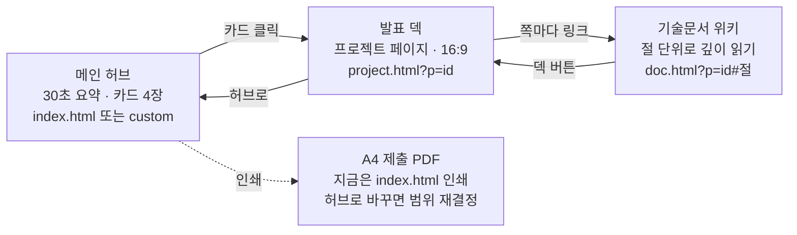

# 포트폴리오 리디자인 인수인계서

2026-11-12 · 박수하

## 목적과 읽는 법

이 문서는 시안 캔버스에서 정한 레이아웃 결정을 이 레포의 AI가 그대로 옮길 수 있게 정리한 작업 지시서입니다. 레이아웃은 확정, 테마(색·글꼴)는 아직 미정입니다.

- **읽는 대상:** `parksooha102-ai/portfolio` 레포에서 `CLAUDE.md`를 따라 일하는 AI.
- **우선순위:** `CLAUDE.md`의 원칙이 이 문서보다 앞섭니다. 특히 원칙 1(지어내지 않는다), 2(`src/`·`profile.md`를 대신 고쳐 쓰지 않는다), 5(렌더러는 사용자가 요청할 때만 고친다)를 지킵니다.
- **[렌더러] 표시:** `index.html`·`project.html`·`doc.html`·`assets/`를 고쳐야 하는 항목입니다. 박수하 님이 이 문서를 넘기면서 해당 항목을 진행하라고 직접 말한 경우에만 시작합니다.
- **상태 표기:** 확정 = 시안에서 정함 · 제안 = 시안 쪽 의견, 구현 전에 확인 · 미정 = 아직 고르지 않음.

**정정 한 가지.** 캔버스의 '덱 4개 지도'는 `data/projects/*.json`의 `deck.slides`만 셌습니다. 실제 덱은 `assets/project-deck.js`의 `renderAll`이 표지(`cover`)·목차(`toc`)·장 표지·회고(`retro`)·맺음(`end`) 장면을 자동으로 더합니다. 그래서 지도의 "표지·마무리 없음" 소견은 틀렸고, 이 문서에서 표지·마무리 틀은 새로 만드는 것이 아니라 기존 장면의 개편으로 다룹니다.

## 결정 요약

사이트는 "허브 → 발표 덱 → 기술문서" 3단으로 갑니다. 셋 다 레포에 렌더러가 이미 있어서, 대부분은 새로 만들기보다 개편입니다.

| 항목 | 결정 | 상태 | 레포에서 바뀌는 곳 |
| --- | --- | --- | --- |
| 메인 | 허브: 첫 화면 · 숫자 요약 4칸 · 프로젝트 카드 4장 · 기술 스택 · 연락처 | 확정 | `/portfolio-custom`(`custom/index.html`) 권장, 또는 [렌더러] `index.html`·`assets/portfolio.*` |
| 프로젝트 페이지 | 발표 덱(`project.html`, 1280×720) | 확정 | 이미 있음. 장면 틀 개편 [렌더러] + 프로젝트별 `src/<NN>/deck-edits.json` |
| 슬라이드 틀 | 공용 틀 11종 + 기존 `screens` | 디자인 확정, 구현 제안 | [렌더러] `assets/project-deck.js`·`deck-kit.css`·`scene-kit.css`·`deck-pptx.js`·`strings.js` |
| 결정 틀 모양 | 줄 긋기 없음. 선택지 비교 → 결정과 이유 → 결과 | 확정 | 위와 같음 |
| 기술문서 | 위키 사이드바(`doc.html`) | 확정 | 이미 대부분 있음. 프로젝트 트리 추가 [렌더러] `assets/doc.*` |
| 테마 | 후보 4개(다크 랩 · 블루프린트 · 아케이드 · 스위스 그리드) | 미정 | `theme/theme.css` (`/portfolio-theme`) |
| 제출 PDF 범위 | 허브로 바꿀 때 PDF에 무엇을 남길지 | 미정 | 아래 "메인 허브 명세"의 질문 참고 |

## 사이트 구조와 이동 흐름

허브는 요약, 덱은 발표, 기술문서는 깊이를 맡고, 세 페이지는 쪽 단위 링크로 이어집니다.

새로 생기는 길은 덱의 모든 장면 아래 띠에서 기술문서의 해당 절로 가는 링크입니다. 점선은 지금 `index.html`에서 뽑는 제출 PDF로, 허브를 어떻게 구현하느냐에 따라 범위를 다시 정해야 합니다.

## 메인 허브 명세

메인은 30초 안에 훑는 사람을 위한 요약만 담고, 자세한 내용은 모두 덱으로 보냅니다. 섹션은 아래 순서로 한 번씩만 나옵니다.

1. **첫 화면:** 이름, 한 줄 정체성("조합의 구조를 설계하는 유니티 개발자"), `profile.md` 자기소개 원문, 이메일·GitHub 버튼. 오른쪽에 대표 그림 또는 시그니처 요소 하나(시안 v1의 6칸 슬롯 인터랙션은 테마를 정한 뒤 결정).
2. **숫자 요약 4칸:** 프로젝트마다 숫자 하나 + 한 줄 + 그 프로젝트 덱 링크. 값은 `data/`에 있는 것만 씁니다. 시안 값: 63가지 조합(총기 모듈) · 16줄 지뢰·횃불 클래스(FOLK SACK) · 스킬 18종, 입력 코드 수정 0줄(Oddity) · 12홀, 진행 코드 수정 없음(미니골프).
3. **프로젝트 카드 2×2:** 대표 그림(16:9 그대로), 번호, 역할·기간, 제목, 한 줄 소개(`tagline`), 대표 숫자 한 줄, "자세히 →". 카드 전체가 `project.html?p=<id>` 링크입니다.
4. **기술 스택:** 근거가 있는 기술만, 근거 줄마다 프로젝트 번호를 붙입니다.
5. **연락처:** 이메일·GitHub만. 프로젝트 목록을 다시 넣지 않습니다.

**지금 사이트에서 없앨 것**

- 프로젝트 목록 3번 반복(본문 · 프로젝트 요약 · 연락처).
- 프로젝트마다 큰 제목 2번 반복(개요 + 기능 소개).
- "발표 덱에서 보기" 버튼 16개 → 카드 전체 링크 1개.
- 대표 그림을 세로로 긴 흰 틀에 넣어 생기는 빈 공간.

**미정 질문 — 제출 PDF.** 지금 `index.html`은 "아래로 읽는 한 페이지 = A4 제출 PDF"의 원본입니다(`assets/portfolio.css`의 `@media print`). 허브로 줄이면 PDF에서 프로젝트 상세가 빠집니다. 권장은 허브를 `/portfolio-custom`으로 `custom/index.html`에 만들고, `index.html`은 제출 PDF 문서로 그대로 두는 것입니다. 어느 쪽으로 할지 박수하 님께 확인하고 시작합니다.

## 발표 덱 보기 화면과 슬라이드 규격

슬라이드 크기는 지금 렌더러 그대로 1280×720(PPT 와이드)이고, 바뀌는 것은 격자·글자 크기·아래 띠와 기술문서 링크입니다.

| 항목 | 규격 | 비고 |
| --- | --- | --- |
| 슬라이드 | 1280 × 720 px = 13.333 × 7.5 in | `deck-kit.js`의 `W`·`H`, `deck-pptx.js`의 `LAYOUT_WIDE`와 같음 |
| 격자 | 12칸, 바깥 여백 64, 칸 사이 24 | 칸 너비 74 |
| 글자 | 제목 40 · 리드 24 · 본문 20 · 캡션 16 · 쪽 번호 14 | 한글은 Pretendard 유지 |
| 코드 | 16 고정폭(D2Coding), 한 쪽에 15줄 이내 | 넘으면 다음 쪽으로 나눔 |
| 위쪽 | 장 라벨(14) + 제목(40) | 장 라벨 = 개요·구조·기능·선택·결과 |
| 아래 띠 | 높이 52: 프로젝트 이름 · 기술문서 n.x → · 쪽 번호 | 모든 장면 공통 |

**보기 화면 (제안)**

- 위: ← 허브 · 프로젝트 이름 · 장 탭(개요·구조·기능·선택·결과, 지금 장 강조) · 한 번에 보기 · PPTX.
- 아래: 진행 막대 · nn / NN · "이 쪽 원문: 기술문서 n.x →".
- 모바일: 넘기기 대신 슬라이드를 세로로 쌓아 스크롤로 읽기.

**기술문서 링크 [렌더러].** 각 장면의 `sectionPath` 마지막 절을 `doc.html?p=<id>#<그 절의 제목 id>`로 잇습니다. 지금은 결정 G1에 따라 상세 문서 링크가 표지·맺음에만 있으므로, G1을 "모든 장면 아래 띠"로 바꾸는 결정이 필요합니다.

**PPTX 제약.** `deck-pptx.js`는 그린 장면을 재서 PowerPoint 개체로 만듭니다. 새 틀도 글상자·사각형·그림·표·코드만으로 짜고, 그림자·그러데이션·반투명 겹침은 쓰지 않습니다. 확인은 `(await PFPptx.build()).report`의 `warnings`로 합니다.

## 슬라이드 틀 11종

11종 중 6종은 지금 있는 장면·틀의 개편이고, 새로 만드는 틀은 `decision`·`team`·`result`·`chart` 4종입니다. 기존 `screens`(화면 2~3장)는 그대로 둡니다. 배치의 숫자는 12칸 격자에서 차지하는 칸 수입니다.

| # | 틀 (제안 id) | 쓰는 곳 | 배치 | 들어가는 내용 (모두 원문에서) | 지금과의 관계 |
| --- | --- | --- | --- | --- | --- |
| 1 | 표지 `cover` | 덱 첫 장 | 글 5 : 대표 그림 7, 아래 숫자 칩 3개 | 제목, 한 줄 소개, 역할·기간·엔진·언어, 대표 그림, 핵심 숫자 | 자동 표지 장면 개편 |
| 2 | 개요 `overview` | 무엇을·왜, 프로젝트 소개, 담당 범위 | 리드 12, 카드 4·4·4(문제·해결·결과) | `lead`, `points`(문제/해결/결과) | 기존 틀 |
| 3 | 팀 역할 `team` | 팀 프로젝트 1.2 | 팀원 줄 7(본인 줄 강조) : 내 담당 5 | 팀 표, 담당 범위 | **새 틀** (지금 `full` 표) |
| 4 | 그림 + 설명 `visual` | 흐름·조작법·구조 설명 | 그림 7 : 설명 5 | 시각 자료 1개, 리드, 요점 2~3 | 기존 틀 |
| 5 | 전체 `full` | 큰 다이어그램·큰 표 | 12 | 시각 자료 1개, 한 줄 설명(선택) | 기존 틀 |
| 6 | 코드 `code` | 사용법(API)·핵심 동작·결정의 코드 | 코드 6 : 설명 6(+동작 그림) | 코드, 리드, 요점, 그림(있을 때) | 기존 틀 |
| 7 | 결정 `decision` | 4장 고민과 선택의 "A vs B" | 선택지 카드 6·6 → 결정 띠 12 → 결과 띠 12 | 선택지 이름, 좋은 점·걸리는 점, 고른 안, 이유, 결과 | **새 틀** |
| 8 | 결과 숫자 `result` | 5.1 결과 | 숫자 4·4·4, 아래 그림 띠 12 | 원문의 수치(`retro.achieved` 등) | **새 틀** |
| 9 | 트러블슈팅 `problem` | 5.2 문제 해결 | 문제·원인·해결 4·4·4, 아래 남은 과제 띠 | `troubleshooting` | 기존 틀 |
| 10 | 그래프 `chart` | 값의 변화(예: 난이도 곡선) | 그래프 9 : 설명 3 | 원문 표의 값 | **새 틀** |
| 11 | 마무리 `end` + `retro` | 배운 점, 링크 | 배운 점 7 : 링크 4개 5 | `retro`, 기술문서·GitHub·다음 프로젝트·허브 | 자동 회고·맺음 장면 개편 |

**결정 틀 규칙 (확정)**

- 위쪽 선택지 카드는 A안·B안 모두 같은 모양입니다. 고르지 않은 안에 줄을 긋거나 흐리게 하지 않습니다.
- 확정은 가운데 진한 "결정" 띠에서만 합니다: 결정 도장 + 고른 안 이름(크게) + 이유.
- 맨 아래 결과 띠에 그 결정으로 무엇이 됐는지 적고, 오른쪽에 숫자·그림 자리를 둡니다.
- 선택지가 3개면 카드를 4·4·4로 나눕니다.

**글의 출처 (원칙 1·3).** 새 틀에 들어가는 글은 기술 문서 원문이거나 그것을 줄인 것만 씁니다. 줄인 문장은 `report.md`의 "확인해 주세요"에 올립니다. 원문에 결정의 '결과'나 선택지의 '걸리는 점'이 없으면 그 칸은 비워 두고 리포트에 적습니다.

## 덱 구성 규칙과 장면 매핑

새 프로젝트가 늘어나도 아래 6가지 규칙만 지키면 덱 모양이 맞춰집니다. 지금 덱 4개(slides 73쪽)에서 손댈 곳은 아래 표의 27곳(틀 변경 18 · 쪽 표시 5 · 합치기 2 · 새 쪽 2)이고, 나머지는 지금 틀 그대로입니다.

1. 덱 = (자동) 표지·목차 + 5장(개요·구조·기능·선택·결과) + (자동) 회고·맺음.
2. 팀 프로젝트는 개요 장에 `team` 1쪽.
3. "A vs B" 하나 = `decision` 1쪽. 코드가 길면 바로 뒤에 `code` 1쪽을 같은 제목으로 이어 붙입니다.
4. 결과 장은 원문에 수치가 있으면 `result` 1쪽으로 시작합니다.
5. 같은 절이 두 쪽 이상이면 쪽 표시를 "2/3"처럼 그 절 안의 순번으로 씁니다. 지금 `rlabel`은 장 안 순번이라 [렌더러] 수정이 필요합니다.
6. 장마다 그림 1장 이상. 없으면 빈 그림 자리로 두고 `report.md`에 "그림 필요"로 적습니다.

| 프로젝트 | slides 순번 | 절 | 지금 | 바꿀 틀 |
| --- | --- | --- | --- | --- |
| 총기 모듈 | 13 | 4.1 모듈 규격 — 인터페이스 vs 추상 클래스 | `full` | `decision` |
| 총기 모듈 | 14 | 4.2 생존 판정 — OR vs AND | `visual` | `decision` |
| 총기 모듈 | 15 | 4.4 탄환·이펙트 생성 | `full` | `decision` |
| 총기 모듈 | 16 | 4.5 자식 탄환의 상태 계승 — `Clone()` | `visual` | `decision` |
| 총기 모듈 | 17 | 5.1 결과 | `visual` | `result` |
| FOLK SACK | 2 | 1.2 팀 역할 | `full` | `team` |
| FOLK SACK | 11 | 3.4 핵심 동작 ③ (두 번째 쪽) | `visual` | `visual`, 2/2 표시 |
| FOLK SACK | 12 | 4.1 아이템 데이터 | `full` | `decision` |
| FOLK SACK | 13 | 4.2 소모 책임 | `full` | `decision` |
| FOLK SACK | 14 | 4.2 소모 책임 (코드) | `code` | `code`, 2/2 표시 |
| FOLK SACK | 15 | 4.3 쿨타임 저장 위치 | `full` | `decision` |
| FOLK SACK | 19 | 5.4 배운 점 | `overview` | 회고 장면으로 합침 |
| FOLK SACK | 새 쪽 | 5장 첫 쪽 | — | `result` (원문 수치 확인 후) |
| Oddity | 2 | 1.2 팀 역할 | `full` | `team` |
| Oddity | 11 | 4.1 쿨타임 — "준비되는 시각" vs "남은 시간" | `full` | `decision` |
| Oddity | 12 | 4.1 (코드) | `code` | `code`, 2/2 표시 |
| Oddity | 13 | 4.2 스탯 보너스 계산 — 데코레이터 vs 단순 가감 | `full` | `decision` |
| Oddity | 14 | 4.2 (두 번째 표) | `full` | 13에 합치거나 `decision` 2/3 |
| Oddity | 15 | 4.2 (코드) | `code` | `code`, 3/3 표시 |
| Oddity | 17 | 5.1 결과 | `full` | `result` |
| 미니골프 | 5 | 2.3 난이도 곡선 | `full` | `chart` |
| 미니골프 | 8 | 4.2 해저드 벌칙 | `full` | `decision` |
| 미니골프 | 9 | 4.2 (코드) | `code` | `code`, 2/2 표시 |
| 미니골프 | 10 | 4.3 홀을 데이터로 분리 | `visual` | `decision` |
| 미니골프 | 11 | 4.4 움직이는 장애물과 공의 충돌 | `overview` | `decision` |
| 미니골프 | 12 | 5.3 배운 점 | `overview` | 회고 장면으로 합침 (지금 `retro`가 비어 있어 빌드 확인 필요) |
| 미니골프 | 새 쪽 | 5장 첫 쪽 | — | `result` (원문 수치 확인 후) |

**적용 방법.** 새 틀이 렌더러에 생긴 뒤 `/portfolio-edit`로 장면마다 `pin → layout`을 `src/<NN>/deck-edits.json`에 씁니다. 그 전에 `.claude/skills/portfolio-edit/SKILL.md`의 "쓸 수 있는 틀" 목록과 `/portfolio-build`가 틀을 고르는 규칙에도 새 틀 4종을 더해야 합니다.

## 기술문서 위키 명세

`doc.html`은 이미 왼쪽 목차(H2·H3) · 본문 · 오른쪽 프로젝트 카드(`rail`, "지금 보는 절" 포함) · 모바일 목차 버튼(`doc-fab` + `toc-dialog`)을 갖고 있어서, 위키 사이드바 안에 필요한 것은 세 가지 추가뿐입니다.

1. **프로젝트 트리 [렌더러]:** 왼쪽 목차 위에 모든 프로젝트 이름을 둡니다. 지금 문서만 펼쳐서 H2·H3를 보이고, 나머지는 접힌 채(▸) 그 문서로 가는 링크입니다. 목록은 `data/portfolio.json`의 프로젝트 순서를 따릅니다.
2. **위치 표시 [렌더러]:** 지금 `crumb`(포트폴리오 › 프로젝트)에 스크롤 중인 절 이름을 이어 붙입니다. 같은 정보가 이미 `rail-now`에 있으니 그 값을 씁니다.
3. **덱에서 오는 링크 [렌더러]:** `doc.html?p=<id>#<제목 id>`로 들어오면 그 절로 스크롤하고 잠깐 강조합니다. 덱 아래 띠의 링크가 모두 실제 제목 id에 닿아야 합니다(완료 기준 참고).

**모바일.** 목차 버튼을 누르면 프로젝트 트리까지 포함한 서랍이 열립니다. 지금 `toc-dialog`를 넓히는 방식이면 충분합니다.

**선택(제안).** 시안 와이어프레임의 위쪽 "검색"은 새 기능이라 이번 범위에서 빼도 됩니다.

## 테마 (미정)

테마는 레이아웃을 끝낸 뒤 고르기로 했습니다. 후보 4개를 `theme/theme.css`의 `--t-*` 손잡이 값으로 옮겨 두었으니, 고른 열의 값을 넣으면 세 페이지가 함께 바뀝니다.

| 손잡이 | A 다크 랩 | B 블루프린트 | C 아케이드 | D 스위스 그리드 |
| --- | --- | --- | --- | --- |
| `--t-scheme` | dark | light | dark | light |
| `--t-bg` | #0D1015 | #F3F6FA | #1A1033 | #FFFFFF |
| `--t-surface` | #151A21 | #FFFFFF | #281A4F | #F5F5F5 |
| `--t-ink` | #EEF1F5 | #0E2340 | #FFFFFF | #111111 |
| `--t-body` | #C4CBD5 | #2B3D57 | #DCD4F5 | #2A2A2A |
| `--t-muted` | #8D97A5 | #55657D | #B3A6DE | #666666 |
| `--t-line` | #29313C | #DFE6F0 | #4A3A80 | #DDDDDD |
| `--t-line-2` | #3A4452 | #9DB0CA | #6B5BA8 | #111111 |
| `--t-accent` | #FFB547 | #1F5BD6 | #FFE14D | #D42A12 |
| `--t-accent-2` | `--t-accent`와 같게 | `--t-accent`와 같게 | #FF5FA8 | `--t-accent`와 같게 |
| `--t-radius` | 8px | 0px | 0px | 0px |
| `--t-pill` | 6px | 0px | 0px | 0px |
| `--t-display` (영문 라벨) | 'IBM Plex Mono' | 'IBM Plex Mono' | 'Press Start 2P' | 'Inter' |
| `--t-diagram` | #151A21 | #FFFFFF | #281A4F | #F5F5F5 |

- **공통:** `--t-badge`·`--t-grad`는 그러데이션 없이 단색, `--t-glow`·`--t-mark`는 0. 영문 글꼴은 지금 Poppins처럼 파일 맨 위 `@import`로 싣습니다. 넣은 뒤 `check-theme.py`로 대비(제목 12 · 본문 7 · 보조 4.5 이상)를 확인합니다.
- **한글 글꼴은 바뀌지 않습니다.** 템플릿은 한글을 늘 Pretendard로 그리고, 테마는 영문 라벨 글꼴만 바꿉니다. 시안의 IBM Plex Sans KR·검은고딕 같은 한글 글꼴을 쓰려면 [렌더러] 수정이 필요하니, 기본은 Pretendard 유지로 둡니다.
- **손잡이로 안 되는 것:** B의 모눈 바탕·치수선, C의 굵은 테두리·각진 그림자, A의 슬롯 모양과 점 격자. 이것까지 원하면 `/portfolio-custom` 또는 [렌더러] 영역입니다.
- **인쇄·PPTX:** 제출 PDF는 `@media print`에서 밝은 색으로 되돌아가므로 어두운 테마(A·C)도 인쇄는 괜찮습니다. PPTX는 Pretendard·D2Coding을 쓰니 테마를 넣은 뒤 한 번 내려받아 색을 확인합니다.

## 콘텐츠 빈칸

아래는 AI가 만들 수 없고 박수하 님이 채워야 하는 것입니다. AI는 빈 자리를 "그림 자리"로 두고 `report.md`에 적기만 합니다(원칙 1·2).

| 프로젝트 | 빈칸 | 쓰이는 곳 |
| --- | --- | --- |
| Oddity | 스크린샷이 하나도 없음(`src/`에 그림 폴더 없음) | 허브 카드, 덱 표지, 기능·결정 장면 |
| 미니골프 | 스크린샷이 하나도 없음, 특히 코스 전체를 위에서 본 그림 | 허브 카드, 덱 표지, 코스 구조 장면 |
| 총기 모듈 | 추적 모듈(3.5) 동작 GIF | 덱 3.5 코드 장면 |
| 미니골프 | `retro`가 비어 있음(달성·아쉬움·계획 0개) — 기술 문서 5장에 있는지 확인 | 회고·마무리 장면, `result` 쪽 |
| FOLK SACK · 미니골프 | 5장 첫 `result` 쪽에 쓸 수치. FOLK SACK은 `retro.achieved`에 수치(16줄 · 수정 0줄 · 상점 카드 8장 · TSV만 고친 커밋 3건)가 있어 그대로 씀 | 결과 장 첫 쪽 |
| 4개 덱 공통 | 결정 쪽의 '결과'·'걸리는 점' 문장이 원문 4.x에 없는 경우 | `decision` 틀의 결과 띠·선택지 카드 |

## 작업 순서와 완료 기준

덱부터 손보고, 허브와 테마는 마지막에 합니다. 덱의 틀이 정해져야 허브 카드와 숫자 요약이 어디로 이어질지 확정되기 때문입니다.

1. **박수하 님께 확인:** [렌더러] 항목 진행 여부, 허브를 `custom/index.html`로 만들지 `index.html`을 바꿀지, 제출 PDF 범위.
2. **덱 새 틀 [렌더러]:** `decision`·`team`·`result`·`chart` 추가, 표지·회고·맺음 장면 개편, 아래 띠 기술문서 링크, 같은 절 안 쪽 표시. 대상: `assets/project-deck.js`·`deck-kit.css`·`scene-kit.css`·`deck-pptx.js`·`strings.js`.
3. **스킬 갱신:** `/portfolio-edit`의 "쓸 수 있는 틀"과 `/portfolio-build`의 틀 고르기 규칙에 새 틀 4종을 더함.
4. **장면 매핑:** 위 표의 27곳을 `/portfolio-edit`로 `src/<NN>/deck-edits.json`에 기록하고 `/portfolio-build`.
5. **기술문서 [렌더러]:** 프로젝트 트리, 위치 표시, 덱에서 온 링크 강조. 대상: `assets/doc.js`·`doc.css`.
6. **허브:** 1번에서 고른 경로로.
7. **테마:** 고른 뒤 `theme/theme.css`.

**완료 기준**

- [ ] 덱 4개 모두 `PFScene.report().audit`에 빨간 띠 0건, 장면 수 15~30장.
- [ ] `(await PFPptx.build()).report.warnings` 0건, 새 틀이 PPTX에서 글상자·도형으로 나옴.
- [ ] 덱 모든 장면의 "기술문서 n.x →"가 `doc.html`의 실제 제목 id로 이동.
- [ ] 결정 장면에 줄 그은 선택지가 없고, 고른 안은 결정 띠에서만 강조.
- [ ] `PFPage.report()`의 `images.broken` 0, `overflowX` 0 (허브 · 390px 폭 포함).
- [ ] 세 페이지 report의 `strings.issues` 0건.
- [ ] `data/`에 원문에 없는 문장·수치 0. 줄인 문장은 `report.md` "확인해 주세요"에 올라감.

## 참고: 시안 캔버스

결정의 근거가 된 그림은 [포트폴리오 리디자인 시안](https://claude.ai/artifact/SzbcYqWJaGNNyqgUtoWesL) 캔버스에 있습니다. 캔버스는 비공개라 레포의 AI가 직접 열지 못할 수 있어서, 구현에 필요한 수치와 규칙은 이 문서에 모두 옮겨 두었습니다.

| 캔버스 페이지 | 담긴 것 |
| --- | --- |
| 레이아웃 1 · 뼈대 | 사이트 뼈대 A·B·C 비교, 결정 메모 |
| 레이아웃 2 · 프로젝트 페이지 | 프로젝트 페이지 A·B·C 비교, 결정 메모 |
| 레이아웃 3 · 덱 4개 지도 | 73쪽 지도(slides 배열 기준), 틀 체계 11종과 규칙 |
| 레이아웃 4 · 슬라이드 틀 11종 | 덱 보기 화면, 공용 슬라이드 틀 11장, 규격 메모 |
| 참고 · 테마 고르기 | 테마 후보 4개 |
| 참고 · 시안 v1 | 첫 화면 슬롯 인터랙션이 들어간 다크 랩 메인 시안 |
