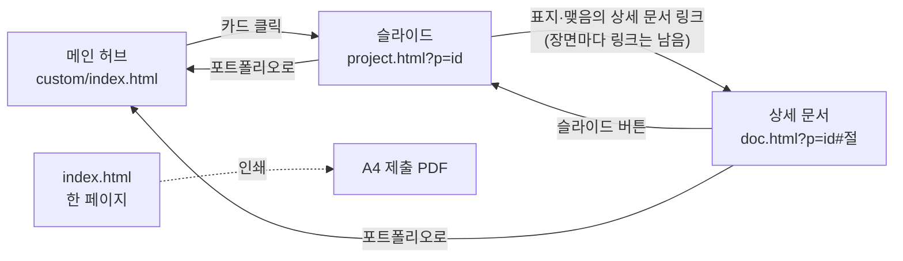

# 포트폴리오 리디자인 인수인계서

2026-11-12 작성 · 2026-11-25 갱신 · 박수하

> 11월 12일 원본은 [redesign-handoff-2026-11-12.md](redesign-handoff-2026-11-12.md)에 그대로 두었습니다.
> 이 문서는 그 뒤 프로젝트 문서가 "시스템별 장" 구성으로 바뀌고, 렌더러에 새 틀이 들어간 지금 상태에 맞춰 고친 판입니다.

## 목적과 읽는 법

이 문서는 시안 캔버스에서 정한 레이아웃 결정을 이 레포의 AI가 이어서 작업할 수 있게 정리한 작업 지시서입니다.

- **읽는 대상:** 이 레포에서 `CLAUDE.md`를 따라 일하는 AI.
- **우선순위:** `CLAUDE.md`의 원칙이 이 문서보다 앞섭니다. 특히 원칙 1(지어내지 않는다), 2(`src/`·`profile.md`를 대신 고쳐 쓰지 않는다), 5(렌더러는 사용자가 요청할 때만 고친다)를 지킵니다.
- **[렌더러] 표시:** `index.html`·`project.html`·`doc.html`·`assets/`를 고쳐야 하는 항목입니다. 박수하 님이 해당 항목을 진행하라고 직접 말한 경우에만 시작합니다.
- **상태 표기:** 완료 = 레포에 들어감 · 남음 = 아직 안 함 · 바뀜 = 원본 계획과 다르게 감 · 미정 = 아직 고르지 않음.
- **보관 위치:** `notes/`는 템플릿이 받아 오는 폴더(`docs/` 등)가 아니라서 `/portfolio-update`가 덮어쓰지 않습니다.

## 11월 12일 이후 바뀐 것

1. **프로젝트 문서 구성이 바뀌었습니다.** 원본은 "개요·구조·기능·선택·결과" 5장을 전제로 했습니다. 지금 네 문서는 모두 아래 구성입니다.
   - 1장 프로젝트 소개
   - 2~4장 시스템별 장(장마다 "해결하려는 문제 → 설계 → 결정·문제 해결 → 결과와 한계")
   - 5장 통합 검증과 프로젝트 회고
   - 부록(AI 협업 등)
2. **그래서 원본의 "장면 매핑 27곳" 표(slides 순번 기준)는 더 이상 맞지 않습니다.** 덱이 다시 빌드되면서 순번·절 번호가 모두 바뀌었습니다. 아래 「지금 덱 지도」로 바꿨습니다.
3. **결정·팀 역할·결과 숫자 틀은 `deck-edits.json` 없이 렌더러가 자동으로 고릅니다.** 원본은 `/portfolio-edit`로 장면마다 틀을 지정하려 했지만, 실제로는 원문 모양(비교 표, 본인 줄이 있는 팀 표, 굵은 숫자)을 보고 자동으로 씁니다. 안 들어가면 원래 틀로 돌아가고 미리보기 참고(`decision-fallback`·`team-fallback`·`result-fallback`)를 남깁니다.
4. **테마는 B 블루프린트로 정했습니다.** 다만 요청에 따라 각진 모서리를 둥글게 바꿨고, 영문 라벨 글꼴은 JetBrains Mono입니다(`theme/theme.css`).
5. **허브는 `custom/index.html`로 만들었습니다.** `index.html`은 제출 PDF용 한 페이지로 그대로 둡니다. 상세 문서·슬라이드의 "포트폴리오로" 링크도 `custom/`을 가리킵니다.

## 결정 요약

사이트는 "허브 → 슬라이드(발표 덱) → 상세 문서(기술문서 위키)" 3단입니다.

| 항목 | 결정 | 상태 | 레포에서 바뀐/바뀔 곳 |
| --- | --- | --- | --- |
| 메인 | 허브: 첫 화면 · 프로젝트 카드 · 기술 스택 · 연락처 | 완료(숫자 요약 4칸은 남음) | `custom/index.html` |
| 제출 PDF | 허브는 `custom/`, `index.html`은 A4 제출 PDF로 유지 | 완료(바뀜: 원본 권장안대로 정함) | 바꿀 것 없음 |
| 프로젝트 페이지 | 슬라이드(`project.html`, 1280×720) | 완료 | — |
| 슬라이드 틀 | 공용 틀 11종 + 기존 `screens` | 일부 완료(아래 표) | `assets/project-deck.js`·`deck-theme.css` |
| 결정 틀 모양 | 줄 긋기 없음. 선택지 비교 → 결정과 이유 → 결과 | 완료 | 같은 곳 |
| 상세 문서 | 위키 사이드바(`doc.html`) | 일부 완료(트리는 남음) | `assets/doc.*` |
| 테마 | B 블루프린트(둥근 모서리로 조정) | 완료(바뀜) | `theme/theme.css` |

## 사이트 구조와 이동 흐름

허브는 요약, 슬라이드는 발표, 상세 문서는 깊이를 맡습니다. 제출 PDF는 허브와 따로 `index.html`에서 뽑습니다.

## 메인 허브

`custom/index.html`에 있는 것: 첫 화면(`top`) · 프로젝트 카드(`projects`, 누르면 소개·기능 소개가 펼쳐짐) · 기술 스택(`stack`, AI 활용 포함) · 연락처(`contact`).

**남은 것**

- **숫자 요약 4칸:** 원본 계획의 "프로젝트마다 숫자 하나 + 한 줄 + 슬라이드 링크" 띠는 아직 없습니다. 값은 프로젝트 문서에 있는 수치만 씁니다. 원본 시안 값(63가지 조합 · 16줄 · 스킬 18종 · 12홀)은 문서가 바뀌었으니 **지금 문서에 그대로 있는지 다시 확인한 뒤** 씁니다.
- 원본에서 "없앨 것"으로 적은 것(프로젝트 목록 3번 반복, 큰 제목 2번 반복, "발표 덱에서 보기" 버튼 16개, 세로로 긴 흰 틀)은 허브를 새로 만들면서 해당이 없어졌습니다. `index.html`(제출 PDF)에는 남아 있을 수 있습니다.

## 슬라이드 보기 화면과 규격

| 항목 | 규격 | 상태 |
| --- | --- | --- |
| 슬라이드 | 1280 × 720 px = 13.333 × 7.5 in | 완료(원래 그대로) |
| 격자·글자 크기 | 12칸 · 여백 64 · 칸 사이 24 / 제목 40 · 리드 24 · 본문 20 · 캡션 16 | 확인 안 됨 — 렌더러 값과 대조 필요 |
| 코드 | D2Coding, 한 장면 20줄 안팎(`MAXL = 20`), 넘으면 "계속" 장면 | 바뀜(원본 15줄 → 지금 20줄) |
| 쪽 표시 | 같은 절이 여러 장이면 절 안 순번 "2/3", 한 장이면 탭만 | 완료 |
| 아래 띠의 상세 문서 링크 | 모든 장면에 "상세 문서 n.x →" | **남음** — 결정 G1 때문에 지금은 표지·맺음에만 있음 |

**PPTX 제약(그대로).** 새 틀도 글상자·사각형·그림·표·코드만으로 짜고, 그림자·그러데이션·반투명 겹침은 쓰지 않습니다. 확인은 `(await PFPptx.build()).report`의 `warnings`로 합니다.

## 슬라이드 틀 11종 — 지금 상태

| # | 틀 | 상태 | 지금 어떻게 되어 있나 |
| --- | --- | --- | --- |
| 1 | 표지 `cover` | 그대로 | 기존 프로젝트 소개 템플릿(`PF.projectIntro`, 결정 G4). 원본의 "글 5 : 그림 7 + 숫자 칩 3개" 개편은 안 함 |
| 2 | 개요 `overview` | 그대로 | 기존 틀 |
| 3 | 팀 역할 `team` | **완료(자동)** | 원문 팀 표(2열, 첫 열에 `(본인)` 줄) 하나뿐인 장면 → 팀원 줄 : 내 담당 |
| 4 | 그림 + 설명 `visual` | 그대로 | 기존 틀. 결정 장면에서 그림이 오른쪽이면 1:1 |
| 5 | 전체 `full` | 그대로 | 그림 표(칸마다 그림 하나)는 작은 표 대신 그림으로 풀어 그림 |
| 6 | 코드 `code` | 그대로 | 기존 틀 |
| 7 | 결정 `decision` | **완료(자동)** | 원문 비교 표([A]·[B]…)가 있으면 선택지 카드 → 결정 띠 → 결과 띠 |
| 8 | 결과 숫자 `result` | **완료(자동)** | 제목에 "결과"가 든 절에서 굵은 숫자 항목 2개 이상 → 숫자 카드(최대 3장) + 그림 띠 |
| 9 | 트러블슈팅 `problem` | 그대로 | 기존 틀 |
| 10 | 그래프 `chart` | **남음** | 렌더러에 없음. 후보: 미니골프 2.4 난이도 곡선과 Par 배치 |
| 11 | 마무리 `end` + `retro` | **완료** | 맺음 장면에 문서 머리 요약의 "배운 점:" 한 줄. "배운 점" 절 장면은 따로 두지 않음 |

**결정 틀 규칙(그대로).** 선택지 카드는 모두 같은 모양, 고르지 않은 안에 줄 긋기·흐리게 하지 않음, 확정은 가운데 "결정" 띠에서만, 결과 띠에 그 결정으로 된 것.

**글의 출처(원칙 1·3).** 새 틀의 글은 프로젝트 문서 원문이거나 줄인 것만 씁니다. 줄인 문장은 `report.md`의 "확인해 주세요"에 올립니다.

## 덱 구성 규칙

1. 덱 = (자동) 표지·목차 + 프로젝트 소개 장 + 시스템별 장 3개 + (자동) 결과와 회고·맺음. **바뀜:** 원본의 "개요·구조·기능·선택·결과" 장 이름 대신 문서의 장 제목을 그대로 씁니다.
2. 부록(장면 1~2개)은 장 표지 없이 바로 앞 장 끝에 붙입니다.
3. 팀 프로젝트는 소개 장에 팀 역할 1쪽(원문에 팀 표가 있을 때 자동).
4. "A vs B" 하나 = 결정 1쪽. 코드가 길면 바로 뒤에 같은 제목의 코드 쪽.
5. 같은 절이 두 쪽 이상이면 "2/3"처럼 절 안 순번.
6. 장마다 그림 1장 이상. 없으면 `report.md`에 "그림 필요".

## 지금 덱 지도 (2026-11-25, `data/projects/*.json` 기준)

`deck.slides`만 센 수입니다. 표지·목차·장 표지·회고·맺음은 렌더러가 더합니다. 네 프로젝트 모두 `deck-edits.json`은 없습니다.

| 프로젝트 | slides | 장 구성 |
| --- | --- | --- |
| 1 총기 모듈 | 21 | 프로젝트 소개 · 모듈 조립 시스템 · 탄환 실행 및 충돌 처리 시스템 · 모듈 간 상호작용과 분열 시스템 · 부록 |
| 2 FOLK SACK | 20 | 프로젝트 소개 · 아이템 사용 시스템 · 설치형 아이템 시스템 · 데이터 기반 상점 시스템 · 부록 |
| 3 Oddity | 21 | 프로젝트 소개 · 증강칩 데이터 및 장착 시스템 · 초능력 스킬 실행 시스템 · 전투 이벤트 및 패시브 시스템 · 부록 |
| 4 미니골프 | 21 | 프로젝트 소개 · 코스 학습 구조 · 장애물 설계와 플레이어의 판단 · 플레이테스트와 설계 결정 · 부록 |

**결정 장면(제목에 "vs")** — 결정 틀이 자동으로 붙는 후보입니다. 실제로 틀이 붙었는지는 미리보기의 `decision-fallback` 참고로 확인합니다.

| 프로젝트 | 장면 |
| --- | --- |
| 총기 모듈 | 모듈 규격 — 추상 클래스 vs 인터페이스 · 생존 판정 — AND vs OR · 생성 — `Instantiate/Destroy` vs 오브젝트 풀링 · 자식 모듈 생성 — `Clone()` vs `CreateModule()` |
| FOLK SACK | 사용 결과 — `void` vs `bool` · 설치형 베이스 — 일반 클래스 vs 제네릭 클래스 · 데이터 위치 — TSV 칼럼 vs ScriptableObject |
| Oddity | 스탯 반영 — 데코레이터 vs 합계 더하기·빼기 · 3.5 쿨타임 — 준비되는 시각 vs 남은 시간 |
| 미니골프 | 4.2 해저드 복귀 위치 — 출발점 vs 직전 샷 위치 |

## 상세 문서(위키)

| 항목 | 상태 |
| --- | --- |
| 왼쪽 목차 · 본문 · 오른쪽 "지금 보는 절" 카드 · 모바일 목차 버튼 | 완료(원래 있음) |
| 슬라이드에서 오는 링크(`#절` · `#sec=절 제목`)로 도착하면 그 절 강조 | 완료 |
| 프로젝트 트리(목차 위에 모든 프로젝트, 지금 문서만 펼침) | **남음** [렌더러] |
| 위치 표시(`crumb`에 지금 절 이름 이어 붙이기) | **남음** [렌더러] |
| 위쪽 검색 | 범위에서 뺌(선택) |

## 테마

B 블루프린트로 정했습니다(`theme/theme.css`, 2026-11-12). 원본 값에서 바꾼 점:

- 모서리: `0px` → 둥글게(요청).
- 영문 라벨 글꼴: IBM Plex Mono → JetBrains Mono.
- 한글은 그대로 Pretendard. 모눈 바탕·치수선은 손잡이로 안 되는 것이라 넣지 않음.

다른 후보(A 다크 랩 · C 아케이드 · D 스위스 그리드)의 값은 원본 문서의 「테마」 표에 있습니다.

## 콘텐츠 빈칸

| 프로젝트 | 빈칸 | 상태 |
| --- | --- | --- |
| Oddity | 스크린샷 없음 | **채움** — `이미지/` 11장 |
| 미니골프 | 스크린샷 없음 | **채움** — `이미지/` 7장. "코스 전체를 위에서 본 그림"이 있는지는 확인 필요 |
| 미니골프 | `retro` 비어 있음 | **채움** — 달성 4 · 아쉬움 3 · 계획 3 |
| 총기 모듈 | 추적 모듈(3.5) 동작 GIF | **남음** — GIF는 3-3 관통·4-2 관통+폭발 두 개뿐. 검증 영상 표에 추적 조합 타임스탬프 링크는 있음 |
| 4개 덱 공통 | 결정 장면의 '결과'·'걸리는 점'이 원문에 없는 경우 | 확인 필요 — 미리보기의 `decision-fallback` 참고로 장면별 확인 |
| 허브 | 숫자 요약 4칸에 쓸 수치 | 남음 — 지금 문서에서 다시 찾기 |

## 남은 작업과 완료 기준

순서는 원본과 같습니다(덱 → 상세 문서 → 허브). 모두 [렌더러]이거나 박수하 님 확인이 필요합니다.

1. **아래 띠 상세 문서 링크:** 결정 G1(링크는 표지·맺음에만)을 "모든 장면"으로 바꿀지 박수하 님께 확인 → `project-deck.js`.
2. **그래프 틀 `chart`:** 미니골프 2.4처럼 원문 표의 값으로 그릴 수 있는 곳에만. PPTX 제약 지킴.
3. **상세 문서 프로젝트 트리·위치 표시:** `assets/doc.js`·`doc.css`.
4. **허브 숫자 요약 4칸:** 지금 문서에서 수치를 찾아 `custom/index.html`에.
5. **표지 개편(선택):** 원본의 "글 5 : 그림 7 + 숫자 칩" — 지금 표지로 충분하면 하지 않음.
6. **규격 대조:** 격자·글자 크기가 원본 규격과 맞는지 렌더러 값 확인.

**완료 기준**

- [ ] 덱 4개 모두 `PFScene.report().audit`에 빨간 띠 0건, 장면 수 15~30장.
- [ ] `(await PFPptx.build()).report.warnings` 0건.
- [ ] (1번을 하면) 모든 장면의 상세 문서 링크가 `doc.html`의 실제 제목 id로 이동.
- [ ] 결정 장면에 줄 그은 선택지가 없고, 고른 안은 결정 띠에서만 강조.
- [ ] `PFPage.report()`의 `images.broken` 0, `overflowX` 0 (390px 폭 포함).
- [ ] 세 페이지 report의 `strings.issues` 0건.
- [ ] `data/`에 원문에 없는 문장·수치 0.

## 참고: 시안 캔버스

결정의 근거가 된 그림은 [포트폴리오 리디자인 시안](https://claude.ai/artifact/SzbcYqWJaGNNyqgUtoWesL) 캔버스에 있습니다(비공개). 페이지: 레이아웃 1 뼈대 · 레이아웃 2 프로젝트 페이지 · 레이아웃 3 덱 4개 지도(11월 12일 기준 73쪽, 지금은 맞지 않음) · 레이아웃 4 슬라이드 틀 11종 · 테마 고르기 · 시안 v1.

## 관련 커밋

| 커밋 | 내용 |
| --- | --- |
| `3e1a426` | 메인 허브 · AI 활용 기술 · 블루프린트 테마 |
| `258f306` | 허브: 카드를 누르면 소개·기능 소개 펼침 |
| `62420c1` | 결정 · 팀 역할 · 결과 숫자 틀 |
| `7b252e1` | 덱 통일: 장 구성 · 쪽 번호 · 배운 점 · 다이어그램 색 · 카드 모양 |
| `1d3dae3` | 그림 표를 그림으로 풀어 그리기 |
| `0263b7b` | 시스템별 문서 구성에 맞춘 슬라이드로 다시 빌드 |
| `712fa8e` | 상세 문서·슬라이드의 "포트폴리오로" 링크를 `custom/`으로 |
