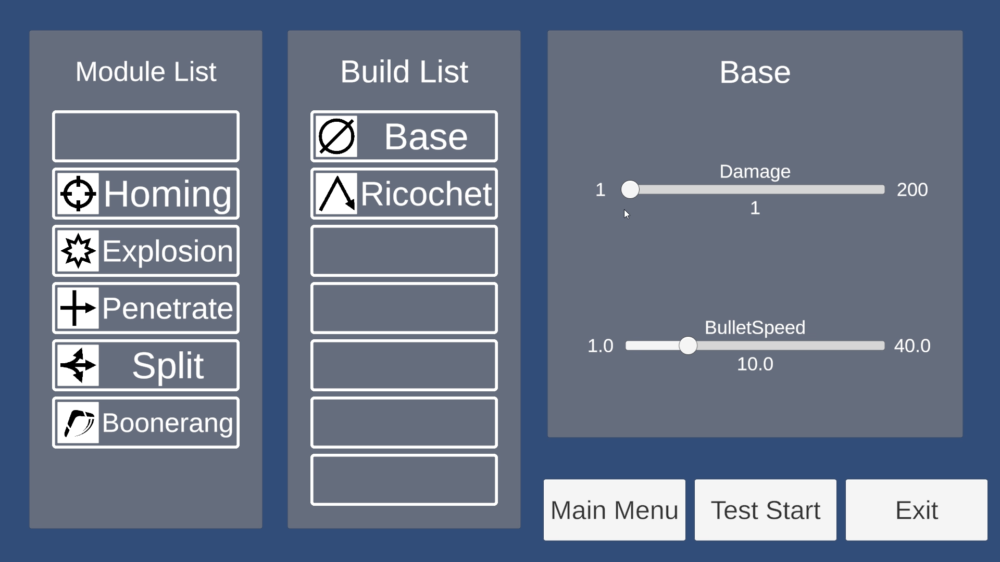
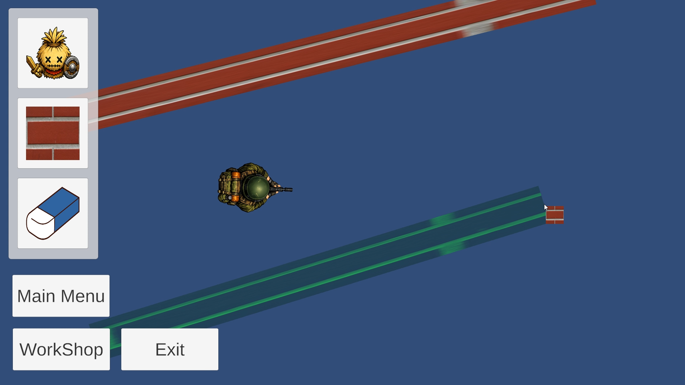
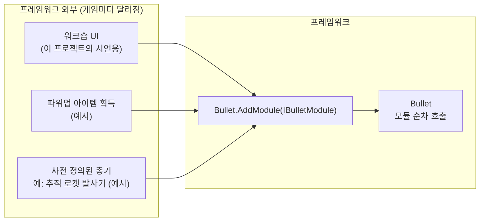
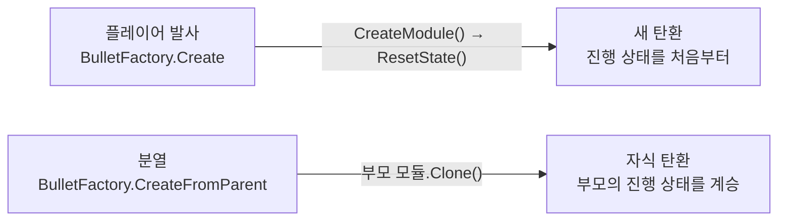
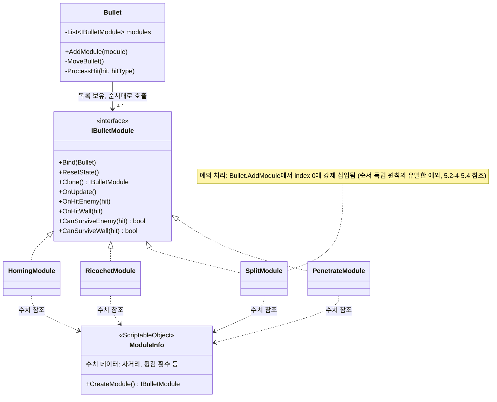
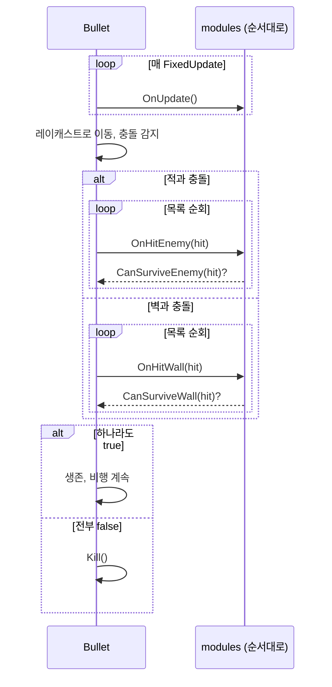
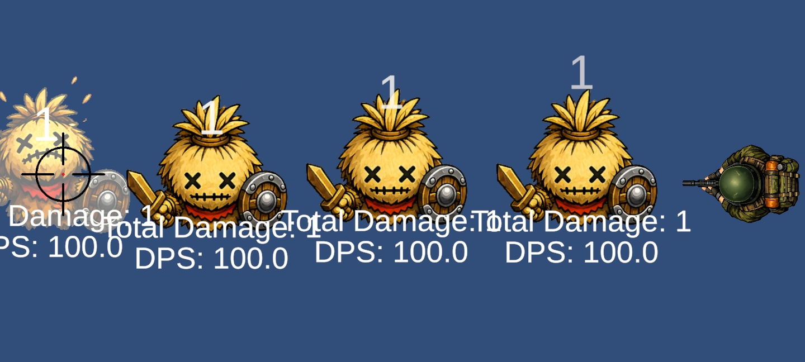
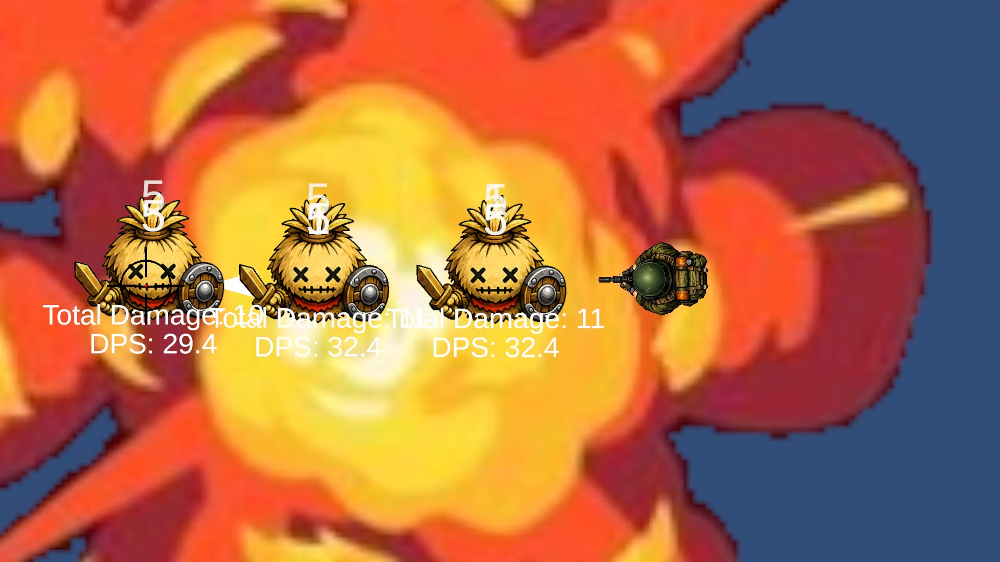
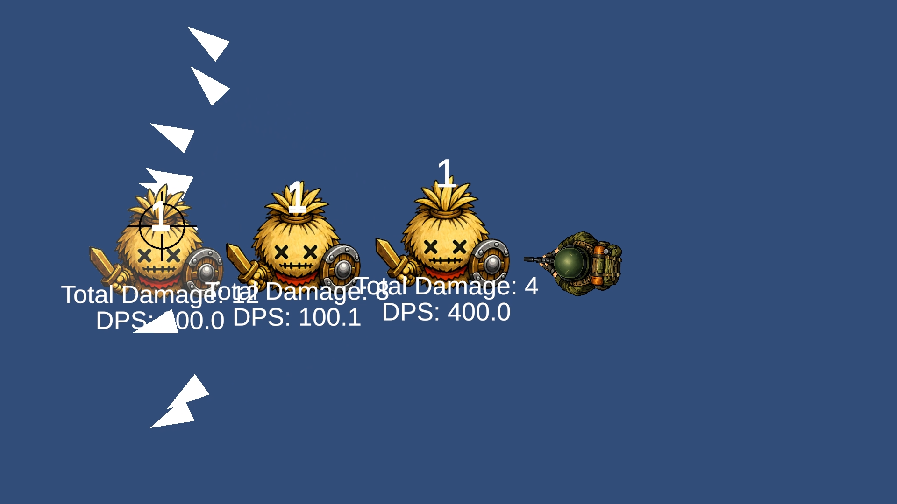
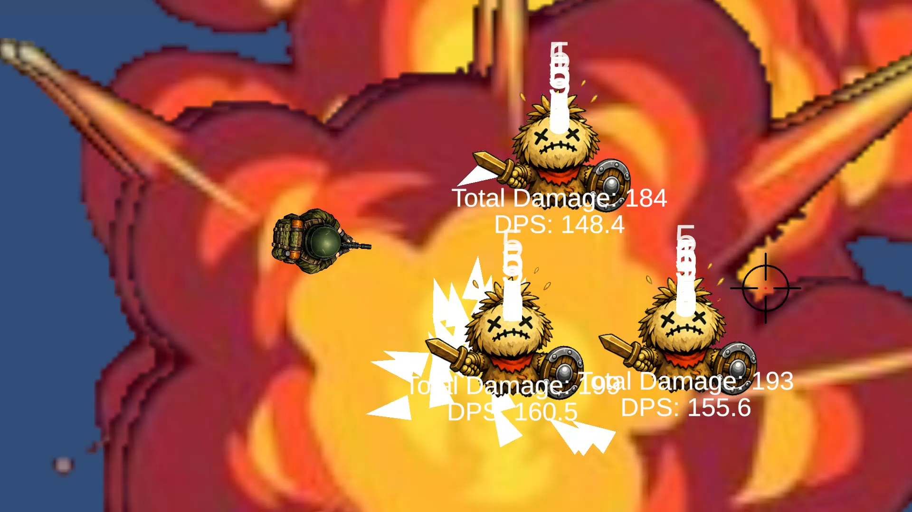

# 총기 모듈 프레임워크 (Bullet Module Framework)

> 탄환에 효과 부품(모듈)을 끼워 총기를 조립하는 Unity 2D 프레임워크
>
> - **무엇을:** 추적·반사·분열·관통·폭발·부메랑 6종 모듈을 자유롭게 조합하는 탄환 구조
> - **왜:** 효과별 탄환 클래스로는 조합(63가지)을 감당할 수 없어서
> - **결과:** 63가지 조합 전수 검증, 새 모듈 추가 시 기존 코드 수정 0줄
> - **배운 점:** 순서 독립성의 구조적 한계와, 프레임워크와 프로젝트 사이 의존 방향의 중요성

---

## 1. 개요

### 1.1 무엇을 (What)

이 문서는 탄환 하나에 여러 효과를 조합해 붙일 수 있는 **총기 모듈 프레임워크**를 다룬다.
6종의 모듈을 자유롭게 장착해, 하나의 `Bullet`으로 유탄 발사기나 추적 미사일 같은 서로 다른 총기를 만든다.
모듈끼리 조합하면 어느 모듈에도 따로 작성하지 않은 새 총기가 나오기도 한다. 관통 모듈과 폭발 모듈을 함께 달면 적을 꿰뚫으며 맞을 때마다 터지는 '관통 유탄'이 된다.

> **문서 범위** — 게임 전체가 아니라 **탄환과 모듈의 구조**만 다룬다. 실험실의 배치 기능(허수아비·벽)과 워크숍 UI는 모듈을 시연하고 검증하기 위한 도구로, 필요한 만큼만 언급한다.

### 1.2 왜 (Why)

출발점은 **워프레임(Warframe)의 모딩 시스템**이다. 무기에 모드를 끼우고 빼는 것만으로 성질이 바뀌는 구조를 탄환에 적용하고 싶었다.

효과마다 전용 탄환 클래스(`HomingBullet`, `SplitBullet` …)를 만드는 방식으로는 이런 구조를 만들 수 없다. "추적하면서 분열하는 탄환"을 만들려면 `HomingSplitBullet`을 새로 작성해야 한다. 효과가 6종이면 가능한 조합은 **63가지(2⁶−1)** 이고, 효과가 하나 추가될 때마다 약 두 배로 늘어난다. 모든 경우의 수를 클래스로 미리 만들어 두는 것은 현실적으로 불가능하다고 판단했다.

그래서 설계 단계부터 탄환은 공통 몸통(`Bullet`) 하나로 두고, 효과는 같은 규격(인터페이스)을 따르는 독립된 **부품(모듈)** 으로 분리했다. **조합으로 총기를 만드는** 구조다. 이렇게 하면 조합이 아무리 늘어도 작성할 코드는 모듈 개수만큼만 늘어난다.

### 1.3 목표의 전환

초기 목표는 "누구나 간편하게 쓸 수 있는 종합형 총기 모듈"이었다. 그러나 데미지 처리 로직을 설계하면서 이 목표가 성립하지 않는다고 판단했다. 모듈을 사용하는 개발자가 어떤 피해 로직을 쓸지 프레임워크는 미리 알 수 없으므로, 이를 대신 "간편하게" 처리해 줄 방법이 없다고 보았다.

그래서 목표를 **"필요할 때마다(유탄 발사기, 추적 미사일 등) 원하는 총기를 조립해 꺼내 쓸 수 있는 재사용 가능한 프레임워크"** 로 바꿨다. (이 판단은 문서를 쓰며 다시 검토했다. 5.5 참조)

이 문서는 이 목표를 구현한 구조(2장), 핵심 동작(3장), 설계 근거(4장), 검증 결과와 한계(5장)를 차례로 정리한다.

### 1.4 레퍼런스와 차이점

| | 워프레임 모딩 시스템 | 이 프로젝트 |
|---|---|---|
| 모드가 바꾸는 것 | 주로 **수치**(데미지, 연사력, 속성 등) | 탄환의 **행동**(경로, 충돌 반응, 생존 여부) |
| 조합의 결과 | 수치가 합산·곱연산됨 | 행동이 동시에 실행되어 상호작용함 (예: 분열한 자식 탄환이 다시 추적) |
| 핵심 과제 | 밸런싱 | 모듈 간 **실행 순서와 상호작용**의 일관성 (2.2, 5.2-4 참조) |

### 1.5 핵심 루프와 조작법

플레이어(=테스터)는 아래 흐름을 반복하며 모듈 조합을 실험한다.


| 워크숍 — 모듈 장착·수치 확인 | 실험실 — 허수아비·벽 배치 |
|---|---|
|  |  |

| 입력 | 동작 |
|---|---|
| `WASD` / 방향키 | 이동 |
| 마우스 이동 | 조준 |
| 좌클릭 | 발사 |
| `V` | 연사 모드 토글 (켜면 좌클릭 유지 시 연사) |
| `Tab` (누르는 동안) | 배치 모드 — 메뉴에서 허수아비·벽 선택 |
| 배치 모드 + 좌클릭 | 허수아비 배치 / 벽은 드래그로 길이 지정, 휠로 두께 조절 / 배치물 제거 |

### 1.6 개발 환경

- **Engine:** Unity 6 (6000.3.15f1), URP 2D
- **Language:** C#
- **Core:** 인터페이스 기반 모듈 설계, ScriptableObject 데이터 분리, 오브젝트 풀링, `Physics2D.Raycast` 기반 이동
- **기간:** 2026.06.24 ~ 2026.07.08 (2주, 개인 프로젝트)
<!-- ✏️ AI 활용: 활용했다면 Oddity 문서처럼 한 줄 추가 (예: - **AI 활용:** Claude Code — 구현 보조, 설계 결정과 검토는 직접) -->

### 1.7 링크

- **GitHub:** https://github.com/parksooha102-ai/3rd-2D-Project-parksooha102-ai
- **시연 영상:** (업로드 예정) <!-- TODO: 업로드 후 실제 주소로 교체 -->

---

## 2. 시스템 구조

### 2.1 구성요소

| 구성요소 | 역할 |
|---|---|
| `Bullet` | 탄환의 몸통. 이동과 레이캐스트 충돌 감지를 맡고, 보유한 모듈을 차례로 호출한다. 각 모듈의 구체적인 동작은 모른다. |
| `IBulletModule` | 부품 규격(인터페이스). `HomingModule`, `RicochetModule`, `SplitModule`, `PenetrateModule` 등 개별 효과가 구현한다. 부품끼리는 서로의 존재를 모른다. |
| `ModuleInfo` (ScriptableObject) | 부품의 수치 데이터. 모듈별로 `HomingModuleData` 등이 상속하고, `CreateModule()`로 로직 인스턴스를 만든다. 로직과 분리되어 있어 코드 수정 없이 에디터에서 밸런싱할 수 있다. |
| `BulletFactory` / `BulletPool` | 탄환 조립과 재사용. 풀에서 탄환을 꺼내 모듈을 붙여 발사하고(`Create`), 분열 시에는 부모 모듈을 복제해 자식 탄환을 만든다(`CreateFromParent`). |

### 2.2 관계와 설계 원칙

이 프레임워크는 두 가지 원칙을 따른다.

1. **서로 모른다.** `Bullet`은 모듈 목록만 가지고 있고, 모듈끼리는 서로의 존재를 모른다. 각 모듈은 자기 수치를 데이터 에셋(`XxxModuleData`)에서 읽고, 필요하면 `Bind()`로 `Bullet`을 참조한다.
2. **순서와 무관하다.** 조합이 자유로우려면 "어떤 모듈을 먼저 장착했는가"가 결과를 바꾸면 안 된다.

다만 `SplitModule`은 두 번째 원칙을 완전히 만족하지 못해, `Bullet.AddModule()`에서 항상 목록 맨 앞(index 0)에 넣는 방식으로 우회하고 있다. 원인은 5.2-4에서, 근본 해결 방향은 5.4에서 다룬다.

### 2.3 처리 흐름

물리 프레임(`FixedUpdate`)마다 `Bullet`은 다음 순서로 동작한다.

1. 보유한 모든 모듈의 `OnUpdate()`를 순서대로 호출한다.
2. 레이캐스트로 이동하며 충돌을 감지한다.
3. 적과 충돌했다면, 이미 통과 중인 적인지 피격 기록(`hitSet`)으로 확인하고 처리한 적이면 건너뛴다 (5.2-2).
4. 충돌 대상(적/벽)에 따라 `OnHitEnemy()` 또는 `OnHitWall()`을 모듈 순서대로 호출한다.
5. 적이라면 이 프로젝트의 전투 시스템(`CombatSystem`)에 데미지 이벤트를 전달한다. 이 연결 방식의 한계는 5.3에서 다룬다.
6. 모듈 중 하나라도 `CanSurviveEnemy()`/`CanSurviveWall()`이 `true`를 반환하면, 탄환은 소멸하지 않고 비행을 계속한다.

### 2.4 모듈 장착 경로 — 프레임워크의 경계

프레임워크가 정의하는 것은 **"모듈을 장착한 탄환이 어떻게 동작하는가"** 까지다. **"모듈을 언제, 어떻게 장착하는가"** 는 프레임워크 바깥의 일이다. 외부에서 `Bullet.AddModule()`만 호출하면 어떤 방식으로든 붙일 수 있다.



이 프로젝트는 모듈 조합을 빠르게 바꿔 가며 검증하려고 **워크숍 UI**를 진입로로 썼다. 워크숍에서 장착한 모듈 목록을 `BulletFactory`가 읽어 발사 시점에 탄환에 붙인다.
다른 게임이라면 파워업 아이템을 먹을 때 모듈을 추가하거나, 모듈이 고정된 총기를 획득하게 하는 식으로 진입로만 바꾸면 된다. 탄환과 모듈의 코드는 그대로다.

### 2.5 모듈의 생명주기 — 새로 시작할 것인가, 이어받을 것인가

모듈이 가진 값은 두 종류다.

| 종류 | 예시 | 설정 시점 |
|---|---|---|
| **설정값** (데이터에서 읽음) | `maxPenetrateLimit`, `maxGeneration` | 생성자 |
| **진행 상태** (비행 중 변함) | `currentPenetrateCount`, `currentGeneration`, `excludedTarget` | `ResetState()` 또는 `Clone()` |

탄환이 만들어지는 경로는 두 가지이고, 경로마다 진행 상태를 다루는 방식이 다르다.



- **`ResetState()`** — 진행 상태를 초기값으로 채운다. 관통 모듈이라면 남은 관통 횟수를 최대값으로 되돌린다.
- **`Clone()`** — 부모 모듈의 진행 상태까지 복사한 새 인스턴스를 만든다(프로토타입 방식).

`Clone()`은 분열 모듈 때문에 생겼다. 자식 탄환은 **자신이 몇 세대인지** 알아야 분열을 멈출 수 있는데, 자식에게도 새 모듈을 만들어 붙이자 세대 수가 0으로 초기화되어 무한 분열이 일어났다. 데이터로 새로 만드는 방식은 "어떤 설정인가"는 전달하지만 "지금 어디까지 진행됐는가"는 전달하지 못한다. 그래서 부모의 상태를 그대로 복사하는 `Clone()`을 인터페이스에 추가했다.

### 2.6 클래스 다이어그램



> 다이어그램에는 대표 모듈 4종만 그렸다. 폭발·부메랑 모듈도 같은 방식으로 `IBulletModule`을 구현하고 `ModuleInfo`의 수치를 참조한다.

### 2.7 시퀀스 다이어그램



---

## 3. 핵심 기능

먼저 프레임워크를 **쓰는 방법**(3.1 총기 조립, 3.2 새 모듈 추가)을 소개하고, 이어서 **관통·분열·추적** 세 모듈로 실제 동작을 설명한다.
세 모듈은 인터페이스의 서로 다른 훅을 쓰기 때문에, 함께 보면 모듈 규격이 어떻게 쓰이는지 한눈에 들어온다.

| 모듈 | 사용하는 훅 | 진행 상태 | 한 줄 요약 |
|---|---|---|---|
| 관통 | `CanSurviveEnemy` | 남은 관통 횟수 | 생존 여부만 바꾼다 |
| 분열 | `OnHitEnemy` / `OnHitWall` | 세대 수, 처리한 대상 | 충돌 시 새 탄환을 만든다 |
| 추적 | `OnUpdate` | 없음 | 비행 중 방향만 바꾼다 |

### 3.1 사용법 — 총기 조립하기

프레임워크를 쓰는 쪽이 할 일은 세 가지다. 풀에서 탄환을 꺼내고, 모듈을 붙이고, 발사한다.

```csharp
// 예시: '추적 + 폭발' 조합으로 추적 로켓을 조립하는 경우
Bullet bullet = bulletPool.Get();                 // 풀에서 꺼낼 때 이전 모듈은 비워진다

foreach (ModuleInfo info in rocketModules)        // 추적, 폭발 모듈 데이터(SO)
{
    IBulletModule module = info.CreateModule();   // 데이터 → 로직 인스턴스 생성
    module.ResetState();                          // 진행 상태 초기화 (2.5 참조)
    bullet.AddModule(module);
}

bullet.Initialize(muzzle.position, aimDirection, damage, speed);
```

이 프로젝트에서는 이 과정을 `BulletFactory.Create()`가 대신한다. 워크숍에서 장착한 목록(`ModuleDataManager.EquippedModules`)을 읽어 위 순서대로 조립하므로, 플레이어 코드는 `BulletFactory.Create(pool, 위치, 방향)` 한 줄만 호출한다.

### 3.2 확장법 — 새 모듈 추가하기

새 효과를 추가할 때 작성하는 파일은 **두 개**이고, **기존 코드는 고치지 않는다.**

| 단계 | 작업 | 내용 |
|---|---|---|
| 1 | `XxxModule : IBulletModule` 작성 | 효과 로직. 쓰지 않는 훅은 빈 구현으로 둔다 |
| 2 | `XxxModuleData : ModuleInfo` 작성 | 수치 데이터(ScriptableObject)와 `CreateModule()` 구현. `[CreateAssetMenu]`를 붙인다 |
| 3 | 에셋 생성 | 에디터 메뉴에서 `XxxModuleData` 에셋을 만들고 수치를 입력한다 |
| 4 | (이 프로젝트 한정) 워크숍 슬롯 등록 | 워크숍 씬의 슬롯(`ModuleSlotSetting.StartModule`)에 에셋을 연결한다 |

`Bullet`, `BulletFactory`, `ModuleDataManager`는 구체적인 모듈 타입을 모르고 `IBulletModule`과 `ModuleInfo`만 다룬다. 그래서 1~3단계만으로 새 모듈이 기존 모듈과 자유롭게 조합된다. 4단계는 시연용 진입로(2.4)의 작업이다.

> **유일한 예외:** `Bullet.AddModule()`에는 `if (module is SplitModule)` 분기가 하나 있다. 프레임워크 코드가 특정 모듈 타입을 아는 유일한 지점으로, 5.2-4의 순서 의존성 문제를 우회하기 위한 것이다.

### 3.3 관통 — `PenetrateModule`

```csharp
public bool CanSurviveEnemy(RaycastHit2D hit)
{
    if (currentPenetrateCount <= 0)
        return false;

    currentPenetrateCount--;
    return true;
}
```

**동작:** 상태는 카운터(`currentPenetrateCount`) 하나뿐이다. 새로운 적과 충돌할 때마다 남은 관통 횟수를 확인해, 남아 있으면 1 차감하고 생존을, 없으면 소멸을 허용한다. `OnHitEnemy()`/`OnHitWall()`은 빈 구현이라 생존 판정 외의 부수 효과가 없다.

**설계 의도:** 관통은 "몇 번 뚫고 지나갈 수 있는가"만 정하면 되는 효과다. 어떤 대상을 맞았는지 구분해 기억할 필요가 없다.



### 3.4 분열 — `SplitModule`

```csharp
private void ProcessSplit(RaycastHit2D hit)
{
    if (hit.collider == excludedTarget) return;
    if (currentGeneration >= maxGeneration) return;

    excludedTarget = hit.collider;
    currentGeneration++;

    // 각도 계산 후 splitAmount 개수만큼 자식 Bullet 생성
    bullet.Kill();
}
```

**동작:** 적중하면 원본 탄환을 소멸시키고 자식 탄환 여러 발을 만든다. 이때 "이 대상에는 이미 분열했다"는 사실을 `excludedTarget`에 기록한다. 기록하지 않으면 자식 탄환이 같은 대상과 다시 부딪힐 때마다 무한히 재분열한다.

**관통과의 구조적 차이:** 관통은 대상을 구분할 필요가 없지만, 분열은 반드시 구분해야 한다. 이 비대칭이 5.2-4에서 다루는 순서 의존성 문제의 근본 원인이다.

### 3.5 추적 — `HomingModule`

```csharp
public void OnUpdate() => UpdateTracking();   // 충돌 훅은 모두 빈 구현

private void UpdateTracking()
{
    Collider2D[] hits = Physics2D.OverlapCircleAll(bullet.transform.position, trackingRange);
    GameObject target = null;
    float nearestSqr = trackingRange * trackingRange;

    foreach (Collider2D hit in hits)
    {
        if (!hit.CompareTag(bullet.OpponentTag)) continue;                    // 적만
        Vector3 dir = hit.transform.position - bullet.transform.position;
        if (dir.sqrMagnitude >= nearestSqr) continue;                         // 더 가까운 적만
        if (Vector3.Angle(bullet.transform.up, dir) > trackingAngle) continue; // 시야각 안의 적만
        if (Physics2D.Linecast(bullet.transform.position,
                               hit.transform.position, bullet.WallLayer)) continue; // 벽 너머 제외

        nearestSqr = dir.sqrMagnitude;
        target = hit.gameObject;
    }

    if (target != null)
    {
        Vector3 targetDir = (target.transform.position - bullet.transform.position).normalized;
        bullet.transform.up = Vector3.RotateTowards(
            bullet.transform.up, targetDir, trackingSpeed * Time.deltaTime, 0f);
    }
}
```

**동작:** 물리 프레임마다 반경 `trackingRange` 안의 적을 네 가지 조건(적 태그, 거리, 시야각 `trackingAngle`, 벽에 가려지지 않음)으로 걸러 가장 가까운 대상을 고른다. 그런 다음 탄환의 진행 방향(`transform.up`)을 대상 쪽으로 초당 최대 `trackingSpeed` 라디안만큼 돌린다.

**설계 의도:**
- **위치가 아니라 방향만 바꾼다.** 실제 이동은 `Bullet.MoveBullet()`이 `transform.up` 방향으로 처리한다. 그래서 추적 모듈은 이동 방식을 몰라도 되고, 반사 모듈이 방향을 꺾은 뒤에도 그 방향에서 이어서 추적할 수 있다.
- **즉시 꺾지 않고 서서히 돈다** (`RotateTowards`). 탄도가 곡선을 그려 유도탄처럼 보이고, 회전 속도를 데이터로 조절할 수 있다.
- **시야각과 벽 검사로 대상을 제한한다.** 지나친 적을 향해 U턴하거나, 벽 너머의 적에게 끌려가 벽에 박히는 것을 막는다.
- **진행 상태가 없다.** 대상을 매 프레임 새로 찾으므로 기억할 것이 없다. 그래서 `ResetState()`는 빈 구현이고 `Clone()`도 새로 만드는 것과 같다. 분열한 자식 탄환도 각자 자기 위치에서 대상을 다시 찾는다.

---

## 4. 고민과 선택

> 이 장은 대안을 비교해 고른 선택 **네 가지**(4.1 모듈 규격, 4.2 생존 판정, 4.3 이동 방식, 4.4 생성 방식)와, 당시 비교 없이 고른 뒤 문서를 쓰며 돌아본 **사후 검토**(4.5)로 나뉜다.

### 4.1 모듈 규격 — 인터페이스 vs 추상 클래스

**결정 대상** — 모듈의 공통 규격을 무엇으로 정할 것인가?

| | [A] 추상 클래스 | [B] 인터페이스 (채택) |
|---|---|---|
| 장점 | 공통 필드·기본 동작을 부모에서 일괄 관리 | 모듈마다 필요한 상태·동작만 보유 |
| 단점 | 모든 모듈이 불필요한 공통 상태까지 상속 | 빈 구현(no-op)을 모듈마다 반복 작성 |

**[결정]** 이 프레임워크가 모듈에게 정해 주려는 것은 "무엇으로 이루어졌는가"가 아니라 **"무엇을 할 수 있는가"** 다.
관통처럼 카운터 하나뿐인 모듈과 분열처럼 여러 상태를 가진 모듈이 같은 부모를 상속해 불필요한 상태를 물려받을 이유가 없다. 그래서 상속(is-a) 대신 계약(can-do)인 인터페이스를 택했다.

이 판단은 1.2의 출발점과 이어진다. 처음부터 같은 규격의 부품을 조합하는 구조를 목표로 했기 때문에, 부품에게 요구할 것은 공통의 **행동 규격**뿐이었다. 빈 구현을 반복해 써야 하는 대가는, 모듈이 서로의 상태에 휘둘리지 않고 독립적으로 조합된다는 이점과 맞바꿀 만하다고 보았다.

### 4.2 생존 판정 — OR vs AND

**결정 대상** — 모듈마다 생존 판정이 다를 때, 탄환은 언제 살아남는가?

| | [A] AND (모든 모듈이 true여야 생존) | [B] OR (하나라도 true면 생존, 채택) |
|---|---|---|
| 관통 + 반사 조합 시 | 반사 단독이면 벽에서 튕기는데, 관통(`CanSurviveWall=false`)을 함께 달면 벽에서 소멸 | 반사 판정이 반영되어 튕김 |

**[결정]** AND 방식에서는 모듈을 더 달수록 오히려 약해지는 디너지(역시너지)가 생긴다. "모듈을 조합할수록 총기가 강해져야 한다"는 목표와 정면으로 충돌하므로, 하나라도 생존을 주장하면 살아남는 OR 방식을 택했다.

OR 방식은 디너지를 막는 데 그치지 않고, **조합만으로 새 총기가 나오게** 한다. 폭발 모듈은 혼자서는 맞는 즉시 소멸하는 유탄(`CanSurvive = false`)이다. 하지만 관통 모듈과 함께 달면 관통 판정이 생존을 주장해 **적을 꿰뚫으며 맞을 때마다 터지는 '관통 유탄'** 이 된다. 두 모듈 어디에도 "관통 유탄" 코드는 없다. 1.2의 "조합으로 총기를 만든다"는 목표가 의도대로 동작한 사례다.



### 4.3 이동 방식 — `Physics2D.Raycast` 직접 처리 vs `Rigidbody2D`

**결정 대상** — 탄환의 이동과 충돌 감지를 물리 엔진에 맡길 것인가?

`Rigidbody2D`로 이동시켰을 때 두 가지 문제를 실제로 겪었다.

1. 고속 탄환이 얇은 벽을 그대로 통과하는 터널링 현상
2. 플레이어의 `Rigidbody2D`를 Dynamic으로 두었을 때, 발사한 탄환과 부딪혀 플레이어가 밀리는 현상

**[결정]** 두 문제를 원천적으로 피하려고 물리 엔진에 이동을 맡기지 않았다. 매 프레임 이동할 거리만큼 레이캐스트로 앞을 미리 검사한 뒤 위치를 직접 갱신한다.

### 4.4 탄환·이펙트 생성 — `Instantiate/Destroy` vs 오브젝트 풀링

**결정 대상** — 조합에 따라 급격히 늘어나는 탄환과 이펙트를 어떻게 만들고 없앨 것인가?

| | [A] `Instantiate` / `Destroy` | [B] 오브젝트 풀링 (채택) |
|---|---|---|
| 장점 | 구현이 단순하고, 생성할 때마다 상태가 깨끗함 | 생성·파괴 비용과 가비지가 발생하지 않음 |
| 단점 | 생성·파괴가 잦으면 GC 스파이크 발생 | 꺼내 쓸 때 **이전 상태를 직접 초기화**해야 함 |

**[결정]** 이 프레임워크는 조합에 따라 탄환 수가 급격히 늘어난다. 분열 모듈은 세대마다 탄환을 `splitAmount`배로 늘리고(기본값 3발 × 3세대면 탄환 하나가 최대 27발), 폭발 모듈은 맞을 때마다 이펙트를 만든다. 실제로 `Instantiate/Destroy` 방식에서 연사와 분열을 함께 쓰자 GC 스파이크가 눈에 띄게 발생했다. 그래서 탄환(`BulletPool`)과 폭발 이펙트(`ExplosionPool`) 모두 제네릭 풀(`ComponentPool<T>`)로 재사용하도록 바꿨다.

대가인 '상태 초기화 책임'은 두 단계로 처리한다. 풀에서 꺼낼 때 `ClearModules()`로 이전 모듈을 비우고, `Initialize()`에서 위치·데미지·피격 기록을 다시 설정한다.

> 당시 프로파일러로 측정한 수치는 남아 있지 않다. 이 점은 5.5에서 회고한다.

### 4.5 자식 탄환의 상태 계승 — `Clone()` (사후 검토)

**결정 대상** — 분열로 생긴 자식 탄환에게 부모 모듈의 진행 상태를 어떻게 넘길 것인가?

자식 탄환에 모듈을 붙이는 방식으로는 **당시 대안을 비교하지 않은 채**, "자식이니까 부모 상태를 복사하면 되겠다"는 판단만으로 `Clone()`을 택했다. 이 절은 문서를 쓰면서 그 선택을 돌아본 결과다.

| | [A] `Clone()` — 모듈이 자신을 복제 (채택) | [B] 데이터로 새로 생성 + 상태를 외부에서 전달 |
|---|---|---|
| 방식 | 각 모듈이 "무엇을 물려줄지" 스스로 정해 복사본을 만든다 | `CreateModule()`로 새로 만든 뒤, `BulletFactory`가 세대 수 등을 넣어 준다 |
| 장점 | `Bullet`·`BulletFactory`가 모듈 내부 상태를 몰라도 된다 | 무엇이 계승되는지 한곳에서 명시적으로 보인다 |
| 단점 | 모든 모듈이 `Clone()`을 빠짐없이 올바르게 구현해야 한다 | 팩토리가 "분열 모듈에는 세대 수가 있다"는 것을 알아야 한다 → **"프레임워크는 구체 모듈을 모른다"는 원칙 위반** |



**[결정]** [B]는 계승할 상태를 가진 모듈이 생길 때마다 팩토리를 고쳐야 하므로, "새 모듈 추가 시 기존 코드 수정 0줄"(3.2)과 충돌한다. 결과적으로 `Clone()`은 이 프레임워크의 원칙에 맞는 선택이었다.
다만 이 결론은 **사후에** 얻은 것이다. 대안을 따져 보지 않았기 때문에, 관통 횟수처럼 **의도해서 물려주는 상태**와 계승하면 안 되는 상태를 설계 단계에서 구분해 두지 못했다. 모든 모듈이 `Clone()`에서 무엇을 복사할지 각자 판단하므로, 새 모듈이 추가될 때 이 구분이 어긋날 위험이 남아 있다.

---

## 5. 결과 및 배운 점

### 5.1 결과

**목표 달성 여부**

| 목표 (1장) | 결과 |
|---|---|
| 조합으로 총기를 만든다 | 6종 모듈의 조합 **63가지**를 모두 조립해 동작 확인. 관통 유탄(4.2)처럼 전용 코드 없이 조합 규칙만으로 새 총기가 나옴 |
| 재사용 가능한 프레임워크 | 새 모듈 추가 시 **기존 코드 수정 0줄**, 작성 파일은 모듈과 데이터 두 개 (3.2). 예외는 `is SplitModule` 분기 1곳 |
| 모듈 간 순서 독립 | 분열 모듈을 제외하고 달성. 분열 모듈은 목록 맨 앞 강제 삽입으로 우회 중 (5.2-4) |

**전수 테스트**

6종 모듈(추적·반사·분열·관통·폭발·부메랑)의 가능한 모든 조합을 직접 조립해 검증했다.



전수 테스트가 가능했던 것은 **순서 독립성** 덕분이다. 장착 순서가 결과를 바꾸지 않으므로 검증할 것은 "어떤 모듈을 골랐는가"뿐이고, 그 수는 63가지다. 순서가 결과를 바꾼다면 "어떤 순서로 장착했는가"까지 따져야 하므로 **1,956가지**(6개 중 k개를 골라 줄 세우는 경우의 합)로 30배 넘게 늘어난다. 순서 독립성은 조합의 자유를 위한 원칙인 동시에, 테스트를 현실적인 규모로 묶어 두는 장치였다.

검증에는 많은 시간이 들었지만, 이 과정에서 모듈 간 상호작용이 의도대로 동작하는지 확인했고 관통 + 분열 조합의 순서 의존성 버그(5.2-4)도 찾아냈다.

> 테스트 체크리스트는 코드를 고치고 리팩터링할 때마다 함께 바뀌었고, 각 시점의 기록은 남아 있지 않다. 이 점은 5.5에서 회고한다.

### 5.2 트러블슈팅

> 이 문서에서 `5.2-N`은 아래 N번째 트러블슈팅을 가리킨다.

#### 5.2-1. 관통 탄환이 적 앞에서 멈추는 문제

**문제:** 관통 횟수가 남아 있는데도 탄환이 충돌한 자리에 그대로 멈췄다.

**원인:** 초기 `MoveBullet()`은 충돌을 감지하면 `ProcessHit(hit)`을 호출하고 곧바로 반환했다.

```csharp
if (hit.collider != null && hit.collider.gameObject.CompareTag(allyTag) == false)
{
    ProcessHit(hit);
    return;
}
```

"충돌 시 실행할 효과"와 "충돌 후 생존 여부"가 나뉘어 있지 않아, 살아남은 탄환이 더 이상 이동하지 않았다.

**해결:** 효과 실행(`OnHit...`)과 생존 판정(`CanSurvive...`)을 별개 메서드로 분리하는 현재 구조로 리팩터링했다.

**결과:** 관통 횟수가 남은 탄환은 적을 뚫고 계속 날아갔다. 다만 같은 적에 연속으로 꽂히는 새 문제가 드러났다(5.2-2).

#### 5.2-2. 관통 탄환이 한 대상에 연속으로 꽂히는 문제

**문제:** 5.2-1을 고친 뒤, 이번에는 관통 3회짜리 탄환이 적 하나에 '따다닥' 세 번 꽂히고 사라졌다. 관통탄이 아니라 사실상 3연타 탄환이 된 것이다.

**원인:** 탄환이 적의 몸을 통과하는 데는 여러 물리 프레임이 걸린다. 살아남은 탄환의 다음 프레임 레이캐스트가 아직 몸 안에 있는 같은 적을 다시 맞혔고, 그때마다 데미지와 관통 횟수 차감이 반복되었다.

**해결:** `Bullet`에 **현재 통과 중인 적을 기억하는 `hitSet`(`HashSet<Collider2D>`)** 을 두었다.
- 적과 충돌하면 `hitSet`에 등록하고, 이미 등록된 적이면 모듈 호출과 데미지를 모두 건너뛴다.
- 레이캐스트에 아무것도 맞지 않는 프레임, 즉 적을 완전히 빠져나온 시점에 비운다.
- 벽은 등록하지 않는다. 반사 모듈은 같은 벽에 여러 번 튕길 수 있어야 하기 때문이다.

**결과:** 관통 3회 탄환이 적 3명을 꿰뚫고 4번째 적까지, 모두 4명을 맞힌다.

#### 5.2-3. 리팩터링 중 재발한 무한 분열

**문제:** `Bullet`의 책임을 나누는 리팩터링 중에 분열 모듈의 무한 분열 버그가 다시 나타났다.

**원인:** 리팩터링 전에는 분열을 일으킨 대상을 `Bullet`이 기억하고 있었다. 이는 "탄환은 모듈의 사정을 몰라야 한다"는 원칙에 어긋나는 구조였고, 책임을 정리하면서 이 기억이 함께 지워졌다.

**해결:** 처리한 대상을 `SplitModule` 내부의 `excludedTarget`이 직접 관리하도록 옮겼다.

**결과:** 분열이 정해진 세대에서 멈추고, 이후 리팩터링에서도 다시 생기지 않았다.

> 분열 대상은 `Bullet`에서 빼낸 반면, 5.2-2의 `hitSet`은 `Bullet`에 두었다. **"같은 적을 한 번만 맞힌다"는 규칙은 어떤 모듈을 달았든 모든 탄환에 공통**이기 때문이다. 특정 모듈만의 규칙(분열 대상 기억)은 모듈이, 탄환 공통의 규칙(중복 피격 방지)은 탄환이 갖는다.

#### 5.2-4. 관통 + 분열 조합의 순서 의존성

**문제:** 순서 독립성은 처음부터 의도한 설계였지만, 관통 + 분열 조합에서 `SplitModule`이 목록 뒤에 있으면 적 하나에 관통력이 두 번 차감되었다.

> 1. 부모 탄환이 적과 충돌하면 관통 모듈이 먼저 실행되어 관통력이 1 줄고, 탄환은 생존한다.
> 2. 이어서 분열 모듈이 같은 적에 대해 자식 탄환을 만들고 부모를 소멸시킨다.
> 3. 자식 탄환은 스폰 시 부여된 콜라이더 패딩 때문에 생성 직후 같은 적과 다시 충돌한다.
> 4. 분열 모듈은 `excludedTarget`으로 이미 처리한 적임을 알고 무시하지만, 관통 모듈은 이 정보를 모르므로 새 적으로 보고 `CanSurviveEnemy()`를 다시 실행한다.
> 5. 결과적으로 적 하나에 관통력이 두 번 차감된다.

**원인:** 분열 모듈만 자신이 분열시킨 대상을 알고, 나머지 모듈은 그 사실을 모른다. "모듈은 서로를 몰라야 한다"는 원칙과 "대상을 기억해야 하는 모듈(분열)과 그럴 필요가 없는 모듈(관통)이 공존한다"는 사실이 구조적으로 충돌한 것이다.
콜라이더 패딩은 문제가 드러나는 시점을 정하는 트리거일 뿐 근본 원인이 아니다. 관통 모듈이 있으면 콜라이더 안에 머무는 구간은 패딩과 무관하게 원래 존재한다.

**순서에 따라 결과가 달라지는 이유:** `Bullet.ProcessHit()`은 모듈을 하나씩 호출하다가 탄환이 비활성화되면 그 자리에서 멈춘다. 그래서 분열 모듈이 언제 `Kill()`을 부르느냐에 따라, 부모 탄환에서 관통 모듈이 실행될 기회가 생기기도 하고 사라지기도 한다.

| 장착 순서 | 부모 탄환 | 자식 탄환 (같은 적과 재충돌) | 관통력 차감 |
|---|---|---|---|
| 관통 → 분열 | 관통 실행(−1) → 분열이 `Kill()` | 분열은 무시, 관통 실행(−1) | **2회** (버그) |
| 분열 → 관통 | 분열이 `Kill()` → 루프 중단, 관통 미실행 | 분열은 무시, 관통 실행(−1) | **1회** (의도대로) |

**시도했다가 되돌린 해결책:** 자식 탄환을 만들 때 부모가 맞힌 적을 자식의 `hitSet`에 미리 넣어 주었다(`subBullet.AddHitSet(hit.collider)`). 자식이 그 적을 건너뛰므로 이중 차감은 사라졌다. 그러나 부모는 분열 모듈의 `Kill()`로 **데미지 처리 전에 소멸**하고 자식은 그 적을 건너뛰므로, **분열을 일으킨 적이 데미지를 전혀 받지 못하는** 새 문제가 생겼다. 피격 기록을 조작하면 데미지 적용 시점이라는 다른 규칙이 깨진다는 것을 확인했고, 이 코드는 주석 처리해 되돌렸다.

**현재 상태:** 프로젝트 기한이 다가와, `SplitModule`을 항상 목록 맨 앞에 넣어 위 표의 두 번째 행으로 순서를 고정하는 우회책을 택했다. 근본 해결 방향은 5.4에서 다룬다.

### 5.3 아쉬운 점 (기술 부채)

#### 프레임워크와 프로젝트의 결합 (3건)

재사용되어야 할 프레임워크가 이 프로젝트 전용 코드를 직접 알고 있는 곳이 세 군데 있다. 같은 종류의 실수이므로 묶어서 정리한다.

**① `BaseModule`의 워크숍 결합**
- **현상:** 탄환의 기본 속성(데미지, 속도)을 워크숍 UI에서 모듈과 똑같이 다루려고, 아무 동작도 없는 `BaseModule`을 모듈로 만들어 넣었다.
- **문제:** 데미지와 속도는 어떤 프로젝트든 탄환이라면 항상 갖는 속성이고, 워크숍은 이 프로젝트에만 있는 UI다. 프레임워크를 프로젝트 UI의 편의에 맞춘 설계다.
- **개선:** 반대로 워크숍 쪽 코드를 고쳐 기본 속성과 모듈을 따로 다루게 한다.

**② `ModuleInfo`의 워크숍 결합**
- **현상:** 모듈 데이터의 공통 부모 `ModuleInfo`에 `GetEditableFields()`, `SetFieldValue()` 같은 **워크숍 UI 전용 메서드**가 들어 있다.
- **문제:** 의존 방향은 "UI가 모듈 데이터를 읽어 가는" 쪽이어야 하는데, 모듈 데이터가 UI의 형식(`ModuleFieldInfo`)에 맞춰 주고 있다. 다른 프로젝트에서 쓰더라도 쓰지 않는 UI 메서드를 모듈마다 구현해야 한다. 당시에는 "UI에 필요한 정보는 데이터가 제공한다"고 생각했다.
- **개선:** UI 쪽에 모듈 데이터를 읽어 편집 필드로 바꾸는 어댑터(또는 리플렉션 기반 인스펙터)를 두고, `ModuleInfo`에는 수치와 `CreateModule()`만 남긴다.

**③ `Bullet`의 `CombatSystem` 직접 호출**
- **현상:** 전투 시스템(`CombatSystem`)은 관찰자 패턴(`ICombatObserver`)으로 만들어, 데미지를 **받는 쪽**(피격 대상, 데미지 팝업 등)은 탄환을 모르도록 분리했다. 그러나 **보내는 쪽**인 `Bullet.ApplyDamageTo()`는 `CombatSystem.Instance`, `HurtBox`, `CombatEvent` 등 이 프로젝트의 전투 클래스를 이름으로 직접 부른다.
- **문제:** 이벤트를 쓰더라도 보내는 쪽이 받는 쪽의 이름을 알면 의존은 사라지지 않는다. 탄환을 다른 프로젝트로 옮기면 이 전투 시스템까지 함께 옮겨야 한다.
- **개선:** 프레임워크는 `IHitReceiver`(또는 `Bullet` 자체의 피격 이벤트) 같은 **연결 규격만 정의**하고, 각 프로젝트가 이를 구현해 자기 전투 매니저에 연결한다. 프로젝트마다 필요한 피해 정보(속성, 넉백 등)가 다른 문제는, 모듈이 피격 정보에 값을 덧붙일 수 있는 확장 가능한 구조로 풀 수 있다.

#### 그 밖의 부채

**④ `ResetState()`의 역할 상실**
- **현상:** 초기 구조에서는 풀에서 꺼낸 탄환이 **이전 모듈 인스턴스를 그대로 재사용**했기 때문에, 남은 횟수 등을 되돌리는 초기화 함수가 필수였다. 이후 `BulletFactory` 리팩터링으로 발사할 때마다 모듈을 새로 만들게 되면서 원래 목적은 사라졌다.
- **문제:** 관통·반사 모듈은 생성자에서 진행 상태를 채우지 않아서, 지금도 `ResetState()`를 부르지 않으면 횟수가 0으로 시작한다. 이유는 사라졌는데 함수에 기대는 코드만 남았다.
- **개선:** 진행 상태 초기화를 생성자로 옮기고, `ResetState()`는 재사용이 정말 필요한 경우에만 남긴다.

**⑤ 추적 모듈의 매 프레임 메모리 할당**
- **현상:** `HomingModule`은 물리 프레임마다 `Physics2D.OverlapCircleAll()`로 콜라이더 배열을 **새로 할당**한다.
- **문제:** 탄환 하나일 때는 부담이 작지만, 분열과 조합하면 탄환 수만큼 할당이 곱해져 풀링(4.4)으로 줄인 가비지를 다시 만들어 낸다. 당시에는 기능 구현에 쫓겨 이 비용을 생각하지 못했다.
- **개선:** 추적 후보는 범위에 **들어오고 나갈 때만** 바뀌므로, 트리거 진입·이탈 시점에만 후보 목록을 갱신한다. 또는 미리 할당한 버퍼를 재사용하는 비할당 API(`OverlapCircle` + `ContactFilter2D` + 버퍼)로 바꾼다.

**⑥ 분열 모듈의 맨 앞 강제 삽입** — 5.2-4의 순서 의존성을 기한 때문에 우회한 코드다. 근본 해결 방향은 5.4에서 다룬다.

### 5.4 향후 계획 (To-Be) — 순서 의존성의 근본 해결

한 문장으로 줄이면, **분열 모듈만 자신이 분열시킨 대상을 알고 나머지 모듈은 모르기 때문에, 자식 탄환이 같은 대상에 한 번 더 반응한다.** 구조적으로 나누면 문제는 두 겹이다.

1. **한 탄환 안에서의 순서 문제:** 모듈이 호출 도중에 탄환을 소멸시킬 수 있어, 뒤 모듈의 실행 여부가 앞 모듈에 달려 있다.
2. **세대 사이의 기록 단절:** "이 적은 이미 처리했다"는 기록이 탄환(`hitSet`)과 모듈(`excludedTarget`)에 흩어져 있다. 그래서 같은 적을 부모와 자식이 각각 새 적으로 센다.

둘 다 탄환 처리 흐름 자체를 바꾸는 대규모 리팩터링이 필요하다.

| | As-Is (현재) | To-Be (개선안) |
|---|---|---|
| 충돌 처리 | 모듈을 호출하는 **도중에** 효과가 즉시 실행됨 (분열 모듈이 루프 안에서 `Kill()`) | **2단계 처리:** ① 모든 모듈에게 "무엇을 할지"(생존 주장, 자식 생성 요청 등)를 먼저 묻고 ② `Bullet`이 결과를 모아 한 번에 실행 → 모든 모듈이 항상 실행되므로 순서와 무관 |
| 피격 기록 | 탄환마다 `hitSet`, 분열 모듈은 별도로 `excludedTarget` | 부모와 자식이 **복사가 아닌 참조로 공유하는** 계보 단위 기록(`HitContext`) 하나로 통합 → 같은 적은 계보 전체에서 한 번만 처리 |
| 분열 모듈 특수 처리 | `AddModule()`의 `is SplitModule` 분기 | 불필요 → 프레임워크가 구체 모듈 타입을 아는 코드 0곳 |

2단계 처리는 5.2-4에서 되돌린 해결책의 문제(데미지 적용 시점)도 함께 푼다. 소멸 여부를 결과를 모은 뒤에 정하므로, 분열하는 탄환도 데미지를 먼저 적용하고 소멸할 수 있다.

### 5.5 배운 점

**기능보다 구조에 시간을 썼다.**
이번 프로젝트에서는 기능 구현보다 구조 설계에 더 많은 시간을 들였다. 목표를 '종합형 총기 모듈'에서 '재사용 가능한 프레임워크'로 바꾼 뒤(1.3), 인터페이스와 데이터를 분리하고 탄환은 모듈을 호출하는 역할만 맡도록 구조를 다시 짰다.
모듈 간 결합도를 낮추고 순서에 의존하지 않는 구조를 목표로 했지만, 분열 모듈처럼 대상을 기억해야 하는 모듈 앞에서는 구조적 한계가 있었다(5.2-4, 5.4). 모든 원칙을 동시에 만족시키는 구조는 생각보다 만들기 어려웠다.

**같은 실수가 세 번 반복되었다.**
일단 동작하게 만드는 데 집중한 선택이, 시간이 지나 다시 보니 기술 부채로 남은 경우가 여럿 있었다(5.3). 그중에서도 같은 종류의 실수가 세 번 반복된 것이 눈에 띈다.

| 위치 | 프레임워크가 알고 있는 프로젝트 전용 코드 |
|---|---|
| `BaseModule` | 기본 속성을 모듈처럼 다루려는 워크숍 UI의 편의 |
| `ModuleInfo` | 워크숍 UI의 편집 필드 형식(`ModuleFieldInfo`) |
| `Bullet.ApplyDamageTo()` | 이 프로젝트의 전투 시스템(`CombatSystem`, `HurtBox`, `CombatEvent`) |

세 경우 모두 **재사용되어야 할 프레임워크가 이 프로젝트 전용 코드를 직접 알고 있다.** 의존 방향은 "프로젝트가 프레임워크를 아는" 쪽이어야 하는데, 당시에는 필요한 곳에 바로 코드를 넣는 것이 자연스러워 보였다.

**1.3의 판단은 절반만 맞았다.**
세 번째 사례는 1.3의 목표 전환을 다시 보게 만들었다. 당시에는 "프로젝트마다 피해를 어떻게 처리할지 모르니, 프레임워크가 피해 처리까지 맡는 것은 불가능하다"고 판단했다. 돌아보면 프레임워크가 피해 로직을 **구현**할 수는 없지만, "탄환이 무엇을 맞혔다"는 사실을 전달하는 **연결 규격**은 정할 수 있었다. 각 프로젝트는 그 규격에 자기 전투 매니저를 꽂기만 하면 된다.
문제를 "피해 처리를 일반화할 수 있는가"로 보았기 때문에 "불가능"에 닿았지만, "누가 누구를 알아야 하는가"로 보았다면 다른 답이 나왔을 것이다. 다음에는 기능을 구현하기 전에 의존 관계와 책임 분리부터 정한 뒤 구조를 설계할 것이다.

**기록을 남기지 않았다.**
풀링 도입 전후의 가비지 수치도, 리팩터링마다 바뀐 전수 테스트 체크리스트도 지금은 남아 있지 않다. 그래서 이 문서에서 풀링의 효과를 수치로 증명하지 못했고, 63가지 조합 검증도 결과만 말할 수 있다. 다음 프로젝트에서는 성능 개선 전후의 프로파일러 수치를 캡처해 두고, 테스트 체크리스트를 코드와 함께 저장소에서 버전 관리할 것이다.
