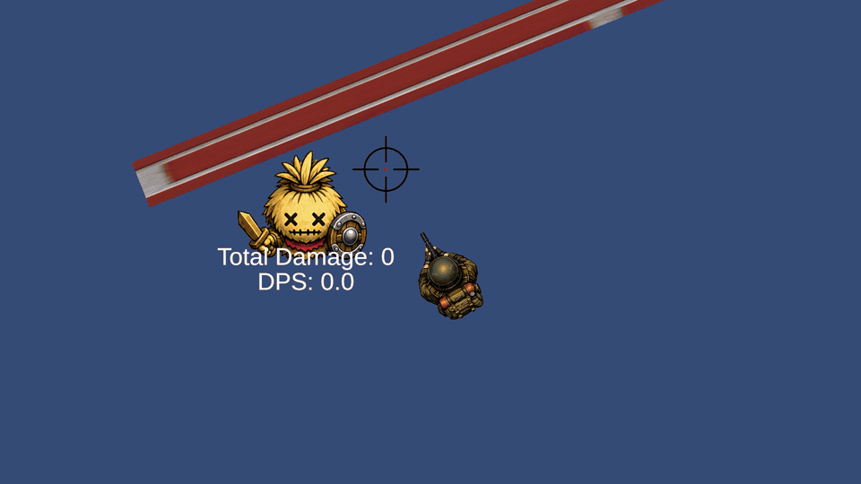
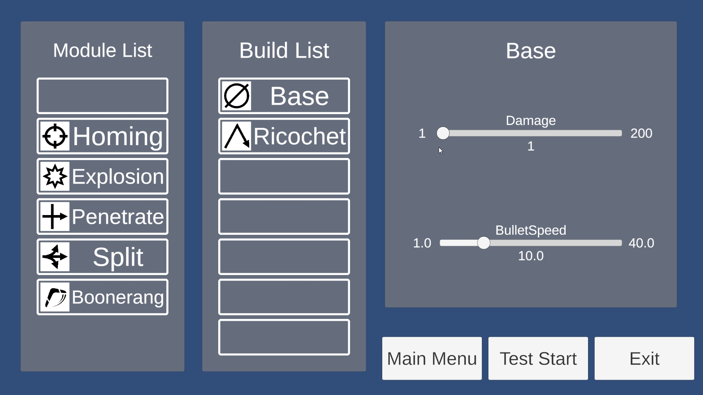
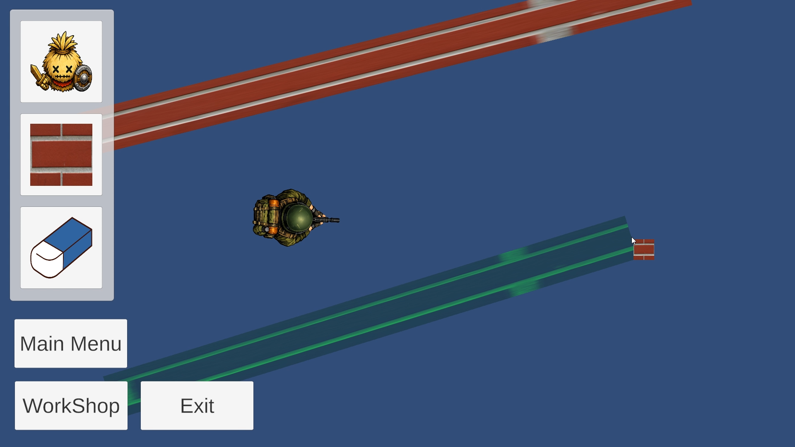
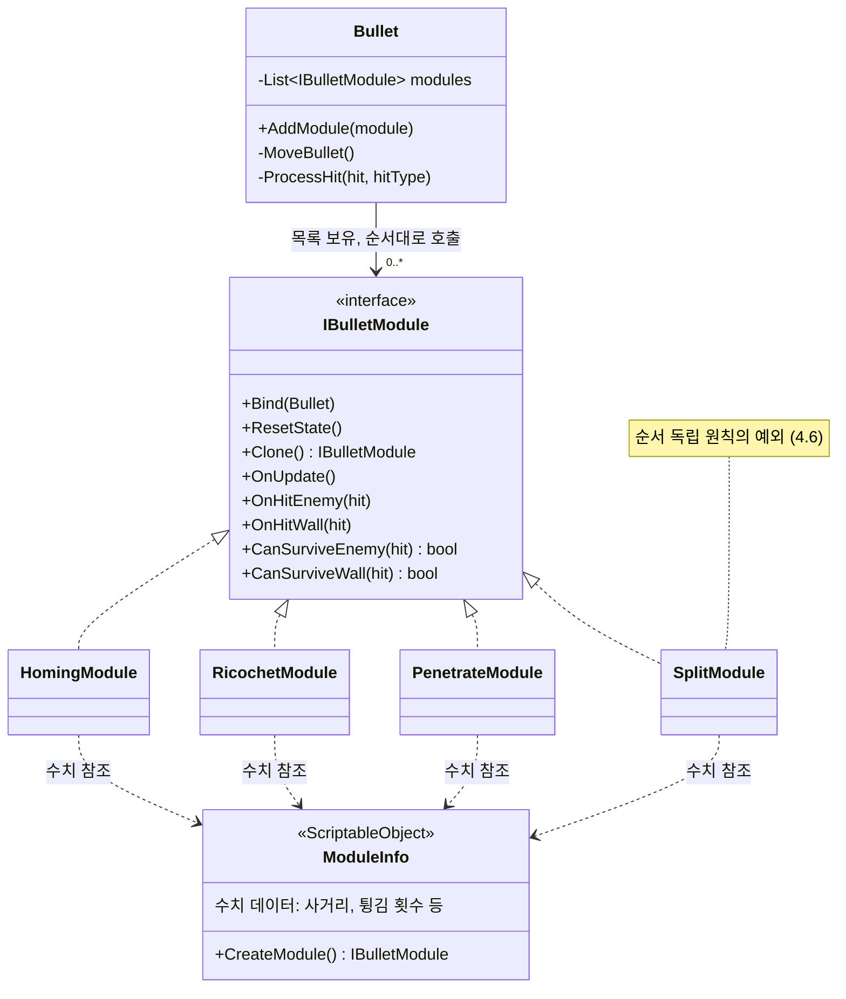
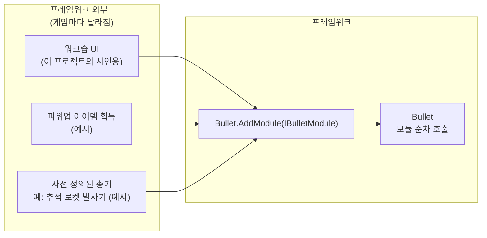
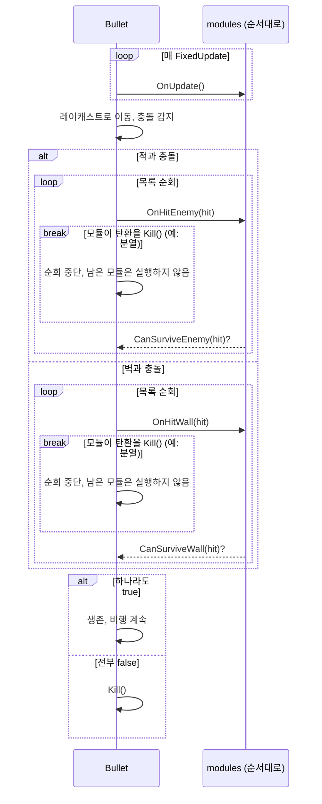
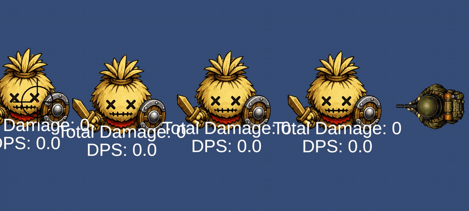
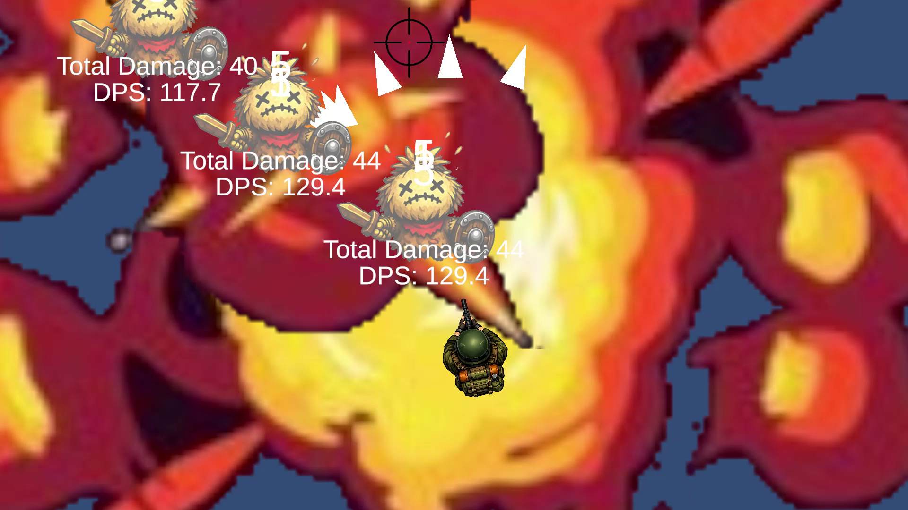
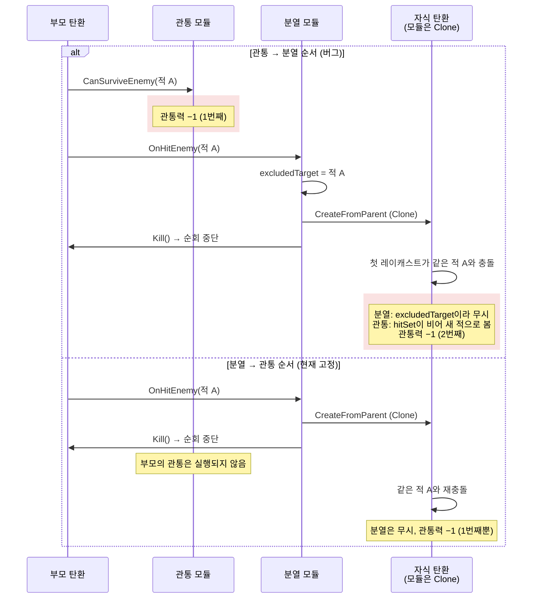
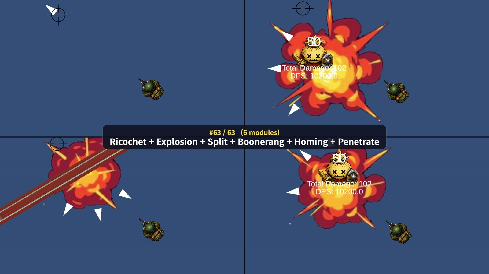

# 총기 모듈 프레임워크 (Bullet Module Framework)

> 탄환에 효과 부품(모듈)을 끼워 총기를 조립하는 Unity 2D 프레임워크
>
> 추적·반사·분열·관통·폭발·부메랑 6종 모듈 중 원하는 모듈과 원하는 수치를 골라 조합하면 새 총기가 된다. 효과마다 탄환을 따로 만들면 조합 63가지를 모두 만들어야 하므로, 효과를 끼우고 빼는 부품으로 나눴다.
>
> - **결과:** 6종 모듈로 나올 수 있는 63가지 조합을 하나도 빼지 않고 검증 코드로 쏘아 영상으로 남겼고, 새 효과는 파일 2개(모듈·데이터)를 더하는 것으로 들어온다
> - **배운 점:** 설계 원칙끼리도 부딪치는 지점이 있고, 여러 게임에서 다시 쓸 코드는 특정 게임의 코드를 몰라야 한다



---

## 1. 프로젝트 소개

### 1.1 프로젝트 개요

**총기 모듈 프레임워크**는 탄환 하나에 여러 효과를 조합해 붙이는 구조다.

| 항목 | 내용 |
|---|---|
| 프로젝트 | 총기 모듈 프레임워크 (Bullet Module Framework) |
| 장르 | Unity 2D 탄환 프레임워크 + 시연용 워크숍·실험실 |
| 팀 구성 | 1명 (개인 프로젝트) |
| 내 담당 | **전체** — 모듈 구조 설계와 프레임워크 구현, 워크숍 UI. 실험실 코드는 Claude의 도움을 받았다(부록 A) |

6종의 모듈을 원하는 수치와 함께 골라 장착하면, 탄환 하나로 유탄 발사기나 추적 미사일 같은 서로 다른 총기가 된다.
모듈끼리 조합하면 어느 모듈에도 따로 작성하지 않은 새 총기가 나오기도 한다. 관통 모듈과 폭발 모듈을 함께 달면 적을 꿰뚫으며 맞을 때마다 터지는 '관통 유탄'이 된다(3.3).

출발점은 **워프레임(Warframe)의 모딩 시스템**이다. 무기에 모드를 끼우고 빼는 것만으로 성질이 바뀌는 구조를 탄환에 적용했다. 다만 바꾸는 대상이 다르다.

| | 워프레임 모딩 시스템 | 이 프로젝트 |
|---|---|---|
| 모드가 바꾸는 것 | 주로 **수치**(데미지, 연사력, 속성 등) | 탄환의 **행동**(경로, 충돌 반응, 생존 여부) |
| 조합의 결과 | 수치가 합산·곱연산됨 | 행동이 동시에 실행되어 상호작용함 (예: 분열한 자식 탄환이 다시 추적) |
| 핵심 과제 | 밸런싱 | 모듈 간 **실행 순서와 상호작용**의 일관성 (4장) |

수치가 아니라 행동을 조합하기 때문에, 이 프로젝트의 어려움은 "모듈을 어떻게 나눌까"(2장)에서 끝나지 않고 "나눈 모듈이 한 탄환에서 함께 돌 때 어떻게 맞물릴까"(3·4장)까지 이어진다.

> **문서 범위** — 게임 전체가 아니라 **탄환과 모듈의 구조**만 다룬다. 실험실의 배치 기능(허수아비·벽)과 워크숍 UI는 모듈을 시연하고 검증하기 위한 도구로, 필요한 만큼만 언급한다.

### 1.2 프로젝트 목표와 핵심 성과

**목표한 경험:** 새 효과(모듈)는 개발자가 코드로 더하고, **기획자는 그 모듈로 원하는 총기를 제작하고 시험할 수 있다.**

프레임워크 자체의 목표는 **"필요할 때마다(유탄 발사기, 추적 미사일 등) 원하는 총기를 조립해 꺼내 쓸 수 있는 재사용 가능한 프레임워크"** 다.
처음 목표는 "누구나 간편하게 쓸 수 있는 종합형 총기 모듈"이었지만, 데미지 처리 로직을 설계하면서 바꿨다. 모듈을 사용하는 개발자가 어떤 데미지 로직을 쓸지 프레임워크는 미리 알 수 없으므로, 데미지 처리까지 대신 "간편하게" 해 줄 방법이 없다고 보았기 때문이다. 이 판단의 한계는 5.3에서 다룬다.

목표와 실제 결과는 다음과 같다. 달성하지 못한 부분도 함께 적는다.

| 목표 | 결과 | 다루는 곳 |
|---|---|---|
| 조합으로 총기를 만든다 | 6종 모듈의 조합 **63가지**를 모두 쏘아 보고 영상으로 남김. 관통 유탄처럼 전용 코드 없이 조합 규칙만으로 새 총기가 나옴 | 3.3, 5.1 |
| 조합별 전용 탄환 클래스를 만들지 않는다 | 탄환은 공통 몸통 `Bullet` 하나, 효과는 모두 모듈로 분리 | 2.2 |
| 새 모듈을 넣어도 기존 코드는 고치지 않는다 | 새 효과는 **파일 2개**(모듈·데이터)로 추가. 단, 프레임워크가 특정 모듈 타입을 아는 예외 1곳이 남음 | 2.4, 4.6 |
| 모듈 간 순서 독립 | 분열 모듈을 **제외하고** 달성. 분열 모듈은 임시 대응으로 순서를 고정 | 4.5~4.7 |
| 재사용 가능한 프레임워크 | 구조는 갖췄지만, 프레임워크가 이 프로젝트의 UI·전투 코드를 직접 아는 결합이 3곳 남음 | 2.5, 3.7, 5.2 |
| 기획자가 원하는 총기를 제작하고 시험한다 | 워크숍·실험실로 직접 시험함. 만든 사람 외의 기획자는 써 보지 않음 | 1.3, 5.1 |

### 1.3 시연 및 조작법

기획자(테스터)는 아래 흐름을 반복하며 모듈 조합을 실험한다. **워크숍**에서 모듈을 장착하고 수치를 확인한 뒤, **실험실**에 허수아비와 벽을 배치하고 직접 쏘아 본다.
이 루프의 목적은 총기를 구상해 실제로 만들기 전에, 모듈 조합의 시너지와 디너지(역시너지, 3.3)가 어떤 결과를 내는지 미리 시뮬레이션하는 것이다.

**영상:** [핵심 루프 (쇼츠)](https://youtube.com/shorts/27kf7JanWME)

| 워크숍 — 모듈 장착·수치 확인 | 실험실 — 허수아비·벽 배치 |
|---|---|
|  |  |

| 입력 | 동작 |
|---|---|
| `WASD` / 방향키 | 이동 |
| 마우스 이동 | 조준 |
| 좌클릭 | 발사 |
| `V` | 연사 모드 토글 (켜면 좌클릭 유지 시 연사) |
| `Tab` (누르는 동안) | 배치 모드 — 메뉴에서 허수아비·벽 선택 |
| 배치 모드 + 좌클릭 | 허수아비 배치 / 벽은 드래그로 길이 지정, 휠로 두께 조절 / 배치물 제거 |

### 1.4 개발 환경 및 프로젝트 정보

| 항목 | 내용 |
|---|---|
| Engine | Unity 6 (6000.3.15f1), URP 2D |
| Language | C# |
| Core | 인터페이스 기반 모듈 설계, ScriptableObject(Unity의 데이터 에셋) 데이터 분리, 오브젝트 풀링(만든 오브젝트를 버리지 않고 재사용), `Physics2D.Raycast`(이동할 방향으로 광선을 쏘아 부딪힐 대상을 미리 검사) 기반 이동 |
| 기간 | 2026.06.24 ~ 2026.07.08 (2주, 개인 프로젝트) |
| AI 활용 | Claude — 인터페이스 학습, 아이디어 브레인스토밍, 실험실 코드. 그 밖의 설계와 결정은 직접 (부록 A) |
| GitHub | https://github.com/parksooha102-ai/3rd-2D-Project-parksooha102-ai |
| 시연 영상 | https://youtu.be/yWw14spoHGo |

---

## 2. 모듈 조립 시스템

**핵심 질문:** 서로 다른 효과를 가진 모듈을 어떻게 독립적인 부품으로 만들고 조합할 수 있는가?

### 2.1 해결하려는 문제

효과마다 전용 탄환을 만드는 방식으로는 조합이 자유로운 총기를 만들 수 없다. "추적하면서 분열하는 탄환"을 쓰려면 그 조합 전용 탄환(`HomingSplitBullet` 같은)을 또 만들어야 한다.
효과가 6종이면 가능한 조합은 **63가지**이고, 효과가 하나 추가될 때마다 약 두 배로 늘어난다. 모든 경우의 수를 클래스로 미리 만들어 두는 것은 현실적으로 불가능하다.

그래서 탄환은 공통 몸통(`Bullet`) 하나로 두고, 효과는 같은 규격(인터페이스)을 따르는 독립된 **부품(모듈)** 으로 분리했다. 조합이 아무리 늘어도 작성할 코드는 모듈 개수만큼만 늘어난다.

### 2.2 모듈 구조 설계

#### 두 가지 원칙

부품을 자유롭게 조합하려면 부품끼리 얽히지 않아야 한다. 그래서 다음 두 원칙을 세웠다.

1. **서로 모른다.** `Bullet`은 모듈 목록만 가지고 있고, 모듈끼리는 서로의 존재를 모른다. 각 모듈은 자기 수치를 데이터 에셋(`XxxModuleData`)에서 읽고, 필요하면 `Bind()`로 `Bullet`을 참조한다.
2. **순서와 무관하다.** 조합이 자유로우려면 "어떤 모듈을 먼저 장착했는가"가 결과를 바꾸면 안 된다. 이 원칙은 분열 모듈에서 지켜지지 않았다(4장).

#### 모듈 구성 — `Bullet`과 부품

아래 그림에서 모듈끼리는 선이 없다. 모든 모듈은 `IBulletModule`을 구현하고 `ModuleInfo`의 수치만 참조한다.



> 다이어그램에는 대표 모듈 4종만 그렸다. 폭발·부메랑 모듈도 같은 방식으로 `IBulletModule`을 구현하고 `ModuleInfo`의 수치를 참조한다.

| 클래스 / 인터페이스 | 역할 |
|---|---|
| `Bullet` | 탄환의 몸통. 이동과 레이캐스트 충돌 감지를 맡고, 보유한 모듈을 차례로 호출한다. 각 모듈의 구체적인 동작은 모른다. 실행 흐름은 3장에서 다룬다. |
| `IBulletModule` | 부품 규격(인터페이스). `HomingModule`, `RicochetModule`, `SplitModule`, `PenetrateModule` 등 개별 효과가 구현한다. 비행 중(`OnUpdate`), 충돌 시(`OnHit...`), 생존 판정(`CanSurvive...`) 지점에 끼어들고, 생명주기를 위한 `ResetState()`·`Clone()`(4.3)을 가진다. |
| `ModuleInfo` (ScriptableObject) | 부품의 수치 데이터. 아래에서 설명한다. |

#### 모듈 규격 — 추상 클래스 vs 인터페이스

공통 규격을 무엇으로 정할지는 이 구조의 첫 결정이었다.

| | [A] 추상 클래스 | [B] 인터페이스 (채택) |
|---|---|---|
| 장점 | 공통 필드·기본 동작을 부모에서 일괄 관리 | 모듈마다 필요한 상태·동작만 보유 |
| 단점 | 모든 모듈이 불필요한 공통 상태까지 상속 | 빈 구현(no-op)을 모듈마다 반복 작성 |

이 프레임워크가 모듈에게 정해 주려는 것은 "무엇으로 이루어졌는가"가 아니라 **"무엇을 할 수 있는가"** 다.
관통처럼 카운터 하나뿐인 모듈과 분열처럼 여러 상태를 가진 모듈이 같은 부모를 상속해 불필요한 상태를 물려받을 이유가 없다. 그래서 상속(is-a) 대신 계약(can-do)인 인터페이스를 택했다.

처음부터 같은 규격의 부품을 조합하는 구조를 목표로 했으므로, 부품에게 요구할 것은 공통의 **행동 규격**뿐이었다. 빈 구현을 반복해 써야 하는 대가는, 모듈이 서로의 상태에 휘둘리지 않고 독립적으로 조합된다는 이점과 맞바꿀 만하다고 보았다.

#### 데이터 분리 — `ModuleInfo`

모듈의 수치(사거리, 튕김 횟수 등)는 로직과 떼어 ScriptableObject인 `ModuleInfo`에 둔다. 모듈마다 `HomingModuleData` 같은 하위 클래스가 이를 상속하고, `CreateModule()`로 로직 인스턴스를 만든다.
로직과 분리되어 있어 코드를 고치지 않고 에디터에서 밸런싱할 수 있다.

### 2.3 모듈 장착과 총기 조립

#### 역할 분담 — 탄환 재사용과 부품 장착

| 클래스 | 역할 |
|---|---|
| `BulletPool` | 탄환 오브젝트를 재사용한다. 풀에서 꺼낼 때 이전 모듈을 비운다. 풀링을 고른 이유는 3.6에서 다룬다. |
| `BulletFactory` | 탄환 조립. 풀에서 탄환을 꺼내 모듈을 붙여 발사하고(`Create`), 분열 시에는 부모 모듈을 복제해 자식 탄환을 만든다(`CreateFromParent`, 4.3). |

#### 조립 순서

프레임워크를 쓰는 쪽이 할 일은 세 가지다. 풀에서 탄환을 꺼내고, 모듈 데이터에서 로직 인스턴스를 만들어 붙이고, 발사한다.

```csharp
// 예시: '추적 + 폭발' 조합으로 추적 로켓을 조립하는 경우
Bullet bullet = bulletPool.Get();                 // 풀에서 꺼낼 때 이전 모듈은 비워진다

foreach (ModuleInfo info in rocketModules)        // 추적, 폭발 모듈 데이터(SO)
{
    IBulletModule module = info.CreateModule();   // 데이터 → 로직 인스턴스 생성
    module.ResetState();                          // 진행 상태 초기화 (4.3)
    bullet.AddModule(module);
}

bullet.Initialize(muzzle.position, aimDirection, damage, speed);
```

이 프로젝트에서는 이 과정을 `BulletFactory.Create()`가 대신한다. 워크숍에서 장착한 목록(`ModuleDataManager.EquippedModules`)을 읽어 위 순서대로 조립하므로, 플레이어 코드는 `BulletFactory.Create(pool, 위치, 방향)` 한 줄만 호출한다.

**영상:** [모듈 시너지 (쇼츠)](https://youtube.com/shorts/a6Bxdq142es)

#### 장착 방식 — 프레임워크의 경계

프레임워크가 정의하는 것은 **"모듈을 장착한 탄환이 어떻게 동작하는가"** 까지다. **"모듈을 언제, 어떻게 장착하는가"** 는 프레임워크 바깥의 일이다. 외부에서 `Bullet.AddModule()`만 호출하면 어떤 방식으로든 붙일 수 있다.

<details>
<summary>장착 방식 그림 보기</summary>



</details>

이 프로젝트는 모듈 조합을 빠르게 바꿔 가며 검증하려고 **워크숍 UI**를 진입로로 썼다. 워크숍 UI는 프레임워크의 일부가 아니라 바깥의 진입로 중 하나다.
다른 게임이라면 파워업 아이템을 먹을 때 모듈을 추가하거나, 모듈이 고정된 총기를 획득하게 하는 식으로 진입로만 바꾸면 된다. 탄환과 모듈의 코드는 그대로다.

### 2.4 새로운 모듈 추가

새 효과를 추가할 때 작성하는 파일은 **두 개**이고, **기존 코드는 고치지 않는다.**

| 단계 | 작업 | 내용 |
|---|---|---|
| 1 | `XxxModule : IBulletModule` 작성 | 효과 로직. 쓰지 않는 훅은 빈 구현으로 둔다 |
| 2 | `XxxModuleData : ModuleInfo` 작성 | 수치 데이터(ScriptableObject)와 `CreateModule()` 구현. `[CreateAssetMenu]`를 붙인다 |
| 3 | 에셋 생성 | 에디터 메뉴에서 `XxxModuleData` 에셋을 만들고 수치를 입력한다 |
| 4 | (이 프로젝트 한정) 워크숍 슬롯 등록 | 워크숍 씬의 슬롯(`ModuleSlotSetting.StartModule`)에 에셋을 연결한다 |

`Bullet`, `BulletFactory`, `ModuleDataManager`는 구체적인 모듈 타입을 모르고 `IBulletModule`과 `ModuleInfo`만 다룬다. 그래서 1~3단계만으로 새 모듈이 기존 모듈과 자유롭게 조합된다. 4단계는 이 프로젝트의 시연용 진입로(2.3)에서 하는 작업이라, 다른 프로젝트에서는 그 프로젝트의 진입로에 맞게 바뀐다.

> **예외:** `Bullet.AddModule()`의 `is SplitModule` 분기 하나는 프레임워크가 특정 모듈 타입을 아는 유일한 지점이다. 관통·분열 조합의 순서 문제에 대한 임시 대응으로, 4.6에서 다룬다.

### 2.5 결과와 한계

**결과**
- 6종 모듈을 하나의 `Bullet`에 자유롭게 조합하는 구조를 완성했다. 조합별 전용 클래스는 없다.
- 새 효과는 파일 2개(모듈·데이터)로 추가된다.
- 모듈 장착 방식을 프레임워크 바깥으로 빼 두어, 진입로만 바꾸면 다르게도 장착할 수 있다.

**한계 — 프레임워크와 워크숍 UI의 결합**

재사용되어야 할 프레임워크가 이 프로젝트의 워크숍 UI를 직접 알고 있는 곳이 두 군데 있다.

- **`BaseModule`** — 탄환의 기본 속성(데미지, 속도)을 워크숍 UI에서 모듈과 똑같이 다루려고, 아무 동작도 없는 `BaseModule`을 모듈로 만들어 넣었다. 데미지와 속도는 어떤 프로젝트든 탄환이라면 항상 갖는 속성이고, 워크숍은 이 프로젝트에만 있는 UI다. 프레임워크를 프로젝트 UI의 편의에 맞춘 설계다.
- **`ModuleInfo`** — 모듈 데이터의 공통 부모 `ModuleInfo`에 `GetEditableFields()`, `SetFieldValue()` 같은 **워크숍 UI 전용 메서드**가 들어 있다. 의존 방향은 "UI가 모듈 데이터를 읽어 가는" 쪽이어야 하는데, 모듈 데이터가 UI의 형식(`ModuleFieldInfo`)에 맞춰 주고 있다. 다른 프로젝트에서 쓰더라도 쓰지 않는 UI 메서드를 모듈마다 구현해야 한다. "UI에 필요한 정보는 데이터가 제공한다"는 발상에서 나온 구조다.

2.3에서 "워크숍은 바깥의 진입로"라고 경계를 그었지만, 실제 코드는 그 경계를 두 군데에서 넘고 있다. 개선 방향은 5.2에서 정리한다.

---

## 3. 탄환 실행 및 충돌 처리 시스템

**핵심 질문:** 조립된 모듈은 탄환의 비행과 충돌 과정에서 어떻게 실행되는가?

**영상:** [모듈 6종의 단독 동작 (쇼츠)](https://youtube.com/shorts/n-dxs-edFsY)

### 3.1 해결하려는 문제

2장에서 조립한 탄환은 모듈 목록을 가진 `Bullet` 하나일 뿐이다. 모듈이 실제 효과가 되려면 탄환이 날아가고 부딪히는 순간마다 누군가 모듈을 불러 주고, 모듈마다 다른 판정을 "계속 날아갈 것인가, 소멸할 것인가"라는 하나의 결과로 묶어야 한다. 이 시스템이 그 일을 맡는다.
기획자가 실험실에서 확인하는 시너지와 디너지(1.3)도 여기서 정해진다. 같은 모듈 조합이라도 실행 규칙에 따라 더 강한 총기가 되기도, 오히려 약한 총기가 되기도 한다(3.3).

### 3.2 탄환의 실행 흐름

물리 프레임(`FixedUpdate`)마다 `Bullet`은 다음 순서로 동작한다.

1. 보유한 모든 모듈의 `OnUpdate()`를 순서대로 호출한다.
2. 레이캐스트로 이동하며 충돌을 감지한다(3.6).
3. 적과 충돌했다면, 이미 통과 중인 적인지 피격 기록(`hitSet`)으로 확인하고 처리한 적이면 건너뛴다(3.4).
4. 충돌 대상(적/벽)에 따라 `OnHitEnemy()` 또는 `OnHitWall()`을 모듈 순서대로 호출한다. 도중에 어떤 모듈이 탄환을 소멸시키면(분열) 그 자리에서 멈춘다(4.5).
5. 적이라면 이 프로젝트의 전투 시스템(`CombatSystem`)에 데미지 이벤트를 전달한다. 이 연결 방식의 한계는 3.7에서 다룬다.
6. 모듈 중 하나라도 `CanSurviveEnemy()`/`CanSurviveWall()`이 `true`를 반환하면, 탄환은 소멸하지 않고 비행을 계속한다(3.3).

<details>
<summary>탄환 실행 흐름 시퀀스 보기</summary>



</details>

모듈은 이 흐름의 서로 다른 지점(훅)에 끼어든다. 이 장에서는 관통·추적 모듈로 생존 판정과 비행 중 훅을, 4장에서는 분열 모듈로 충돌 훅을 설명한다.

| 모듈 | 사용하는 훅 | 진행 상태 | 한 줄 요약 | 다루는 곳 |
|---|---|---|---|---|
| 관통 | `CanSurviveEnemy` | 남은 관통 횟수 | 생존 여부만 바꾼다 | 3.3, 3.4 |
| 추적 | `OnUpdate` | 없음 | 비행 중 방향만 바꾼다 | 3.5 |
| 분열 | `OnHitEnemy` / `OnHitWall` | 세대 수, 처리한 대상 | 충돌 시 새 탄환을 만든다 | 4장 |

세 모듈의 동작은 모두 실험실(1.3)에서 허수아비에 쏘아 확인한다.

### 3.3 충돌 효과와 생존 판정의 분리

#### 관통 모듈



```csharp
// PenetrateModule.CanSurviveEnemy
public bool CanSurviveEnemy(RaycastHit2D hit)
{
    if (currentPenetrateCount <= 0)
        return false;

    currentPenetrateCount--;
    return true;
}
```

관통 모듈의 상태는 카운터(`currentPenetrateCount`) 하나뿐이다. 새로운 적과 충돌할 때마다 남은 관통 횟수를 확인해, 남아 있으면 1 차감하고 생존을, 없으면 소멸을 허용한다. `OnHitEnemy()`/`OnHitWall()`은 빈 구현이라 생존 판정 외의 부수 효과가 없다.
관통은 "몇 번 뚫고 지나갈 수 있는가"만 정하면 되는 효과라, 어떤 대상을 맞았는지 구분해 기억할 필요가 없다. 이 성질은 4장의 순서 문제에서 다시 중요해진다.

그러나 처음부터 이렇게 "생존 판정"만 하는 모듈을 만들 수 있었던 것은 아니다.

#### 적 앞에서 멈추던 관통 탄환

**문제:** 관통 횟수가 남아 있는데도 탄환이 충돌한 자리에 그대로 멈췄다.

**원인:** 초기 `MoveBullet()`은 충돌을 감지하면 `ProcessHit(hit)`을 호출하고 곧바로 반환했다.

```csharp
// Bullet.MoveBullet() — 초기 구조 (발췌)
if (hit.collider != null && hit.collider.gameObject.CompareTag(allyTag) == false)
{
    ProcessHit(hit);
    return;
}
```

"충돌 시 실행할 효과"와 "충돌 후 생존 여부"가 나뉘어 있지 않아, 살아남은 탄환이 더 이상 이동하지 않았다.

**해결:** 효과 실행(`OnHit...`)과 생존 판정(`CanSurvive...`)을 별개 메서드로 분리하는 현재 구조로 리팩터링했다.

**결과:** 관통 횟수가 남은 탄환은 적을 뚫고 계속 날아갔다. 다만 같은 적에 연속으로 꽂히는 새 문제가 드러났다(3.4).

#### 생존 판정 — AND vs OR

생존 판정을 따로 떼자 새 질문이 생겼다. 모듈마다 생존 판정이 다를 때, 탄환은 언제 살아남는가?

| | [A] AND (모든 모듈이 true여야 생존) | [B] OR (하나라도 true면 생존, 채택) |
|---|---|---|
| 관통 + 반사 조합 시 | 반사 단독이면 벽에서 튕기는데, 관통(`CanSurviveWall=false`)을 함께 달면 벽에서 소멸 | 반사 판정이 반영되어 튕김 |

AND 방식에서는 모듈을 더 달수록 오히려 약해지는 디너지가 생긴다. "모듈을 조합할수록 총기가 강해져야 한다"는 목표와 정면으로 충돌하므로, 하나라도 생존을 주장하면 살아남는 OR 방식을 택했다.

OR 방식은 디너지를 막는 데 그치지 않고, **조합만으로 새 총기가 나오게** 한다. 폭발 모듈은 혼자서는 맞는 즉시 소멸하는 유탄(`CanSurvive = false`)이다. 하지만 관통 모듈과 함께 달면 관통 판정이 생존을 주장해 **적을 꿰뚫으며 맞을 때마다 터지는 '관통 유탄'** 이 된다. 두 모듈 어디에도 "관통 유탄" 코드는 없다. "조합으로 총기를 만든다"는 목표가 의도대로 동작한 사례다(문서 맨 위 그림).

**영상:** [생존 판정 — OR vs AND (쇼츠)](https://youtube.com/shorts/NfJHmQRBRmY)

### 3.4 중복 피격 방지와 관통 처리

**문제:** 멈춤 문제를 고친 뒤, 이번에는 관통 3회짜리 탄환이 적 하나에 '따다닥' 세 번 꽂히고 사라졌다. 관통탄이 아니라 사실상 3연타 탄환이 된 것이다.

**원인:** 탄환이 적의 몸을 통과하는 데는 여러 물리 프레임이 걸린다. 살아남은 탄환의 다음 프레임 레이캐스트가 아직 몸 안에 있는 같은 적을 다시 맞혔고, 그때마다 데미지와 관통 횟수 차감이 반복되었다.

**해결:** `Bullet`에 **현재 통과 중인 적을 기억하는 `hitSet`(`HashSet<Collider2D>`)** 을 두었다.
- 적과 충돌하면 `hitSet`에 등록하고, 이미 등록된 적이면 모듈 호출과 데미지를 모두 건너뛴다.
- 레이캐스트에 아무것도 맞지 않는 프레임, 즉 적을 완전히 빠져나온 시점에 비운다.
- 벽은 등록하지 않는다. 반사 모듈은 같은 벽에 여러 번 튕길 수 있어야 하기 때문이다.

**결과:** 3.3의 그림처럼 관통 3회 탄환이 적 3명을 꿰뚫고 4번째 적까지, 모두 4명을 맞힌다.

`hitSet`을 관통 모듈이 아니라 `Bullet`에 둔 것은, **"같은 적을 한 번만 맞힌다"는 규칙이 어떤 모듈을 달았든 모든 탄환에 공통**이기 때문이다. 이 기록은 탄환 하나의 것이다. 분열로 생긴 자식 탄환은 모듈만 복제해 받고(`BulletFactory.CreateFromParent()`), `hitSet`은 `Initialize()`에서 비운 채로 시작한다. 이 점이 4.5의 문제와 연결된다.

### 3.5 추적 모듈

관통이 생존 판정 훅만 쓰는 모듈이라면, 추적은 비행 중 훅(`OnUpdate`)만 쓰는 모듈이다.

```csharp
// HomingModule (발췌)
public void OnUpdate() => UpdateTracking();   // 충돌 훅은 모두 빈 구현

private void UpdateTracking()
{
    Collider2D[] hits = Physics2D.OverlapCircleAll(bullet.transform.position, trackingRange);
    GameObject target = null;
    float nearestSqr = trackingRange * trackingRange;

    foreach (Collider2D hit in hits)
    {
        if (!hit.CompareTag(bullet.OpponentTag)) continue;                    // 적만
        Vector3 dir = hit.transform.position - bullet.transform.position;
        if (dir.sqrMagnitude >= nearestSqr) continue;                         // 더 가까운 적만
        if (Vector3.Angle(bullet.transform.up, dir) > trackingAngle) continue; // 시야각 안의 적만
        if (Physics2D.Linecast(bullet.transform.position,
                               hit.transform.position, bullet.WallLayer)) continue; // 벽 너머 제외

        nearestSqr = dir.sqrMagnitude;
        target = hit.gameObject;
    }

    if (target != null)
    {
        Vector3 targetDir = (target.transform.position - bullet.transform.position).normalized;
        bullet.transform.up = Vector3.RotateTowards(
            bullet.transform.up, targetDir, trackingSpeed * Time.deltaTime, 0f);
    }
}
```

**동작:** 물리 프레임마다 반경 `trackingRange` 안의 적을 네 가지 조건으로 걸러 가장 가까운 대상을 고른다.
- 적 태그(`OpponentTag`)를 가졌는가
- 지금까지 찾은 대상보다 가까운가
- 시야각 `trackingAngle` 안에 있는가
- 벽에 가려지지 않았는가

그런 다음 탄환의 진행 방향(`transform.up`)을 대상 쪽으로 초당 최대 `trackingSpeed` 라디안만큼 돌린다.

**설계 의도:**
- **위치가 아니라 방향만 바꾼다.** 실제 이동은 `Bullet.MoveBullet()`이 `transform.up` 방향으로 처리한다. 그래서 추적 모듈은 이동 방식을 몰라도 되고, 반사 모듈이 방향을 꺾은 뒤에도 그 방향에서 이어서 추적할 수 있다.
- **즉시 꺾지 않고 서서히 돈다** (`RotateTowards`). 탄도가 곡선을 그려 유도탄처럼 보이고, 회전 속도를 데이터로 조절할 수 있다.
- **시야각과 벽 검사로 대상을 제한한다.** 지나친 적을 향해 U턴하거나, 벽 너머의 적에게 끌려가 벽에 박히는 것을 막는다.
- **진행 상태가 없다.** 대상을 매 프레임 새로 찾으므로 기억할 것이 없다. 그래서 `ResetState()`는 빈 구현이고 `Clone()`도 새로 만드는 것과 같다. 분열한 자식 탄환도 각자 자기 위치에서 대상을 다시 찾는다.

### 3.6 탄환 이동과 생성 방식

모듈이 끼어드는 흐름 아래에는 탄환을 실제로 움직이고, 만들고, 없애는 바탕이 있다. 두 가지를 직접 처리하는 쪽으로 정했다.

#### 이동 — `Rigidbody2D` vs `Physics2D.Raycast` 직접 처리

`Rigidbody2D`로 이동시켰을 때 두 가지 문제를 실제로 겪었다.

1. 고속 탄환이 얇은 벽을 그대로 통과하는 터널링 현상
2. 플레이어의 `Rigidbody2D`를 Dynamic으로 두었을 때, 발사한 탄환과 부딪혀 플레이어가 밀리는 현상

두 문제를 원천적으로 피하려고 물리 엔진에 이동을 맡기지 않았다. 매 프레임 이동할 거리만큼 레이캐스트로 앞을 미리 검사한 뒤 위치를 직접 갱신한다. 3.2의 "레이캐스트로 이동하며 충돌을 감지한다"가 이 방식이다.

#### 생성 — `Instantiate/Destroy` vs 오브젝트 풀링

| | [A] `Instantiate` / `Destroy` | [B] 오브젝트 풀링 (채택) |
|---|---|---|
| 장점 | 구현이 단순하고, 생성할 때마다 상태가 깨끗함 | 생성·파괴 비용과 가비지가 발생하지 않음 |
| 단점 | 생성·파괴가 잦으면 GC 스파이크(버려진 메모리를 한꺼번에 치우느라 생기는 순간 끊김) 발생 | 꺼내 쓸 때 **이전 상태를 직접 초기화**해야 함 |

이 프레임워크는 조합에 따라 탄환 수가 급격히 늘어난다. 분열 모듈은 세대마다 탄환을 `splitAmount`배로 늘리고(기본값 3발 × 3세대면 탄환 하나가 최대 27발), 폭발 모듈은 맞을 때마다 이펙트를 만든다. 실제로 `Instantiate/Destroy` 방식에서 연사와 분열을 함께 쓰자 GC 스파이크가 눈에 띄게 발생했다. 그래서 탄환(`BulletPool`)과 폭발 이펙트(`ExplosionPool`) 모두 제네릭 풀(`ComponentPool<T>`)로 재사용하도록 바꿨다.

대가인 '상태 초기화 책임'은 두 단계로 처리한다. 풀에서 꺼낼 때 `ClearModules()`로 이전 모듈을 비우고, `Initialize()`에서 위치·데미지·피격 기록(`hitSet`)을 다시 설정한다.

> 풀링 도입 전후의 가비지 수치는 측정 기록을 남겨 두지 않아, 개선 정도를 수치로 말할 수 없다(5.3).

### 3.7 결과와 한계

**결과**
- 탄환이 모듈 목록을 차례로 호출하는 실행 흐름과, 레이캐스트 기반 이동·충돌 처리를 완성했다.
- 효과 실행과 생존 판정을 나누고 OR로 묶어, 조합할수록 강해지고 조합만으로 새 총기(관통 유탄)가 나오게 했다.
- 관통은 `hitSet`으로 적 하나를 한 번만 세고, 추적은 이동 방식과 독립적으로 방향만 바꾼다.

**한계 — 프레임워크와 전투 시스템의 결합**

전투 시스템(`CombatSystem`)은 관찰자 패턴(`ICombatObserver`)으로 만들어, 데미지를 **받는 쪽**(피격 대상, 데미지 팝업 등)은 탄환을 모르도록 분리했다. 그러나 **보내는 쪽**인 `Bullet.ApplyDamageTo()`는 `CombatSystem.Instance`, `HurtBox`, `CombatEvent` 등 이 프로젝트의 전투 클래스를 이름으로 직접 부른다.
이벤트를 쓰더라도 보내는 쪽이 받는 쪽의 이름을 알면 의존은 사라지지 않는다. 탄환을 다른 프로젝트로 옮기면 이 전투 시스템까지 함께 옮겨야 한다.

**한계 — 추적 모듈의 매 프레임 메모리 할당**

`HomingModule`은 물리 프레임마다 `Physics2D.OverlapCircleAll()`로 콜라이더 배열을 **새로 할당**한다. 탄환 하나일 때는 부담이 작지만, 분열과 조합하면 탄환 수만큼 할당이 곱해져 풀링(3.6)으로 줄인 가비지를 다시 만들어 낸다.

두 한계의 개선 방향은 5.2에서 정리한다.

---

## 4. 모듈 간 상호작용과 분열 시스템

**핵심 질문:** 독립적인 모듈이 함께 실행될 때, 각 모듈의 상태와 처리 결과를 어떻게 일관되게 유지할 것인가?

### 4.1 해결하려는 문제

이 프로젝트의 조합은 수치를 더하는 것이 아니라, 여러 모듈의 행동이 동시에 실행되어 상호작용하는 것이다(1.1). 그 상호작용이 가장 크게 일어나는 곳이 분열이다. 분열한 자식 탄환은 부모의 모듈을 모두 이어받으므로, 추적·폭발·관통 같은 다른 모듈이 자식 탄환 수만큼 다시 동작한다. 가장 화려했던 조합(분열 + 폭발 + 관통 + 추적, 5.1)도 분열이 폭발을 복사해 만든 결과다.
그래서 분열을 조합에 넣으려면, 부모와 자식에 걸쳐 각 모듈의 상태와 처리 결과를 일관되게 유지하는 시스템이 필요하다.

3장의 관통·추적은 자기 탄환 안에서만 일하는 모듈이었다. 분열 모듈은 충돌할 때 **새 탄환을 만든다.** 그래서 "자식에게 무엇을 물려줄 것인가", "부모와 자식이 같은 적을 어떻게 셀 것인가"라는, 탄환 하나로는 생기지 않던 문제가 나타났다.

### 4.2 분열 모듈의 동작

```csharp
// SplitModule.ProcessSplit (발췌·요약)
private void ProcessSplit(RaycastHit2D hit)
{
    if (hit.collider == excludedTarget) return;
    if (currentGeneration >= maxGeneration) return;

    excludedTarget = hit.collider;
    currentGeneration++;

    // 각도 계산 후 splitAmount 개수만큼 자식 Bullet 생성
    bullet.Kill();
}
```

분열 모듈은 충돌 훅(`OnHitEnemy`/`OnHitWall`)에서 동작한다. 적중하면 원본 탄환을 소멸시키고 자식 탄환 여러 발을 만든다. 두 가지 진행 상태로 분열을 제한한다.

- **세대 수(`currentGeneration`)** — 몇 번째 분열인지 센다. `maxGeneration`에 닿으면 더 분열하지 않는다.
- **처리한 대상(`excludedTarget`)** — "이 대상에는 이미 분열했다"는 사실을 기록한다. 기록하지 않으면 자식 탄환이 같은 대상과 다시 부딪힐 때마다 무한히 재분열한다.

**관통과의 구조적 차이:** 관통은 대상을 구분할 필요가 없지만(3.3), 분열은 반드시 구분해야 한다. 이 비대칭이 4.5에서 다룰 순서 의존성 문제의 근본 원인이다.

### 4.3 자식 탄환의 상태 계승

#### 설정값과 진행 상태

모듈이 가진 값은 두 종류다.

| 종류 | 예시 | 설정 시점 |
|---|---|---|
| **설정값** (데이터에서 읽음) | `maxPenetrateLimit`, `maxGeneration` | 생성자 |
| **진행 상태** (비행 중 변함) | `currentPenetrateCount`, `currentGeneration`, `excludedTarget` | `ResetState()` 또는 `Clone()` |

탄환이 만들어지는 경로는 두 가지이고, 경로마다 진행 상태를 다루는 방식이 다르다.

- **`ResetState()`** — 진행 상태를 초기값으로 채운다. 관통 모듈이라면 남은 관통 횟수를 최대값으로 되돌린다. 2.3의 조립 순서에서 부르는 함수다.
- **`Clone()`** — 부모 모듈의 진행 상태까지 복사한 새 인스턴스를 만든다(프로토타입 방식).

<details>
<summary>자식 탄환이 폭발을 이어받는 장면 보기</summary>



</details>

#### 자식 모듈 생성 — `Clone()` vs `CreateModule()`

자식 탄환은 **자신이 몇 세대인지** 알아야 분열을 멈출 수 있다. 자식에게도 플레이어 발사와 똑같이 데이터로 새 모듈을 만들어 붙이면 세대 수가 0으로 초기화되어 무한 분열이 일어난다.
데이터로 새로 만드는 방식(`CreateModule()`)은 "어떤 설정인가"는 전달하지만 "지금 어디까지 진행됐는가"는 전달하지 못한다. 그래서 부모의 상태를 그대로 복사하는 `Clone()`을 인터페이스에 두었다.

`Clone()`은 **대안을 비교하지 않고**, "자식이니까 부모 상태를 복사하면 된다"는 판단만으로 고른 방식이다. 뒤늦게 대안과 비교하면 다음과 같다.

| | [A] `Clone()` — 모듈이 자신을 복제 (채택) | [B] `CreateModule()`로 새로 생성 + 상태를 외부에서 전달 |
|---|---|---|
| 방식 | 각 모듈이 "무엇을 물려줄지" 스스로 정해 복사본을 만든다 | `CreateModule()`로 새로 만든 뒤, `BulletFactory`가 세대 수 등을 넣어 준다 |
| 장점 | `Bullet`·`BulletFactory`가 모듈 내부 상태를 몰라도 된다 | 무엇이 계승되는지 한곳에서 명시적으로 보인다 |
| 단점 | 모든 모듈이 `Clone()`을 빠짐없이 올바르게 구현해야 한다 | 팩토리가 "분열 모듈에는 세대 수가 있다"는 것을 알아야 한다 → **"프레임워크는 구체 모듈을 모른다"는 원칙 위반** |

[B]는 계승할 상태를 가진 모듈이 생길 때마다 팩토리를 고쳐야 하므로, "새 효과를 넣어도 기존 코드는 고치지 않는다"(2.4)는 원칙과 충돌한다. 결과적으로 `Clone()`은 이 프레임워크의 원칙에 맞는 선택이었다.

#### 남은 한계 — 계승할 상태를 구분하지 못함

위 결론은 **사후에** 얻은 것이다. 대안을 따져 보지 않았기 때문에, 관통 횟수처럼 **의도해서 물려주는 상태**와 계승하면 안 되는 상태를 설계 단계에서 구분해 두지 못했다. 모든 모듈이 `Clone()`에서 무엇을 복사할지 각자 판단하므로, 새 모듈이 추가될 때 이 구분이 어긋날 위험이 남아 있다.

### 4.4 분열 과정에서 발생한 문제

**문제:** `Bullet`의 책임을 나누는 리팩터링 중에 분열 모듈의 무한 분열 버그가 다시 나타났다.

**원인:** 리팩터링 전에는 분열을 일으킨 대상을 `Bullet`이 기억하고 있었다. 이는 "탄환은 모듈의 사정을 몰라야 한다"는 원칙에 어긋나는 구조였고, 책임을 정리하면서 이 기억이 함께 지워졌다.

**해결:** 처리한 대상을 `SplitModule` 내부의 `excludedTarget`이 직접 관리하도록 옮겼다.

**결과:** 분열이 정해진 세대에서 멈추고, 이후 리팩터링에서도 다시 생기지 않았다.

#### `hitSet`과 `excludedTarget` — 누가 무엇을 기억하는가

분열 대상은 `Bullet`에서 빼낸 반면, 관통 문제를 풀며 만든 `hitSet`(3.4)은 `Bullet`에 두었다. 기준은 규칙이 누구의 것인가다.

| 기록 | 위치 | 기억하는 것 | 범위 |
|---|---|---|---|
| `hitSet` | `Bullet` | 지금 통과 중인 적 | 탄환 공통 규칙 — 어떤 모듈을 달았든 같은 적은 한 번만 맞힌다 |
| `excludedTarget` | `SplitModule` | 이미 분열을 일으킨 대상 | 분열 모듈만의 규칙 — 자식에게 `Clone()`으로 이어진다 |

특정 모듈만의 규칙은 모듈이, 탄환 공통의 규칙은 탄환이 갖는다. 책임 구분으로는 맞는 정리였지만, 그 결과 **"이 적은 이미 처리했다"는 기록이 두 곳에 나뉘었다.** 이것이 다음 문제의 무대가 된다.

### 4.5 관통 + 분열 조합의 순서 의존성

**영상:** [관통 + 분열 조합 (쇼츠)](https://youtube.com/shorts/Rn8FuRFmR1Y)

순서 독립성은 처음부터 의도한 설계였다(2.2). 그런데 관통 + 분열 조합에서 `SplitModule`이 목록 뒤에 있으면 적 하나에 관통력이 두 번 차감되었다. 이 버그는 63가지 조합을 손으로 하나씩 조립해 시험하는 과정에서 찾아냈다(5.1).

**순서에 따라 결과가 달라지는 이유**

`Bullet.ProcessHit()`은 모듈을 하나씩 호출하다가 탄환이 비활성화되면 그 자리에서 멈춘다. 그래서 분열 모듈이 언제 `Kill()`을 부르느냐에 따라, 부모 탄환에서 관통 모듈이 실행될 기회가 생기기도 하고 사라지기도 한다.



| 장착 순서 | 부모 탄환 | 자식 탄환 (같은 적과 재충돌) | 관통력 차감 |
|---|---|---|---|
| 관통 → 분열 | 관통 실행(−1) → 분열이 `Kill()` | 분열은 무시, 관통 실행(−1) | **2회** (버그) |
| 분열 → 관통 | 분열이 `Kill()` → 루프 중단, 관통 미실행 | 분열은 무시, 관통 실행(−1) | **1회** (의도대로) |

**문제** (관통 → 분열 순서일 때)

1. 부모 탄환이 적과 충돌하면 관통 모듈이 먼저 실행되어 관통력이 1 줄고, 탄환은 생존한다.
2. 이어서 분열 모듈이 같은 적에 대해 자식 탄환을 만들고 부모를 소멸시킨다.
3. 부모 탄환은 충돌하면 충돌 지점에서 표면 바깥쪽으로 0.01만큼 떨어진 곳에 놓인다(패딩, `hit.point + hit.normal * 0.01f`). 자식 탄환은 그 자리에서 생성되므로, 첫 레이캐스트가 바로 앞의 같은 적과 다시 충돌한다.
4. 부모의 분열 모듈은 자식을 만들기 **전에** `excludedTarget`에 이 적을 기록하고, 자식의 분열 모듈은 `Clone()`으로 그 기록을 이어받는다. 그래서 자식의 분열 모듈은 이미 처리한 적임을 알고 무시한다. 하지만 관통 모듈은 이 정보를 모르고, 자식의 `hitSet`은 `Initialize()`에서 비운 채로 시작했으므로, 같은 적을 새 적으로 보고 `CanSurviveEnemy()`를 다시 실행한다. 자식의 관통 모듈은 부모가 이미 1 줄인 횟수를 `Clone()`으로 이어받은 상태다.
5. 결과적으로 적 하나에 관통력이 두 번 차감된다.

**원인**

분열 모듈만 자신이 분열시킨 대상을 알고, 나머지 모듈은 그 사실을 모른다. "모듈은 서로를 몰라야 한다"는 원칙과 "대상을 기억해야 하는 모듈(분열)과 그럴 필요가 없는 모듈(관통)이 공존한다"는 사실이 구조적으로 충돌한 것이다.
패딩은 문제가 드러나는 시점을 정하는 트리거일 뿐 근본 원인이 아니다. 관통 모듈이 있으면 콜라이더 안에 머무는 구간은 패딩과 무관하게 원래 존재한다.

### 4.6 해결 시도와 임시 대응

**해결 시도 — 부모가 맞힌 적을 자식에게 넘기기**

자식 탄환을 만들 때 부모가 맞힌 적을 자식의 `hitSet`에 미리 넣어 주었다(`subBullet.AddHitSet(hit.collider)`). 자식이 그 적을 건너뛰므로 이중 차감은 사라졌다.

**부작용 — 분열을 일으킨 적이 데미지를 받지 못함**

부모는 분열 모듈의 `Kill()`로 **데미지 처리 전에 소멸**하고, 자식은 그 적을 건너뛴다. 결국 **분열을 일으킨 적이 데미지를 전혀 받지 못하는** 새 문제가 생겼다. 피격 기록을 조작하면 데미지 적용 시점이라는 다른 규칙이 깨진다는 것을 확인했고, 이 코드는 주석 처리해 되돌렸다.

**최종 대응(임시) — 분열 모듈을 맨 앞에 고정**

프로젝트 기한이 다가와, `Bullet.AddModule()`에서 `SplitModule`을 항상 목록 맨 앞에 넣어 4.5 표의 두 번째 행으로 순서를 고정했다.
이 대응으로 버그는 나타나지 않지만, 대가가 있다. **프레임워크가 특정 모듈 타입(`is SplitModule`)을 직접 아는 유일한 코드**가 생겼고, 2.4에서 말한 "구체 모듈을 모른다"는 원칙의 예외가 되었다. 문제의 원인을 없앤 것이 아니라, 문제가 드러나지 않는 순서로 묶어 둔 것이다.

| 단계 | 내용 |
|---|---|
| 문제 | 관통 → 분열 순서일 때 적 하나에 관통력 2회 차감 |
| 원인 | 처리 기록이 `excludedTarget`과 `hitSet`으로 나뉨 + 호출 도중의 `Kill()` (4.5) |
| 해결 시도 | 자식 `hitSet`에 부모가 맞힌 적을 미리 등록 |
| 부작용 | 분열을 일으킨 적이 데미지를 받지 못함 → 되돌림 |
| 최종 대응 | `SplitModule`을 목록 맨 앞에 고정 (임시 대응) |
| 한계 | 순서 독립 원칙의 예외 1곳, 프레임워크가 구체 모듈 타입을 아는 코드 1곳이 남음 |

### 4.7 근본 개선 방향

> 이 절의 내용은 **아직 구현하지 않은 개선안**이다. 현재 코드는 4.6의 임시 대응 상태다.

4.5에서 상술한 두 원인(호출 도중의 `Kill()`, 나뉜 처리 기록)은 모두 탄환 처리 흐름 자체를 바꾸는 대규모 리팩터링이 필요하다.

| | As-Is (현재 구현) | To-Be (개선안) |
|---|---|---|
| 충돌 처리 | 모듈을 호출하는 **도중에** 효과가 즉시 실행됨 (분열 모듈이 루프 안에서 `Kill()`) | **2단계 처리:** ① 모든 모듈에게 "무엇을 할지"(생존 주장, 자식 생성 요청 등)를 먼저 묻고 ② `Bullet`이 결과를 모아 한 번에 실행 → 모든 모듈이 항상 실행되므로 순서와 무관 |
| 피격 기록 | 탄환마다 `hitSet`, 분열 모듈은 별도로 `excludedTarget` | 부모와 자식이 **복사가 아닌 참조로 공유하는** 계보 단위 기록(`HitContext`) 하나로 통합 → 같은 적은 계보 전체에서 한 번만 처리 |
| 분열 모듈 특수 처리 | `AddModule()`의 `is SplitModule` 분기 | 불필요 → 프레임워크가 구체 모듈 타입을 아는 코드 0곳 |

2단계 처리는 되돌린 해결책의 문제(데미지 적용 시점)도 함께 푼다. 소멸 여부를 결과를 모은 뒤에 정하므로, 분열하는 탄환도 데미지를 먼저 적용하고 소멸할 수 있다.

### 4.8 결과와 한계

**결과**
- 분열 모듈과, `Clone()`을 통한 자식 탄환의 상태 계승(세대 수·처리한 대상)을 구현했다.
- 모듈 고유 상태와 탄환 공통 상태의 책임을 나누어, 리팩터링 중 생긴 무한 분열을 다시 생기지 않게 정리했다.

**한계** (개선 방향은 5.2)
- **순서 독립성을 완전히 달성하지 못했다.** 관통 + 분열 조합에서 "모듈은 서로 모른다"와 "순서와 무관하다"는 두 원칙이 함께 지켜지지 않는 지점을 발견했고, 현재는 분열 모듈을 맨 앞에 고정하는 임시 대응 상태다. 근본 해결은 충돌 처리 흐름과 피격 기록 구조를 바꿔야 한다(4.7).
- **`Clone()`에서 계승할 상태를 구분하는 기준이 없다**(4.3).
- **`ResetState()`가 원래 역할을 잃었다.** 초기 구조에서는 풀에서 꺼낸 탄환이 **이전 모듈 인스턴스를 그대로 재사용**했기 때문에, 남은 횟수 등을 되돌리는 초기화 함수가 필수였다. 이후 `BulletFactory` 리팩터링으로 발사할 때마다 모듈을 새로 만들게 되면서 원래 목적은 사라졌다. 그런데 관통·반사 모듈은 생성자에서 진행 상태를 채우지 않아서, 지금도 `ResetState()`를 부르지 않으면 횟수가 0으로 시작한다. 이유는 사라졌는데 함수에 기대는 코드만 남았다.

---

## 5. 통합 검증과 프로젝트 회고

**핵심 질문:** 모듈 조합이 실제로 어디까지 동작했으며, 구현 과정에서 무엇을 배웠는가?

### 5.1 63가지 조합 검증

목표한 경험은 "기획자가 모듈로 원하는 총기를 제작하고 시험한다"였다(1.2). 워크숍에서 조합하고 실험실에서 쏘아 보는 루프(1.3)로 직접 시험했고, 가장 화려했던 조합은 **분열 + 폭발 + 관통 + 추적**(아래 목록 #54)이었다. 분열한 자식 탄환이 폭발 모듈까지 이어받아, 탄환이 늘어나는 만큼 폭발도 늘어난다. 관통 유탄(3.3)처럼 전용 코드 없이 조합만으로 새 총기가 나오는 것도 확인했다. 다만 시험한 사람은 만든 사람 한 명뿐이라, 다른 기획자에게도 같은 경험이 되는지는 확인하지 못했다.

6종 모듈의 가능한 모든 조합 63가지를 검증 코드로 하나씩 장착해 쏘고, 그 결과를 영상 하나로 남겼다. 검증 코드는 장착 수가 적은 조합부터 차례로 모듈을 장착하고, 한 발을 쏜 뒤 탄환과 폭발이 모두 사라지면 다음 조합으로 넘어간다. 같은 63가지를 네 가지 상황에서 촬영해 한 화면에 나눠 보여 준다. 네 상황은 모듈마다 제 역할이 드러나는 상황을 단순화한 것이다.

**영상:** [63가지 조합 검증 (전체)](https://www.youtube.com/watch?v=Ma5M-mut3yk)

| 화면 위치 | 상황 | 드러나는 모듈 |
|---|---|---|
| 왼쪽 위 | 표적 없음 | 부메랑 |
| 오른쪽 위 | 총알 궤적에서 벗어난 허수아비 | 추적 |
| 왼쪽 아래 | 벽 | 반사 |
| 오른쪽 아래 | 총알 궤적 안의 허수아비 | 통상적인 명중 |

| 장착 수 | 조합 수 | 영상 시작 시각 |
|---|---|---|
| 1개 | 6 | [0:00](https://www.youtube.com/watch?v=Ma5M-mut3yk&t=0s) |
| 2개 | 15 | [0:20](https://www.youtube.com/watch?v=Ma5M-mut3yk&t=20s) |
| 3개 | 20 | [1:12](https://www.youtube.com/watch?v=Ma5M-mut3yk&t=72s) |
| 4개 | 15 | [2:25](https://www.youtube.com/watch?v=Ma5M-mut3yk&t=145s) |
| 5개 | 6 | [3:22](https://www.youtube.com/watch?v=Ma5M-mut3yk&t=202s) |
| 6개 | 1 | [3:45](https://www.youtube.com/watch?v=Ma5M-mut3yk&t=225s) |
| **합계** | **63** | 전체 3:49 |

<details>
<summary>63가지 조합 전체 목록 (검증 영상 시각)</summary>

| # | 장착 수 | 조합 | 영상 시각 |
|---|---|---|---|
| 1 | 1 | 반사 | [0:00](https://www.youtube.com/watch?v=Ma5M-mut3yk&t=0s) |
| 2 | 1 | 폭발 | [0:03](https://www.youtube.com/watch?v=Ma5M-mut3yk&t=3s) |
| 3 | 1 | 분열 | [0:06](https://www.youtube.com/watch?v=Ma5M-mut3yk&t=6s) |
| 4 | 1 | 부메랑 | [0:10](https://www.youtube.com/watch?v=Ma5M-mut3yk&t=10s) |
| 5 | 1 | 추적 | [0:13](https://www.youtube.com/watch?v=Ma5M-mut3yk&t=13s) |
| 6 | 1 | 관통 | [0:16](https://www.youtube.com/watch?v=Ma5M-mut3yk&t=16s) |
| 7 | 2 | 반사 + 폭발 | [0:20](https://www.youtube.com/watch?v=Ma5M-mut3yk&t=20s) |
| 8 | 2 | 반사 + 분열 | [0:23](https://www.youtube.com/watch?v=Ma5M-mut3yk&t=23s) |
| 9 | 2 | 반사 + 부메랑 | [0:27](https://www.youtube.com/watch?v=Ma5M-mut3yk&t=27s) |
| 10 | 2 | 반사 + 추적 | [0:31](https://www.youtube.com/watch?v=Ma5M-mut3yk&t=31s) |
| 11 | 2 | 반사 + 관통 | [0:35](https://www.youtube.com/watch?v=Ma5M-mut3yk&t=35s) |
| 12 | 2 | 폭발 + 분열 | [0:38](https://www.youtube.com/watch?v=Ma5M-mut3yk&t=38s) |
| 13 | 2 | 폭발 + 부메랑 | [0:42](https://www.youtube.com/watch?v=Ma5M-mut3yk&t=42s) |
| 14 | 2 | 폭발 + 추적 | [0:45](https://www.youtube.com/watch?v=Ma5M-mut3yk&t=45s) |
| 15 | 2 | 폭발 + 관통 | [0:48](https://www.youtube.com/watch?v=Ma5M-mut3yk&t=48s) |
| 16 | 2 | 분열 + 부메랑 | [0:52](https://www.youtube.com/watch?v=Ma5M-mut3yk&t=52s) |
| 17 | 2 | 분열 + 추적 | [0:55](https://www.youtube.com/watch?v=Ma5M-mut3yk&t=55s) |
| 18 | 2 | 분열 + 관통 | [0:59](https://www.youtube.com/watch?v=Ma5M-mut3yk&t=59s) |
| 19 | 2 | 부메랑 + 추적 | [1:02](https://www.youtube.com/watch?v=Ma5M-mut3yk&t=62s) |
| 20 | 2 | 부메랑 + 관통 | [1:06](https://www.youtube.com/watch?v=Ma5M-mut3yk&t=66s) |
| 21 | 2 | 추적 + 관통 | [1:09](https://www.youtube.com/watch?v=Ma5M-mut3yk&t=69s) |
| 22 | 3 | 반사 + 폭발 + 분열 | [1:12](https://www.youtube.com/watch?v=Ma5M-mut3yk&t=72s) |
| 23 | 3 | 반사 + 폭발 + 부메랑 | [1:16](https://www.youtube.com/watch?v=Ma5M-mut3yk&t=76s) |
| 24 | 3 | 반사 + 폭발 + 추적 | [1:20](https://www.youtube.com/watch?v=Ma5M-mut3yk&t=80s) |
| 25 | 3 | 반사 + 폭발 + 관통 | [1:24](https://www.youtube.com/watch?v=Ma5M-mut3yk&t=84s) |
| 26 | 3 | 반사 + 분열 + 부메랑 | [1:27](https://www.youtube.com/watch?v=Ma5M-mut3yk&t=87s) |
| 27 | 3 | 반사 + 분열 + 추적 | [1:31](https://www.youtube.com/watch?v=Ma5M-mut3yk&t=91s) |
| 28 | 3 | 반사 + 분열 + 관통 | [1:35](https://www.youtube.com/watch?v=Ma5M-mut3yk&t=95s) |
| 29 | 3 | 반사 + 부메랑 + 추적 | [1:38](https://www.youtube.com/watch?v=Ma5M-mut3yk&t=98s) |
| 30 | 3 | 반사 + 부메랑 + 관통 | [1:42](https://www.youtube.com/watch?v=Ma5M-mut3yk&t=102s) |
| 31 | 3 | 반사 + 추적 + 관통 | [1:46](https://www.youtube.com/watch?v=Ma5M-mut3yk&t=106s) |
| 32 | 3 | 폭발 + 분열 + 부메랑 | [1:50](https://www.youtube.com/watch?v=Ma5M-mut3yk&t=110s) |
| 33 | 3 | 폭발 + 분열 + 추적 | [1:53](https://www.youtube.com/watch?v=Ma5M-mut3yk&t=113s) |
| 34 | 3 | 폭발 + 분열 + 관통 | [1:57](https://www.youtube.com/watch?v=Ma5M-mut3yk&t=117s) |
| 35 | 3 | 폭발 + 부메랑 + 추적 | [2:00](https://www.youtube.com/watch?v=Ma5M-mut3yk&t=120s) |
| 36 | 3 | 폭발 + 부메랑 + 관통 | [2:03](https://www.youtube.com/watch?v=Ma5M-mut3yk&t=123s) |
| 37 | 3 | 폭발 + 추적 + 관통 | [2:07](https://www.youtube.com/watch?v=Ma5M-mut3yk&t=127s) |
| 38 | 3 | 분열 + 부메랑 + 추적 | [2:10](https://www.youtube.com/watch?v=Ma5M-mut3yk&t=130s) |
| 39 | 3 | 분열 + 부메랑 + 관통 | [2:14](https://www.youtube.com/watch?v=Ma5M-mut3yk&t=134s) |
| 40 | 3 | 분열 + 추적 + 관통 | [2:18](https://www.youtube.com/watch?v=Ma5M-mut3yk&t=138s) |
| 41 | 3 | 부메랑 + 추적 + 관통 | [2:21](https://www.youtube.com/watch?v=Ma5M-mut3yk&t=141s) |
| 42 | 4 | 반사 + 폭발 + 분열 + 부메랑 | [2:25](https://www.youtube.com/watch?v=Ma5M-mut3yk&t=145s) |
| 43 | 4 | 반사 + 폭발 + 분열 + 추적 | [2:29](https://www.youtube.com/watch?v=Ma5M-mut3yk&t=149s) |
| 44 | 4 | 반사 + 폭발 + 분열 + 관통 | [2:32](https://www.youtube.com/watch?v=Ma5M-mut3yk&t=152s) |
| 45 | 4 | 반사 + 폭발 + 부메랑 + 추적 | [2:36](https://www.youtube.com/watch?v=Ma5M-mut3yk&t=156s) |
| 46 | 4 | 반사 + 폭발 + 부메랑 + 관통 | [2:40](https://www.youtube.com/watch?v=Ma5M-mut3yk&t=160s) |
| 47 | 4 | 반사 + 폭발 + 추적 + 관통 | [2:44](https://www.youtube.com/watch?v=Ma5M-mut3yk&t=164s) |
| 48 | 4 | 반사 + 분열 + 부메랑 + 추적 | [2:47](https://www.youtube.com/watch?v=Ma5M-mut3yk&t=167s) |
| 49 | 4 | 반사 + 분열 + 부메랑 + 관통 | [2:51](https://www.youtube.com/watch?v=Ma5M-mut3yk&t=171s) |
| 50 | 4 | 반사 + 분열 + 추적 + 관통 | [2:55](https://www.youtube.com/watch?v=Ma5M-mut3yk&t=175s) |
| 51 | 4 | 반사 + 부메랑 + 추적 + 관통 | [2:59](https://www.youtube.com/watch?v=Ma5M-mut3yk&t=179s) |
| 52 | 4 | 폭발 + 분열 + 부메랑 + 추적 | [3:03](https://www.youtube.com/watch?v=Ma5M-mut3yk&t=183s) |
| 53 | 4 | 폭발 + 분열 + 부메랑 + 관통 | [3:07](https://www.youtube.com/watch?v=Ma5M-mut3yk&t=187s) |
| 54 | 4 | 폭발 + 분열 + 추적 + 관통 | [3:11](https://www.youtube.com/watch?v=Ma5M-mut3yk&t=191s) |
| 55 | 4 | 폭발 + 부메랑 + 추적 + 관통 | [3:14](https://www.youtube.com/watch?v=Ma5M-mut3yk&t=194s) |
| 56 | 4 | 분열 + 부메랑 + 추적 + 관통 | [3:18](https://www.youtube.com/watch?v=Ma5M-mut3yk&t=198s) |
| 57 | 5 | 반사 + 폭발 + 분열 + 부메랑 + 추적 | [3:22](https://www.youtube.com/watch?v=Ma5M-mut3yk&t=202s) |
| 58 | 5 | 반사 + 폭발 + 분열 + 부메랑 + 관통 | [3:26](https://www.youtube.com/watch?v=Ma5M-mut3yk&t=206s) |
| 59 | 5 | 반사 + 폭발 + 분열 + 추적 + 관통 | [3:30](https://www.youtube.com/watch?v=Ma5M-mut3yk&t=210s) |
| 60 | 5 | 반사 + 폭발 + 부메랑 + 추적 + 관통 | [3:33](https://www.youtube.com/watch?v=Ma5M-mut3yk&t=213s) |
| 61 | 5 | 반사 + 분열 + 부메랑 + 추적 + 관통 | [3:37](https://www.youtube.com/watch?v=Ma5M-mut3yk&t=217s) |
| 62 | 5 | 폭발 + 분열 + 부메랑 + 추적 + 관통 | [3:41](https://www.youtube.com/watch?v=Ma5M-mut3yk&t=221s) |
| 63 | 6 | 반사 + 폭발 + 분열 + 부메랑 + 추적 + 관통 | [3:45](https://www.youtube.com/watch?v=Ma5M-mut3yk&t=225s) |

</details>

<details>
<summary>63가지 검증 영상 화면 보기</summary>

[](https://www.youtube.com/watch?v=Ma5M-mut3yk&t=225s)

</details>

**영상:** [결과 — 6종 전부 장착 (쇼츠)](https://youtube.com/shorts/lss0Qs1829E)

전수 검증이 가능했던 것은 **순서 독립성** 덕분이다. 장착 순서가 결과를 바꾸지 않으므로 검증할 것은 "어떤 모듈을 골랐는가"뿐이고, 그 수는 63가지다. 순서가 결과를 바꾼다면 "어떤 순서로 장착했는가"까지 따져야 하므로 **1,956가지**(6개 중 k개를 골라 줄 세우는 경우의 합)로 30배 넘게 늘어난다. 순서 독립성은 조합의 자유를 위한 원칙인 동시에, 검증을 현실적인 규모로 묶어 두는 장치였다.

관통 + 분열 조합의 순서 의존성 버그(4.5)는 이 영상을 찍기 전, 조합을 손으로 하나씩 조립해 시험하던 과정에서 찾아냈다. 그 버그는 바로 이 "순서와 무관하다"는 전제가 깨진 사례이기도 하다. 영상은 그 버그를 고친 뒤의 코드로 63가지를 다시 확인한 것이다.

> **검증 범위** — 검증 코드가 하는 일은 조합을 장착하고 쏘는 것까지다. 결과가 의도대로인지는 코드가 판정하지 않고 영상을 보고 사람이 판정하므로, 합격·불합격을 자동으로 가르는 테스트는 아니다. 리팩터링마다 했던 시험의 기록은 남아 있지 않아, 영상은 지금 코드의 결과만 보여 준다(5.3). 만든 사람 외의 기획자가 써 보거나 성능을 측정하지는 않았다.

### 5.2 기술 부채와 개선 방향

각 장의 "결과와 한계"에서 다룬 부채 6건을 한곳에 모으고 우선순위를 붙였다. 현상은 해당 절에 자세히 적었고, 여기서는 개선 방향을 정리한다. 아래 개선 방향은 모두 **아직 구현하지 않은 계획**이며, 효과를 측정한 것도 아니다.

| 순위 | 부채 | 현상 | 영향 | 개선 방향 | 자세히 |
|---|---|---|---|---|---|
| 1 | 분열 모듈의 맨 앞 고정 | `AddModule()`의 `is SplitModule` 분기로 순서를 고정 | 핵심 원칙인 순서 독립성의 예외. 프레임워크가 구체 모듈 타입을 앎 | 2단계 충돌 처리와 계보 단위 피격 기록(`HitContext`) | 4.5~4.7 |
| 2 | `Bullet`의 `CombatSystem` 직접 호출 | `ApplyDamageTo()`가 이 프로젝트의 전투 클래스를 이름으로 부름 | 탄환을 다른 프로젝트로 옮기면 전투 시스템까지 함께 옮겨야 함 → 재사용 목표를 직접 막음 | 프레임워크는 `IHitReceiver`(또는 `Bullet` 자체의 피격 이벤트) 같은 **연결 규격만 정의**하고, 각 프로젝트가 이를 구현해 자기 전투 매니저에 연결한다. 프로젝트마다 필요한 데미지 정보(속성, 넉백 등)가 다른 문제는, 모듈이 피격 정보에 값을 덧붙일 수 있는 확장 가능한 구조로 풀 수 있다 | 3.7 |
| 3 | `ModuleInfo`의 워크숍 결합 | 모듈 데이터 부모에 UI 전용 메서드가 있음 | 다른 프로젝트에서도 쓰지 않는 UI 메서드를 모듈마다 구현해야 함 | UI 쪽에 모듈 데이터를 읽어 편집 필드로 바꾸는 어댑터(또는 리플렉션 기반 인스펙터)를 두고, `ModuleInfo`에는 수치와 `CreateModule()`만 남긴다 | 2.5 |
| 4 | `BaseModule`의 워크숍 결합 | 데미지·속도를 동작 없는 모듈로 다룸 | 탄환의 기본 속성이 UI 편의에 맞춰 모듈 행세를 함 | 워크숍 쪽 코드를 고쳐 기본 속성과 모듈을 따로 다루게 한다 | 2.5 |
| 5 | 추적 모듈의 매 프레임 메모리 할당 | `OverlapCircleAll()`이 프레임마다 배열 할당 | 분열과 조합하면 탄환 수만큼 가비지가 늘어남(측정 기록은 없음) | 추적 후보는 범위에 **들어오고 나갈 때만** 바뀌므로, 트리거 진입·이탈 시점에만 후보 목록을 갱신한다. 또는 미리 할당한 버퍼를 재사용하는 비할당 API(`OverlapCircle` + `ContactFilter2D` + 버퍼)로 바꾼다 | 3.7 |
| 6 | `ResetState()`의 역할 상실 | 목적은 사라졌는데 관통·반사 모듈이 여전히 의존 | 지금은 동작하지만, 부르는 것을 잊으면 횟수가 0으로 시작함 | 진행 상태 초기화를 생성자로 옮기고, `ResetState()`는 재사용이 정말 필요한 경우에만 남긴다 | 4.8 |

2~4순위는 모두 의존 방향을 "프로젝트가 프레임워크를 아는" 쪽으로 뒤집는 일이다.

### 5.3 배운 점

**두 설계 원칙이 동시에 지켜지지 않는 지점이 있다.**
구조는 1.2의 목표에 맞춰 인터페이스와 데이터를 분리하고, 탄환은 모듈을 호출하는 역할만 맡도록 짰다(2장). 그러나 "모듈은 서로 모른다"와 "순서와 무관하다"(2.2)는 분열 모듈처럼 대상을 기억해야 하는 모듈 앞에서 함께 지켜지지 않는다(4.5). 그래서 순서 독립 원칙은 분열 모듈만 예외로 남았다(4.6).

**의존 방향은 프로젝트에서 프레임워크 쪽이어야 한다.**
`BaseModule`·`ModuleInfo`(2.5)와 `CombatSystem` 직접 호출(3.7)은 같은 종류의 실수다. 세 경우 모두 **재사용되어야 할 프레임워크가 이 프로젝트 전용 코드를 직접 알고 있다.** 일단 동작하게 만들려고 필요한 곳에 바로 코드를 넣은 결과로, 의존 방향은 "프로젝트가 프레임워크를 아는" 쪽이어야 한다.

**데미지 로직은 구현할 수 없어도 연결 규격은 정할 수 있다.**
1.2의 목표 전환은 절반만 맞았다. 그때는 "프로젝트마다 데미지를 어떻게 처리할지 모르니, 프레임워크가 데미지 처리까지 맡는 것은 불가능하다"고 보았다. 프레임워크가 데미지 로직을 **구현**할 수 없다는 것은 맞지만, "탄환이 무엇을 맞혔다"는 사실을 전달하는 **연결 규격**은 정할 수 있었다(5.2). 각 프로젝트는 그 규격에 자기 전투 매니저를 꽂기만 하면 된다.
문제를 "데미지 처리를 일반화할 수 있는가"로 보면 "불가능"에 닿지만, "누가 누구를 알아야 하는가"로 보면 다른 답이 나온다. 다음에는 기능을 구현하기 전에 의존 관계와 책임 분리부터 정한 뒤 구조를 설계한다.

**개선 전후의 수치와 테스트 기록은 코드와 함께 남긴다.**
풀링 도입 전후의 가비지 수치도, 리팩터링마다 바뀐 전수 테스트 체크리스트도 남아 있지 않다. 그래서 이 문서는 풀링의 효과(3.6)를 수치로 증명하지 못하고, 63가지 조합 검증(5.1)도 지금 코드의 결과만 영상으로 남았다. 다음 프로젝트에서는 성능 개선 전후의 프로파일러 수치를 캡처해 두고, 테스트 체크리스트를 코드와 함께 저장소에서 버전 관리한다.

---

## 부록

### A. AI 협업

Claude는 학습·아이디어·시연 도구에 쓰고, 이 문서에서 다룬 설계 결정은 직접 했다.

| | 내용 |
|---|---|
| Claude에게 맡긴 것 | 인터페이스의 구성과 사용법 학습 · 탄환이 모듈 목록을 순회하며 각 모듈의 구현(`OnUpdate`·`OnHitEnemy` 등)을 부르는 구조(3.2) 브레인스토밍 · 실험실(1.3) 코드 전반 |
| 직접 판단한 것 | 그 밖의 설계와 각 장의 결정 전부 (예: 모듈 규격을 인터페이스로 정한 것 2.2, OR 생존 판정 3.3, 풀링 3.6, `Clone()` 4.3, 분열 모듈 임시 대응 4.6) |
| 확인한 방법 | 받은 코드를 그대로 붙이지 않고, 읽은 뒤 이 프로젝트에 맞게 고쳐 적용 |
| 잘 된 것 | 인터페이스 문법 학습 — 배운 문법으로 `IBulletModule` 규격을 직접 설계 (2.2) |
| 받아들이지 않은 것 | 탄환 풀(3.6)과 별도로, 모듈 인스턴스까지 데이터(`ModuleInfo`)별로 모아 재사용하는 풀(`BulletModulePool`). 모듈 객체까지 재사용할 만큼 한 화면에 수십·수백 발씩 나오는 탄환이 아니어서 쓸 필요가 없다고 보고, 연결하지 않은 채 다음 날 삭제 |
