<!-- 작성 상태: 초안 v0.6 (가이드의 C. 팀 프로젝트 유형) · 남은 할 일: 시연 영상 링크 추가 -->

# 아이템 사용 시스템 (FOLK SACK)

> 3인 팀 2D 멀티플레이 채굴 게임에서 맡은 아이템 사용 시스템
>
> - **무엇을:** 곡괭이·다이너마이트·지뢰·횃불·포션·탐지기 6종을 공통 계약(`Item`) 하나로 묶은 사용 구조와, TSV 데이터로 만드는 상점
> - **왜:** 아이템을 추가할수록 분기 코드가 늘어, 멀티플레이에서 일부 아이템에 쿨타임이 적용되지 않는 버그가 생겨서
> - **결과:** 설치형 아이템 하나가 클래스 16줄과 TSV 한 줄로 완성되고, 밸런스 조정 커밋 3건은 TSV 파일만 고쳐 끝냈다
> - **배운 점:** 클라이언트·서버처럼 역할이 겹치는 구간은 최종 책임자와 값의 의미를 팀이 함께 정해야 한다

---

## 1. 개요

### 1.1 프로젝트 소개

| 항목 | 내용 |
|---|---|
| 프로젝트 | FOLK SACK |
| 장르 | 2D 멀티플레이 채굴·생존 게임 |
| 팀 구성 | 3명 — 박수하(본인), 팀원 A, 팀원 B |

**핵심 루프**

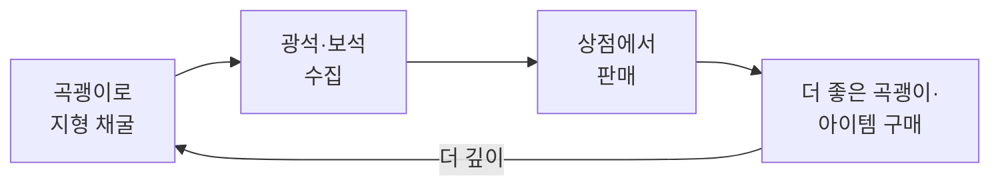

채굴하면 지형이 무너지고, 여러 플레이어가 같은 맵에서 함께 플레이한다.

| ① 채굴 | ② 상점 | ③ 더 깊이 |
|---|---|---|
| 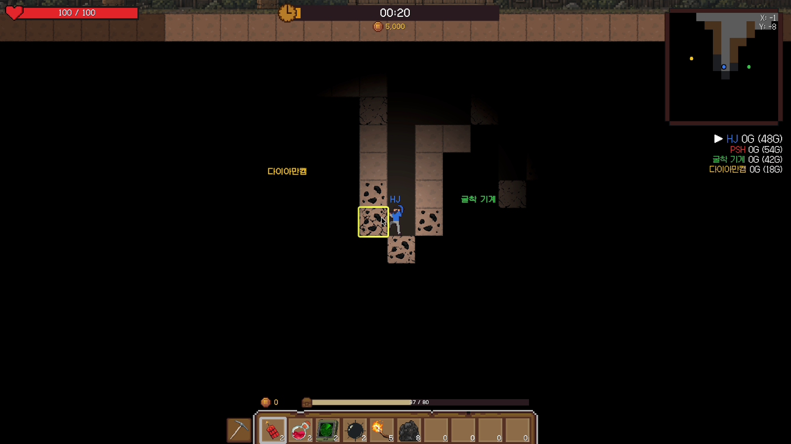 | 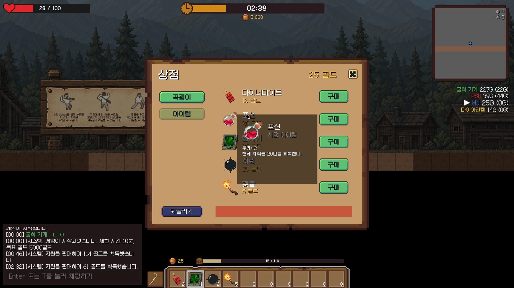 | 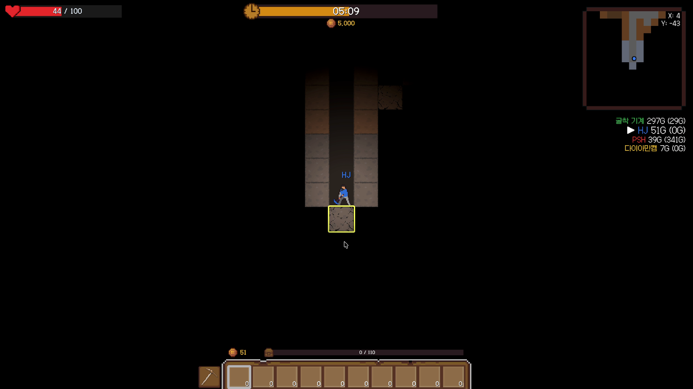 |

### 1.2 팀 역할

| 팀원 | 담당 |
|---|---|
| **박수하 (본인)** | **아이템 사용 시스템** (곡괭이·다이너마이트·지뢰·횃불·포션·탐지기), 아이템 데이터 테이블, 쿨타임, 상점, 리스폰, 초기 캐릭터 조작 |
| 팀원 A | 지형 생성·붕괴 시스템, 서버 권위 멀티플레이(로비·동기화), 인게임 UI·UX |
| 팀원 B | 그래픽·UI 디자인, 사운드, 굴착 피드백(DOTween 흔들림·균열 표시) |

### 1.3 담당 파트 요약 — 이 문서가 다루는 범위

**What**
이 문서는 팀 프로젝트 중 내가 맡은 **아이템 사용 시스템**을 깊게 다룬다. 플레이어 입력을 받아 아이템을 조준·사용하고,
멀티플레이에서는 서버에 사용을 요청하는 흐름을 어떻게 설계하고 구현했는지 정리한다.
상점·리스폰 등 나머지 담당 작업은 **부록에서 간단히** 소개한다.

| 다이너마이트 | 탐지기 |
|---|---|
| 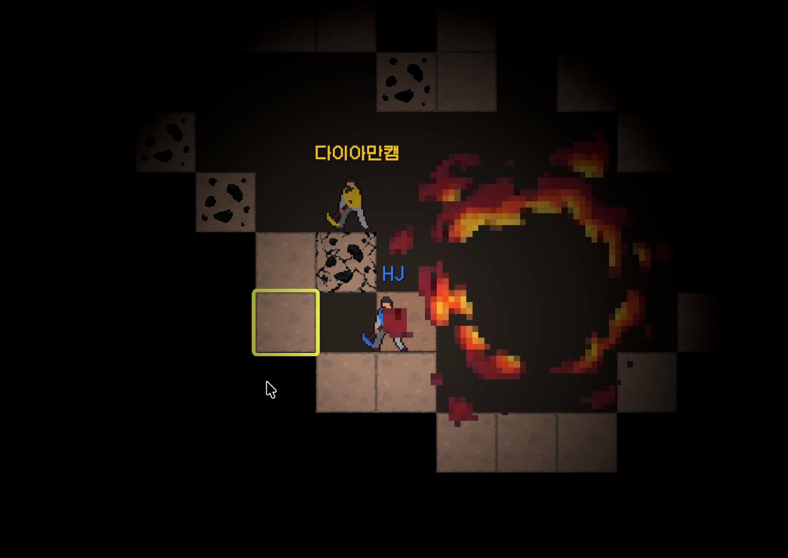 | 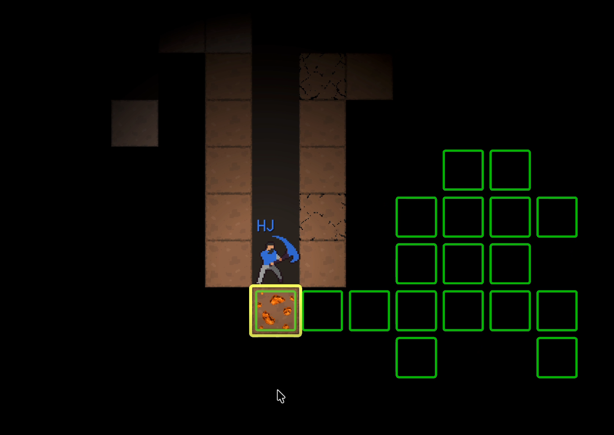 |

**Why — 해결하려던 문제**
- **아이템을 추가할수록 분기 코드가 늘어났다.** 멀티플레이용 아이템 사용 처리는 아이템 종류별 `switch` 분기로 나뉘어 있었고,
  분기마다 서버 요청·쿨타임·미리보기 종료 코드를 따로 적었다.
  그 결과 **다이너마이트 분기에만 쿨타임 시작 코드가 들어가, 멀티플레이에서 지뢰·포션·탐지기에는 쿨타임이 적용되지 않는 버그**가 생겼다.
- **검증의 최종 책임이 나뉘어 있지 않았다.** 멀티플레이를 붙이는 과정에서 같은 사용 조건을 클라이언트와 서버가 각각 검증했고,
  서버가 사용을 거절해도 화면에 아무 메시지가 뜨지 않는 버그가 생겼다.

**이 문서에서 다루는 내용**
1. 아이템을 **공통 계약(`Item`) + 타입별 베이스 클래스**로 나눈 구조 (2장)
2. 우클릭 조준 → 릴리스 사용 입력 흐름과 **아이템별 쿨타임** (3.2), 소모 책임과 쿨타임 저장 위치를 정한 이유 (4.2, 4.3)
3. 설치형 아이템 **제네릭 베이스(`PlaceableItemBase<T>`)** (3.3)
4. **TSV 한 줄이 상점 카드가 되는 데이터 주도 상점** — 새 곡괭이 등급은 TSV 한 줄과 썸네일로 늘어난다 (3.4)
5. 공통 데이터는 TSV, 아이템 전용 데이터는 ScriptableObject로 **데이터를 나눈 이유** (4.1)
6. 아이템 사용 검증을 **서버로 일원화**하기까지의 트러블슈팅 (5.2-1)

### 1.4 조작법

| 입력 | 동작 |
|---|---|
| 좌클릭 (홀드) | 장착된 곡괭이로 채굴 (휠 선택과 관계없이 고정) |
| 우클릭 홀드 | 휠로 선택한 아이템의 조준 미리보기 표시 |
| 우클릭 릴리스 | 미리보기 중이던 아이템 사용 |
| 미리보기 중 좌클릭 | 사용 취소 (곡괭이도 발동하지 않음) |

### 1.5 개발 환경

- **Engine:** Unity 6 (6000.3.15f1), URP 2D, Input System, DOTween
- **Language:** C#
- **Core:** 추상 클래스 계약 + 제네릭 베이스 클래스, TSV 데이터 테이블 + ScriptableObject, 서버 권위 멀티플레이 연동
- **기간:** 2026.08.23 ~ 2026.09.10 (3인 팀)
<!-- ✏️ AI 활용: 활용했다면 Oddity 문서처럼 한 줄 추가 -->

### 1.6 링크

- **GitHub:** https://github.com/parksooha102-ai/3rd-TeamProject-KH
- **시연 영상:** (업로드 예정) <!-- TODO: 업로드 후 실제 주소로 교체 -->

---

## 2. 시스템 구조

### 2.1 아키텍처 흐름

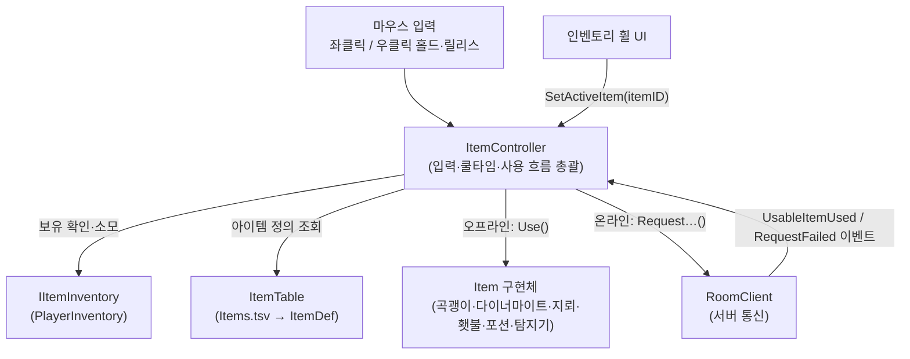

### 2.2 클래스 계층

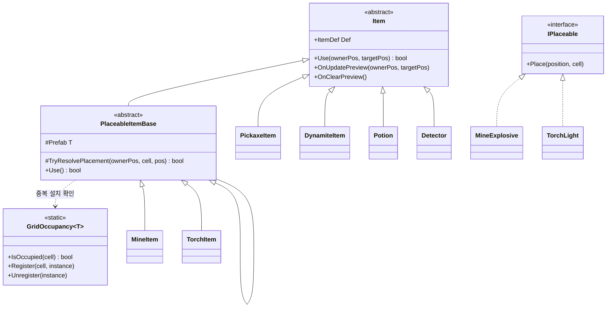

### 2.3 핵심 클래스 역할 분담

| 클래스 / 인터페이스 | 역할 |
|---|---|
| `ItemController` | 입력 해석, 장착 아이템 관리, 쿨타임, 온라인/오프라인 사용 분기 |
| `Item` (abstract) | 모든 아이템의 계약. `Use()`는 **실제로 사용됐는지만** `bool`로 반환한다 |
| `ItemTable` / `ItemDef` | `StreamingAssets/Table/Item/Items.tsv`를 읽어 아이템 정의(가격·쿨타임·곡괭이 스탯)를 만든다 |
| `PlaceableItemBase<T>` | 설치형 아이템 공통 흐름: 셀 계산 → 중복 확인 → 생성 → `Place()` |
| `GridOccupancy<T>` | 타입별로 "이 셀에 이미 설치돼 있는가"를 기록하는 정적 레지스트리 |
| `ExplosiveBase` | 다이너마이트·지뢰가 공유하는 폭발 처리(이펙트 → 지형 채굴 → 플레이어 피해) |
| `IItemInventory` | 인벤토리 계약(보유 확인·소모·변경 이벤트). `ItemController`는 인벤토리 구현체 대신 이 계약에만 의존한다 |
| `ShopService` | `ItemTable`에서 팔 수 있는 정의만 걸러 상점 목록(`ShopListing`)을 만든다. 구매·되돌리기 결과를 결과 구조체로 반환 |
| `ShopView` | 카드 템플릿 하나를 목록 수만큼 복제해 상점 화면을 그린다 |

**설계 의도 (미리 보기)**
`ItemController`는 아이템이 **무엇을 하는지** 모른다. `Use()`가 성공했는지만 받고, 쿨타임과 소모는
`ItemController` 한 곳에서만 처리한다. 그래서 새 아이템을 추가해도 입력·쿨타임 코드는 고치지 않는다.
이 구조가 나온 계기는 **3.2**에서 다룬다.

---

## 3. 핵심 기능

### 3.1 사용법 — 아이템 선택과 쿨타임 조회 (API)

외부(인벤토리 휠 UI)는 `itemID` 하나만 넘기면 된다. 보유 여부와 타입 검증은 `ItemController`가 한다.

```csharp
// 인벤토리 휠에서 아이템을 고를 때
itemController.SetActiveItem(itemID);

// 쿨타임 UI(라디얼 필)를 그릴 때
float remaining = itemController.GetItemCooldownRemaining(itemID);
float duration  = itemController.GetItemCooldownDuration(itemID);
fillImage.fillAmount = duration > 0f ? remaining / duration : 0f;
```

새 아이템을 추가할 때는 `Item`을 상속해 `Use()`만 구현하고, `Items.tsv`에 한 줄을 추가한다. 단, 멀티플레이에서는 서버 요청 분기도 하나 추가해야 한다(5.3).

### 3.2 핵심 동작 ① — 사용 흐름과 쿨타임

우클릭을 떼는 순간 아래 순서로 동작한다.

1. 쿨타임 중이면 사용하지 않는다.
2. 서버에 연결돼 있으면 서버에 **사용 요청**을 보내고, 아니면 `Use()`를 직접 호출한다.
3. 요청이나 사용이 **성공했을 때만** 쿨타임을 시작한다. 이 부수 효과는 한 곳에서만 처리한다.

```csharp
// ItemController.cs (발췌)
if (IsOnCooldown(activeItem.Def) == false)
{
    Item item = activeItem; // 소모로 activeItem이 해제되기 전에 참조를 확보
    if (TryUseActiveItem(item, ownerPos, mouseWorldPos, out string requestId))
    {
        StartCooldown(item.Def);                   // 성공 시 부수효과는 여기 한 곳에서만
        TrackPendingCooldown(requestId, item.Def); // (팀원 A 구현) 서버가 거절하면 되돌리기 위해 기록
    }
}

// 어떤 분기를 탔든 미리보기 종료는 여기서 한 번만
activeItem?.OnClearPreview();
isPreviewingActiveItem = false;
```

**(Why)** 이전에는 쿨타임 시작 코드를 멀티플레이 경로의 아이템 종류별 분기마다 따로 넣어야 했는데, 실제로는 다이너마이트 분기에만 들어 있었다.
"사용에 성공했는가"를 판단하는 함수(`TryUseActiveItem`)와 그 결과로 쿨타임을 거는 곳을 분리하자,
아이템 종류와 관계없이 쿨타임이 한 곳에서 일관되게 적용됐다.
`Use()`가 성공 여부를 `bool`로 돌려주게 된 계기는 **4.2**, 쿨타임을 `itemID` 기준으로 저장한 이유는 **4.3**에서 다룬다.

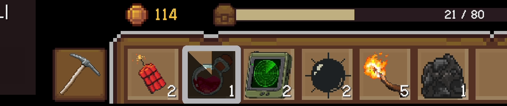

### 3.3 핵심 동작 ② — 설치형 아이템 제네릭 베이스

지뢰와 횃불은 "플레이어가 선 타일에 프리팹을 하나 놓는다"는 흐름이 같다.
횃불을 추가하면서 지뢰에 있던 설치 로직을 `PlaceableItemBase<T>`로 옮겨, 이 흐름을 한 곳에만 두었다.

```csharp
// PlaceableItemBase<TPlaceable>.Use() (발췌)
if (TryResolvePlacement(ownerPos, out Vector2Int cell, out Vector3 placePosition) == false)
    return false; // 셀을 못 찾으면 플레이어 위치로 대신 설치하지 않고 실패 처리

if (GridOccupancy<TPlaceable>.IsOccupied(cell))
    return false; // 같은 타입은 한 셀에 하나만

TPlaceable instance = Instantiate(prefab, placePosition, Quaternion.identity);
instance.Place(placePosition, cell);
return true;
```

그 결과 지뢰와 횃불 아이템 클래스는 둘 다 프리팹 필드 하나만 가진 **16줄**짜리 클래스가 됐다.

```csharp
public class TorchItem : PlaceableItemBase<TorchLight>
{
    [SerializeField] private TorchLight torchPrefab;
    protected override TorchLight Prefab => torchPrefab;
}
```

### 3.4 핵심 동작 ③ — TSV 한 줄이 상점 카드가 되기까지

상점에 무엇을 팔지 적어 둔 코드는 없다. `Items.tsv`의 행이 그대로 상점 카드가 된다.

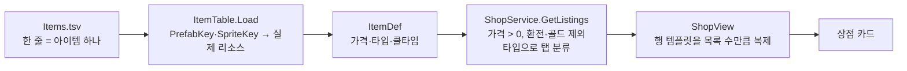

**① 판매 목록은 데이터에서 걸러 낸다.** `ShopService`는 `ItemTable`의 모든 정의를 돌면서 팔 수 있는 것만 고른다.

```csharp
// ShopService.cs (발췌)
public static bool IsShopPurchasable(ItemDef def)
{
    if (def.Price <= 0) return false;              // 기본 지급·디버그 곡괭이는 가격 0이라 빠진다
    return def.Type != ItemType.Exchange           // 광물(상점에 파는 쪽)
        && def.Type != ItemType.Gold;              // 화폐
}

public IReadOnlyList<ShopListing> GetListings()
{
    List<ShopListing> listings = new();
    foreach (ItemDef def in itemTable.GetDefs())
    {
        if (IsShopPurchasable(def) == false) continue;
        listings.Add(new ShopListing(def.ID, def.Name, def.Price, def.Sprite,
            GetCategory(def),                      // Pickaxe면 곡괭이 탭, 나머지는 아이템 탭
            def.PickaxeData?.DigPower ?? 0));
    }
    return listings;
}
```

**② 카드는 템플릿 하나를 복제한다.** `ShopView`는 씬에 비활성으로 둔 카드 템플릿(`rowTemplate`) 하나를 목록 수만큼 복제하고, 각 카드에 `ShopListing`을 넘긴다.
카드 디자인을 바꿔도 템플릿 하나만 고치면 되고, 카드 수는 데이터가 정한다.

```csharp
// ShopView.RefreshListing (발췌·요약)
foreach (ShopListing listing in shopService.GetListings())
{
    if (listing.Category != currentCategory) continue;   // 지금 열린 탭만
    ShopItemRowView row = Instantiate(rowTemplate, itemListContent);
    row.gameObject.SetActive(true);
    row.Bind(listing, HandlePurchaseRequested, isLocked, discountedPrice);
}
```

**③ 실제 화면과 데이터가 그대로 대응한다.**

| 상점 아이템 탭 카드 | `Items.tsv` 행 |
|---|---|
| 다이너마이트 15골드 | `50  다이너마이트  15  Usable  Items/Usable/Dynamite` |
| 포션 20골드 | `51  포션  20  Usable  Items/Usable/Potion` |
| 탐지기 30골드 | `52  탐지기  30  Usable  Items/Usable/Detector` |
| 지뢰 25골드 | `53  지뢰  25  Usable  Items/Usable/Mine` |
| 횃불 5골드 | `54  횃불  5  Usable  Items/Usable/Torch` |

| 아이템 탭 (ID 50~54) | 곡괭이 탭 (ID 1~3) |
|---|---|
| 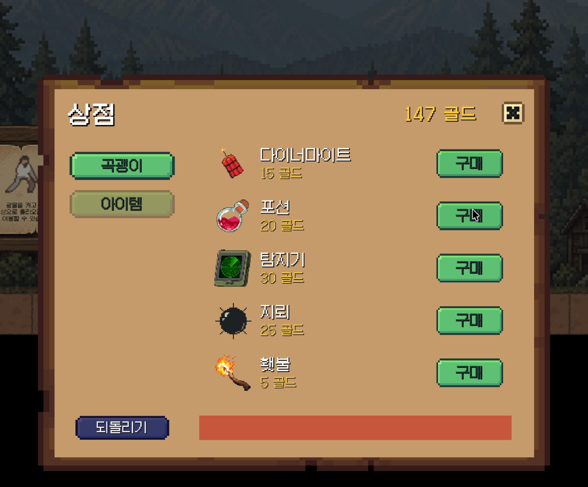 | 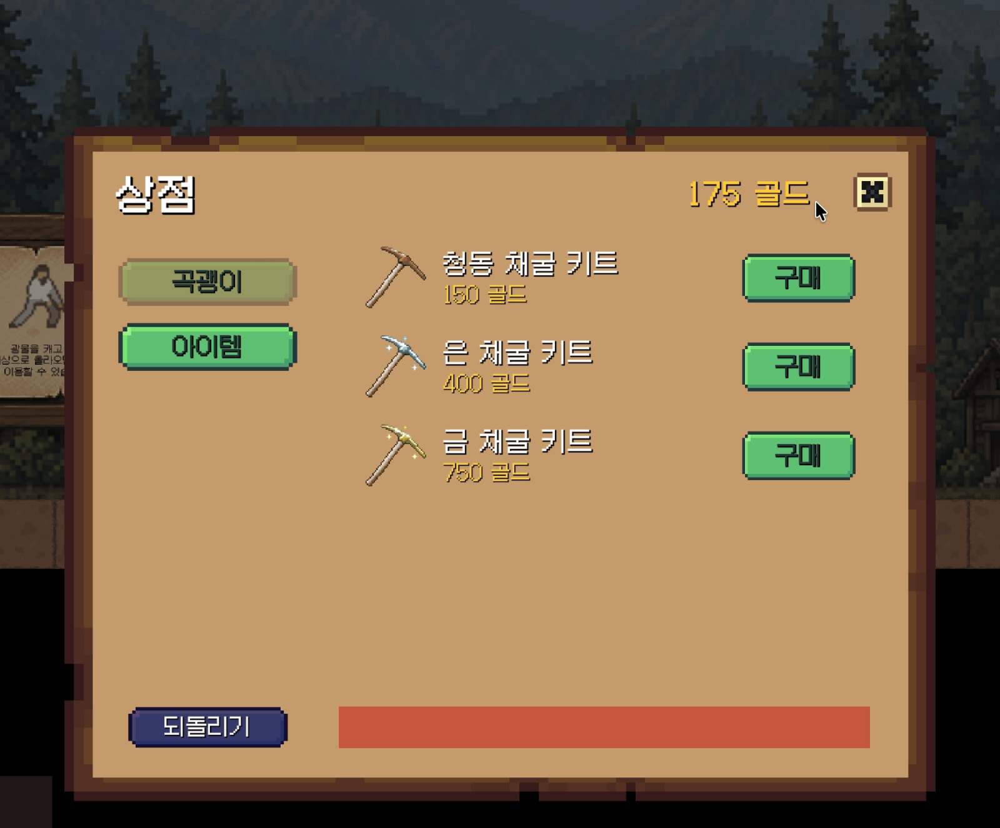 |

**곡괭이 등급은 코드 없이 늘어난다.** 청동·은·금 채굴 키트(ID 1~3)는 모두 같은 프리팹(`Items/Pickaxe/Pickaxe`)을 쓴다.
`PickaxeItem`은 사거리와 굴착력을 자기 필드가 아니라 `Def.PickaxeData`(TSV의 `PickaxeRange`, `DigPower`)에서 읽는다.
그래서 새 등급은 **TSV 한 줄 + 썸네일 스프라이트**만 추가하면 상점 곡괭이 탭에 나타나고, 사면 그 굴착력으로 채굴한다.

**코드가 필요한 경우.** 새로운 *동작*을 가진 아이템(예: 새 설치형 아이템)은 `Item`을 상속한 클래스와 프리팹이 필요하다(3.3).
멀티플레이에서는 그 아이템의 서버 요청 분기도 추가해야 한다(5.3).

> 팀원 기여: 보유 곡괭이보다 약한 등급을 잠그는 표시, 업그레이드 할인 가격 표시, 멀티플레이 구매의 서버 연결은 팀원 A가 추가했다.

### 3.5 예외 처리

| 상황 | 처리 |
|---|---|
| 보유 수량 0 (판매·드롭으로 소진) | 인벤토리 변경 이벤트를 받아 장착 자동 해제 |
| 환전용·골드 타입 선택 | 장착하지 않음 |
| 일시정지·설정 창이 열림 | 진행 중인 미리보기와 채굴을 취소 |
| 흙에 묻힘(매몰) | 아이템 미리보기를 취소 (탈출용 곡괭이 채굴은 가능) |
| 설치할 셀 계산 실패 | 설치하지 않음 (플레이어 위치로 대신 설치하지 않음) |
| 서버가 지원하지 않는 아이템 | 멀티플레이에서 사용 차단 + 경고 로그 |

---

## 4. 고민과 선택

> 이 장은 아이템 시스템에서 대안을 비교해 고른 선택 **세 가지**(4.1 데이터 분리, 4.2 소모 책임, 4.3 쿨타임 저장 위치)를 다룬다.

### 4.1 아이템 데이터 — 하나의 TSV에 모두 vs 공통 TSV + 아이템 전용 ScriptableObject

**결정 대상** — 다이너마이트의 폭발 반경·위력·퓨즈 시간처럼 **특정 아이템에서만 쓰는 값**을 어디에 둘까?

| | [A] 모든 값을 `Items.tsv` 하나에 칼럼으로 (처음 방식) | [B] 공통 값은 TSV, 전용 값은 ScriptableObject (채택) |
|---|---|---|
| 장점 | 모든 아이템 데이터를 한 파일에서 보고 고칠 수 있다 | TSV에는 모든 아이템이 공유하는 값(이름, 가격, 쿨타임 등)만 남는다. 전용 값은 그 아이템의 데이터 에셋에만 있다 |
| 단점 | 전용 값을 칼럼으로 추가하면 **그 값을 쓰지 않는 모든 아이템에도 빈 칼럼이 생긴다** | 한 아이템의 데이터가 두 곳에 나뉜다. 값을 고치려면 공통 값인지 전용 값인지 알아야 한다 |

[A]의 단점은 실제로 드러났다. 분리 직전 테이블에는 다이너마이트 전용 칼럼 3개(`ExplosionRadius`, `ExplosionPower`, `FuseTime`)가 있었고,
6개 행 중 5개 행은 이 칸이 모두 `0`이었다. 지뢰처럼 전용 값을 가진 아이템이 늘수록 이런 칼럼도 계속 늘어난다.

**[결정]** 테이블이 지저분해지는 것을 보고 대안 B로 리팩터링했다("다이너마이트 정보 분리" 커밋).
다이너마이트 전용 칼럼 3개를 TSV에서 빼고 `ExplosiveData` 에셋으로 옮겼다.
이후 추가한 지뢰의 전용 값(설치 후 대기 시간, 감지 반경 등)도 TSV 칼럼을 늘리지 않고 `MineData` 에셋에 두었다.
(곡괭이 전용 칼럼 2개는 리팩터링을 미루다 아직 TSV에 남아 있다. 5.3에 적었다.)

### 4.2 소모 책임 — 무조건 소모 vs 아이템이 성공을 알리고 컨트롤러가 소모

**결정 대상** — 아이템을 사용한 뒤 인벤토리에서 1개를 빼는 일을 **언제, 누가** 할까?

| | [A] `Use()`는 `void`, 호출 뒤 무조건 소모 (처음 방식) | [B] `Use()`가 성공 여부를 `bool`로 반환, `ItemController`가 성공했을 때만 소모 (채택) |
|---|---|---|
| 장점 | 단순하다. 아이템은 효과만 내면 된다 | 실패한 사용은 소모되지 않는다. 소모와 쿨타임 같은 부수 효과가 `ItemController` 한 곳에 모인다 |
| 단점 | 아이템이 **"이번에는 사용하지 않았다"를 알릴 방법이 없다.** 사용이 막혀도 아이템이 사라진다 | 모든 아이템이 "`true` = 실제로 사용했다"는 약속을 지켜야 한다. 멀티플레이에서는 서버 결과가 나중에 오기 때문에 이 `bool`만으로는 최종 성공을 알 수 없다 |

**계기** — 지뢰 중복 설치 버그를 고칠 때 [A]의 한계가 드러났다.
이미 지뢰가 있는 칸에는 설치를 막아야 했는데, `Use()`가 `void`라 설치를 막아도 호출 측은 그 사실을 몰랐다. 막은 지뢰가 인벤토리에서는 그대로 빠지는 것이다.

```csharp
// 수정 전: 결과와 관계없이 소모
activeItem.Use(ownerPos, mouseWorldPos);
inventory?.TryRemove(itemID, 1);

// 수정 후: 실제로 사용했을 때만 소모
bool wasUsed = activeItem.Use(ownerPos, mouseWorldPos);
if (wasUsed)
    inventory?.TryRemove(itemID, 1);
```

**[결정]** 대안 B를 선택했다("지뢰가 중복설치되던 버그 해결" 커밋). `Item`의 계약에 이 규칙을 주석으로 남겼다.

> "실제로 사용(소모)되었는지를 bool로 반환한다. false를 반환하면 호출 측(ItemController)에서 인벤토리 소모를 하지 않는다."
> — `Item.cs` 주석 (09.07)

같은 날 쿨타임을 추가할 때도 이 규칙을 그대로 따라 "성공했을 때만 소모하고 쿨다운을 건다"로 정했고,
이후 쿨타임 버그를 고칠 때 이 규칙을 "성공 판단 함수와 부수 효과 처리 위치의 분리"로 정리했다(3.2).
**감수한 대가**인 멀티플레이 문제는 실제로 드러났다. 요청 전송에 성공해 쿨타임이 시작된 뒤 서버가 거절하면 쿨타임을 되돌려야 했고,
이 처리는 팀원 A가 `requestId` 기반으로 구현했다(5.2-1).

### 4.3 쿨타임 저장 위치 — 아이템 인스턴스 vs `itemID`

**결정 대상** — 아이템별 쿨타임(재사용 대기 시간)을 어디에 저장할까?

| | [A] 아이템 인스턴스의 필드 | [B] `ItemController`의 `Dictionary<itemID, 사용 가능 시각>` (채택) |
|---|---|---|
| 장점 | 쿨타임이 아이템 자기 상태라서 직관적이다 | 인스턴스가 바뀌어도 쿨타임이 유지된다. UI가 `itemID`만으로 남은 시간을 조회할 수 있다 |
| 단점 | 이 프로젝트는 장착할 때마다 아이템 인스턴스를 새로 만들고, 바꾸면 이전 인스턴스를 없앤다. 그래서 **다른 아이템으로 바꿨다가 다시 장착하면 쿨타임이 초기화된다** | 쿨타임 관리까지 `ItemController`가 맡아 책임이 늘어난다(5.3). 같은 ID의 아이템은 쿨타임을 공유한다 |

**[결정]** 대안 B를 선택했다("아이템별 재사용 대기시간 추가" 커밋). 쿨타임을 처음 만들 때 이유를 주석으로 남겼다.

> "인스턴스가 아니라 itemID에 귀속시켜 아이템을 교체/재장착해도(인스턴스가 새로 생성돼도) 쿨다운이 초기화되지 않게 한다."
> — `ItemController.cs` 주석 (09.07)

인스턴스에 두면 휠로 아이템을 바꿨다 돌아오는 것만으로 쿨타임을 우회할 수 있다.
또 `itemID`로 조회할 수 있어서, 휠 UI가 장착하지 않은 아이템 칸에도 쿨타임을 그릴 수 있다(3.1의 `GetItemCooldownRemaining(itemID)`).
늘어난 책임은 `ItemController`를 나누는 개선 계획으로 5.3에 적었다.

---

## 5. 결과 및 배운 점

### 5.1 결과

- 6종 아이템(곡괭이, 다이너마이트, 지뢰, 횃불, 포션, 탐지기)을 `Item` 계약 하나로 통합했다.
- 새 설치형 아이템 추가 비용: 아이템 클래스 **16줄** + TSV 한 줄 + 프리팹. 입력·쿨타임 코드는 손대지 않는다.
  (단, 멀티플레이에서는 서버 요청 분기를 하나 추가해야 한다. 5.3에 적었다.)
- 상점 목록은 코드 어디에도 적혀 있지 않다. 상점 카드 **8장**(아이템 5 + 곡괭이 3)이 모두 `Items.tsv` 행에서 만들어진다.
- 새 곡괭이 등급 추가 비용: **TSV 한 줄 + 썸네일 스프라이트**. 등급 3개가 프리팹 하나를 공유한다.
- 수치를 데이터 파일로 관리한 덕분에, 밸런스 조정 커밋 3건(아이템 가격, 광물 내구도 등)은 **TSV 파일만 수정**했고 C# 코드는 한 줄도 바뀌지 않았다.

### 5.2 트러블슈팅

#### 5.2-1. 두 버그가 겹쳐서 드러난 "실패했는데 쿨타임이 도는" 현상
- **문제:** 아이템 사용이 실패해도 서버의 경고 메시지가 뜨지 않고, 쿨타임은 정상적으로 돌았다.
- **원인 1:** 멀티플레이를 붙이면서 같은 사용 조건(사망, 채팅 중, 게임 진행 상태, 스폰 지역)을 클라이언트와 서버가 각각 검증하고 있었다.
  클라이언트 검증이 실패 시 바로 `return`해서, 서버가 보낸 실패 사유를 출력하는 함수가 호출되지 않았다.
- **원인 2:** 사용 결과로 받는 `bool` 값을 나는 "아이템 사용 성공"으로, 서버 담당 팀원은 "서버 요청 성공"으로 이해했다. 그래서 서버가 사용을 거절해도 이 값은 `true`였고, 쿨타임이 그대로 시작됐다.
- **해결:** 서버가 이미 최종 판정을 하고 있었기 때문에, 같은 검증을 클라이언트에도 두면 두 판정이 언제든 어긋날 수 있다고 판단했다.
  그래서 클라이언트 검증 코드(41줄)를 제거하고 판정을 서버로 일원화했다.
  서버가 요청을 거절하면 그 요청으로 시작한 쿨타임만 되돌리는 처리(`requestId`별 대기 쿨타임 기록 → 거절 시 삭제)는 **팀원 A가 구현**했다.
- **결과:** 서버가 사용을 거절하면 실패 메시지가 뜨고, 쿨타임은 돌지 않는다.

#### 5.2-2. 탐지기 연타 시 연출이 끊기는 버그
- **문제:** 탐지기를 빠르게 여러 번 쓰면 먼저 시작한 음파 연출이 중간에 끊겼다.
- **원인:** 서버가 확정한 결과 연출과 로컬 미리보기 연출이 **코루틴 슬롯 하나를 공유**해서, 나중 응답이 먼저 응답의 연출을 멈췄다.
- **해결:** 슬롯은 로컬 미리보기에만 쓰고, 서버가 확정한 결과는 매번 독립된 코루틴으로 실행했다.
- **결과:** 탐지기를 연달아 써도 음파 연출이 끊기지 않고 안정적으로 재생된다.

#### 5.2-3. 다이너마이트가 벽 안에서 던져지는 버그
- **문제:** 벽에 붙어서 오른쪽으로 다이너마이트를 던지면 벽 안쪽에서 생성돼 벽을 통과했다.
- **원인:** 플레이어 스프라이트가 제대로 분할되지 않아 그림이 왼쪽으로 쏠려 있었다. 이를 보정하려고 투척 시작 위치를 앞쪽으로 미는 계산을 넣었는데, 오른쪽으로 던질 때는 이 보정 때문에 시작 위치가 벽 안으로 들어갔다.
- **해결:** 근본 원인인 스프라이트 분할(피벗)을 바로잡고, 투척 위치 보정 계산(26줄)을 제거했다. 지금은 플레이어 위치에서 던지고, 플레이어와의 충돌만 무시한다.
- **결과:** 벽에 붙어 던져도 다이너마이트가 벽 안에서 생성되지 않는다.
- **교훈:** 그래픽 문제를 로직으로 덮으면 다른 곳에서 버그가 생긴다. 증상이 아니라 원인이 있는 곳을 고쳐야 한다.

### 5.3 아쉬운 점 (기술 부채) 및 향후 계획

| 아쉬운 점 (As-Is) | 개선 계획 (To-Be) |
|---|---|
| 서버로 일원화하면서 "스폰 지역", "체력이 가득 참" 클라이언트 검증 2개를 놓쳐 레거시로 남았다. 서버와 판정 기준이 다시 어긋날 수 있다 | 제거하고 서버 응답의 실패 사유로만 안내 |
| `TryUseActiveItemOnline`이 아이템 타입별 `if`/`is` 분기로 서버 요청을 고른다. 아이템을 추가하면 여기를 수정해야 한다 | 각 `Item`이 자기 서버 요청을 만드는 메서드를 갖게 해서 분기 제거 |
| `ItemController`가 562줄이다. 입력·쿨타임·채굴·네트워크를 모두 담당한다 | 쿨타임 관리자, 입력 해석기를 분리 |
| `FindFirstObjectByType<TerrainManager>()`를 사용할 때마다 호출한다 | 초기화 시 주입하거나 캐싱 |
| `ItemTable`이 열 순서(`cells[7]` 등)에 의존해 TSV를 파싱한다 | 헤더 이름으로 열을 찾도록 변경 |
| `Cooldown`은 `float`인데 TSV에서 `int.Parse`로 읽는다. `1.5`처럼 소수 쿨타임을 넣으면 로드 중 오류가 난다 | `float.Parse`로 수정 |
| 곡괭이 전용 칼럼(`PickaxeRange`, `DigPower`)이 아직 TSV에 남아 있어, 곡괭이가 아닌 행은 이 칸이 `0`이다. 다이너마이트처럼 분리해야 했지만 기능 구현에 밀려 끝까지 미뤘다 (4.1의 분리 기준과 어긋남) | 곡괭이 데이터도 분리해 4.1 기준으로 통일. 미룬 리팩터링은 발견 즉시 작업 목록에 올려 관리 |

### 5.4 배운 점

이 프로젝트에서 겪은 문제들은 공통적으로, 기능이 **'일단 동작하는 것'과 '팀이 함께 유지보수할 수 있는 것'은 다른 문제**임을 보여 주었다.

- 클라이언트와 서버처럼 역할이 겹치는 구간에서는 **누가 최종 책임을 가지는지** 미리 정해야 한다.
- `bool` 값 하나도 **정확히 무엇을 의미하는지** 협업자와 미리 맞추지 않으면 찾기 어려운 버그가 된다.
- 다음 프로젝트에서는 시작 단계부터 역할 경계와 데이터 의미를 문서로 남기려고 한다.

---

## 부록 — 그 밖의 담당 작업

| 작업 | 내용 |
|---|---|
| **아이템 데이터 테이블** | 아이템 정보를 `Items.tsv`로 관리한다. 이름·가격·쿨타임·곡괭이 사거리·굴착력을 표의 값만 바꿔 조정한다 |
| **상점** | TSV 기반 판매 목록과 카드 템플릿 복제(3.4). 구매 결과·실패 사유를 결과 구조체로 반환하고, 이번 방문의 구매를 되돌리는(환불) 기능도 있다 |
| **리스폰** | "사망 → 대기 → 시작 지점 리스폰" 흐름을 처음 구현하고, 공중에서 죽으면 그 자리에 멈추던 버그를 고쳤다. (이후 팀원 A가 플레이어 컨트롤러 책임 분리와 사망 시 아이템 드롭을 추가했다) |
| **곡괭이 조준** | 조준선과 목표 타일 하이라이트, 매몰 시 자기 타일 채굴 허용 |
| **초기 캐릭터 조작** | 벽 매달리기, 회피 기동 |
