# 아이템 사용 시스템 (FOLK SACK)

> 3인 팀 2D 멀티플레이 채굴 게임에서 맡은 아이템 사용 시스템
>
> 아이템을 쓰고, 개수를 줄이고, 다시 쓸 때까지 기다리게 하는(쿨타임) 규칙이 아이템마다 따로 만들어져 있었다. 이 규칙을 한곳으로 모아 어떤 아이템이든 같은 규칙으로 쓰이게 했다. 지뢰·횃불처럼 바닥에 놓는 아이템은 놓는 과정을 한 번만 만들어 함께 쓰게 했고, 상점은 표 파일(TSV)에 한 줄을 적으면 그대로 판매 카드가 되도록 만들었다. 출발점은 아이템이 늘수록 같은 코드가 아이템마다 반복되면서, 멀티플레이에서 일부 아이템에 쿨타임이 걸리지 않던 버그다.
>
> - **결과:** 아이템 6종이 같은 규칙으로 쓰인다. 지뢰·횃불은 각각 16줄짜리 코드, 표 한 줄, 미리 만들어 둔 게임 오브젝트(프리팹) 하나로 만들었다. 상점 카드 8장이 모두 표 파일에서 만들어지고, 세 번의 밸런스 조정은 코드를 고치지 않고 표 파일만 고쳐 끝냈다
> - **배운 점:** 내 컴퓨터(클라이언트)와 서버처럼 두 쪽이 같은 일을 맡는 구간은, 누가 최종 판단하는지와 주고받는 값의 뜻을 팀이 함께 정해야 한다

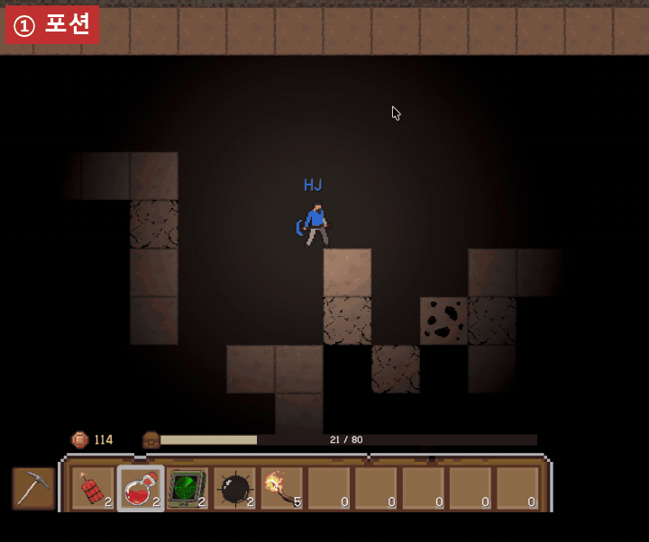

---

## 1. 프로젝트 소개

### 1.1 프로젝트 개요

FOLK SACK은 여러 명이 한 맵에서 땅을 파 내려가며 광물을 캐고, 판 돈으로 장비를 사서 더 깊이 들어가는 2D 게임이다.

| 항목 | 내용 |
|---|---|
| 프로젝트 | FOLK SACK |
| 장르 | 2D 멀티플레이 채굴·생존 게임 |
| 팀 구성 | 3명 — 박수하(본인), 팀원 A, 팀원 B |
| 내 담당 | **아이템 사용 시스템**과 **상점** — 플레이어가 쓰는 아이템 6종과, 그 아이템을 파는 상점 |

| 팀원 | 담당 |
|---|---|
| **박수하 (본인)** | **아이템 사용 시스템** (곡괭이·다이너마이트·지뢰·횃불·포션·탐지기), 아이템 데이터 테이블, 쿨타임, 상점, 리스폰, 초기 캐릭터 조작 |
| 팀원 A | 지형 생성·붕괴 시스템, 서버 권위 멀티플레이(로비·동기화), 인게임 UI·UX |
| 팀원 B | 그래픽·UI 디자인, 사운드, 굴착 피드백(DOTween 흔들림·균열 표시) |

**핵심 루프**

채굴하면 지형이 무너진다.
깊이 내려갈수록 위험과 보상이 함께 커지기 때문에 플레이어는 이 루프를 되풀이한다. 아이템은 이 루프 안에서 자원을 찾고, 다른 플레이어를 견제하고, 위기를 빠져나가는 도구다.

| ① 채굴 | ② 상점 | ③ 더 깊이 |
|---|---|---|
|  |  | 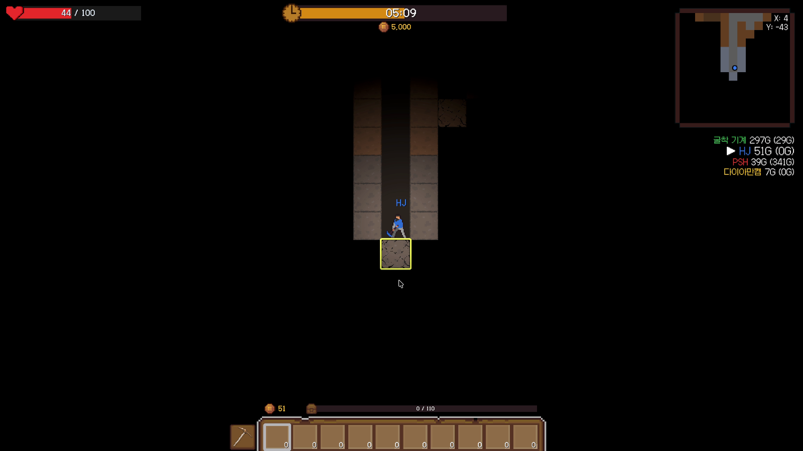 |

**영상:** [게임 소개와 핵심 루프 (쇼츠)](https://youtube.com/shorts/_NhzFKVbz-E)

> **문서 범위** — 아이템 사용(2장) · 설치형 아이템(3장) · 데이터 기반 상점(4장)을 시스템마다 한 장씩 다룬다. AI 협업 기록은 부록 A에, 리스폰·곡괭이 조준·초기 캐릭터 조작 등 그 밖의 담당 작업은 부록 B에 둔다.
> 서버 쪽 처리(사용 판정, 거절 시 쿨타임 되돌리기, 상점 구매 연결)는 팀원 A가 구현했고, 해당 절에 따로 표시한다. 기여 범위 전체는 5.2에 정리한다.

### 1.2 프로젝트 목표와 핵심 성과

**목표한 경험:** 상황에 맞는 아이템을 골라 꺼내 쓰는 **판단의 재미**

아이템마다 쓰는 목적이 다르다. 플레이어는 지금 상황에 필요한 것이 탐색인지, 견제인지, 위기 탈출인지를 보고 아이템을 고른다.

| 목적 | 아이템 | 하는 일 |
|---|---|---|
| 탐색 | 탐지기 · 횃불 | 주변 자원 위치를 표시한다 · 주변을 밝힌다 |
| 견제 | 지뢰 · 다이너마이트 | 다른 플레이어에 반응해 폭발한다 · 폭발로 플레이어에게 피해를 준다 |
| 위기 탈출 | 포션 · 다이너마이트 | 체력을 회복한다 · 지형을 부순다 |
| 채굴 | 곡괭이 | 지형을 판다 (등급별 사거리·굴착력) |

이 경험을 받치려면 아이템이 늘어나도 **모든 아이템이 같은 규칙으로 사용·소모·쿨타임 처리**돼야 했다. 처음 구조에서는 이 규칙이 아이템마다 따로 적혀 있어서, 멀티플레이에서 일부 아이템에 쿨타임이 걸리지 않는 버그가 생겼다(2.1).

목표와 실제 결과는 다음과 같다. 달성하지 못한 부분도 함께 적는다.

| 목표 | 결과 | 다루는 곳 |
|---|---|---|
| 모든 아이템이 같은 사용 규칙을 따른다 | 6종이 `Item` 계약 하나로 사용·소모·쿨타임 처리됨. 단, 온라인 요청은 아이템 타입별 분기로 남음 | 2.2, 2.4, 2.5 |
| 사용하지 못했으면 소모하지 않는다 | 설치가 막히면 아이템도 줄지 않고 쿨타임도 걸리지 않음 | 2.4, 3.3 |
| 멀티플레이의 최종 판정은 서버가 한다 | 클라이언트 검증 41줄을 지우고 서버로 모음. 거절되면 쿨타임을 되돌림(팀원 A 구현). 단, 클라이언트 검증 2개가 남음 | 2.5, 2.6 |
| 설치 과정이 같은 아이템은 그 과정을 한 번만 쓴다 | 지뢰·횃불이 제네릭 베이스 클래스 하나를 함께 쓰고, 아이템 클래스는 각각 16줄 | 3장 |
| 판매 목록과 수치는 표 파일로 정한다 | TSV(탭으로 칸을 나눈 표 파일) 행에서 상점 카드 8장이 모두 만들어짐. 단, 곡괭이 전용 칼럼은 아직 TSV에 남음 | 4장 |
| 상황에 맞는 아이템을 골라 쓴다 | 팀 내부 플레이와 수업 최종 발표 시연에서 사용함. 팀 밖의 플레이어는 써 보지 않음 | 1.3, 5.1 |

### 1.3 시연 및 조작법

| 입력 | 동작 |
|---|---|
| 좌클릭 (홀드) | 장착된 곡괭이로 채굴 (휠 선택과 관계없이 고정) |
| 우클릭 홀드 | 휠로 선택한 아이템의 조준 미리보기 표시 |
| 우클릭 릴리스(떼기) | 미리보기 중이던 아이템 사용 |
| 미리보기 중 좌클릭 | 사용 취소 (곡괭이도 발동하지 않음) |

<details>
<summary>다이너마이트·탐지기 사용 장면 보기</summary>

대표 아이템인 다이너마이트와 탐지기는 실제 플레이에서 이렇게 보인다.

| 다이너마이트 | 탐지기 |
|---|---|
| 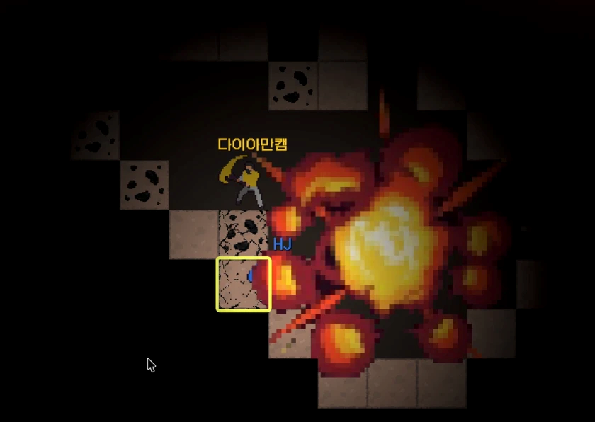 | 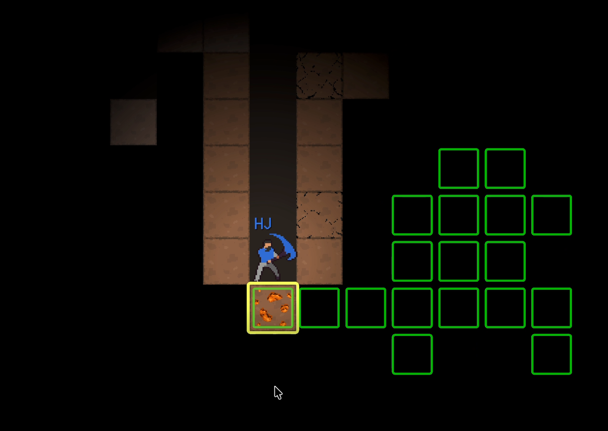 |

</details>

### 1.4 개발 환경 및 프로젝트 정보

| 항목 | 내용 |
|---|---|
| Engine | Unity 6 (6000.3.15f1), URP 2D, Input System, DOTween |
| Language | C# |
| Core | 추상 클래스 계약 + 제네릭 베이스 클래스, TSV 데이터 테이블 + ScriptableObject(Unity의 데이터 에셋), 서버 권위 멀티플레이 연동 |
| 기간 | 2026.08.23 ~ 2026.09.10 (약 3주, 3인 팀) |
| AI 활용 | Claude Code — 구현·리팩터링·문서 작성 보조. 설계 결정은 직접 하거나 팀원과 함께 (부록 A) |
| GitHub | https://github.com/parksooha102-ai/3rd-TeamProject-KH |
| 시연 영상 | https://youtu.be/ip59QB7ZMEA |

---

## 2. 아이템 사용 시스템

**핵심 질문:** 서로 다른 아이템을 어떻게 같은 사용 규칙으로 처리하고, 멀티플레이에서도 사용 결과를 일관되게 유지할 수 있는가?

### 2.1 해결하려는 문제

아이템이 늘면서 드러난 문제는 다섯 가지였다. ①~③은 사용한 뒤의 처리(소모·쿨타임)가 아이템마다 흩어져 있어서, ④·⑤는 멀티플레이에서 누가 최종 판정하는지와 주고받는 값의 뜻이 정해져 있지 않아서 생겼다.

**① 사용 처리가 아이템마다 따로 적혀 있었다.**
- **기존 구조:** 멀티플레이 사용 처리가 아이템 종류별 `switch` 분기로 나뉘어 있었다. 분기마다 서버 요청·쿨타임 시작·미리보기 종료 코드를 따로 적었다.
- **현상:** 아이템을 추가할수록 같은 코드가 분기마다 늘었다.
- **구조적 원인:** "사용한 뒤에 해야 할 일"을 아이템 종류마다 반복해서 적는 구조였다.
- **개선 목표:** 사용 뒤의 공통 처리를 한 곳에만 둔다. 새 아이템을 넣어도 입력·소모·쿨타임 코드를 고치지 않는다.

**② 아이템이 "이번에는 사용하지 않았다"를 알릴 수 없었다.**
- **기존 구조:** `Use()`가 `void`였고, 호출한 쪽은 결과와 관계없이 아이템을 소모했다.
- **현상:** 이미 지뢰가 있는 칸에 설치를 막아도, 막힌 지뢰가 인벤토리에서 빠졌다.
- **구조적 원인:** 사용 결과를 돌려받을 통로가 없었다.
- **개선 목표:** 실제로 사용했을 때만 소모한다. 사용하지 못했으면 쿨타임도 걸리지 않는다.

**③ 멀티플레이에서 일부 아이템에만 쿨타임이 걸렸다.**
- **현상:** 멀티플레이에서 지뢰·포션·탐지기에는 쿨타임이 적용되지 않았다.
- **구조적 원인:** ①의 분기 구조에서 쿨타임 시작 코드가 다이너마이트 분기에만 들어 있었다.
- **개선 목표:** 쿨타임 시작을 아이템 종류와 관계없는 한 곳으로 모은다.

아래는 ①·③을 고치기 전의 멀티플레이 사용 코드다. 분기마다 서버 요청·미리보기 종료를 따로 적었고, 쿨타임 시작은 다이너마이트 분기에만 있다.

```csharp
// ItemController.UpdateActiveItemPreview — 리팩터링 전 (발췌, 로그 문구 생략)
if (RoomClient.Instance is { IsConnected: true } roomClient)
{
    switch (activeItem)
    {
        case DynamiteItem:
        {
            bool requested = roomClient.RequestDynamiteThrow(activeItem.Def.ID, ownerPos, mouseWorldPos);
            if (requested == false)
                Debug.LogWarning(...);
            else
                StartCooldown(activeItem.Def);   // ③ 쿨타임 시작이 이 분기에만 있다

            activeItem.OnClearPreview();         // ① 미리보기 종료를 분기마다 반복
            isPreviewingActiveItem = false;
            return;
        }
        case MineItem:
        {
            bool requested = roomClient.RequestMinePlacement(activeItem.Def.ID, ownerPos);
            if (requested == false)
                Debug.LogWarning(...);
            // StartCooldown 없음
            activeItem.OnClearPreview();
            isPreviewingActiveItem = false;
            return;
        }
        case Potion:
        case Detector:
        {
            if (roomClient.RequestUsableItemUse(activeItem.Def.ID) == false)
                Debug.LogWarning(...);
            // StartCooldown 없음
            activeItem.OnClearPreview();
            isPreviewingActiveItem = false;
            return;
        }
    }
    // ...
}
```

**④ 같은 사용 조건을 클라이언트와 서버가 각각 검증했다.**
- **현상:** 서버가 사용을 거절할 상황에서 서버의 실패 메시지가 화면에 뜨지 않았다.
- **구조적 원인:** 클라이언트 검증이 실패하면 바로 `return`해서, 서버가 보낸 실패 사유를 출력하는 함수까지 가지 않았다.
- **개선 목표:** 최종 판정은 서버 한 곳에서 한다.

**⑤ 서버가 거절해도 쿨타임이 시작됐다.**
- **현상:** 서버가 사용을 거절해도 쿨타임은 정상적으로 돌았다.
- **구조적 원인:** 사용 결과로 받는 `bool`의 뜻을 본인과 팀원 A가 서로 다르게 이해하고 있었다(2.6).
- **개선 목표:** 요청 성공과 사용 성공을 구분하고, 거절된 요청의 쿨타임은 되돌린다.

그래서 공통 사용 흐름 하나를 두고, 소모·쿨타임 같은 부수 효과는 그 흐름 한 곳에서만 처리하며, 멀티플레이의 최종 판정은 서버에 맡겼다. ①②는 2.2·2.4, ③은 2.4, ④는 2.5, ⑤는 2.6에서 해결 과정을 다룬다.

### 2.2 아이템 사용 구조 설계

공통 사용 흐름의 중심은 `ItemController`와 `Item`의 역할 나누기다. 아이템(`Item`)은 자기 효과를 내고 실제로 사용했는지만 돌려준다. 소모와 쿨타임은 `ItemController` 한 곳에서만 처리한다.

마우스 입력과 휠 선택은 모두 `ItemController`로 모인다. 오프라인이면 `Use()`를 바로 부르고, 온라인이면 `RoomClient`를 거쳐 서버에 사용을 요청한 뒤 결과 이벤트를 받는다. 아래는 아이템을 고르고 한 번 사용하기까지의 순서다.

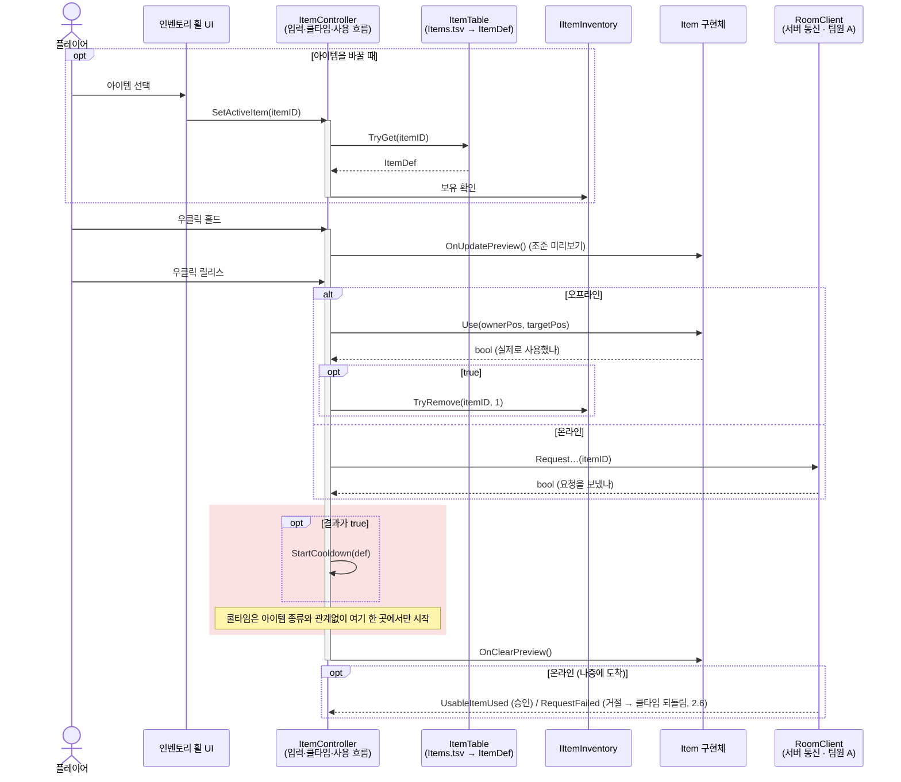

| 클래스 / 인터페이스 | 역할 | 누구와 무엇을 주고받나 |
|---|---|---|
| `ItemController` | 입력 해석, 장착 아이템 관리, 쿨타임, 온라인/오프라인 사용 분기 | 휠 UI에서 `itemID`를 받고, `Item`에 `Use()`를 부르거나 `RoomClient`에 요청을 넘긴다. 아이템이 **무엇을 하는지** 모르고 성공 여부만 받는다 |
| `Item` (abstract) | 모든 아이템의 계약과 실제 효과. `Use()`는 실제로 사용했는지만 `bool`로 반환한다 | `ItemTable`에서 만든 `ItemDef`를 `Def`로 가진다 |
| `IItemInventory` | 보유 확인과 소모의 계약, 변경 이벤트 | `ItemController`는 인벤토리 구현체 대신 이 계약에만 의존한다 |
| `ItemTable` / `ItemDef` | `Items.tsv`를 읽어 아이템 정의(가격·쿨타임·곡괭이 스탯)를 만든다 | 아이템과 상점이 같은 정의를 쓴다(4.2) |
| `RoomClient` | 서버에 사용 요청을 보내고 결과를 이벤트로 알린다 (팀원 A) | 승인은 `UsableItemUsed`, 거절은 `RequestFailed`로 `ItemController`에 돌려준다 |

지금 구조에서는 입력·쿨타임·채굴·네트워크 분기가 모두 `ItemController`에 있다(562줄). 이 책임 집중은 아직 나누지 못한 기술 부채다(5.3).

모든 아이템은 `Item`을 상속한다. 설치형인 지뢰·횃불은 그 사이에 설치형 베이스 클래스를 거치며, 그 구조는 3장에서 다룬다.

<details>
<summary>아이템 상속 구조 보기</summary>

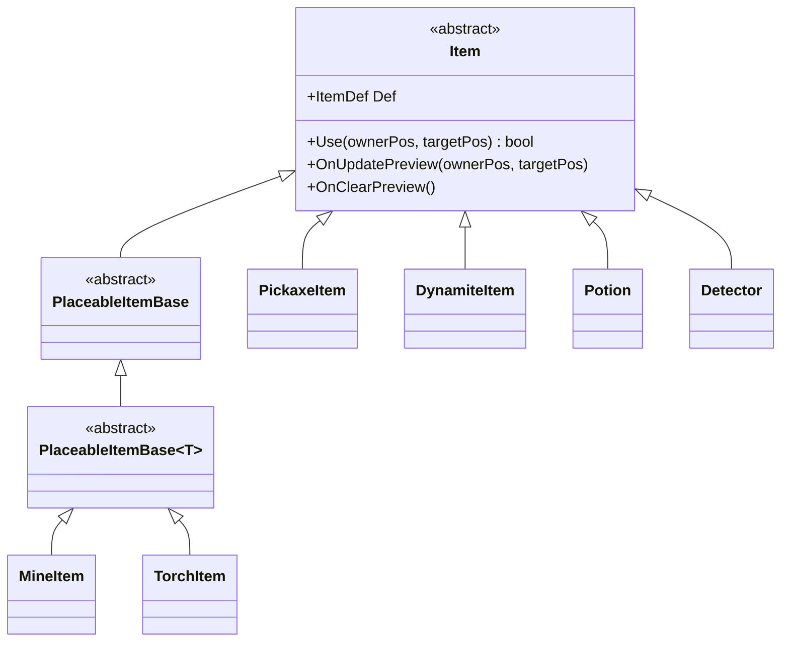

</details>

다이너마이트와 지뢰는 폭발 처리(이펙트 → 지형 채굴 → 플레이어 피해)를 `ExplosiveBase`에서 함께 쓴다.

#### 사용 결과 — `void` vs `bool`

`Item`의 계약에서 가장 중요한 결정은 `Use()`가 무엇을 돌려주느냐였다.

| | [A] `Use()`는 `void`, 호출 뒤 무조건 소모 (처음 방식) | [B] `Use()`가 성공 여부를 `bool`로 반환, `ItemController`가 성공했을 때만 소모 (채택) |
|---|---|---|
| 장점 | 단순하다. 아이템은 효과만 내면 된다 | 실패한 사용은 소모되지 않는다. 소모와 쿨타임 같은 부수 효과가 `ItemController` 한 곳에 모인다 |
| 단점 | 아이템이 **"이번에는 사용하지 않았다"를 알릴 방법이 없다.** 사용이 막혀도 아이템이 사라진다 | 모든 아이템이 "`true` = 실제로 사용했다"는 약속을 지켜야 한다 |

계기는 2.1 ②의 지뢰 중복 설치 버그였다.

```csharp
// ItemController — 수정 전후 (발췌)
// 수정 전: 결과와 관계없이 소모
activeItem.Use(ownerPos, mouseWorldPos);
inventory?.TryRemove(itemID, 1);

// 수정 후: 실제로 사용했을 때만 소모
bool wasUsed = activeItem.Use(ownerPos, mouseWorldPos);
if (wasUsed)
    inventory?.TryRemove(itemID, 1);
```

팀원과 함께 대안 B를 선택했다("지뢰가 중복설치되던 버그 해결" 커밋). `Item`의 계약에 이 규칙을 주석으로 남겼다.

> "실제로 사용(소모)되었는지를 bool로 반환한다. false를 반환하면 호출 측(ItemController)에서 인벤토리 소모를 하지 않는다."
> — `Item.cs` 주석 (09.07)

### 2.3 아이템 선택·장착과 쿨타임 관리

쿨타임은 같은 아이템을 연달아 쓰지 못하게 해, 상황마다 어떤 아이템을 꺼낼지 고르게 한다.

1. 휠 UI가 아이템을 고르면 `itemID` 하나만 넘긴다.
2. `ItemController`가 정의가 있는지, 보유하고 있는지, 장착할 수 있는 타입인지 확인한다. 환전용·골드 타입은 장착하지 않는다.
3. 쿨타임은 `itemID`로 조회한다.
4. 그래서 휠 UI는 지금 장착하지 않은 아이템 칸에도 쿨타임을 그릴 수 있다.

```csharp
// 휠 UI에서 ItemController를 부르는 쪽 (예시)
// 인벤토리 휠에서 아이템을 고를 때
itemController.SetActiveItem(itemID);

// 쿨타임 UI(라디얼 필)를 그릴 때
float remaining = itemController.GetItemCooldownRemaining(itemID);
float duration  = itemController.GetItemCooldownDuration(itemID);
fillImage.fillAmount = duration > 0f ? remaining / duration : 0f;
```

<details>
<summary>쿨타임이 도는 아이템 바 크게 보기</summary>

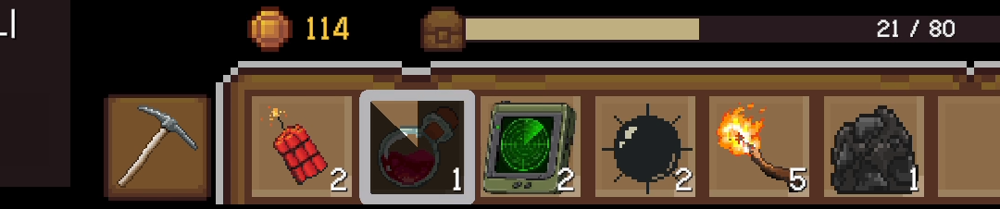

</details>

**영상:** [아이템 바의 쿨타임 (쇼츠)](https://youtube.com/shorts/3ZUQGxux458)

판매·드롭으로 보유 수량이 0이 되면, 인벤토리 변경 이벤트를 받아 장착을 자동으로 해제한다.

#### 쿨타임 저장 위치 — 아이템 인스턴스 vs `itemID`

| | [A] 아이템 인스턴스의 필드 | [B] `ItemController`의 `Dictionary<itemID, 사용 가능 시각>` (채택) |
|---|---|---|
| 장점 | 쿨타임이 아이템 자기 상태라서 직관적이다 | 인스턴스가 바뀌어도 쿨타임이 유지된다. UI가 `itemID`만으로 남은 시간을 조회할 수 있다 |
| 단점 | 이 프로젝트는 장착할 때마다 아이템 인스턴스를 새로 만들고, 바꾸면 이전 인스턴스를 없앤다. 그래서 **다른 아이템으로 바꿨다가 다시 장착하면 쿨타임이 초기화된다** | 쿨타임 관리까지 `ItemController`가 맡아 책임이 늘어난다. 같은 ID의 아이템은 쿨타임을 공유한다 |

인스턴스에 두면 휠로 아이템을 바꿨다 돌아오는 것만으로 쿨타임을 우회할 수 있다. 그래서 대안 B를 선택했다("아이템별 재사용 대기시간 추가" 커밋). 쿨타임을 처음 만들 때 이유를 주석으로 남겼다.

> "인스턴스가 아니라 itemID에 귀속시켜 아이템을 교체/재장착해도(인스턴스가 새로 생성돼도) 쿨다운이 초기화되지 않게 한다."
> — `ItemController.cs` 주석 (09.07)

늘어난 책임은 아직 덜어 내지 못했다(5.3).

### 2.4 아이템 사용과 소모 처리

- **우클릭 홀드:** 조준 미리보기를 시작한다. 쿨타임 중인 아이템은 미리보기조차 시작하지 않는다.
- **미리보기 중 좌클릭:** 사용을 취소한다.
- **사용 중단:** 일시정지·설정 창이 열리면 진행 중인 미리보기와 채굴을 취소하고, 흙에 묻히면(매몰) 아이템 미리보기를 취소한다(탈출용 곡괭이 채굴은 가능).
- **우클릭 릴리스:** 아래 순서로 사용한다.

1. 쿨타임 중이면 사용하지 않는다.
2. 서버에 연결돼 있으면 서버에 **사용 요청**을 보내고, 아니면 `Use()`를 직접 호출한다(`TryUseActiveItem`).
3. 2의 결과가 `true`일 때만 쿨타임을 시작한다.
4. 어떤 분기를 탔든 미리보기는 한 곳에서 한 번만 끝낸다.

```csharp
// ItemController.cs (발췌)
if (IsOnCooldown(activeItem.Def) == false)
{
    Item item = activeItem; // 소모로 activeItem이 해제되기 전에 참조를 확보
    if (TryUseActiveItem(item, ownerPos, mouseWorldPos, out string requestId))
    {
        StartCooldown(item.Def);                   // 쿨타임 시작은 여기 한 곳에서만
        TrackPendingCooldown(requestId, item.Def); // (팀원 A 구현) 온라인 요청이면 거절에 대비해 기록
    }
}

// 어떤 분기를 탔든 미리보기 종료는 여기서 한 번만
activeItem?.OnClearPreview();
isPreviewingActiveItem = false;
```

**쿨타임을 한 곳으로 모은 과정.** 2.1 ③의 버그(수정 전 코드는 2.1)는 이렇게 고쳤다.
"사용에 성공했는가"를 판단하는 `TryUseActiveItem`과, 그 결과로 쿨타임을 거는 곳을 나눴다. 분기는 성공 여부만 돌려주고 쿨타임은 호출한 쪽 한 곳에서 걸기 때문에, 아이템 종류와 관계없이 같은 규칙이 적용된다("다이너마이트를 제외한 아이템에 쿨타임이 적용되지 않던 버그 수정" 커밋, 본인).

**오프라인의 소모.** 오프라인에서는 `Use()`가 돌려준 값이 곧 **아이템 사용 성공**이다(2.2의 계약).

- `true`: 아이템 효과가 실제로 적용됐다 → 인벤토리에서 1개를 뺀다
- `false`: 설치할 칸이 이미 차 있는 등 실제로 사용하지 않았다 → 소모하지 않는다

```csharp
// ItemController.TryUseActiveItemOffline (발췌)
bool wasUsed = item.Use(ownerPos, mouseWorldPos);
if (wasUsed)
    inventory?.TryRemove(itemID, 1);
return wasUsed;
```

실패하면 위 3번 규칙대로 쿨타임도 걸리지 않는다.

이 `bool`은 **오프라인의 실제 사용 성공**만 뜻한다. 온라인에서는 서버 결과가 나중에 오므로 같은 값으로 최종 성공을 알 수 없다(2.5).

### 2.5 멀티플레이 아이템 사용과 서버 판정

`TryUseActiveItem()`이 돌려주는 `true`의 뜻은 연결 상태에 따라 다르다.

| 구분 | 오프라인 | 온라인 |
|---|---|---|
| 처리 | `Use()`를 직접 호출 | `RoomClient`로 서버에 사용 요청을 보냄 |
| 판정 | 아이템이 직접 판단 | **서버 최종 판정** |
| 반환값 의미 | **아이템 사용 성공** (효과가 실제로 적용됨) | **서버 요청 전송 성공** (아직 서버가 승인하지 않음) |
| 아이템 소모 | 성공 시 `ItemController`가 로컬 인벤토리에서 감소 | 클라이언트가 직접 줄이지 않고, 서버가 보내는 인벤토리 상태를 따름 |
| 쿨타임 | 사용 성공 시 시작 | 요청 전송 시 시작하고, 서버가 거절하면 되돌림(2.6) |

요청 전송 성공과 아이템 사용 성공은 같은 뜻이 아니다. 이 차이를 팀이 같은 뜻으로 맞추지 않아서 생긴 문제가 2.6이다.

온라인 요청은 아이템 타입별 분기로 고른다.

| 아이템 | 서버 요청 |
|---|---|
| `DynamiteItem` | `RequestDynamiteThrow` (투척) |
| `MineItem` | `RequestMinePlacement` (설치) |
| `TorchItem` | `RequestTorchPlacement` (설치) |
| `Potion`, `Detector` | `RequestUsableItemUse` (사용) |
| 그 밖의 아이템 | 요청하지 않고 경고 로그를 남긴 뒤 차단 |

**현재 구조의 한계:** 새 아이템을 추가하면 이 분기에 한 줄을 더해야 한다. 입력·소모·쿨타임 코드는 그대로지만, 온라인 요청만큼은 아이템 종류를 알고 있는 셈이다(5.3).

#### 사용 판정은 서버 한 곳에서

멀티플레이를 붙이면서 같은 사용 조건(사망, 채팅 중, 게임 진행 상태, 스폰 지역)을 클라이언트와 서버가 각각 검증하고 있었다(2.1 ④).
서버가 이미 최종 판정을 하고 있으므로, 같은 검증을 클라이언트에도 두면 두 판정이 언제든 어긋날 수 있다.

그래서 클라이언트 검증 코드 **41줄**을 제거하고 판정을 서버로 모았다("아이템 사용 허가를 서버에 위임" 커밋). 이제 서버가 거절하면 서버가 보낸 실패 메시지가 뜬다.
다만 이때 "스폰 지역", "체력이 가득 참" 클라이언트 검증 2개를 놓쳐 아직 남아 있다(5.3).

#### 온라인 투척의 생성 위치 문제

서버 권위 투척을 연동한 뒤 다이너마이트에서 생긴 문제다.

**문제:** 다이너마이트가 벽 안쪽에서 생성돼 벽을 통과했다.

**재현 조건:** 벽에 붙은 채로 벽 쪽(오른쪽)으로 던질 때.

**원인:** 두 가지가 겹쳤다.
- 서버 권위 투척을 연동할 때 팀원 A가 넣은 위치 계산(`GetSeparatedLaunchPosition`)은, 다이너마이트 콜라이더가 플레이어와 겹치지 않도록 투척 시작 위치를 플레이어 중심에서 `launchClearance`만큼 발사 방향 앞으로 밀었다.
- 플레이어 스프라이트가 제대로 분할되지 않아 그림이 왼쪽으로 쏠려 있었다. 그래서 그림상 벽에 붙어 있을 때, 오른쪽으로 던지면 앞으로 민 시작 위치가 벽 안으로 들어갔다.

**해결 시도 (임시 조정):** 먼저 밀어내는 거리(`launchClearance`)를 0.05에서 0.01로 줄였다("아이템 크기 조절과 다이너마이트 터널링 현상 수정" 커밋).
하지만 거리만 줄었을 뿐 벽 안에서 생성되는 문제는 남았다. 계산값을 조정하는 것으로는 그림이 쏠린 원인을 없앨 수 없었다.

**최종 대응:** 근본 원인인 플레이어 스프라이트의 분할(피벗)을 바로잡고, 위치 계산(`GetSeparatedLaunchPosition` 메서드와 설정값)을 제거했다("플레이어 스프라이트 조정 및 다이너마이트 벽 터널링 버그 수정" 커밋). 지금은 플레이어 위치에서 던지고, 플레이어와의 충돌만 무시한다.

**결과:** 벽에 붙어 던져도 다이너마이트가 벽 안에서 생성되지 않는다.

> 기여 구분: 위치 계산은 팀원 A가 서버 권위 투척을 연동하며 넣었고, 문제 해결과 위치 계산 제거는 본인이 했다.

### 2.6 서버 요청 실패와 쿨타임 복구

**문제:** 판정을 서버로 모은 뒤에도 2.1 ⑤의 문제가 남았다. 서버가 사용을 거절해도 쿨타임은 정상적으로 돌았다.

**원인:** 사용 결과로 받는 `bool`을 아이템 담당(본인)은 "아이템 사용 성공"으로, 서버 담당 팀원 A는 "서버 요청 성공"으로 이해하고 있었다. 코드상 온라인의 `true`는 요청 전송 성공이었다(2.5). 그런데 2.4의 흐름은 `true`이면 쿨타임을 시작하므로, 서버가 나중에 거절해도 이미 시작한 쿨타임은 그대로 돌았다.

**해결:** 팀원 A는 `bool`의 뜻을 "요청 전송 성공"으로 두고, 거절된 요청의 쿨타임만 되돌리는 처리를 추가했다("아이템 사용 요청 거절 시 쿨타임 미적용" 커밋). 2.4 코드의 `TrackPendingCooldown`이 이 처리의 시작점이다.

1. 요청을 보낼 때 `requestId`와 아이템 ID를 대기 목록(`pendingCooldowns`)에 기록한다.
2. 서버가 승인하면(`UsableItemUsed`) 기록만 지운다. 쿨타임은 그대로 돈다.
3. 서버가 거절하면(`RequestFailed`) 그 `requestId`로 시작한 쿨타임만 지운다.

**결과:** 서버가 사용을 거절하면 실패 메시지가 뜨고, 쿨타임은 돌지 않는다.

### 2.7 탐지기 연출 문제와 해결

서버가 확정한 사용 결과를 화면에 연출하는 과정에서 생긴 문제다.

**문제:** 탐지기를 빠르게 여러 번 쓰면 아이템은 소모되는데, 먼저 시작한 음파 연출이 중간에 끊기고 그 음파를 따라 찍히던 자원 마커(초록 칸)가 나타나지 않았다.

**재현 조건:** 멀티플레이에서 탐지기를 연타해, 서버가 확정한 탐지 결과 여러 개가 짧은 간격으로 겹쳐 도착할 때.

**원인:** 탐지기의 음파는 코루틴 하나가 퍼져 나가면서, 음파가 닿은 순서대로 마커를 찍는다. 그런데 로컬 미리보기 연출과 서버가 확정한 결과 연출이 **코루틴 슬롯(`waveCoroutine`) 하나를 공유**했다. 새 연출을 시작할 때마다 슬롯의 이전 코루틴을 `StopCoroutine`으로 멈췄기 때문에, 나중에 온 응답이 먼저 온 응답의 음파와 남은 마커를 끊었다.

**해결:** 슬롯(`previewWaveCoroutine`)은 로컬 미리보기에만 쓰고, "새 미리보기가 이전 미리보기를 대체한다"는 뜻으로만 둔다. 서버가 확정한 결과는 각각 독립된 유효한 탐지이므로, 슬롯을 쓰지 않고 매번 독립된 코루틴으로 실행했다("디텍터 광클 오류 해결" 커밋).

```csharp
// Detector.ShowConfirmedResults (발췌)
// 서버가 확정해준 결과는 각각 독립된 유효한 스캔이다.
// 광클로 여러 요청의 응답이 겹쳐 도착해도 서로 취소하지 않도록
// 공유 슬롯을 쓰지 않고 매번 독립적인 코루틴으로 실행한다.
StartCoroutine(RunDetectionWave(ownerPos, found));
```

**결과:** 탐지기를 연달아 써도 각 탐지의 음파와 마커가 끝까지 재생된다. 응답이 겹치면 음파도 겹쳐 재생된다.

### 2.8 결과와 한계

**결과**
- 아이템 6종(곡괭이, 다이너마이트, 지뢰, 횃불, 포션, 탐지기)이 `Item` 계약 하나로 같은 사용 규칙을 따른다(2.2, 2.4).
- 쿨타임 시작을 한 곳으로 모아, 지뢰·포션·탐지기에 쿨타임이 걸리지 않던 버그를 고쳤다(2.4).
- 설치가 막히면 `false`를 돌려주고, 아이템도 줄지 않고 쿨타임도 걸리지 않는다(2.4, 3.3).
- 서버가 최종 판정하고, 서버가 거절하면 실패 메시지가 뜨고 쿨타임이 되돌려진다(2.5, 2.6 — 쿨타임 복구는 팀원 A 구현).
- 탐지기를 연달아 써도 각 탐지 연출이 끝까지 재생된다(2.7).

**한계** (개선 방향은 5.3)
- 온라인 요청은 아직 아이템 타입별 분기로 고른다. 새로운 동작을 가진 아이템은 이 분기도 추가해야 한다.
- `ItemController`에 입력·쿨타임·채굴·네트워크 책임이 모여 있다(562줄).
- "스폰 지역", "체력이 가득 참" 클라이언트 검증 2개가 남아 있다.

---

## 3. 설치형 아이템 시스템

**핵심 질문:** 지뢰와 횃불처럼 설치 과정은 같지만 설치 후 동작이 다른 아이템을 어떻게 하나의 구조로 확장할 수 있는가?

### 3.1 해결하려는 문제

지뢰 같은 설치형 아이템은 다른 플레이어를 견제하는 데 쓴다.
지뢰와 횃불은 "플레이어가 선 타일에 프리팹을 하나 놓는다"는 흐름이 같고, 설치된 뒤에 하는 일만 다르다.

| 단계 | 공통 처리 | 지뢰 | 횃불 |
|---|---|---|---|
| 셀 계산 | 플레이어 위치에서 설치할 타일과 좌표를 구한다 (`TryResolvePlacement`) | 같음 | 같음 |
| 중복 확인 | 같은 타입이 이미 그 셀에 있는지 본다 (`GridOccupancy<T>`) | 같음 | 같음 |
| 생성 | 프리팹을 만든다 | `MineExplosive` | `TorchLight` |
| 설치 뒤 | 생성한 개체의 `Place()`를 부른다 (`IPlaceable`) | 대기 시간 뒤 감지 반경 안의 플레이어에 반응해 폭발 | 주변을 밝힌다 |

이 설치 과정을 아이템마다 따로 쓰면, 셀 계산이나 중복 확인 규칙을 바꿀 때마다 설치형 아이템 클래스를 모두 같이 고쳐야 한다. 그래서 같은 부분(설치 과정)과 다른 부분(설치 뒤 동작)을 나눠, 설치 과정은 한 번만 쓰기로 했다.

### 3.2 설치형 아이템 공통 구조

처음에는 설치 흐름이 지뢰 클래스 안에 있었다. 횃불을 추가할 때 이 흐름을 횃불에 복사하는 대신, 지뢰에 있던 설치 로직을 공통 베이스 클래스 `PlaceableItemBase<T>`로 옮겼다.

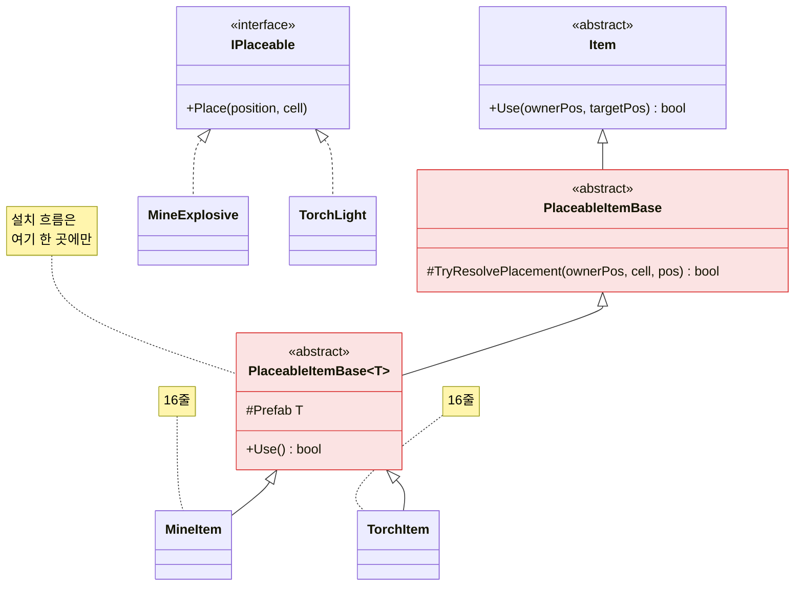

- `PlaceableItemBase`는 플레이어 위치에서 설치할 셀을 구하고(`TryResolvePlacement`), `PlaceableItemBase<T>`는 그 셀에 `T` 프리팹을 놓는 `Use()`를 가진다.
- `T`는 **설치될 개체의 타입**(`MineExplosive`, `TorchLight`)이다.
- `GridOccupancy<T>`는 "이 셀에 `T`가 이미 설치돼 있는가"를 기록한다(아래).
- 설치된 뒤의 동작은 `IPlaceable.Place()`로 개체 쪽에 넘긴다. 베이스 클래스는 "어디에 놓을지"만 책임진다.

#### 셀 점유 기록 — `GridOccupancy<T>`

`GridOccupancy<T>`는 설치 개체 타입마다 "어느 셀에 무엇이 놓여 있는가"를 기록하는 **정적 제네릭 클래스**다.

- **정적 클래스:** 인스턴스를 만들지 않고 어디서나 `GridOccupancy<MineExplosive>.IsOccupied(cell)`처럼 부른다. 기록은 게임 중에 설치·제거에 따라 계속 바뀐다.
- **타입별 기록:** C#에서 제네릭 정적 클래스의 정적 필드는 `T`마다 따로 생긴다. 그래서 `GridOccupancy<MineExplosive>`와 `GridOccupancy<TorchLight>`는 서로 다른 기록을 가진다. 타입마다 딕셔너리를 따로 선언하지 않아도, 지뢰와 횃불은 서로의 칸을 막지 않는다.

```csharp
// GridOccupancy.cs (발췌)
public static class GridOccupancy<T> where T : Component
{
    private static readonly Dictionary<Vector2Int, T> cellToInstance = new(); // 셀 → 개체: 설치 전 조회용
    private static readonly Dictionary<T, Vector2Int> instanceToCell = new(); // 개체 → 셀: 제거할 때 셀을 찾는 용

    public static bool IsOccupied(Vector2Int cell) => cellToInstance.ContainsKey(cell);
    public static void Register(Vector2Int cell, T instance) { ... }
    public static void Unregister(T instance) { ... } // 그 셀에 다른 개체가 다시 등록돼 있으면 셀 기록은 지우지 않는다
}
```

| 메서드 | 하는 일 | 부르는 곳 |
|---|---|---|
| `IsOccupied(cell)` | 그 셀에 같은 타입이 이미 있는지 확인 | `PlaceableItemBase<T>.Use()`, 생성 전(3.3) |
| `Register(cell, instance)` | 셀과 개체를 기록 | 설치된 개체(`MineExplosive`, `TorchLight`)가 자리를 잡을 때 |
| `Unregister(instance)` | 기록을 지움 | 설치된 개체의 `OnDestroy()` |

확인은 베이스 클래스가, 기록과 해제는 설치된 개체가 스스로 한다. 그래서 지뢰가 터지거나 횃불이 흙에 묻혀 사라지는 등 어떤 이유로 없어져도 `OnDestroy()`에서 기록이 지워져, 빈 칸이 막힌 채로 남지 않는다.

### 3.3 설치 흐름과 실패 처리

#### 설치형 베이스 — 일반 클래스 vs 제네릭 클래스

| | [A] 제네릭 없는 공통 베이스 클래스 | [B] 설치 개체 타입을 `T`로 받는 `PlaceableItemBase<T>` (채택) |
|---|---|---|
| 중복 확인 | 어떤 개체 타입의 기록을 볼지 따로 알려 줘야 한다 | `GridOccupancy<T>`가 타입마다 따로 기록한다 |
| 생성 뒤 | 만든 개체를 `IPlaceable`로 형 변환해야 `Place()`를 부를 수 있다 | `T` 타입 그대로 받아 바로 `Place()`를 부른다 |

제네릭으로 만든 이유는 두 가지다. 중복 확인을 **설치 개체의 타입별로** 해야 했고(`GridOccupancy<T>`), 프리팹을 `T` 타입으로 받아 생성 직후 형 변환 없이 `Place()`를 부를 수 있다.

```csharp
// PlaceableItemBase<TPlaceable>.Use() (발췌)
if (TryResolvePlacement(ownerPos, out Vector2Int cell, out Vector3 placePosition) == false)
    return false; // 셀을 못 찾으면 플레이어 위치로 대신 설치하지 않고 실패 처리

if (GridOccupancy<TPlaceable>.IsOccupied(cell))
    return false; // 같은 타입은 한 셀에 하나만

TPlaceable instance = Instantiate(prefab, placePosition, Quaternion.identity);
instance.Place(placePosition, cell);
return true;
```

설치할 수 없으면 `Use()`가 `false`를 돌려준다. 이 결과를 `ItemController`가 받아 아이템을 소모하지 않고 쿨타임도 걸지 않는다(2.4). 그래서 이미 지뢰가 있는 칸에 설치를 시도해도 지뢰가 줄지 않는다.

### 3.4 새로운 설치형 아이템 추가

아이템 클래스에는 다른 점(프리팹)만 남는다. 지뢰(`MineItem.cs`)와 횃불(`TorchItem.cs`) 아이템 클래스는 둘 다 프리팹 필드 하나만 가진 **16줄**짜리 클래스다.

```csharp
// TorchItem.cs (전체)
public class TorchItem : PlaceableItemBase<TorchLight>
{
    [SerializeField] private TorchLight torchPrefab;
    protected override TorchLight Prefab => torchPrefab;
}
```

같은 흐름의 설치형 아이템을 추가하는 작업은 이렇다.

1. 이런 아이템 클래스를 작성한다.
2. `Items.tsv`에 한 줄을 추가한다.
3. 프리팹을 연결한다.

설치된 뒤의 동작(폭발, 빛)은 설치될 개체 쪽에 `IPlaceable.Place()`로 따로 구현해야 하고, 멀티플레이에서는 서버 요청 분기도 추가해야 한다(2.5).

### 3.5 결과와 한계

**결과**
- 지뢰와 횃불이 `PlaceableItemBase<T>`의 설치 흐름(셀 계산 → 중복 확인 → 생성 → `Place()`)을 함께 쓴다.
- 설치 로직이 베이스 클래스 한 곳에만 있어, 지뢰·횃불 아이템 클래스는 각각 16줄이다.
- 설치 과정은 베이스 클래스가, 설치 뒤 동작은 설치된 개체가 맡는다.

**한계** (개선 방향은 5.3)
- 새로운 동작을 가진 설치형 아이템은 설치될 개체의 `Place()` 구현과 함께, 멀티플레이 서버 요청 분기도 추가해야 한다(5.3).

---

## 4. 데이터 기반 상점 시스템

**핵심 질문:** 아이템과 곡괭이의 판매 목록과 가격을 코드 수정 없이 데이터만으로 관리할 수 있는가?

### 4.1 해결하려는 문제

상점에서는 판 돈으로 다음에 쓸 아이템과, 더 깊이 내려갈 곡괭이를 함께 산다.
아이템과 곡괭이 등급이 늘 때마다 상점 코드를 고치지 않도록, 판매 목록과 수치는 표 파일로 정하는 것이 목표였다.

또 상점이 파는 아이템과 플레이어가 쓰는 아이템은 같은 아이템이므로, 두 시스템이 **같은 아이템 정의**를 써야 한다. 그래서 상점에 무엇을 팔지 적어 둔 코드는 없다. `Items.tsv`의 한 행이 하나의 아이템 정의가 되고, 판매 조건에 맞으면 그대로 상점 카드가 된다.

```
Items.tsv → ItemDTO → ItemDef → ShopListing → ShopView → 상점 카드
```

### 4.2 아이템 데이터 로드와 정의 변환

아이템 정의는 `StreamingAssets/Table/Item/Items.tsv` 한 파일에서 나온다. 게임이 시작되면 `DataManager`가 `ItemTable.Load()`로 이 표를 읽어 `ItemDef`를 만들고, 같은 정의를 두 곳이 나눠 쓴다.

- **아이템 사용:** `ItemController`가 장착할 아이템의 정의(타입·쿨타임·프리팹)를 `ItemTable`에서 찾고, 보유 수량은 `IItemInventory`로 확인한다(2.2).
- **상점:** `ShopService`가 같은 `ItemTable`에서 팔 수 있는 정의만 골라 판매 목록을 만들고, `ShopView`가 카드를 그린다(4.4).

`Items.tsv`에는 모든 아이템이 함께 쓰는 **공통 데이터**(이름·가격·타입·쿨타임 등)가 있다. `ItemTable.Load()`는 이 표를 두 단계로 바꾼다. 먼저 줄마다 탭으로 칸을 나눠 글자 그대로 `ItemDTO`에 담고, 그다음 문자열 키를 실제 값으로 풀어 `ItemDef`를 만든다.

<details>
<summary>아이템 정의 전체 구조 보기 (ERD)</summary>

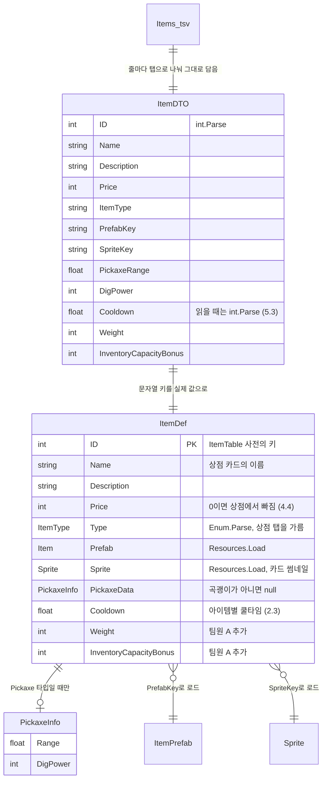

</details>

`ItemDTO`는 표의 칸을 글자 그대로 담고, `ItemDef`에서 값이 바뀌는 칸은 세 가지다. 나머지는 그대로 옮긴다.

- **`ItemType`** → `Enum.Parse`로 열거형(`Exchange`·`Pickaxe`·`Usable`·`Gold`)이 되어 상점 탭을 가른다.
- **`PrefabKey`·`SpriteKey`** → `Resources.Load`로 찾은 실제 프리팹과 썸네일이 된다.
- **`PickaxeRange`·`DigPower`** → `Type`이 `Pickaxe`일 때만 `PickaxeInfo`로 묶고, 그 밖의 아이템은 `null`이다.

예를 들어 청동 채굴 키트(ID 1)는 `Price` 150, `ItemType` `Pickaxe`, `PickaxeRange`·`DigPower` 2라서 `PickaxeData`가 `(2, 2)`가 된다. 사용 아이템은 같은 표에서 곡괭이 칸이 0이다. 예: 탐지기(ID 52)는 `Price` 30, `ItemType` `Usable`, `Cooldown` 8, `PickaxeRange`·`DigPower` 0이라 `ItemDef`에 `PickaxeData`가 없다.

### 4.3 공통 데이터와 전용 데이터의 분리

#### 데이터 위치 — TSV 칼럼 vs ScriptableObject

특정 아이템만 쓰는 **전용 데이터**는 `Items.tsv`에 두지 않는다. 다이너마이트의 폭발 반경·위력·퓨즈 시간은 `ExplosiveData`, 지뢰의 설치 후 대기 시간·감지 반경 등은 `MineData`라는 ScriptableObject 에셋에 있다.

| | [A] 모든 값을 `Items.tsv` 하나에 칼럼으로 (처음 방식) | [B] 공통 값은 TSV, 전용 값은 ScriptableObject (채택) |
|---|---|---|
| 장점 | 모든 아이템 데이터를 한 파일에서 보고 고칠 수 있다 | TSV에는 모든 아이템이 공유하는 값만 남는다. 전용 값은 그 아이템의 데이터 에셋에만 있다 |
| 단점 | 전용 값을 칼럼으로 추가하면 **그 값을 쓰지 않는 모든 아이템에도 빈 칼럼이 생긴다** | 한 아이템의 데이터가 두 곳에 나뉜다. 값을 고치려면 공통 값인지 전용 값인지 알아야 한다 |

[A]의 단점은 실제로 드러났다. 분리 직전 테이블에는 다이너마이트 전용 칼럼 3개(`ExplosionRadius`, `ExplosionPower`, `FuseTime`)가 있었고, 6개 행 중 5개 행은 이 칸이 모두 `0`이었다.
전용 값을 가진 아이템이 늘수록 빈 칼럼도 늘어나므로 대안 B로 리팩터링했다("다이너마이트 정보 분리" 커밋). 이후 추가한 지뢰도 TSV 칼럼을 늘리지 않고 `MineData`에 값을 두었다.
곡괭이 전용 칼럼 2개(`PickaxeRange`, `DigPower`)는 아직 TSV에 남아 있다(5.3).

### 4.4 판매 목록 생성과 상점 카드 출력

게임이 시작되면 `ShopAccessController`가 `ShopService`를 만들어 `ShopView`에 넘긴다. 탭을 바꿀 때마다 아래 순서로 카드 목록을 다시 그린다.

<details>
<summary>상점 카드를 그리는 순서 보기</summary>

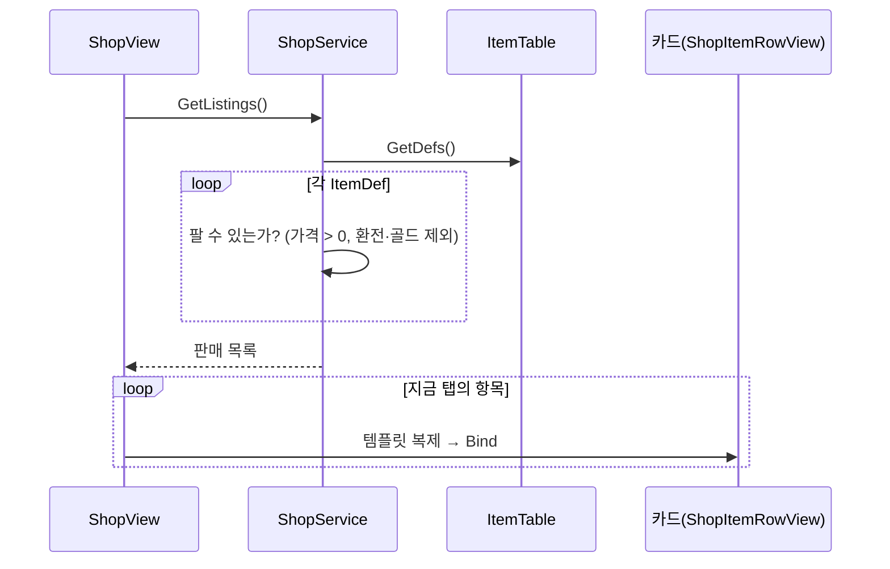

</details>

**판매 목록은 데이터에서 걸러 낸다.** `ShopService`는 `ItemTable`의 모든 정의를 돌면서 팔 수 있는 것만 고른다(`IsShopPurchasable`).

- 가격이 0 이하면 뺀다. 기본 지급·디버그 곡괭이는 가격이 0이라 상점에 나오지 않는다.
- 타입이 `Exchange`(광물, 상점에 파는 쪽)이거나 `Gold`(화폐)면 뺀다.
- 남은 정의는 타입이 `Pickaxe`면 곡괭이 탭, 나머지는 아이템 탭 카드가 된다.

구매·되돌리기(이번 방문의 구매 환불) 결과는 결과 구조체로 돌려준다.

**카드는 템플릿 하나를 복제한다.** `ShopView`는 씬에 비활성으로 둔 카드 템플릿(`rowTemplate`) 하나를 목록 수만큼 복제하고, 각 카드에 `ShopListing`을 넘긴다.
카드 디자인을 바꿔도 템플릿 하나만 고치면 되고, 카드 수는 데이터가 정한다.

```csharp
// ShopView.RefreshListing (발췌·요약)
foreach (ShopListing listing in shopService.GetListings())
{
    if (listing.Category != currentCategory) continue;   // 지금 열린 탭만
    ShopItemRowView row = Instantiate(rowTemplate, itemListContent);
    row.gameObject.SetActive(true);
    row.Bind(listing, HandlePurchaseRequested, isLocked, discountedPrice);
}
```

> 팀원 기여: `Bind`에 넘기는 잠금 표시(보유 곡괭이보다 약한 등급)와 업그레이드 할인 가격, 멀티플레이 구매의 서버 연결은 팀원 A가 추가했다. 본인 구현은 데이터 로드, 판매 목록 생성, 카드 템플릿 복제다.

**실제 화면과 데이터는 이름·가격·순서까지 그대로 대응한다.**

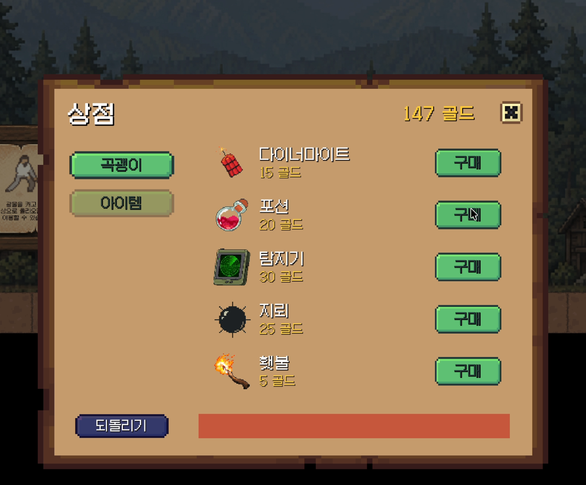

<details>
<summary>곡괭이 탭 화면 보기 (ID 1~3)</summary>


</details>

**영상:** [데이터로 만드는 상점 카드 (쇼츠)](https://youtube.com/shorts/-YI-EwyRZ_k)

| 상점 아이템 탭 카드 | `Items.tsv` 행(일부 열) |
|---|---|
| 다이너마이트 15골드 | `50  다이너마이트  15  Usable  Items/Usable/Dynamite` |
| 포션 20골드 | `51  포션  20  Usable  Items/Usable/Potion` |
| 탐지기 30골드 | `52  탐지기  30  Usable  Items/Usable/Detector` |
| 지뢰 25골드 | `53  지뢰  25  Usable  Items/Usable/Mine` |
| 횃불 5골드 | `54  횃불  5  Usable  Items/Usable/Torch` |

### 4.5 곡괭이 등급 확장

청동·은·금 채굴 키트(ID 1~3)는 모두 같은 프리팹(`Items/Pickaxe/Pickaxe`)을 쓴다.
`PickaxeItem`은 사거리와 굴착력을 자기 필드가 아니라 `Def.PickaxeData`(TSV의 `PickaxeRange`, `DigPower`, 4.2 표)에서 읽는다.

새 곡괭이 등급을 추가하는 과정은 이렇다.

1. `Items.tsv`에 한 줄을 추가한다. `PrefabKey`는 기존 `Items/Pickaxe/Pickaxe`를 그대로 쓰고, `PickaxeRange`·`DigPower`·`Price`만 정한다.
2. 썸네일 스프라이트를 넣고 `SpriteKey`로 연결한다.
3. 상점 곡괭이 탭에 카드가 나타나고, 사면 그 굴착력으로 채굴한다.

추가할 것에 따라 필요한 작업이 다르다.

| 추가할 것 | 필요한 작업 |
|---|---|
| 새 곡괭이 등급 | TSV 한 줄 + 썸네일 스프라이트 |
| 기존 아이템의 수치 조정 | TSV 값만 수정 |
| 새로운 *동작*을 가진 아이템 | `Item`을 상속한 클래스 + 프리팹 + TSV 한 줄(3.4). 멀티플레이에서는 서버 요청 분기도 추가(2.5) |

### 4.6 결과와 한계

**결과**
- 상점 카드 8장(아이템 5 + 곡괭이 3)이 모두 `Items.tsv` 행에서 만들어진다(4.4).
- 곡괭이 등급 3개가 프리팹 하나를 공유하고, 새 등급은 TSV 한 줄과 썸네일로 늘어난다(4.5).
- 밸런스 조정 커밋 3건은 TSV 파일만 고쳤고, C# 코드는 바뀌지 않았다(5.1).

**한계** (개선 방향은 5.3)
- `ItemTable`이 열 순서에 의존해 TSV를 읽는다.
- `Cooldown`은 `float`인데 `int.Parse`로 읽어 소수 값을 처리하지 못한다.
- 곡괭이 전용 칼럼(`PickaxeRange`, `DigPower`)이 아직 TSV에 남아 있다.

---

## 5. 통합 검증과 프로젝트 회고

**핵심 질문:** 각 시스템을 연결해 실제 게임에서 어디까지 동작을 확인했으며, 구현 과정에서 무엇을 배웠는가?

### 5.1 통합 구현 결과

목표한 경험은 "상황에 맞는 아이템을 골라 꺼내 쓰는 판단의 재미"였다(1.2). 아이템 6종과 상점을 게임에 연결해 팀원들과 함께 플레이했고, 수업 최종 발표에서 시연했다. 다만 팀 밖의 플레이어가 상황에 맞게 아이템을 골라 쓰는 재미를 느꼈는지는 확인하지 못했다(5.2).

**팀의 결과** — 3인 팀이 게임을 완성해 수업 최종 발표에서 시연했다. 내 파트(아이템·상점)의 목표별 결과는 1.2 표에, 장마다의 결과는 2.8 · 3.5 · 4.6에 있다.

새 아이템이 언제나 코드 수정 없이 추가되는 것은 아니다. 멀티플레이에서 새로운 동작을 가진 아이템은 서버 요청 분기도 추가해야 한다(5.3).

**성과와 근거**

| 성과 | 근거 |
|---|---|
| 아이템 6종의 공통 사용 규칙 | 2.2 `Item` 계약과 상속 구조, 2.4 `ItemController` 코드 |
| 지뢰·횃불 아이템 클래스 각각 **16줄** | `MineItem.cs`, `TorchItem.cs` (3.4) |
| 상점 카드 **8장**(아이템 5 + 곡괭이 3)이 모두 `Items.tsv` 행에서 생성 | 4.4 상점 화면과 TSV 행 대조 |
| 곡괭이 등급 3개가 프리팹 하나를 공유 | 4.5, `PrefabKey` = `Items/Pickaxe/Pickaxe` |
| 밸런스 조정 커밋 **3건**은 TSV 파일만 수정, C# 코드는 한 줄도 바뀌지 않음 | "게임 밸런스 디자인", "가격 밸런스 조정", "광물 내구도 밸런싱" 커밋 |
| 클라이언트 검증 코드 **41줄** 제거 | "아이템 사용 허가를 서버에 위임" 커밋 (2.5) |

### 5.2 기여도와 검증 범위

**기여 범위**

| 내용 | 기여 |
|---|---|
| `Item` 계약, `ItemController` 사용 흐름, 쿨타임 한 곳 처리 | 본인 구현 |
| 설치형 아이템 공통화(`PlaceableItemBase<T>`), 데이터 로드·판매 목록·카드 생성 | 본인 구현 |
| 아이템 전용 데이터 분리(4.3), 쿨타임 `itemID` 저장(2.3) | 본인 설계 결정 |
| `Use()` 반환값으로 소모 책임 변경(2.2) | 팀 공동 결정 |
| 서버 검증 책임 조정(2.5) | 팀 공동 결정, 클라이언트 검증 제거는 본인 구현 |
| 서버 거절 시 `requestId` 기반 쿨타임 복구(2.6) | 팀원 A 구현 |
| 상점 구매 서버 연결, 할인·잠금 표시(4.4) | 팀원 A 구현 |
| 서버 권위 투척의 위치 계산(2.5 「온라인 투척의 생성 위치 문제」의 원인) | 팀원 A 구현, 문제 해결과 제거는 본인 |
| 구현·리팩터링·문서 작성 보조 | AI 보조 (부록 A) |

**검증 범위**

| 확인 방법 | 확인한 것 |
|---|---|
| 코드·커밋 | 5.1의 줄 수·카드 수·커밋 수 |
| 본인 검증 (에디터 플레이) | 구현한 기능을 코드를 읽고 이해한 뒤 넣고, 에디터에서 플레이로 동작을 확인했다 |
| 팀 내부 플레이 | 팀원들과 함께 플레이했고, 수업 최종 발표에서 시연했다 |
| **확인하지 못한 것** | 상황에 맞는 아이템을 골라 쓰는 재미를 팀 밖의 플레이어가 실제로 느꼈는지는 확인하지 못했다. 외부 사용자 테스트나 성능 측정은 하지 않았다 |

### 5.3 기술 부채와 개선 방향

각 장의 "결과와 한계"에서 다룬 부채 7건을 한곳에 모으고 우선순위를 붙였다. 현상은 해당 절에 자세히 적었고, 여기서는 개선 방향을 정리한다. 아래 개선 방향은 모두 **아직 구현하지 않은 계획**이며, 효과를 측정한 것도 아니다.

| 순위 | 부채 | 현상 | 영향 | 개선 방향 | 자세히 |
|---|---|---|---|---|---|
| 1 | 온라인 요청의 아이템 타입별 분기 | `TryUseActiveItemOnline`이 아이템 타입별 `if`/`is` 분기로 서버 요청을 고른다 | 새 아이템을 추가할 때마다 이 분기를 수정해야 한다 → "모든 아이템이 같은 사용 규칙"이라는 목표를 직접 막음 | 각 `Item`이 자기 서버 요청을 만드는 메서드를 갖게 해서 분기 제거 | 2.5 |
| 2 | `ItemController`의 책임 집중 | 562줄이고, 입력·쿨타임·채굴·네트워크를 모두 담당한다 | 한 클래스가 바뀔 이유가 너무 많아, 쿨타임만 고쳐도 입력·네트워크 코드와 같은 파일을 건드린다 | 쿨타임 관리자, 입력 해석기를 분리 | 2.2 |
| 3 | 남은 클라이언트 검증 2개 | 서버로 일원화하면서 "스폰 지역", "체력이 가득 참" 검증이 남았다 | 서버와 판정 기준이 다시 어긋날 수 있다 | 제거하고 서버 응답의 실패 사유로만 안내 | 2.5 |
| 4 | `Cooldown`의 자료형 불일치 | `float`인데 TSV에서 `int.Parse`로 읽는다 | `1.5`처럼 소수 쿨타임을 넣으면 로드 중 오류가 난다 | `float.Parse`로 수정 | 4.2 |
| 5 | `ItemTable`의 열 순서 의존 | 열 순서(`cells[7]` 등)로 TSV를 파싱한다 | 표에 열을 끼워 넣거나 순서를 바꾸면 값이 엉뚱한 칸에서 읽힌다 | 헤더 이름으로 열을 찾도록 변경 | 4.6 |
| 6 | 곡괭이 전용 TSV 칼럼 | `PickaxeRange`, `DigPower`가 아직 TSV에 남아 있다 | 곡괭이가 아닌 행은 이 칸이 `0`이고, 4.3의 분리 기준과 어긋난다 | 곡괭이 데이터도 분리해 같은 기준으로 통일 | 4.3 |
| 7 | `TerrainManager` 반복 검색 | `FindFirstObjectByType<TerrainManager>()`를 사용할 때마다 호출한다 | 쓸 때마다 씬 전체를 검색한다 | 초기화 시 주입하거나 캐싱 | — |

### 5.4 배운 점

이 프로젝트의 문제들은 한 가지로 모인다. **'일단 동작하는 것'과 '팀이 함께 유지보수할 수 있는 것'은 다르다.**

**공통화는 중복을 줄이는 일이기 전에 책임의 위치를 정하는 일이다.**
쿨타임 버그(2.4)는 코드가 길어서가 아니라, "사용한 뒤의 처리"를 누가 맡는지 정해져 있지 않아서 생겼다. 쿨타임을 한 곳으로 모으자 아이템 종류와 관계없이 같은 규칙이 적용됐다.

**역할이 겹치는 구간은 최종 책임자와 값의 의미를 미리 정한다.**
클라이언트와 서버가 같은 조건을 각각 검증하다가 서버의 실패 사유가 화면에 뜨지 않았고(2.5), 사용 결과 `bool`을 서로 다르게 이해해 서버가 거절해도 쿨타임이 시작됐다(2.6). 값 하나도 정확히 무엇을 의미하는지 미리 맞추지 않으면 찾기 어려운 버그가 된다.

**데이터 기반 구조는 데이터 형식이 안정적일 때만 힘을 낸다.**
TSV만 고쳐 밸런스를 맞출 수 있었지만(5.1), 열 순서에 의존하는 파싱과 `Cooldown`의 자료형 불일치처럼 표를 읽는 쪽이 약하면 데이터 수정이 곧 오류가 된다(5.3).

**공통 구조는 다음 아이템을 넣을 때 어디를 고치는지까지 보고 설계한다.**
입력·소모·쿨타임은 공통화했지만, 온라인 요청 분기는 아이템마다 고쳐야 하는 곳으로 남았다(5.3).

**증상이 아니라 원인이 있는 곳을 고친다.**
다이너마이트가 벽 안에서 생성된 문제는 위치 계산값을 줄여도 남았고, 원인인 플레이어 스프라이트의 피벗을 바로잡고서야 사라졌다(2.5). 그래픽 문제를 로직으로 덮으면 다른 곳에서 버그가 생긴다.

다음 프로젝트에서는 시작 단계부터 역할 경계와 데이터 의미를 문서로 남긴다.

---

## 부록

### A. AI 협업

Claude Code를 구현 보조로 썼다.

| | 내용 |
|---|---|
| Claude Code에게 맡긴 것 | 코드 구현, 리팩터링, 문서·커밋 메시지 작성 |
| 직접 판단한 것 | 아이템 전용 값을 ScriptableObject로 나눈 것(4.3), 쿨타임을 `itemID`에 기록한 것(2.3). 소모 시점(2.2)과 검증을 서버로 모은 것(2.5)은 팀원과 함께 정했다 |
| 확인한 방법 | 코드를 읽고 이해한 뒤 넣었고, 에디터에서 플레이로 확인했다 |
| 잘 된 것 | 횃불을 추가하면서 지뢰의 설치 로직을 `PlaceableItemBase<T>`로 옮긴 작업(3.2). 지뢰·횃불 클래스가 둘 다 16줄이 됐다 |
| 받아들이지 않은 것 | AI가 짠 코드가 과하게 설계된 경우가 있어, 전체 코딩 스타일을 한눈에 보이고 직관적이고 쉬운 방식으로 다시 리팩터링했다 |

### B. 그 밖의 담당 작업

| 작업 | 내용 |
|---|---|
| **아이템 데이터 테이블** | 아이템 정보를 `Items.tsv`로 관리한다. 이름·가격·쿨타임·곡괭이 사거리·굴착력을 표의 값만 바꿔 조정한다(4.2) |
| **리스폰** | "사망 → 대기 → 시작 지점 리스폰" 흐름을 처음 구현하고, 공중에서 죽으면 그 자리에 멈추던 버그를 고쳤다. (이후 팀원 A가 플레이어 컨트롤러 책임 분리와 사망 시 아이템 드롭을 추가했다) |
| **곡괭이 조준** | 조준선과 목표 타일 하이라이트, 매몰 시 자기 타일 채굴 허용 |
| **초기 캐릭터 조작** | 벽 매달리기, 회피 기동 |
