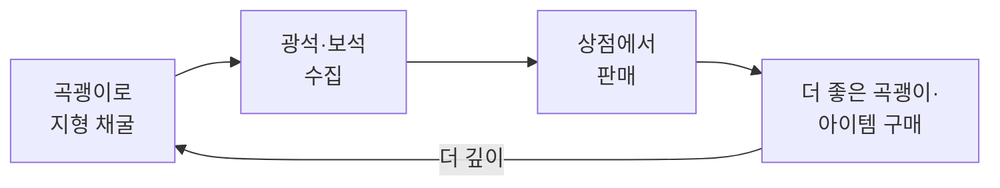
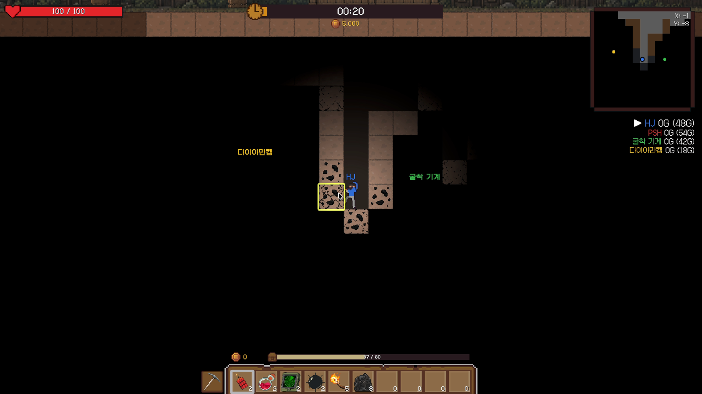
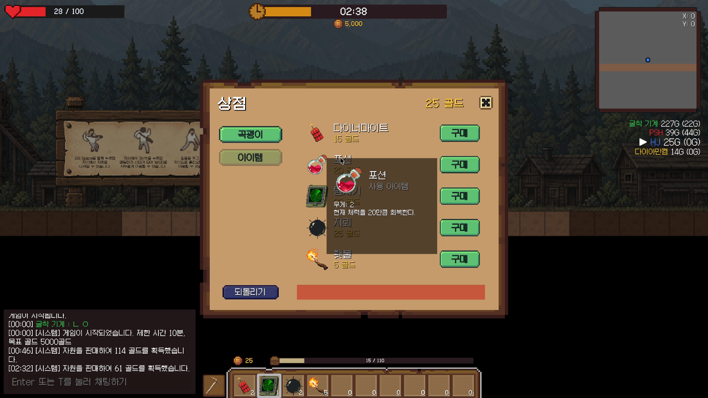
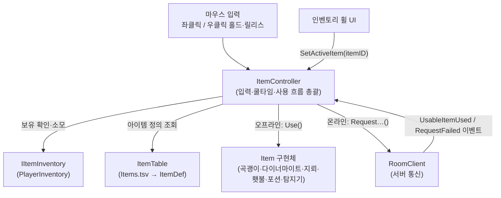
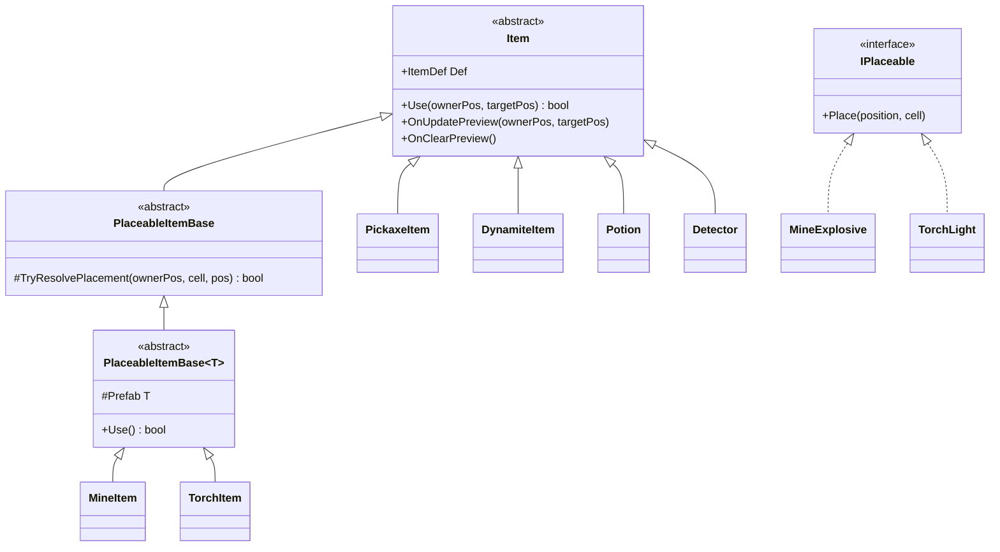
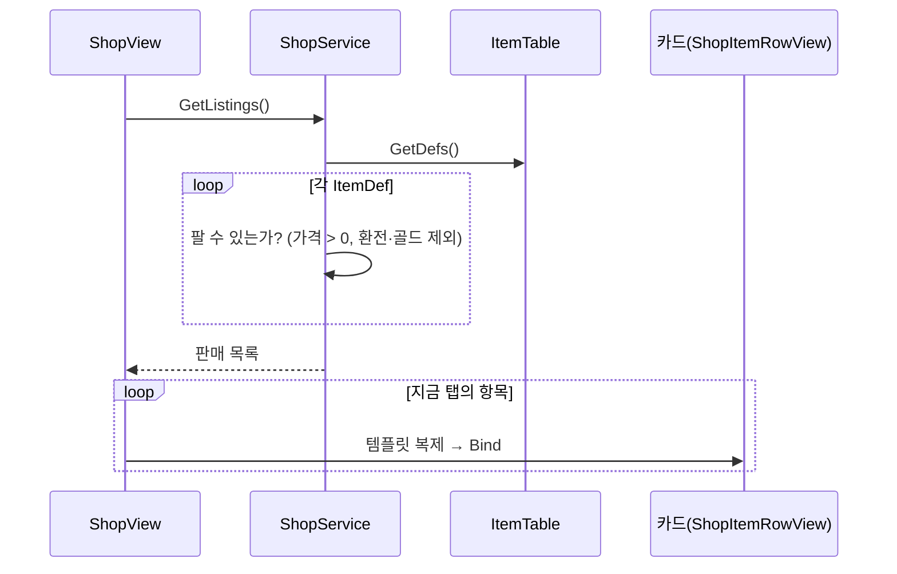
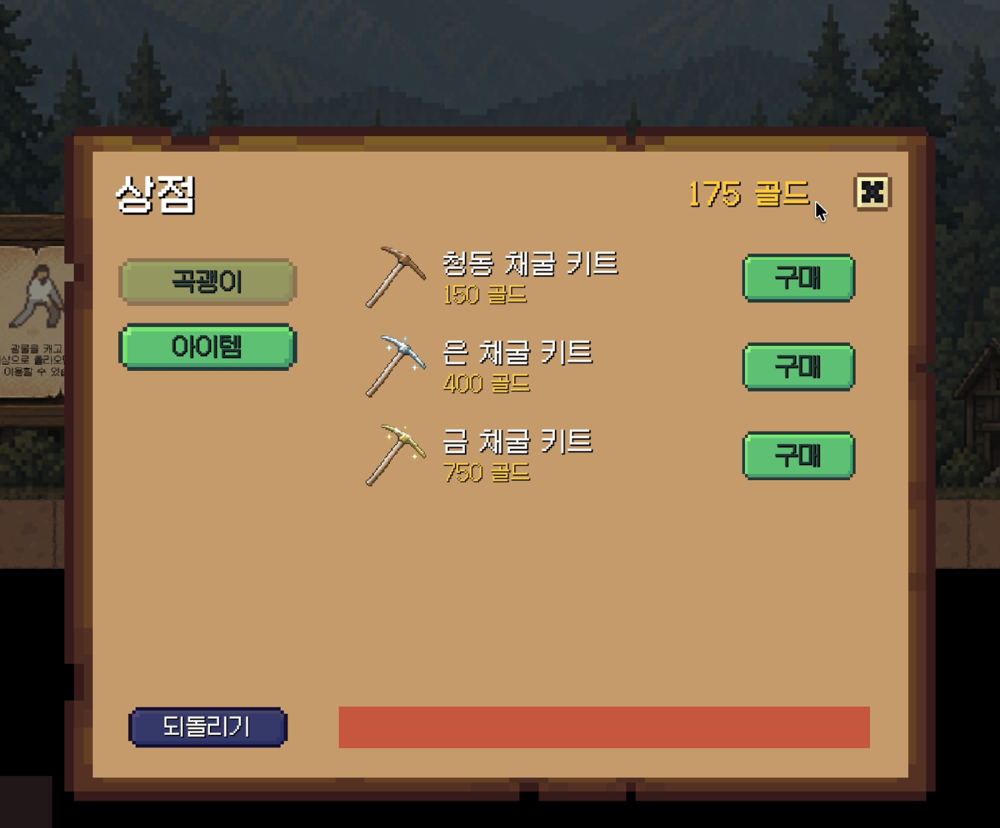

<!-- 작성 상태: 초안 v0.9 (개편 가이드 적용 — 문제 → 구조 → 구현 → 설계 결정 → 결과의 6장 구성, AI 협업은 부록 B) · 시연 영상·쇼츠 링크 넣음(2026-11-22) -->

# 아이템 사용 시스템 (FOLK SACK)

> 3인 팀 2D 멀티플레이 채굴 게임에서 맡은 아이템 사용 시스템
>
> 아이템마다 따로 짜여 있던 사용 처리와 쿨타임을 `Item` 계약과 `ItemController` 한 곳으로 모으고, 설치형 아이템은 제네릭 베이스 클래스로, 상점은 표 파일(TSV)의 한 줄이 그대로 카드가 되도록 만들었다. 출발점은 아이템별 분기 코드가 늘면서 멀티플레이에서 일부 아이템에 쿨타임이 적용되지 않던 버그다.
>
> - **결과:** 아이템 6종이 같은 사용 규칙을 따르고, 지뢰·횃불은 클래스 16줄·TSV 한 줄·프리팹으로 만들어졌다. 상점 카드 8장이 모두 TSV에서 만들어지고, 밸런스 조정 커밋 3건은 TSV 파일만 고쳐 끝냈다
> - **배운 점:** 클라이언트·서버처럼 역할이 겹치는 구간은 최종 책임자와 값의 의미를 팀이 함께 정해야 한다

---

## 1. 프로젝트 소개

### 1.1 게임 소개와 핵심 플레이 루프

FOLK SACK은 여러 명이 한 맵에서 땅을 파 내려가며 광물을 캐고, 판 돈으로 장비를 사서 더 깊이 들어가는 2D 게임이다.

| 항목 | 내용 |
|---|---|
| 프로젝트 | FOLK SACK |
| 장르 | 2D 멀티플레이 채굴·생존 게임 |
| 팀 구성 | 3명 — 박수하(본인), 팀원 A, 팀원 B |

**핵심 루프**



채굴하면 지형이 무너진다.
깊이 내려갈수록 위험과 보상이 함께 커지기 때문에 플레이어는 이 루프를 되풀이한다. 아이템은 그 위험을 넘기는 도구다.

| ① 채굴 | ② 상점 | ③ 더 깊이 |
|---|---|---|
|  |  |  |

**영상:** [게임 소개와 핵심 루프 (쇼츠)](https://youtube.com/shorts/wmK_vLV52E4)

### 1.2 팀 구성과 담당 역할

| 팀원 | 담당 |
|---|---|
| **박수하 (본인)** | **아이템 사용 시스템** (곡괭이·다이너마이트·지뢰·횃불·포션·탐지기), 아이템 데이터 테이블, 쿨타임, 상점, 리스폰, 초기 캐릭터 조작 |
| 팀원 A | 지형 생성·붕괴 시스템, 서버 권위 멀티플레이(로비·동기화), 인게임 UI·UX |
| 팀원 B | 그래픽·UI 디자인, 사운드, 굴착 피드백(DOTween 흔들림·균열 표시) |

### 1.3 담당 시스템과 해결 목표

담당 시스템은 플레이어가 쓰는 아이템 6종과, 그 아이템을 파는 상점이다.

**목표한 경험:** 위기에 몰린 플레이어가 아이템을 꺼내 빠져나가는 **위기 탈출의 손맛**

| 다이너마이트 | 탐지기 |
|---|---|
|  |  |

이 경험을 받치려면 아이템이 늘어나도 **모든 아이템이 같은 규칙으로 사용·소모·쿨타임 처리**돼야 했다. 그 규칙이 어떻게 깨져 있었는지는 2장에서 다룬다.

> **문서 범위** — 팀 프로젝트 중 담당 파트를 이렇게 나눠 다룬다.
> - **핵심 시스템:** 아이템 사용 — 입력을 받아 아이템을 조준·사용하고, 멀티플레이에서는 서버에 사용을 요청하는 흐름(4.1, 4.2)
> - **핵심 확장 구조:** 설치형 아이템의 제네릭 베이스 클래스(4.3)
> - **연관 시스템:** 데이터 기반 상점 — TSV(탭으로 칸을 나눈 표 파일) 한 줄이 상점 카드가 되는 구조(4.4)
> - **부록:** 리스폰·곡괭이 조준·초기 캐릭터 조작 등 그 밖의 담당 작업(부록 A)
>
> 서버 쪽 처리(사용 판정, 거절 시 쿨타임 되돌리기, 상점 구매 연결)는 팀원 A가 구현했고, 해당 절에 따로 표시한다.

### 1.4 아이템 조작 및 사용 방식

| 입력 | 동작 |
|---|---|
| 좌클릭 (홀드) | 장착된 곡괭이로 채굴 (휠 선택과 관계없이 고정) |
| 우클릭 홀드 | 휠로 선택한 아이템의 조준 미리보기 표시 |
| 우클릭 릴리스(떼기) | 미리보기 중이던 아이템 사용 |
| 미리보기 중 좌클릭 | 사용 취소 (곡괭이도 발동하지 않음) |

### 1.5 개발 환경과 프로젝트 링크

| 항목 | 내용 |
|---|---|
| Engine | Unity 6 (6000.3.15f1), URP 2D, Input System, DOTween |
| Language | C# |
| Core | 추상 클래스 계약 + 제네릭 베이스 클래스, TSV 데이터 테이블 + ScriptableObject(Unity의 데이터 에셋), 서버 권위 멀티플레이 연동 |
| 기간 | 2026.08.23 ~ 2026.09.10 (약 3주, 3인 팀) |
| AI 활용 | Claude Code — 구현·리팩터링·문서 작성 보조. 설계 결정은 직접 하거나 팀원과 함께 (부록 B) |
| GitHub | https://github.com/parksooha102-ai/3rd-TeamProject-KH |
| 시연 영상 | https://youtu.be/rNZDtatcqBI |

---

## 2. 해결하려던 문제와 설계 방향

### 2.1 기존 아이템 사용 구조의 문제

처음 구조에서는 아이템을 쓰는 처리가 아이템마다 따로 적혀 있었다.

- **멀티플레이 사용 처리가 아이템 종류별 `switch` 분기로 나뉘어 있었다.** 분기마다 서버 요청·쿨타임 시작·미리보기 종료 코드를 따로 적어야 해서, 아이템을 추가할수록 같은 코드가 늘었다.
- **아이템은 "이번에는 사용하지 않았다"를 알릴 수 없었다.** `Use()`가 `void`여서 호출한 쪽은 결과와 관계없이 아이템을 소모했다. 이미 지뢰가 있는 칸에 설치를 막아도, 막힌 지뢰가 인벤토리에서 빠졌다.

### 2.2 멀티플레이 환경에서 발생한 쿨타임 문제

분기마다 코드를 따로 적는 구조는 실제 버그로 이어졌다.

- **일부 아이템에만 쿨타임이 걸렸다.** 쿨타임 시작 코드가 다이너마이트 분기에만 들어 있어서, 멀티플레이에서 지뢰·포션·탐지기에는 쿨타임이 적용되지 않았다.
- **서버가 거절해도 쿨타임이 돌았다.** 같은 사용 조건을 클라이언트와 서버가 각각 검증하고 있었고, 사용 결과로 받는 `bool`의 의미도 팀 안에서 다르게 이해하고 있었다. 그래서 서버가 사용을 거절해도 실패 메시지는 뜨지 않고 쿨타임만 시작됐다(5.4).

### 2.3 공통 아이템 사용 구조의 설계 목표

| 목표 | 기준 |
|---|---|
| 아이템을 추가해도 사용 흐름은 그대로 | 새 아이템을 넣어도 입력·소모·쿨타임 코드를 고치지 않는다 |
| 실패한 사용은 아무것도 남기지 않는다 | 사용하지 못했으면 아이템도 줄지 않고 쿨타임도 걸리지 않는다 |
| 판정의 최종 책임은 한 곳 | 멀티플레이에서는 서버가 최종 판정하고, 클라이언트는 그 결과를 따른다 |
| 수치는 데이터로 | 가격·쿨타임 같은 값은 코드를 고치지 않고 표 파일로 조정한다 |

### 2.4 시스템의 핵심 설계 원칙

1. **아이템은 효과만, 부수 효과는 한 곳에서.** 아이템(`Item`)은 자기 효과를 내고 실제로 사용했는지만 돌려준다. 소모와 쿨타임은 `ItemController` 한 곳에서만 처리한다.
2. **사용 성공과 요청 성공을 구분한다.** 오프라인에서는 아이템이 직접 성공을 알리지만, 온라인에서는 요청을 보낸 것과 서버가 승인한 것이 다르다.
3. **같은 흐름은 한 번만 쓴다.** 지뢰·횃불처럼 흐름이 같은 아이템은 공통 베이스 클래스에 흐름을 두고, 아이템 클래스는 다른 점만 가진다.

---

## 3. 시스템 구조

### 3.1 전체 아이템 사용 흐름

마우스 입력과 휠 선택은 모두 `ItemController`로 모인다. 오프라인이면 `Use()`를 바로 부르고, 온라인이면 `RoomClient`를 거쳐 서버에 사용을 요청한 뒤 결과 이벤트를 받는다.



### 3.2 주요 클래스와 책임 분담

| 클래스 / 인터페이스 | 책임 | 연결 |
|---|---|---|
| `ItemController` | 입력 해석, 장착 아이템 관리, 쿨타임, 온라인/오프라인 사용 분기 | 아이템이 **무엇을 하는지** 모르고 `Use()`의 성공 여부만 받는다 |
| `Item` (abstract) | 모든 아이템의 계약. `Use()`는 실제로 사용했는지만 `bool`로 반환한다 | 6종 아이템이 상속한다(3.3) |
| `IItemInventory` | 인벤토리 계약(보유 확인·소모·변경 이벤트) | `ItemController`는 인벤토리 구현체 대신 이 계약에만 의존한다 |
| `ItemTable` / `ItemDef` | `Items.tsv`를 읽어 아이템 정의(가격·쿨타임·곡괭이 스탯)를 만든다 | 아이템·상점이 같은 정의를 쓴다(3.4) |
| `RoomClient` | 서버에 사용 요청을 보내고 결과를 이벤트로 알린다 (팀원 A) | 승인은 `UsableItemUsed`, 거절은 `RequestFailed` |

지금 구조에서는 입력·쿨타임·채굴·네트워크 분기가 모두 `ItemController`에 있다. 이 책임 집중은 남은 기술 부채다(6.3).

### 3.3 아이템 상속 구조

모든 아이템은 `Item`을 상속하고, 설치형인 지뢰·횃불은 그 사이에 `PlaceableItemBase`와 `PlaceableItemBase<T>`를 거친다. 설치 구조의 구현은 4.3에서 다룬다.



다이너마이트와 지뢰는 폭발 처리(이펙트 → 지형 채굴 → 플레이어 피해)를 `ExplosiveBase`에서 함께 쓴다.

### 3.4 데이터 및 인벤토리 연결 구조

아이템 정의는 `StreamingAssets/Table/Item/Items.tsv` 한 파일에서 나온다. 게임이 시작되면 `DataManager`가 `ItemTable.Load()`로 이 표를 읽어 `ItemDef`를 만들고, 같은 정의를 두 곳이 나눠 쓴다.

- **아이템 사용:** `ItemController`가 장착할 아이템의 정의(타입·쿨타임·프리팹)를 `ItemTable`에서 찾고, 보유 수량은 `IItemInventory`로 확인한다.
- **상점:** `ShopService`가 같은 `ItemTable`에서 팔 수 있는 정의만 골라 판매 목록을 만들고, `ShopView`가 카드를 그린다(4.4).

특정 아이템만 쓰는 값(다이너마이트의 폭발 반경, 지뢰의 감지 반경 등)은 TSV가 아니라 ScriptableObject 에셋에 둔다(5.1).

---

## 4. 핵심 기능 구현

### 4.1 아이템 선택과 장착 관리

외부(인벤토리 휠 UI)는 `itemID` 하나만 넘긴다. 정의가 있는지, 보유하고 있는지, 장착할 수 있는 타입인지는 `ItemController`가 확인한다. 환전용·골드 타입은 장착하지 않는다.

```csharp
// 인벤토리 휠에서 아이템을 고를 때
itemController.SetActiveItem(itemID);

// 쿨타임 UI(라디얼 필)를 그릴 때
float remaining = itemController.GetItemCooldownRemaining(itemID);
float duration  = itemController.GetItemCooldownDuration(itemID);
fillImage.fillAmount = duration > 0f ? remaining / duration : 0f;
```

쿨타임은 `itemID`로 조회하므로, 휠 UI는 장착하지 않은 아이템 칸에도 쿨타임을 그릴 수 있다. 이렇게 저장한 이유는 5.3에서 다룬다.

### 4.2 아이템 사용과 쿨타임 처리

쿨타임은 같은 아이템을 연달아 써서 위기를 넘기지 못하게 한다.

#### 4.2.1 입력부터 사용 요청까지

우클릭을 누르면 조준 미리보기가 시작되고, 쿨타임 중인 아이템은 미리보기조차 시작하지 않는다. 미리보기 중 좌클릭하면 사용을 취소한다.
우클릭을 떼는 순간 아래 순서로 동작한다.

1. 쿨타임 중이면 사용하지 않는다.
2. 서버에 연결돼 있으면 서버에 **사용 요청**을 보내고, 아니면 `Use()`를 직접 호출한다(`TryUseActiveItem`).
3. 2의 결과가 `true`일 때만 쿨타임을 시작한다.
4. 어떤 분기를 탔든 미리보기는 한 곳에서 한 번만 끝낸다.

```csharp
// ItemController.cs (발췌)
if (IsOnCooldown(activeItem.Def) == false)
{
    Item item = activeItem; // 소모로 activeItem이 해제되기 전에 참조를 확보
    if (TryUseActiveItem(item, ownerPos, mouseWorldPos, out string requestId))
    {
        StartCooldown(item.Def);                   // 쿨타임 시작은 여기 한 곳에서만
        TrackPendingCooldown(requestId, item.Def); // (팀원 A 구현) 온라인 요청이면 거절에 대비해 기록
    }
}

// 어떤 분기를 탔든 미리보기 종료는 여기서 한 번만
activeItem?.OnClearPreview();
isPreviewingActiveItem = false;
```

아이템 종류별 분기에 흩어져 있던 쿨타임 시작 코드를 이 한 곳으로 모은 것이 2.2의 "일부 아이템에만 쿨타임" 버그를 고친 방법이다("다이너마이트를 제외한 아이템에 쿨타임이 적용되지 않던 버그 수정" 커밋).

#### 4.2.2 사용 성공과 아이템 소모

오프라인에서는 `Use()`가 돌려준 값이 곧 **아이템 사용 성공**이다. `true`일 때만 인벤토리에서 1개를 뺀다.

```csharp
// ItemController.TryUseActiveItemOffline (발췌)
bool wasUsed = item.Use(ownerPos, mouseWorldPos);
if (wasUsed)
    inventory?.TryRemove(itemID, 1);
return wasUsed;
```

그래서 이미 지뢰가 있는 칸처럼 설치가 막히면, 아이템도 줄지 않고 쿨타임도 걸리지 않는다. `Use()`가 `bool`을 돌려주게 된 이유는 5.2에서 다룬다.


**영상:** [아이템 사용과 쿨타임 (쇼츠)](https://youtube.com/shorts/MxmaHOm_v6k)

#### 4.2.3 온라인·오프라인 사용 흐름

`TryUseActiveItem()`이 돌려주는 `true`의 뜻은 연결 상태에 따라 다르다.

| | 오프라인 | 온라인 |
|---|---|---|
| 호출 | `Use()`를 직접 호출 | `RoomClient`로 서버에 사용 요청을 보냄 |
| `true`의 뜻 | **아이템 사용 성공** (효과가 실제로 적용됨) | **서버 요청 전송 성공** (아직 서버가 승인하지 않음) |
| 사용 가능 판정 | 아이템이 직접 판단 | **서버 최종 판정** |
| 아이템 소모 | `ItemController`가 `TryRemove` | 클라이언트가 직접 줄이지 않고, 서버가 보내는 인벤토리 상태를 따름 |
| 쿨타임 | 성공 시 시작 | 요청 전송 시 시작하고, 서버가 거절하면 되돌림(4.2.4) |

온라인 요청은 아이템 타입별 분기(`DynamiteItem` → 투척 요청, `MineItem`·`TorchItem` → 설치 요청, `Potion`·`Detector` → 사용 요청)로 고른다. 서버가 지원하지 않는 아이템은 요청하지 않고 경고 로그를 남긴다. 이 분기는 새 아이템마다 고쳐야 하는 곳으로 남아 있다(6.3).

#### 4.2.4 서버 요청 실패와 쿨타임 복구 (팀원 A 구현)

온라인에서는 요청을 보낸 순간 쿨타임이 시작되므로, 서버가 거절하면 그 쿨타임을 되돌려야 한다.

1. 요청을 보낼 때 `requestId`와 아이템 ID를 대기 목록(`pendingCooldowns`)에 기록한다.
2. 서버가 승인하면(`UsableItemUsed`) 기록만 지운다. 쿨타임은 그대로 돈다.
3. 서버가 거절하면(`RequestFailed`) 그 `requestId`로 시작한 쿨타임만 지운다.

이 처리가 들어오게 된 과정은 5.4에서 다룬다.

### 4.3 설치형 아이템 공통화

지뢰 같은 설치형 아이템은 다른 플레이어를 견제하는 데 쓴다.

#### 4.3.1 지뢰와 횃불의 공통 동작

지뢰와 횃불은 "플레이어가 선 타일에 프리팹을 하나 놓는다"는 흐름이 같다. 처음에는 이 흐름이 지뢰 클래스 안에 있었고, 횃불을 추가하면서 지뢰의 설치 로직을 공통 베이스 클래스로 옮겼다.

| 단계 | 공통 처리 |
|---|---|
| 셀 계산 | 플레이어 위치에서 설치할 타일과 좌표를 구한다 (`TryResolvePlacement`) |
| 중복 확인 | 같은 타입이 이미 그 셀에 있는지 본다 (`GridOccupancy<T>`) |
| 생성 | 프리팹을 만든다 |
| 설치 | 생성한 개체의 `Place()`를 부른다 (`IPlaceable`) |

#### 4.3.2 `PlaceableItemBase<T>` 구현

`T`는 설치될 개체의 타입(`MineExplosive`, `TorchLight`)이다. `GridOccupancy<T>`는 타입별로 "이 셀에 이미 설치돼 있는가"를 기록하는 정적 레지스트리라서, 지뢰와 횃불은 서로의 칸을 막지 않는다.

```csharp
// PlaceableItemBase<TPlaceable>.Use() (발췌)
if (TryResolvePlacement(ownerPos, out Vector2Int cell, out Vector3 placePosition) == false)
    return false; // 셀을 못 찾으면 플레이어 위치로 대신 설치하지 않고 실패 처리

if (GridOccupancy<TPlaceable>.IsOccupied(cell))
    return false; // 같은 타입은 한 셀에 하나만

TPlaceable instance = Instantiate(prefab, placePosition, Quaternion.identity);
instance.Place(placePosition, cell);
return true;
```

실패하면 `false`를 돌려주므로, 4.2.2의 규칙대로 아이템이 줄지 않는다.

#### 4.3.3 신규 설치형 아이템 추가 방식

아이템 클래스에는 다른 점(프리팹)만 남는다. 지뢰와 횃불 아이템 클래스는 둘 다 프리팹 필드 하나만 가진 **16줄**짜리 클래스다.

```csharp
public class TorchItem : PlaceableItemBase<TorchLight>
{
    [SerializeField] private TorchLight torchPrefab;
    protected override TorchLight Prefab => torchPrefab;
}
```

같은 흐름의 설치형 아이템은 이 클래스와 TSV 한 줄, 프리팹으로 추가한다. 설치된 뒤의 동작(폭발, 빛)은 설치될 개체 쪽에 따로 구현해야 하고, 멀티플레이에서는 서버 요청 분기도 추가해야 한다(4.2.3).

### 4.4 데이터 기반 아이템과 상점

상점에서는 판 돈으로 다음 위기를 넘길 아이템과, 더 깊이 내려갈 곡괭이를 함께 산다.
상점에 무엇을 팔지 적어 둔 코드는 없다. `Items.tsv`의 행이 그대로 상점 카드가 된다.

```
Items.tsv → ItemDTO → ItemDef → ShopListing → ShopView → 상점 카드
```

#### 4.4.1 TSV 데이터 로드와 `ItemDef` 변환

`ItemTable.Load()`는 `Items.tsv`를 두 단계로 바꾼다. 먼저 줄마다 탭으로 칸을 나눠 글자 그대로 `ItemDTO`에 담고, 그다음 문자열 키를 실제 값으로 풀어 `ItemDef`를 만든다.

| `Items.tsv` 열 (청동 채굴 키트, ID 1) | `ItemDTO` — 칸을 나눠 그대로 담기 | `ItemDef` — 게임이 쓰는 값 |
|---|---|---|
| `ID` = `1` | `int ID` (`int.Parse`) | `ID` 그대로. `ItemTable` 사전의 키 |
| `Name`·`Description` = `청동 채굴 키트` | `string` | 그대로. 상점 카드의 이름 |
| `Price` = `150` | `int Price` | 그대로. 카드 가격이고, 0이면 상점에서 빠진다(4.4.2) |
| `ItemType` = `Pickaxe` | `string ItemType` | `ItemType Type`. `Enum.Parse`로 열거형(`Exchange`·`Pickaxe`·`Usable`·`Gold`)이 되고, 상점 탭을 가른다 |
| `PrefabKey` = `Items/Pickaxe/Pickaxe` | `string PrefabKey` | `Item Prefab`. `Resources.Load<Item>`으로 찾은 실제 프리팹 |
| `SpriteKey` = `Items/Pickaxe/BronzePickaxe_Thumbnail` | `string SpriteKey` | `Sprite Sprite`. `Resources.Load<Sprite>`로 찾은 썸네일(카드 그림) |
| `PickaxeRange` = `2` · `DigPower` = `2` | `float PickaxeRange` · `int DigPower` | `PickaxeInfo? PickaxeData`. `Type`이 `Pickaxe`일 때만 `(Range, DigPower)`로 묶고, 그 밖의 아이템은 `null` |
| `Cooldown` = `0` | `float Cooldown` (읽을 때는 `int.Parse`, 6.3) | 그대로. 아이템별 쿨타임(5.3) |
| `Weight` = `10` · `InventoryCapacityBonus` = `30` | `int` | 그대로. 인벤토리 수용량 계산에 쓴다(팀원 A가 추가) |

사용 아이템은 같은 표에서 곡괭이 칸이 0이다. 예: 탐지기(ID 52)는 `Price` 30, `ItemType` `Usable`, `Cooldown` 8, `PickaxeRange`·`DigPower` 0이라 `ItemDef`에 `PickaxeData`가 없다.

#### 4.4.2 판매 목록 필터링

게임이 시작되면 `ShopAccessController`가 `ShopService`를 만들어 `ShopView`에 넘긴다. 탭을 바꿀 때마다 아래 순서로 카드 목록을 다시 그린다.



`ShopService`는 `ItemTable`의 모든 정의를 돌면서 팔 수 있는 것만 고른다.

```csharp
// ShopService.cs (발췌)
public static bool IsShopPurchasable(ItemDef def)
{
    if (def.Price <= 0) return false;              // 기본 지급·디버그 곡괭이는 가격 0이라 빠진다
    return def.Type != ItemType.Exchange           // 광물(상점에 파는 쪽)
        && def.Type != ItemType.Gold;              // 화폐
}

public IReadOnlyList<ShopListing> GetListings()
{
    List<ShopListing> listings = new();
    foreach (ItemDef def in itemTable.GetDefs())
    {
        if (IsShopPurchasable(def) == false) continue;
        listings.Add(new ShopListing(def.ID, def.Name, def.Price, def.Sprite,
            GetCategory(def),                      // Pickaxe면 곡괭이 탭, 나머지는 아이템 탭
            def.PickaxeData?.DigPower ?? 0));
    }
    return listings;
}
```

구매·되돌리기(이번 방문의 구매 환불) 결과는 결과 구조체로 돌려준다.

#### 4.4.3 상점 카드 생성

`ShopView`는 씬에 비활성으로 둔 카드 템플릿(`rowTemplate`) 하나를 목록 수만큼 복제하고, 각 카드에 `ShopListing`을 넘긴다.
카드 디자인을 바꿔도 템플릿 하나만 고치면 되고, 카드 수는 데이터가 정한다.

```csharp
// ShopView.RefreshListing (발췌·요약)
foreach (ShopListing listing in shopService.GetListings())
{
    if (listing.Category != currentCategory) continue;   // 지금 열린 탭만
    ShopItemRowView row = Instantiate(rowTemplate, itemListContent);
    row.gameObject.SetActive(true);
    row.Bind(listing, HandlePurchaseRequested, isLocked, discountedPrice);
}
```

> 팀원 기여: `Bind`에 넘기는 잠금 표시(보유 곡괭이보다 약한 등급)와 업그레이드 할인 가격, 멀티플레이 구매의 서버 연결은 팀원 A가 추가했다.

실제 화면과 데이터는 이름·가격·순서까지 그대로 대응한다.

| 상점 아이템 탭 카드 | `Items.tsv` 행(일부 열) |
|---|---|
| 다이너마이트 15골드 | `50  다이너마이트  15  Usable  Items/Usable/Dynamite` |
| 포션 20골드 | `51  포션  20  Usable  Items/Usable/Potion` |
| 탐지기 30골드 | `52  탐지기  30  Usable  Items/Usable/Detector` |
| 지뢰 25골드 | `53  지뢰  25  Usable  Items/Usable/Mine` |
| 횃불 5골드 | `54  횃불  5  Usable  Items/Usable/Torch` |

| 아이템 탭 (ID 50~54) | 곡괭이 탭 (ID 1~3) |
|---|---|
|  |  |

**영상:** [데이터로 만드는 상점 카드 (쇼츠)](https://youtube.com/shorts/y0pHal7zRfc)

#### 4.4.4 곡괭이 등급 확장

청동·은·금 채굴 키트(ID 1~3)는 모두 같은 프리팹(`Items/Pickaxe/Pickaxe`)을 쓴다.
`PickaxeItem`은 사거리와 굴착력을 자기 필드가 아니라 `Def.PickaxeData`(TSV의 `PickaxeRange`, `DigPower`, 4.4.1 표)에서 읽는다.

추가할 것에 따라 필요한 작업이 다르다.

| 추가할 것 | 필요한 작업 |
|---|---|
| 새 곡괭이 등급 | **TSV 한 줄 + 썸네일 스프라이트.** 상점 곡괭이 탭에 나타나고, 사면 그 굴착력으로 채굴한다 |
| 기존 아이템의 수치 조정 | TSV 값만 수정 |
| 새로운 *동작*을 가진 아이템 | `Item`을 상속한 클래스 + 프리팹 + TSV 한 줄(4.3.3). 멀티플레이에서는 서버 요청 분기도 추가(4.2.3) |

### 4.5 예외 처리와 사용 제한

| 상황 | 처리 |
|---|---|
| 보유 수량 0 (판매·드롭으로 소진) | 인벤토리 변경 이벤트를 받아 장착 자동 해제 |
| 환전용·골드 타입 선택 | 장착하지 않음 |
| 일시정지·설정 창이 열림 | 진행 중인 미리보기와 채굴을 취소 |
| 흙에 묻힘(매몰) | 아이템 미리보기를 취소 (탈출용 곡괭이 채굴은 가능) |
| 설치할 셀 계산 실패 | 설치하지 않음 (플레이어 위치로 대신 설치하지 않음) |
| 서버가 지원하지 않는 아이템 | 멀티플레이에서 사용 차단 + 경고 로그 |

---

## 5. 설계 결정과 트러블슈팅

이 장은 대안을 비교해 고른 선택 네 가지(5.1~5.4)와, 실제로 겪은 문제 두 가지(5.5, 5.6)를 다룬다. 결정마다 누가 정했는지 함께 적는다.

### 5.1 아이템 공통 데이터와 전용 데이터의 분리 (본인 결정)

**결정 대상** — 다이너마이트의 폭발 반경·위력·퓨즈 시간처럼 **특정 아이템에서만 쓰는 값**을 어디에 둘까?

| | [A] 모든 값을 `Items.tsv` 하나에 칼럼으로 (처음 방식) | [B] 공통 값은 TSV, 전용 값은 ScriptableObject (채택) |
|---|---|---|
| 장점 | 모든 아이템 데이터를 한 파일에서 보고 고칠 수 있다 | TSV에는 모든 아이템이 공유하는 값(이름, 가격, 쿨타임 등)만 남는다. 전용 값은 그 아이템의 데이터 에셋에만 있다 |
| 단점 | 전용 값을 칼럼으로 추가하면 **그 값을 쓰지 않는 모든 아이템에도 빈 칼럼이 생긴다** | 한 아이템의 데이터가 두 곳에 나뉜다. 값을 고치려면 공통 값인지 전용 값인지 알아야 한다 |

[A]의 단점은 실제로 드러났다. 분리 직전 테이블에는 다이너마이트 전용 칼럼 3개(`ExplosionRadius`, `ExplosionPower`, `FuseTime`)가 있었고,
6개 행 중 5개 행은 이 칸이 모두 `0`이었다. 지뢰처럼 전용 값을 가진 아이템이 늘수록 이런 칼럼도 계속 늘어난다.

**[결정]** 대안 B로 리팩터링했다("다이너마이트 정보 분리" 커밋).
다이너마이트 전용 칼럼 3개를 TSV에서 빼고 `ExplosiveData` 에셋으로 옮겼다.
이후 추가한 지뢰의 전용 값(설치 후 대기 시간, 감지 반경 등)도 TSV 칼럼을 늘리지 않고 `MineData` 에셋에 두었다.

**남은 한계:** 곡괭이 전용 칼럼 2개(`PickaxeRange`, `DigPower`)는 아직 TSV에 남아 있다(6.3).

### 5.2 아이템 소모 시점과 성공 반환값 (팀원과 함께 결정)

**결정 대상** — 아이템을 사용한 뒤 인벤토리에서 1개를 빼는 일을 **언제, 누가** 할까?

| | [A] `Use()`는 `void`, 호출 뒤 무조건 소모 (처음 방식) | [B] `Use()`가 성공 여부를 `bool`로 반환, `ItemController`가 성공했을 때만 소모 (채택) |
|---|---|---|
| 장점 | 단순하다. 아이템은 효과만 내면 된다 | 실패한 사용은 소모되지 않는다. 소모와 쿨타임 같은 부수 효과가 `ItemController` 한 곳에 모인다 |
| 단점 | 아이템이 **"이번에는 사용하지 않았다"를 알릴 방법이 없다.** 사용이 막혀도 아이템이 사라진다 | 모든 아이템이 "`true` = 실제로 사용했다"는 약속을 지켜야 한다. 멀티플레이에서는 서버 결과가 나중에 오기 때문에 이 `bool`만으로는 최종 성공을 알 수 없다 |

**계기** — 지뢰 중복 설치 버그를 고칠 때 [A]의 한계가 드러났다(2.1).
이미 지뢰가 있는 칸에는 설치를 막아야 했는데, `Use()`가 `void`라 설치를 막아도 호출 측은 그 사실을 몰랐다.

```csharp
// 수정 전: 결과와 관계없이 소모
activeItem.Use(ownerPos, mouseWorldPos);
inventory?.TryRemove(itemID, 1);

// 수정 후: 실제로 사용했을 때만 소모
bool wasUsed = activeItem.Use(ownerPos, mouseWorldPos);
if (wasUsed)
    inventory?.TryRemove(itemID, 1);
```

**[결정]** 팀원과 함께 대안 B를 선택했다("지뢰가 중복설치되던 버그 해결" 커밋). `Item`의 계약에 이 규칙을 주석으로 남겼다.

> "실제로 사용(소모)되었는지를 bool로 반환한다. false를 반환하면 호출 측(ItemController)에서 인벤토리 소모를 하지 않는다."
> — `Item.cs` 주석 (09.07)

쿨타임도 같은 규칙을 따른다(4.2.1).
**감수한 대가**는 멀티플레이에서 실제로 드러났다. 온라인에서는 `true`가 "요청을 보냈다"는 뜻일 뿐이어서(4.2.3), 서버의 최종 판정을 따로 받아야 했다(5.4).

### 5.3 쿨타임 저장 위치 (본인 결정)

**결정 대상** — 아이템별 쿨타임(재사용 대기 시간)을 어디에 저장할까?

| | [A] 아이템 인스턴스의 필드 | [B] `ItemController`의 `Dictionary<itemID, 사용 가능 시각>` (채택) |
|---|---|---|
| 장점 | 쿨타임이 아이템 자기 상태라서 직관적이다 | 인스턴스가 바뀌어도 쿨타임이 유지된다. UI가 `itemID`만으로 남은 시간을 조회할 수 있다 |
| 단점 | 이 프로젝트는 장착할 때마다 아이템 인스턴스를 새로 만들고, 바꾸면 이전 인스턴스를 없앤다. 그래서 **다른 아이템으로 바꿨다가 다시 장착하면 쿨타임이 초기화된다** | 쿨타임 관리까지 `ItemController`가 맡아 책임이 늘어난다. 같은 ID의 아이템은 쿨타임을 공유한다 |

**[결정]** 대안 B를 선택했다("아이템별 재사용 대기시간 추가" 커밋). 쿨타임을 처음 만들 때 이유를 주석으로 남겼다.

> "인스턴스가 아니라 itemID에 귀속시켜 아이템을 교체/재장착해도(인스턴스가 새로 생성돼도) 쿨다운이 초기화되지 않게 한다."
> — `ItemController.cs` 주석 (09.07)

인스턴스에 두면 휠로 아이템을 바꿨다 돌아오는 것만으로 쿨타임을 우회할 수 있다.
또 `itemID`로 조회할 수 있어서, 휠 UI가 장착하지 않은 아이템 칸에도 쿨타임을 그릴 수 있다(4.1).
늘어난 책임은 아직 덜어 내지 못했다(6.3).

### 5.4 서버 검증 책임과 요청 결과 처리 (팀원과 함께)

**문제:** 멀티플레이에서 아이템 사용이 막혀도 서버의 실패 메시지가 뜨지 않고, 쿨타임은 정상적으로 돌았다.

**원인 1 — 검증이 두 곳에 있었다.** 멀티플레이를 붙이면서 같은 사용 조건(사망, 채팅 중, 게임 진행 상태, 스폰 지역)을 클라이언트와 서버가 각각 검증하고 있었다.
클라이언트 검증이 실패 시 바로 `return`해서, 서버가 보낸 실패 사유를 출력하는 함수가 호출되지 않았다.

**원인 2 — 값의 의미가 달랐다.** 사용 결과로 받는 `bool`을 아이템 담당(본인)은 "아이템 사용 성공"으로, 서버 담당 팀원 A는 "서버 요청 성공"으로 이해했다.
코드상 온라인의 `true`는 요청 전송 성공이었으므로(4.2.3), 서버가 사용을 거절해도 쿨타임이 그대로 시작됐다.

**해결:**
- **판정을 서버로 일원화했다 (본인).** 서버가 이미 최종 판정을 하고 있으므로, 같은 검증을 클라이언트에도 두면 두 판정이 언제든 어긋날 수 있다. 클라이언트 검증 코드 41줄을 제거해, 서버가 보낸 실패 사유가 화면에 뜨게 했다("아이템 사용 허가를 서버에 위임" 커밋).
- **거절된 요청의 쿨타임을 되돌렸다 (팀원 A).** `bool`의 뜻은 "요청 전송 성공"으로 두고, 요청마다 `requestId`로 쿨타임을 기록했다가 서버가 거절하면 그 쿨타임만 지우게 했다(4.2.4, "아이템 사용 요청 거절 시 쿨타임 미적용" 커밋).

**결과:** 서버가 사용을 거절하면 실패 메시지가 뜨고, 쿨타임은 돌지 않는다.
다만 일원화하면서 클라이언트 검증 2개를 놓쳐 남겨 두었다(6.3).

### 5.5 탐지기 연출 중단 문제

**문제:** 탐지기를 빠르게 여러 번 쓰면 먼저 시작한 음파 연출이 중간에 끊겼다.

**원인:** 서버가 확정한 결과 연출과 로컬 미리보기 연출이 **코루틴 슬롯 하나를 공유**해서, 나중 응답이 먼저 응답의 연출을 멈췄다.

**해결:** 슬롯은 로컬 미리보기에만 쓰고, 서버가 확정한 결과는 매번 독립된 코루틴으로 실행했다.

**결과:** 탐지기를 연달아 써도 음파 연출이 끊기지 않고 재생된다.

### 5.6 다이너마이트 벽 내부 생성 문제

**문제:** 벽에 붙어서 오른쪽으로 다이너마이트를 던지면 벽 안쪽에서 생성돼 벽을 통과했다.

**원인:** 플레이어 스프라이트가 제대로 분할되지 않아 그림이 왼쪽으로 쏠려 있었다. 이를 보정하려고 투척 시작 위치를 앞쪽으로 미는 계산을 넣었는데, 오른쪽으로 던질 때는 이 보정 때문에 시작 위치가 벽 안으로 들어갔다.

**해결:** 근본 원인인 스프라이트 분할(피벗)을 바로잡고, 투척 위치 보정 계산(`GetSeparatedLaunchPosition` 메서드와 설정값)을 제거했다. 지금은 플레이어 위치에서 던지고, 플레이어와의 충돌만 무시한다.

**결과:** 벽에 붙어 던져도 다이너마이트가 벽 안에서 생성되지 않는다.

> 그래픽 문제를 로직으로 덮으면 다른 곳에서 버그가 생긴다. 증상이 아니라 원인이 있는 곳을 고쳐야 한다.

---

## 6. 결과와 회고

### 6.1 목표 대비 구현 결과

| 목표 (2.3) | 구현 결과 | 근거 |
|---|---|---|
| 아이템을 추가해도 사용 흐름은 그대로 | 6종 아이템(곡괭이, 다이너마이트, 지뢰, 횃불, 포션, 탐지기)을 `Item` 계약 하나로 통합했다. 쿨타임 시작은 한 곳에서 처리한다 | 4.2.1 |
| 실패한 사용은 아무것도 남기지 않는다 | 사용에 실패하면 오프라인에서는 소모·쿨타임이 없고, 온라인에서는 서버가 거절한 요청의 쿨타임을 되돌린다 | 4.2.2, 4.2.4 |
| 설치형 아이템 확장 | 지뢰·횃불이 같은 설치 흐름을 쓰고, 아이템 클래스는 둘 다 **16줄**이다 | 4.3 |
| 상점을 데이터로 | 상점 카드 **8장**(아이템 5 + 곡괭이 3)이 모두 `Items.tsv` 행에서 만들어진다. 곡괭이 등급 3개가 프리팹 하나를 공유한다 | 4.4 |
| 수치는 데이터로 | 밸런스 조정 커밋 3건(아이템 가격, 광물 내구도 등)은 **TSV 파일만 수정**했고 C# 코드는 한 줄도 바뀌지 않았다 | 커밋 기록 |

새 아이템이 언제나 이만큼 싸게 추가되는 것은 아니다. 멀티플레이에서 새로운 동작을 가진 아이템은 서버 요청 분기도 추가해야 한다(6.3).

**팀의 결과** — 3인 팀이 게임을 완성해 수업 최종 발표에서 시연했다. 위 표는 그중 내 파트(아이템·상점)의 결과다.

### 6.2 검증 범위와 확인 결과

| 확인 방법 | 확인한 것 |
|---|---|
| 코드·커밋 | 위 표의 줄 수·카드 수·커밋 수, 클라이언트 검증 41줄 제거 |
| 에디터 플레이 | 구현한 기능을 코드를 읽고 이해한 뒤 넣고, 에디터에서 플레이로 동작을 확인했다 |
| 팀 내부 플레이 | 팀원들과 함께 플레이했고, 수업 최종 발표에서 시연했다 |
| **확인하지 못한 것** | '위기 탈출의 손맛'을 팀 밖의 플레이어가 실제로 느꼈는지는 확인하지 못했다. 외부 사용자 테스트나 성능 측정은 하지 않았다 |

### 6.3 현재 기술 부채

| 부채 (As-Is) | 영향 |
|---|---|
| 서버로 일원화하면서 "스폰 지역", "체력이 가득 참" 클라이언트 검증 2개를 놓쳐 레거시로 남았다 | 서버와 판정 기준이 다시 어긋날 수 있다 |
| `TryUseActiveItemOnline`이 아이템 타입별 `if`/`is` 분기로 서버 요청을 고른다 | 아이템을 추가하면 여기를 수정해야 한다 |
| `ItemController`가 562줄이다. 입력·쿨타임·채굴·네트워크를 모두 담당한다 | 한 클래스의 변경 이유가 너무 많다 |
| `FindFirstObjectByType<TerrainManager>()`를 사용할 때마다 호출한다 | 쓸 때마다 씬 전체를 검색한다 |
| `ItemTable`이 열 순서(`cells[7]` 등)에 의존해 TSV를 파싱한다 | 열 순서를 바꾸면 값이 엉뚱한 칸에서 읽힌다 |
| `Cooldown`은 `float`인데 TSV에서 `int.Parse`로 읽는다 | `1.5`처럼 소수 쿨타임을 넣으면 로드 중 오류가 난다 |
| 곡괭이 전용 칼럼(`PickaxeRange`, `DigPower`)이 아직 TSV에 남아 있다 | 곡괭이가 아닌 행은 이 칸이 `0`이고, 5.1의 분리 기준과 어긋난다 |

### 6.4 개선 계획

아래는 모두 **아직 구현하지 않은** 계획이다.

| 부채 | 개선 계획 (To-Be) |
|---|---|
| 남은 클라이언트 검증 2개 | 제거하고 서버 응답의 실패 사유로만 안내 |
| 타입별 서버 요청 분기 | 각 `Item`이 자기 서버 요청을 만드는 메서드를 갖게 해서 분기 제거 |
| 562줄 `ItemController` | 쿨타임 관리자, 입력 해석기를 분리 |
| `TerrainManager` 반복 검색 | 초기화 시 주입하거나 캐싱 |
| TSV 열 순서 의존 | 헤더 이름으로 열을 찾도록 변경 |
| `Cooldown` 자료형 불일치 | `float.Parse`로 수정 |
| 곡괭이 전용 칼럼 | 곡괭이 데이터도 분리해 5.1 기준으로 통일. 미룬 리팩터링은 발견 즉시 작업 목록에 올려 관리 |

### 6.5 개발 과정에서 배운 점

이 프로젝트의 문제들은 한 가지로 모인다. **'일단 동작하는 것'과 '팀이 함께 유지보수할 수 있는 것'은 다르다.**

**역할이 겹치는 구간은 누가 최종 책임을 가지는지 미리 정한다.**
클라이언트와 서버가 같은 사용 조건을 각각 검증하다가, 서버가 보낸 실패 사유가 화면에 뜨지 않았다(5.4).

**값 하나의 의미도 협업자와 미리 맞춘다.**
사용 결과 `bool`을 아이템 담당(본인)은 "아이템 사용 성공"으로, 팀원 A는 "서버 요청 성공"으로 이해해, 서버가 거절해도 쿨타임이 시작됐다(5.4). 값 하나도 정확히 무엇을 의미하는지 미리 맞추지 않으면 찾기 어려운 버그가 된다.

다음 프로젝트에서는 시작 단계부터 역할 경계와 데이터 의미를 문서로 남긴다.

---

## 부록

### A. 그 밖의 담당 작업

| 작업 | 내용 |
|---|---|
| **아이템 데이터 테이블** | 아이템 정보를 `Items.tsv`로 관리한다. 이름·가격·쿨타임·곡괭이 사거리·굴착력을 표의 값만 바꿔 조정한다(4.4.1) |
| **리스폰** | "사망 → 대기 → 시작 지점 리스폰" 흐름을 처음 구현하고, 공중에서 죽으면 그 자리에 멈추던 버그를 고쳤다. (이후 팀원 A가 플레이어 컨트롤러 책임 분리와 사망 시 아이템 드롭을 추가했다) |
| **곡괭이 조준** | 조준선과 목표 타일 하이라이트, 매몰 시 자기 타일 채굴 허용 |
| **초기 캐릭터 조작** | 벽 매달리기, 회피 기동 |

### B. AI 협업과 기여 범위

Claude Code를 구현 보조로 썼다.

| | 내용 |
|---|---|
| Claude Code에게 맡긴 것 | 코드 구현, 리팩터링, 문서·커밋 메시지 작성 |
| 직접 판단한 것 | 아이템 전용 값을 ScriptableObject로 나눈 것(5.1), 쿨타임을 `itemID`에 기록한 것(5.3). 소모 시점(5.2)과 검증을 서버로 모은 것(5.4)은 팀원과 함께 정했다 |
| 확인한 방법 | 코드를 읽고 이해한 뒤 넣었고, 에디터에서 플레이로 확인했다 |
| 잘 된 것 | 횃불을 추가하면서 지뢰의 설치 로직을 `PlaceableItemBase<T>`로 옮긴 작업(4.3). 지뢰·횃불 클래스가 둘 다 16줄이 됐다 |
| 받아들이지 않은 것 | AI가 짠 코드가 과하게 설계된 경우가 있어, 전체 코딩 스타일을 한눈에 보이고 직관적이고 쉬운 방식으로 다시 리팩터링했다 |

**기여 범위 정리**

| 내용 | 기여 |
|---|---|
| `Item` 계약, `ItemController` 사용 흐름, 쿨타임 한 곳 처리 | 본인 구현 |
| 아이템 전용 데이터 분리(5.1), 쿨타임 `itemID` 저장(5.3) | 본인 결정 |
| `Use()` 반환값으로 소모 책임 변경(5.2) | 팀원과 함께 결정 |
| 클라이언트 검증 제거·서버 판정 일원화(5.4) | 팀원과 함께 결정, 본인 구현 |
| 거절 시 `requestId` 기반 쿨타임 복구(4.2.4) | 팀원 A 구현 |
| 상점 구매 서버 연결, 할인·잠금 표시(4.4.3) | 팀원 A 구현 |

### C. 참고 자료 및 관련 링크

| 자료 | 링크 |
|---|---|
| GitHub | https://github.com/parksooha102-ai/3rd-TeamProject-KH |
| 시연 영상 (본편) | https://youtu.be/rNZDtatcqBI |
| 게임 소개와 핵심 루프 (쇼츠) | https://youtube.com/shorts/wmK_vLV52E4 |
| 아이템 사용과 쿨타임 (쇼츠) | https://youtube.com/shorts/MxmaHOm_v6k |
| 데이터로 만드는 상점 카드 (쇼츠) | https://youtube.com/shorts/y0pHal7zRfc |
