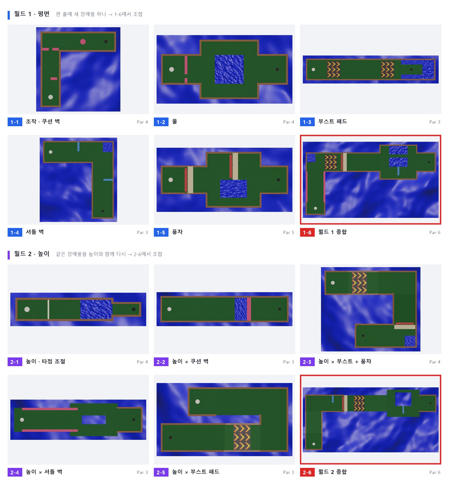
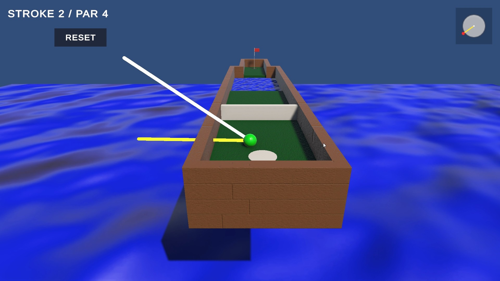
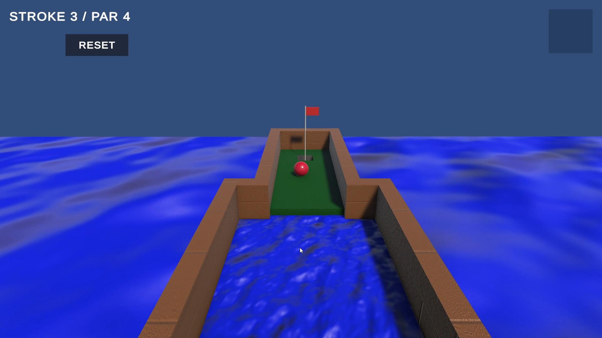
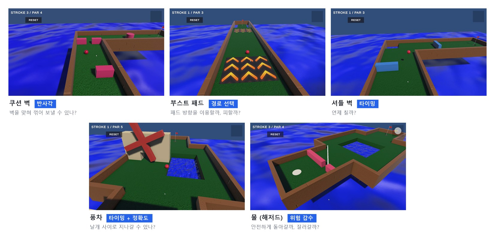
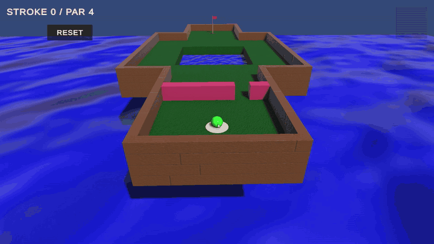
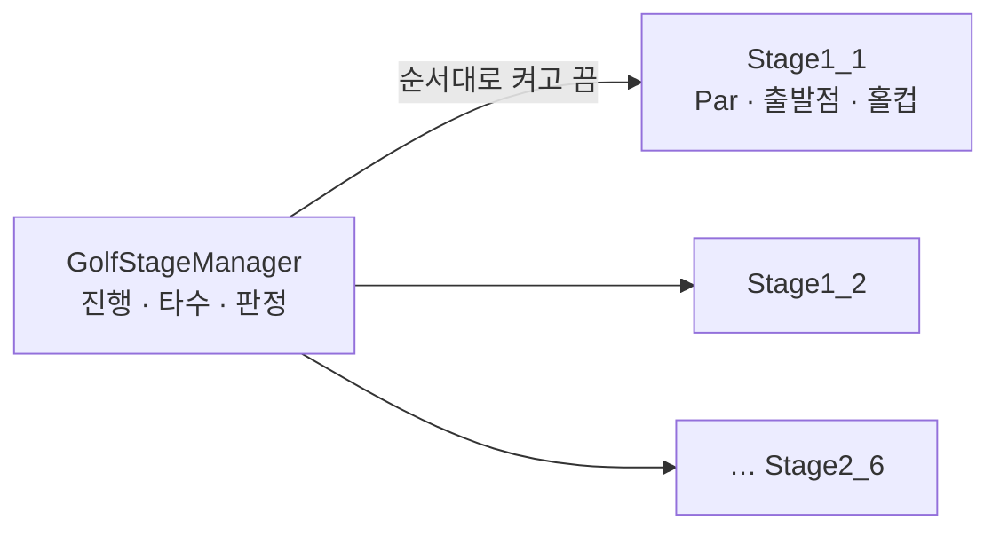

# 미니골프 레벨 디자인 (Mini Golf Level Design)

> 설명 없이 코스만으로 장애물을 가르치는 12홀 미니골프
>
> 2개 월드 × 6홀에 장애물 4종(쿠션 벽·부스트 패드·셔틀 벽·풍차)과 물 해저드를 배치한 레벨 디자인이다. 튜토리얼 텍스트 없이 플레이어가 홀을 지나며 규칙을 스스로 익히도록, 한 홀에 새 요소를 하나씩만 넣고 월드 마지막 홀에서 조합하게 한다.
>
> - **결과:** 한 홀에 새 요소 하나 → 월드 마지막 홀에서 앞서 나온 장애물과 물을 조합하는 12홀 구조. Par는 직접 쳐 보고 다시 테스트해 정했다(예: 1-2 Par 6 → 4). 다만 타점 조작은 설명 없이 전달되지 않아 시연하며 안내해야 했다
> - **배운 점:** 설계자는 정답 경로대로만 친다 — Par는 장애물을 의도대로 활용하는 플레이로 다시 확인해야 한다



---

## 1. 프로젝트 소개

### 1.1 프로젝트 개요

이 문서는 미니골프 12홀의 **레벨 디자인**을 다룬다.

| 항목 | 내용 |
|---|---|
| 프로젝트 | 미니골프 레벨 디자인 (Mini Golf Level Design) |
| 장르 | 3D 미니골프 — 2개 월드 × 6홀 (수업 레벨 디자인 과제) |
| 팀 구성 | 개인 프로젝트 |
| 내 담당 | **레벨 디자인 전체** — 홀 배치·장애물 순서·Par(홀마다 정한 기준 타수)·장애물 수치와 4장의 결정. 공을 치는 조작과 물리는 수업에서 함께 만든 기반을 썼다 |

코스에는 쿠션 벽·부스트 패드·셔틀 벽·풍차 4종의 장애물과 물 해저드를 배치했다.

핵심 목표는 튜토리얼 텍스트 없이 **코스만으로** 장애물을 익히게 하는 것이다.
이 프로젝트는 **어떤 장애물을, 어떤 순서로, 어떤 난이도로 배치하는가**에 집중했다.

> **문서 범위** — 코드 구현보다 **배치 의도와 그 근거**가 중심이다. 코드는 레벨 디자인 작업과 장애물의 동작을 받쳐 준 결정(4.2~4.4)에서만 다룬다.

### 1.2 프로젝트 목표와 핵심 성과

수업 과제는 장애물을 소개 → 응용 → 심화 코스에 나눠 배치해, 플레이어가 장애물을 배우고 익히고 시험받게 만드는 것이었다.

**목표한 경험:** 플레이어가 튜토리얼 텍스트 없이 **코스만으로 장애물을 익히는 것**

이를 위해 한 홀에 새 요소를 **하나만** 등장시키고, 월드 마지막 홀에서 앞서 배운 요소를 조합하게 했다(2장).
장애물 배치는 이 구조대로 완성했지만, 월드 2의 핵심 조작인 **타점 조절은 코스만으로 전달되지 않았다.**

달성하지 못한 부분도 함께 적는다.

| 목표 | 결과 | 다루는 곳 |
|---|---|---|
| 소개 → 응용 → 심화 구조 | 월드마다 새 요소를 하나씩 소개하는 홀 5개 + 조합하는 종합 홀 1개. 월드 2는 월드 1의 장애물을 높이와 결합해 다시 푼다 | 2장 |
| Par를 직접 테스트해 정한다 | 대부분의 홀을 직접 쳐 보고 다시 테스트해 조정. 1-2는 6 → 4 | 4.1 |
| 코스만으로 장애물을 익힌다 | 타점 조작은 전달되지 않아 시연하며 말로 안내함 | 5.1 |

### 1.3 시연 및 조작법

| 입력 | 동작 |
|---|---|
| 공 위에서 좌클릭 → 드래그 → 놓기 | 당긴 반대 방향으로 발사 (당긴 거리 = 세기) |
| 드래그 중 마우스 휠 | **타점(피치) 조절** — 5° 단위, 공을 띄워 치기 |
| 드래그 중 `ESC` | 샷 취소 |
| 우클릭 드래그 / 휠 | 카메라 회전 / 줌 |

타점 조절은 월드 2의 핵심 조작이다(2.3).

**영상:** [조작법 (쇼츠)](https://youtube.com/shorts/KeXlQsp6h6A)

### 1.4 개발 환경 및 프로젝트 정보

| 항목 | 내용 |
|---|---|
| Engine | Unity 6 (6000.3.15f1), URP |
| Language | C# |
| Level Tool | 프리팹(미리 만들어 둔 게임 오브젝트) 조립 (`Floor`, `Wall`, `Water`, `Tee`, `Hole_Group` + 장애물 프리팹) |
| 기간 | 2026.10.01 ~ 2026.10.08 (1주) |
| AI 활용 | Claude — 이 문서의 초안과 시연 영상 편집. 레벨 설계는 직접 (부록 A) |
| GitHub | https://github.com/parksooha102-ai/3rd-minigolf_level_design-parksooha102-ai |
| 시연 영상 | https://youtu.be/kGUTrtlwjWQ |

---

## 2. 코스 학습 구조 — 평면에서 높이로

12개 홀을 어떤 순서로 배치해야 플레이어가 장애물을 익히고, 조합하고, 새로운 조작으로 다시 풀 수 있는가?

12홀의 전체 배치다. 두 월드 모두 한 홀에 새 요소가 하나씩 나오고, 마지막 홀(1-6, 2-6)에서 앞의 요소를 함께 쓴다.

| 홀 | 새로 등장하는 요소 | 함께 쓰인 요소 |
|---|---|---|
| **1-1** | — (조작 익히기) + 쿠션 벽 | |
| **1-2** | 물 (해저드) | 쿠션 벽 |
| **1-3** | 부스트 패드 | 물 |
| **1-4** | 셔틀 벽 | 물 |
| **1-5** | 풍차 | 물 |
| **1-6** | **월드 1 종합** | 쿠션 벽 · 부스트 · 셔틀 · 풍차 · 물 |
| **2-1** | **높이 (타점 조절 필수)** | 물 |
| **2-2** | 높이 × 쿠션 벽 | 물 |
| **2-3** | 높이 × 부스트 + 풍차 | 물 |
| **2-4** | 높이 × 셔틀 벽 | 물 |
| **2-5** | 높이 × 부스트 패드 | 물 |
| **2-6** | **월드 2 종합** | 부스트 · 셔틀 · 풍차 · 물 |

### 2.1 실패 원인이 헷갈리는 홀

여러 장애물을 한 홀에 한꺼번에 처음 보여 주면, 플레이어는 공이 왜 실패했는지 구분하기 어렵다. 벽에 맞은 각도가 틀렸는지, 풍차에 걸렸는지, 타이밍이 늦었는지가 한 샷에 섞이기 때문이다.

그래서 **한 홀에 새 요소는 하나만** 넣기로 했다. 플레이어가 실패했을 때 원인이 무엇인지 헷갈리지 않게 하기 위해서다.
요소를 하나씩 소개한 뒤에는 그 요소를 다시 쓰는 단계가 필요하다. 월드 마지막 홀에서 앞서 배운 요소를 조합하고, 월드 2에서는 같은 장애물을 새 조작과 함께 다시 풀게 했다.

### 2.2 월드 1 — 평면에서 장애물을 하나씩 익히기

월드 1은 평면 코스다. 타점을 쓰지 않아도 모든 홀을 클리어할 수 있다.

- **1-1**에서 기본 조작과 쿠션 벽을 익힌다.
- **1-2**에서 물이 처음 나온다. 이후 물은 거의 모든 홀에 남아, 새 장애물과 함께 놓인다.
- **1-3~1-5**는 부스트 패드·셔틀 벽·풍차를 한 홀에 하나씩 소개한다.
- **1-6**에서 쿠션 벽·부스트 패드·셔틀 벽·풍차를 물과 함께 조합한다.

**영상:** [월드 1 — 한 홀에 새 요소 하나 (쇼츠)](https://youtube.com/shorts/1AKlQ0-vyHM)

### 2.3 월드 2 — 높이 차이와 타점 조절

월드 2는 2-1부터 **타점 조절 없이는 넘어갈 수 없다.** 월드 1에서는 몰라도 클리어할 수 있던 조작을 여기서 반드시 쓰게 한다.

2-1은 높이와 물만 있는 홀이다. 흰 벽 너머에 물과 그린이 있어, 타점을 올려 공을 띄워야 벽과 물을 함께 넘는다.

| 2-1 조준 | 2-1 물 너머 그린 |
|---|---|
|  |  |

**영상:** [월드 2 — 타점 조절 필수 (쇼츠)](https://youtube.com/shorts/v_ZKT3N9fk0)

2-2부터는 월드 1의 장애물을 높이 차이와 결합해 다시 등장시킨다.
같은 장애물이라도 이제는 방향과 세기에 더해 **높이**까지 판단해야 한다.

다만 2-1에는 타점을 써야 한다는 것을 알려 주는 장치가 따로 없다. 이 결과는 5.1에서 다룬다.

### 2.4 난이도 곡선과 Par 배치

| 월드 1 | 1-1 | 1-2 | 1-3 | 1-4 | 1-5 | 1-6 |
|---|---|---|---|---|---|---|
| Par | 4 | 4 | 3 | 3 | 5 | 6 |
| **월드 2** | **2-1** | **2-2** | **2-3** | **2-4** | **2-5** | **2-6** |
| Par | 4 | 3 | 4 | 3 | 3 | 6 |

두 월드 모두 **새 규칙이 나오는 첫 홀은 Par를 넉넉히, 중간 홀은 짧게, 종합 홀은 길게** 잡는 것을 큰 흐름으로 삼았다.
다만 1-5(풍차 소개)와 2-3은 코스를 조금 꺾고 길게 만들어, 중간 홀이어도 Par가 길다.
이 표의 Par는 처음 정한 값이 아니라, 직접 쳐 보고 다시 테스트해 조정을 마친 값이다(4.1). 시연도 이 값으로 진행했다.

### 2.5 12홀 학습 구조와 전달하지 못한 타점 조작

**결과**
- 2.1에서 상술한 대로, 한 홀에 새 요소 하나 → 마지막 홀에서 조합하는 12홀 구조를 만들었다.

**한계** (개선 방향은 5.2)
- 월드 2의 전제인 타점 조작을 코스만으로 전달하지 못했다(5.1).

---

## 3. 장애물 설계와 플레이어의 판단

각 장애물은 플레이어에게 어떤 판단을 요구하며, 그 판단을 코스에서 어떻게 경험하게 하는가?

### 3.1 장애물을 배치하는 기준

장애물은 이름이나 생김새가 아니라 **플레이어에게 어떤 판단을 요구하는가**로 나뉜다. 반사각, 경로 선택, 타이밍, 정확도, 위험 감수가 그 판단이다.
같은 장애물도 홀마다 세기·속도가 다르다. 처음 소개하는 홀과 조합하는 종합 홀은 맡은 역할이 다르기 때문이다.



**영상:** [장애물 설계와 배치 (쇼츠)](https://youtube.com/shorts/ehLdFo4iK2g)

### 3.2 쿠션 벽 — 반사각

**요구하는 판단:** "벽을 맞혀 꺾어 보낼 수 있나?" (반사각)

쿠션 벽에는 탄성 물리 머티리얼 `PM_Bouncy`를 썼다. 공을 벽에 튕겨 **한 번에 모퉁이를 돌게** 하려고 넣은 장애물이다.
1-1에서 처음 등장하고 1-2, 2-2와 종합 홀 1-6에서 다시 나온다. 2-4의 셔틀 벽에도 같은 재질을 썼다.

1-2에서 이 의도와 실제 테스트가 어긋났던 사례는 4.1에서 다룬다.

### 3.3 부스트 패드 — 경로 선택

**요구하는 판단:** "패드 방향을 이용할까, 피할까?" (경로 선택)

부스트 패드의 세기는 홀마다 6~25로 다르다.
처음 등장하는 1-3에서는 6·8로, 일반 샷의 최대 세기(15)보다 약하게 두었다. 패드가 플레이어의 샷보다 세게 밀어내지 않는다. 이후 다시 나오는 홀에서는 종합 홀 1-6이 8, 2-6이 10이고, 높이와 결합하는 2-3은 20, 2-5는 25다.

패드가 밀어낸 공이 물에 빠졌을 때 어디로 돌아가는지는 4.2에서 다룬다.

### 3.4 셔틀 벽 — 타이밍

**요구하는 판단:** "언제 칠까?" (타이밍)

셔틀 벽은 한쪽으로 1.5~2초에 걸쳐 이동하고, 왕복한다.
1-4에서 처음 등장하고 2-4와 종합 홀 1-6, 2-6에서 다시 나온다.

공과 부딪혔을 때의 결과를 예측할 수 있게 한 구현 선택은 4.4에서 다룬다.

### 3.5 풍차 — 타이밍과 정확도

**요구하는 판단:** "날개 사이로 지나갈 수 있나?" (타이밍 + 정확도)

풍차의 회전 속도는 5~60 사이에서 홀마다 다르다.
처음 등장하는 1-5는 30이고, 종합 홀 1-6과 2-6은 그 두 배인 60이다. 종합 홀에서는 처음 소개할 때보다 날개 사이를 통과할 틈이 더 짧다.
2-3에서는 높이 차이·부스트 패드와 함께 나오며, 회전 속도는 5로 가장 느리다.

### 3.6 물 해저드 — 위험 감수

**요구하는 판단:** "안전하게 돌아갈까, 위험하게 질러갈까?" (위험 감수)

물은 1-2에서 처음 등장하고, 이후 대부분의 홀에 배치했다. 다른 장애물이 새로 나올 때도 물은 함께 놓여, 질러가는 경로와 돌아가는 경로를 나눈다.

공이 물에 빠지면 **직전 샷 위치로 복귀**하고, 따로 벌타는 없다. 출발점이 아니라 직전 샷 위치를 고른 이유는 4.2에서 다룬다.

### 3.7 다시 등장하는 장애물과 확인하지 못한 학습

**결과**
- 다섯 요소 모두 월드 1에서 한 번씩 처음 소개되고, 이후 종합 홀이나 월드 2에서 다시 등장한다.
- 부스트 패드와 풍차는 처음 소개하는 홀과 종합 홀의 세기·속도를 다르게 두었다.

**한계**
- 각 장애물이 처음 나오는 홀에서 플레이어가 그 장애물을 실제로 익혔는지는 이 문서에서 확인하지 않는다. 위의 배치는 설계 의도다.

---

## 4. 플레이테스트와 설계 결정

코스를 직접 플레이하면서 설계 의도와 실제 플레이 사이의 차이를 어떻게 발견하고 수정했는가?

Par와 해저드 복귀 위치(4.1, 4.2)는 플레이 경험에 관한 결정이다. 홀 데이터 분리와 셔틀 벽의 충돌 처리(4.3, 4.4)는 반복해서 고치는 레벨 제작과, 플레이어가 예측할 수 있는 장애물을 받쳐 준 선택이다.

### 4.1 Par 정하기 — 직접 쳐 보고 다시 테스트

Par는 대부분의 홀에서 **직접 쳐 보고 정한 뒤, 다시 테스트해서 고치는** 과정을 거쳤다. 2.4의 Par는 이 조정을 마친 값이다.

#### 넉넉하게 잡혔던 1-2의 Par (6 → 4)

**문제:** 1-2는 직접 쳐 본 결과로 Par를 **6**으로 정했는데, 다시 테스트해 보니 이 홀에 필요한 타수보다 넉넉했다.

**원인:** 테스트를 정답 경로로만 쳐서 쿠션 벽을 쓰는 샷이 빠졌다. **코스가 꺾이는 지점마다 공을 멈추고 다음 샷을 쳤는데,** 쿠션 벽은 **벽에 튕겨 한 번에 모퉁이를 돌게** 하려고 넣은 장애물이다(3.2).

**해결:** 쿠션 벽을 의도대로 활용하는 플레이로 다시 쳐 보고 Par를 **4로 낮췄다.**

**결과:** 쿠션 벽에 튕겨 모퉁이를 한 번에 돌면 4타 안에 들어갔다.



### 4.2 해저드 복귀 위치 — 출발점 vs 직전 샷 위치

| | [A] 출발점으로 복귀 | [B] 직전 샷 위치로 복귀 (채택) |
|---|---|---|
| 결과 | 벌칙이 지나치게 큼. 긴 종합 홀(1-6, 2-6)에서 끝부분 실수 한 번에 처음부터 다시 | 실수한 그 샷만 다시 시도. 질러가기를 '시도해 볼 만한 위험'으로 만든다 |

따로 벌타는 더하지 않는다.

물이 묻는 판단은 "안전하게 돌아갈까, 질러갈까?"다(3.6). 실패 비용이 너무 크면 플레이어는 질러가기를 시도하지 않으므로, 실패 비용을 그 샷 하나로 줄였다.

부스트 패드가 공을 밀어낸 것은 '친 위치'로 기록하지 않는다(`isPassive`). 패드 위에서 빠져도 플레이어가 마지막으로 직접 친 곳으로 돌아간다.

```csharp
// GolfBall.cs — 플레이어가 직접 친 샷만 복귀 지점으로 기록
public void Shoot(Vector3 direction, float power, bool isPassive = false)
{
    ...
    if (isPassive == false)
        lastPosition = transform.position;
}
```

**영상:** [해저드 복귀 — 직전 샷 위치로 (쇼츠)](https://youtube.com/shorts/7JFpLJdAlEs)

### 4.3 홀을 데이터로 분리 — 코드 없이 홀을 추가

레벨 디자인은 홀을 조립하고, 쳐 보고, 고치는 일을 반복한다(4.1). 그 반복마다 진행 코드를 고쳐야 한다면 작업이 느려진다.

그래서 각 홀은 `GolfStage` 프리팹 하나로 만들고, **Par, 출발점, 홀컵**만 가지게 했다. 진행·타수·스코어 판정(버디, 보기 등)은 `GolfStageManager` 한 곳에서 처리한다.

<details>
<summary>홀 구조 그림 보기</summary>



</details>

레벨 디자인 작업은 **프리팹을 조립하고 Par를 입력해 목록에 넣는 것**으로 끝난다. 12홀을 만드는 동안 진행 코드는 수정하지 않았다. 홀을 고치고 다시 쳐 보는 반복이 코드 수정으로 끊기지 않았다.

### 4.4 움직이는 장애물과 공의 충돌

셔틀 벽은 `Transform`을 직접 옮기지 않고 키네마틱(물리 힘을 받지 않고 코드로만 움직이는) `Rigidbody`의 `MovePosition`으로 움직인다.
Transform을 직접 옮기면 물리 엔진이 벽의 속도를 모르기 때문에, 벽이 공을 밀어낼 때 공이 벽을 뚫거나 이상하게 튕길 수 있다.

셔틀 벽은 타이밍을 묻는 장애물이다(3.4). 타이밍을 묻는 장애물이 불공정하게 느껴지지 않으려면 **충돌 결과를 플레이어가 예측할 수 있어야** 한다.

**영상:** [움직이는 장애물과 공의 충돌 (쇼츠)](https://youtube.com/shorts/yn78QeDR9Yg)

### 4.5 플레이로 고친 Par와 설계자만의 테스트

**결과**
- Par를 직접 쳐 보고 다시 테스트해 정했다. 1-2는 쿠션 벽을 쓰는 플레이로 다시 쳐 보고 6 → 4로 고쳤다.
- 물에 빠졌을 때 직전 샷 위치로 돌아가게 해, 긴 종합 홀의 실패 부담을 그 샷 하나로 줄였다.
- 4.3에서 상술한 대로, 홀을 `GolfStage` 프리팹으로 분리해 진행 코드 수정 없이 12홀을 만들었다.
- 셔틀 벽을 키네마틱 `Rigidbody.MovePosition`으로 움직여, 공과의 충돌을 물리 엔진이 처리하게 했다.

**한계**
- 테스트는 설계자가 직접 쳐 본 것이다. 1-2 외의 홀은 조정 전 값이 남아 있지 않아, 어떻게 조정했는지는 결과만 말할 수 있다.

---

## 5. 통합 검증과 프로젝트 회고

코스만으로 장애물을 가르친다는 목표를 어디까지 달성했으며, 다음에는 무엇을 바꿔야 하는가?

### 5.1 목표 달성 여부

목표한 경험은 "튜토리얼 텍스트 없이 코스만으로 장애물을 익히는 것"이었다(1.2). 12홀 구조와 Par는 목표대로 완성했지만(1.2 표), 월드 2 전체가 전제로 하는 **타점 조절**은 코스만으로 전달되지 않았다.

타점 조절은 공을 드래그하면서 휠을 함께 움직여야 하는 까다로운 조작이다. 월드 1에서는 쓰지 않아도 클리어할 수 있었고, 2.3에서 상술한 대로 처음 필수가 되는 2-1에도 이를 알려 주는 장치가 없었다. 결국 시연하며 말로 안내해야 했다.

장애물은 한 홀에 하나씩 놓아 보여 줄 수 있었지만, 조작은 배치만으로 보여 줄 수 없었다. 설계 의도와 실제 플레이 경험이 가장 크게 어긋난 곳이다.

> **검증 범위** — Par 테스트는 설계자가 직접 쳐 본 것이고, 1-2 외의 홀은 조정 전 값이 남아 있지 않아 결과만 말할 수 있다(4.5). 다른 사람의 플레이는 시연에서 본 것뿐이다.

### 5.2 한계와 개선 방향

아래 개선 방향은 모두 **아직 구현하지 않은 계획**이며, 효과를 확인한 것도 아니다.

| 순위 | 한계 | 현상 | 영향 | 개선 방향 | 자세히 |
|---|---|---|---|---|---|
| 1 | 타점 조작이 코스만으로 전달되지 않음 | 2-1에 알려 주는 장치가 없다 | 시연하며 말로 안내했다 | **타점이 필요하다는 것을 코스에서 먼저 보여 준다** | 2.3, 5.1 |
| 2 | 코스가 뻔함 | 골 지형을 벽으로 가린 구조가 예상대로 끝난다 | 시연에서 사람들이 벽 너머로 공을 바로 날려, 2타 만에 골인하는 모습이 자주 보였다 | **벽 너머 끝에 아무것도 없게 해 예상을 비튼다** | — |

### 5.3 배운 점

**설계자는 정답 경로대로만 친다.**
코스의 '정답 경로'를 아는 설계자는 오히려 그 경로대로만 친다. 1-2의 Par 6은 쿠션 벽을 활용하지 않은 첫 테스트에서 나왔다(4.1). 설계자가 직접 친 경로와 코스가 플레이어에게 열어 둔 경로는 다를 수 있으므로, Par는 한 번 쳐 보고 정하지 말고 장애물을 의도대로 활용하는 플레이로 다시 확인한다.

**한 홀에 새 요소는 하나만 넣는다.**
새 요소를 하나씩만 추가하면 플레이어가 실패 원인을 알 수 있고, 설계자도 플레이테스트에서 무엇이 문제인지 구분할 수 있다(2.1). 마지막 홀에서 요소를 조합해 앞서 배운 내용을 다시 쓰게 한다.

**까다로운 조작은 코스만으로 가르치기 어렵다.**
조작은 따로 알려 줄 자리가 필요하다(5.1).

---

## 부록

### A. AI 협업

Claude는 이 문서와 시연 영상 작업에 쓰고, 레벨 설계는 직접 했다.

| | 내용 |
|---|---|
| Claude에게 맡긴 것 | 이 프로젝트 문서의 초안 작성 · 시연 영상 편집 |
| 직접 판단한 것 | 홀 배치·장애물 순서·Par·장애물 수치와 4장의 결정 전부 |
| 확인한 방법 | 초안을 읽고 직접 고침 · 영상 편집 결과를 실제 플레이 장면과 대조 |
| 잘 된 것 | 이 문서의 초안 작성 — 받은 초안을 뼈대로 삼아 직접 고쳐 완성했다 |
| 받아들이지 않은 것 | 문서 초안에 코드에 없는 규칙("물에 빠지면 직전 샷 위치 + 1타")이 들어가 있었다. 레포의 코드와 대조해 벌타가 없는 실제 규칙으로 바로잡았다 (4.2) |
