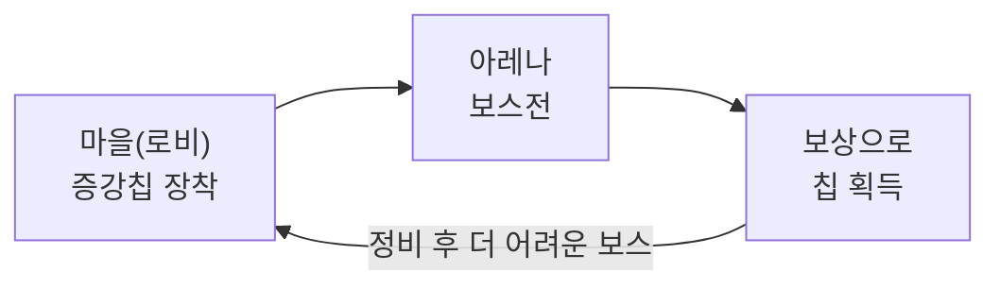
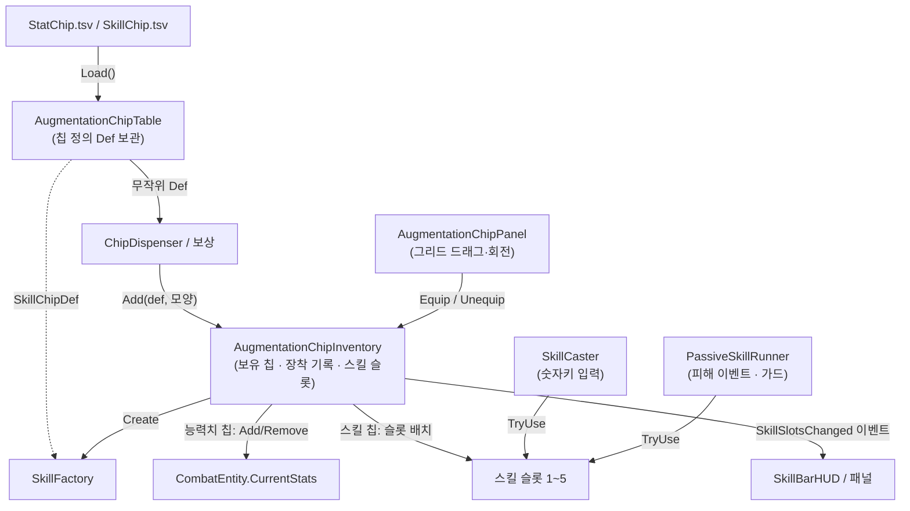
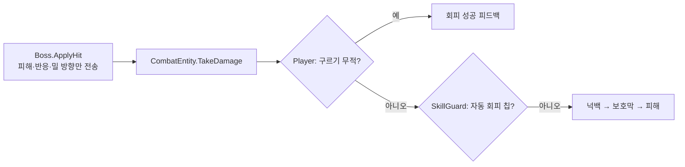

<!-- 작성 상태: 초안 v1.0 (가이드의 C. 팀 프로젝트 유형) · 남은 할 일: 시연 영상 링크 추가 -->

# 증강칩 · 초능력 스킬 시스템 (Oddity)

> 4인 팀 보스 러시 하이퍼 TPS에서 맡은 증강칩 시스템과 초능력 스킬 18종
>
> - **무엇을:** 6×6 그리드에 끼우는 증강칩 28종(능력치 10 · 스킬 18)과, 전략 패턴으로 나눈 스킬 구조
> - **왜:** 3주 동안 칩 규칙·이름·수치가 여러 번 바뀌어, 코드 대신 표만 고치면 되는 구조가 필요해서
> - **결과:** 기획 변경을 TSV 수정만으로 흡수, 새 스킬 추가 시 입력·인벤토리 코드 수정 0줄
> - **배운 점:** 쓰지 않는 유연성은 걷어내고, 땜질로 쌓인 피격 구조는 팀과 합의해 리팩터링했다 — 유연성은 필요해질 때 들인다

---

## 1. 개요

### 1.1 프로젝트 소개

| 항목 | 내용 |
|---|---|
| 프로젝트 | Oddity |
| 장르 | 하이퍼 TPS · 보스 러시 — 다양한 초능력으로 보스를 연달아 공략 |
| 팀 구성 | 4명 — 박수하(본인), 팀원 A, 팀원 B, 팀원 C |

**핵심 루프**



### 1.2 팀 역할

| 팀원 | 담당 |
|---|---|
| **박수하 (본인)** | **증강칩 시스템**(획득·장착 그리드·UI), **초능력 스킬 18종**, 스킬 슬롯·HUD, 패시브 트리거 |
| 팀원 A | 전반 폴리싱, 보스 패턴, 증강칩 UI 편의성 개선(툴팁·전체 필터·조작 안내) 등 |
| 팀원 B | 보스 AI · 상태 머신, 인간형 보스 패턴 |
| 팀원 C | 플레이어 조작 · 카메라, 미션 |

### 1.3 담당 파트 요약 — 이 문서가 다루는 범위

**What**
플레이어가 보상으로 얻은 **증강칩**을 **6×6 그리드**에 테트리스처럼 끼워 넣는다.
- **능력치 칩**(10종): 장착하는 동안 공격력·체력·스태미나 등 스탯을 올린다.
- **스킬 칩**(18종): 1~5번 슬롯에 들어가 숫자키로 발동하거나(공격·방어·유틸), 조건이 맞으면 자동으로 발동한다(패시브).

**Why — 해결하려던 문제**
- **기획이 자주 바뀌었다.** 3주 동안 칩 크기 규칙, 칩 이름, 스킬 수치가 여러 번 바뀌었다.
  칩이 코드에 박혀 있다면 바뀔 때마다 여러 파일을 고치고 버그를 감수해야 한다.
- **스킬마다 필요한 값과 동작이 전부 다르다.** 충격파는 반경·밀어내는 힘, 순간 이동은 거리, 시간 감속은 배율이 필요하다.
  이 차이를 입력 코드가 알게 되면 스킬이 추가될 때마다 `if`가 늘어난다.
- **쿨타임을 건드리는 규칙이 필요했다.** 칩을 바꿔 끼우며 쿨타임을 돌리는 꼼수를 막으려면 "해제한 칩은 쿨타임이 멈춘다"가 필요했다. 이 규칙은 처음 쿨타임 방식으로는 보정 코드 없이 표현할 수 없었다.

**이 문서에서 다루는 내용**
1. 칩 데이터(TSV) → 보유 칩 → 장착 → 스탯/스킬 반영으로 이어지는 **전체 구조** (2장)
2. 스킬을 **전략 패턴 + 단순 팩토리**로 나눠, 새 스킬을 "enum 1줄 + 클래스 1개 + switch 1줄 + 표 1줄"로 추가하는 방법 (3장)
3. 쿨타임을 **"준비되는 시각"에서 "남은 시간"으로 바꾼 이유**와, 스탯 계산에서 **데코레이터를 걷어낸 이유** (4장)
4. 회피 피드백을 붙이려다 발견한 **"보스가 피격을 판단하는" 구조**를, 팀과 합의해 **맞는 쪽이 판단하도록** 리팩터링한 협업 이슈 (5.2)
5. 그 리팩터링을 **AI와 함께 진행하며** 방향을 바로잡은 지점과 역할 분담 (5.3)

### 1.4 레퍼런스와 차이점

| | 백팩 히어로 | 이 프로젝트 |
|---|---|---|
| 조각의 모양 | 아이템마다 **정해진 모양** | 같은 칩도 **장마다 무작위 모양** (`ChipShapeLibrary.Roll`) |
| 의도한 경험 | 정해진 모양을 가방에 맞춰 넣는 배치 | 같은 칩이라도 더 잘 맞는 모양을 다시 얻으려는 **파밍** — 반복해서 도전하는 동기가 된다 |

### 1.5 조작법

| 입력 | 동작 |
|---|---|
| `E` | 증강칩 패널 열기/닫기 |
| `F` | 증강칩 NPC 근처에서 패널 열기 |
| 드래그 / `R` | 칩 이동 / 드래그 중 90도 회전 |
| 우클릭 | 빠른 장착·해제 |
| `1` ~ `5` | 스킬 슬롯 발동 (누르고 있으면 채널링) |

### 1.6 개발 환경

- **Engine:** Unity 6 (6000.3.15f1), URP, Input System, DOTween
- **Language:** C#
- **Core:** TSV 데이터 테이블 + 로드 시 검증, 전략 패턴 + 단순 팩토리, 전투 이벤트 기반 패시브 트리거
- **기간:** 2026.10.15 ~ 2026.11.07 (약 3주, 4인 팀)
- **AI 활용:** Claude Code — 구현·커밋 메시지·문서 초안 작성에 활용, **설계 방향 결정과 결과물 검토는 직접** (사례: 5.3)

### 1.7 링크

- **GitHub:** https://github.com/KooHoo-Dev/3rd_3D_1-3D-Project-team_odd
- **시연 영상:** (업로드 예정) <!-- TODO: 업로드 후 실제 주소로 교체 -->

---

## 2. 시스템 구조

### 2.1 아키텍처 흐름



### 2.2 핵심 클래스 역할 분담

| 클래스 | 역할 | 하지 않는 일 |
|---|---|---|
| `AugmentationChipTable` | TSV 두 개를 읽어 칩 정의(`Def`)를 ID로 보관. 읽을 때 스킬을 한 번 만들어 보며 값을 검증 (3.3) | 플레이어 상태를 모른다 |
| `OwnedChip` | 보유한 칩 **한 장**. 모양·장착 위치·회전·스킬 인스턴스를 가진다 | 스스로 장착 상태를 바꾸지 않는다 |
| `AugmentationChipInventory` | 보유 목록, 장착/해제, 스탯 반영, 스킬 슬롯 관리, 변경 이벤트 발행 | 그리드 칸 겹침 판정은 하지 않는다 (`ChipGridView` 몫) |
| `ChipGridView` / `ChipItemView` | 그리드 점유·배치 가능 판정·미리보기 / 칩 모양·회전 표시 | 스탯을 건드리지 않는다 |
| `SuperpowerSkill` (추상) | 모든 스킬 공통: 쿨타임, `TryUse`, 피해 계산식 | 입력을 받지 않는다 |
| `SkillFactory` | `SkillType`에 맞는 스킬 클래스를 골라 표의 값으로 생성 | — |
| `SkillCaster` | 숫자키 → 해당 슬롯의 `TryUse`. 스태미나·시전 중·정비소 등 공통 조건 확인 | 어떤 스킬인지 모른다 |
| `PassiveSkillRunner` | 피해를 준 뒤·받은 뒤·받기 직전·죽기 직전 트리거에 맞는 패시브 발동 (3.4) | — |

### 2.3 왜 이렇게 나눴나 (미리 보기)

- **데이터(Def)와 보유 칩(OwnedChip)을 분리** — 같은 칩을 여러 장 가질 수 있고, **장마다 모양이 무작위**이며
  **쿨타임도 칩마다 따로** 돌아야 하기 때문이다. 공통 값은 Def에, 한 장마다 다른 값은 OwnedChip에 둔다.
- **스킬 사용(SkillCaster)과 스킬 내용(SuperpowerSkill)을 분리** — 입력 코드는 스킬이 18개든 30개든 바뀌지 않는다.
  새 스킬을 추가하는 실제 절차는 **3.1**에서 다룬다.

---

## 3. 핵심 기능

### 3.1 사용법 — 칩 지급과 장착 (API)

칩을 주는 쪽(보상·디스펜서)은 **`Add` 하나**만 부르면 된다. 장착 UI는 `Equip`/`Unequip`만 부른다.

```csharp
// 보상으로 칩 한 장 지급: 모양은 칸 수에 맞춰 무작위로 정한다
AugmentationChipDef def = table.Get(2101);                       // 염동 충격파
Vector2Int[] cells = ChipShapeLibrary.Roll(def.CellCount, gridSize);
OwnedChip chip = inventory.Add(def, cells);

// 장착: 능력치 칩이면 스탯 +, 스킬 칩이면 가장 앞 빈 슬롯에 들어간다
inventory.Equip(chip, origin, rotation);
```

**새 스킬을 추가하는 방법** (실제 작업 순서)
1. `SkillType` enum에 이름 추가
2. `Skills/분류` 폴더에 `SuperpowerSkill` 자식 클래스 작성 (`Execute`, `Describe`)
3. `SkillFactory`의 switch에 **한 줄** 추가
4. `SkillChip.tsv`에 **한 줄** 추가 — 쿨타임·스태미나·매개변수(`Radius=8;Force=25;Power=400`)는 표에서 조정

### 3.2 핵심 동작 ① — 스킬 발동 (`TryUse`)

모든 스킬은 쿨타임 확인 → 사용 가능 확인 → 실행 순서를 **부모 클래스 한 곳**에서 지킨다.

```csharp
public bool TryUse(SkillContext context)
{
    // (Why) 대상이 없는 등 실제로 나가지 않은 스킬은 쿨타임도, 스태미나도 쓰지 않게 false를 돌려준다
    if (IsReady == false || CanExecute(context) == false)
        return false;

    remainingCooldown = Cooldown;
    Execute(context);   // 무엇을 할지는 자식 클래스가 정한다 (전략 패턴)
    return true;
}
```

쿨타임을 "남은 시간"으로 들고 있는 이유는 **4.1**에서 다룬다.

`SkillCaster`는 `TryUse`가 `true`일 때만 스태미나를 줄인다.
**예외 처리**: 사망·피격 중, 다른 스킬 시전 중(염동 연사·시간 역행 등), 정비소 안, 빈 슬롯, 쿨타임 중, 스태미나 부족 — 각각 경고 메시지를 띄우고 중단한다.

### 3.3 핵심 동작 ② — 표 읽을 때 미리 검증 (Fail-fast)

```csharp
// AugmentationChipTable.Load() 중
// (Why) 매개변수 오타를 '칩을 줍는 순간'이 아니라 '게임 시작 시' 알 수 있게 한 번 만들어 본다
if (SkillFactory.Create(def) == null)
{
    Debug.LogError($"{chipDto.ID}번 스킬 칩의 값이 잘못되어 테이블에서 뺍니다.");
    continue;
}
```

검증은 두 갈래로 나뉜다.
- **만드는 코드가 없는 `SkillType`** → `Create`가 `null`을 돌려주고, 그 칩만 표에서 빼고 계속 읽는다.
- **매개변수 키 오타·형식 오류** (`Raduis=8`, `Radius=abc`) → `SkillParams`가 **예외를 던져** 표 읽기가 그 자리에서 멈춘다.
  게임 시작 시 바로 드러나지만, 오타 하나로 **뒤의 칩까지 로드되지 않는다**는 한계가 있다. (→ 5.4 기술 부채)

### 3.4 핵심 동작 ③ — 패시브 스킬 트리거

패시브(두 번째 심장, 생명 착취, 조건 반사 등 5종)는 키가 아니라 **전투 이벤트**로 발동한다.
- 피해를 **준 뒤/받은 뒤** → `CombatManager`의 피해 이벤트 구독
- 피해를 **받기 직전/죽기 직전** → `Player`의 `SkillGuard`(`IDamageGuard`)로 등록되어, 구르기 무적 판정 **다음에** 질문을 받는다
- 피해·죽음을 막는 트리거는 **하나가 막으면 멈춘다** → 같은 칩 두 장이 내부 쿨타임을 함께 소모하지 않게

---

## 4. 고민과 선택

> 이 장은 깊게 다룬 선택 **두 가지**(4.1 쿨타임, 4.2 스탯 계산)와, 짧게 정리한 **그 밖의 선택**(4.3)으로 나뉜다.

### 4.1 쿨타임 — "준비되는 시각" vs "남은 시간"

**결정 대상** — 스킬 18종의 쿨타임을 어떤 값으로 들고 있을 것인가?

처음 구현은 흔히 쓰는 방식대로 **준비되는 시각**(`readyTime = Time.time + Cooldown`)을 저장했다.
코드를 다시 읽다가 `Time.time`이 **float**라는 점이 걸렸다. 게임을 오래 켜 둘수록 표현 간격이 벌어져, 수천 시간이면 2초 단위로 끊긴다.
그런데 정밀도만이 문제라면 해법은 더 간단했다. 그래서 대안은 세 가지가 됐다.

| | [A] float 시각 (처음 방식) | [A'] double 시각 (`Time.timeAsDouble`) | [B] 남은 시간 + `Tick` (채택) |
|---|---|---|---|
| 정밀도 | 장시간 실행 시 오차 (하루 ≈ 0.008초, 수천 시간 ≈ 2초) | **해결** | **해결** (항상 작은 값만 다룸) |
| 수정량 | — | **두 줄** | 스킬·인벤토리 두 파일 |
| 매 프레임 호출 | 필요 없음 | 필요 없음 | **누군가 `Tick`을 불러야 함** |
| 해제한 칩은 쿨타임 정지 | 해제 시점의 남은 시간을 따로 저장 → 재장착 때 재계산 | A와 같음 | **장착된 칩만 `Tick`** → 추가 코드 없음 |
| N초 감소 | `readyTime -= N` | A와 같음 | `ReduceCooldown(N)` — **둘 다 쉬움** |
| 쿨타임 2배속 같은 속도 효과 | 시작·종료마다 모든 `readyTime`을 역산. 겹치면 금방 꼬임 | A와 같음 | `Tick(deltaTime * 배율)` |

**결정을 가른 질문** — A'로 정밀도는 두 줄이면 끝났다. 정밀도만 보면 B로 갈 이유가 없었다.
방향을 바꾼 건 **"오히려 장착한 칩의 쿨타임만 흐르는 게 의도라면?"** 이라는 기획 쪽 질문이었다.
칩을 바꿔 끼우며 여러 쿨타임을 동시에 돌리는 **꼼수를 막으려면**, 해제한 칩의 쿨타임은 멈춰야 한다.
시각 방식(A, A')으로 이걸 하려면 해제·재장착 때마다 보정 코드가 붙어 결국 카운트다운을 흉내 내게 된다.

**[결정]**
**B를 선택했다.** "언제 쿨타임이 도는가"를 **누가 `Tick`을 부르는가** 한 곳으로 제어할 수 있기 때문이다.
- '장착 칩만' 규칙은 인벤토리가 **스킬 슬롯 5칸만** `Tick`하는 것으로 끝났다.
- 같은 이유로 앞으로의 속도 효과도 배율 하나로 붙는다. 설계 원칙은 **"빨라질 대상이 몇 개인지 효과 쪽이 몰라야 한다"** 였다.
- 바꾼 뒤 실제로 추가된 효과(피해를 줄 때마다 쿨타임 1초 감소, 씬 이동 시 쿨타임 초기화)는 모두 한 줄로 끝났다.

**감수한 대가**
- `Tick` 호출을 빠뜨리면 쿨타임이 영원히 멈춘다 → **인벤토리 `Update` 한 곳에서만** 부르는 규칙으로 관리했다.
  커서 상태에 따라 일찍 `return`하는 `SkillCaster.Update`에 두면 패널을 여는 동안 쿨타임이 멈추기 때문에, 일부러 인벤토리에 두었다.
- 그리드 위의 칩을 집어 옮기는 몇 초 동안은 장착이 풀려 그 칩의 쿨타임이 멈춘다. 이를 막으려면 인벤토리가 패널 상태까지 알아야 해서, **멈추게 두는 쪽이 더 단순하다**고 판단했다.

```csharp
// AugmentationChipInventory — 장착된 칩(슬롯 5칸)만 쿨타임이 돈다
private void Update()
{
    foreach (OwnedChip chip in skillSlots)
    {
        if (chip != null)
            chip.Skill.Tick(Time.deltaTime);
    }
}
```

### 4.2 스탯 보너스 계산 — 데코레이터 vs 단순 가감

**결정 대상** — 능력치 칩의 보너스를 플레이어 스탯에 어떻게 반영할 것인가?

첫 구현은 **데코레이터 패턴**이었다(`Stat` → `StatDecorator` → `StatHandler`). 칩 하나가 스탯을 한 겹씩 감싸는 구조다.

| | [A] 데코레이터 패턴 (초기 구현) | [B] 런타임 스탯에 더하고 빼기 — `CurrentStats.Add/Remove` (채택) |
|---|---|---|
| 장점 | 칩마다 **계산 규칙이 달라도**(곱연산, 조건부 보정) 한 겹씩 쌓아 표현할 수 있다 | 장착 = 더하기, 해제 = 빼기로 끝. 전투·UI를 맡은 팀원도 `CurrentStats`만 읽으면 된다 |
| 단점 | 칩을 **해제할 때** 체인 중간의 한 겹을 빼야 해 구조가 복잡하다. 스탯을 읽을 때마다 체인을 끝까지 계산한다 | 곱연산·조건부 효과는 직접 표현할 수 없다 |

**[결정]**
**B로 바꾸고 데코레이터를 제거했다.** 데코레이터는 계산 규칙이 다를 때 힘을 발휘하는데, 실제 능력치 칩 10종은 모두 **고정값 합연산**뿐이었다.
쓰지 않을 유연성을 위해 클래스 3개와 체인 관리 코드를 유지하는 것은 **과설계(Over-engineering)** 라고 판단했다.

제거한 뒤 "칩을 여러 개 장착하니 결국 데코레이터가 맞지 않나?"를 다시 따져 봤다. 결론은 **패턴은 칩 개수가 아니라 보너스의 성격으로 고른다**는 것이었다.

| 보너스가 하는 일 | 어울리는 방식 |
|---|---|
| 숫자 더하기만 (순서 무관) | **합계 누적** (`Add/Remove`) ← 지금 |
| 더하기와 곱하기가 섞임 (순서 중요) | 보너스 목록 + 계산 순서 |
| 칩마다 동작이 다름 (관통, 충격파) | 전략 패턴 (효과 객체) |
| 한 동작을 여러 겹으로 꾸밈 (투척 → 관통 → 폭발) | 데코레이터 |

이 기준을 지키려고, 뒤에 추가한 염동력 칩도 %가 아니라 **절대값**(사거리 +2m, 최대 질량 +5kg)으로 맞췄다. 모든 능력치 칩이 "기본값 + Value" 규칙 하나로 돌아간다.

**[검증] 곱연산 효과가 실제로 필요해졌을 때**
이후 패시브 '정당한 보복'(피격마다 공격력 +10% 누적)이 생겼다. 데코레이터를 되살리지 않고 이렇게 처리했다.

```csharp
// RightfulRevengeSkill — 비율 효과를 '정수 보너스'로 환산해 같은 합연산 구조에 넣는다
stacks++;
// (Why) owner.Stats = 칩 보너스를 뺀 '기본' 공격력. 합산값에 곱하면 보너스가 보너스를 키우는 복리가 된다
SetBonus(owner.Stats.Atk * amount * stacks / 100);
// (Why) 정수 보너스라 1%씩 바로 더하면 소수점이 버려진다 → 누적 횟수로 매번 다시 계산
```

**기본값 기준 환산**으로 복리 문제를 피하면서, 합연산 구조 하나로 고정값 칩과 비율 효과를 함께 다룰 수 있었다.

**[다시 바꿀 기준]** 비율·곱연산 칩이 **여러 종**으로 늘어 **적용 순서**(고정값 → 비율 → 최종 배율)가 결과를 바꾸기 시작하면,
그때 계산 규칙 계층(데코레이터나 Modifier 파이프라인)을 도입한다. 지금은 그 조건이 아니다.

### 4.3 그 밖의 선택

| 결정 | 고른 것 | 대안 | 이유 | 감수한 대가 |
|---|---|---|---|---|
| 스킬 데이터 | **TSV 한 줄 + `Params` 문자열 + switch 팩토리** | 스킬마다 ScriptableObject | SO는 칩마다 클래스·에셋을 만들고 연결해야 해 번거로움. 28종 수치를 표 하나에서 비교. 외부 표로 데이터를 관리하는 흐름을 직접 구현해 보는 것도 목표 | 매개변수 오타를 컴파일러가 못 잡음 → 로드 시 검증으로 보완 (3.3, 한계는 5.4) |
| 보유 칩 유지 | **보유 목록·스킬 슬롯 필드만 `static`** | `DontDestroyOnLoad` 매니저 등 별도 세이브 객체 | 플레이어가 씬마다 새로 생겨도 칩이 남아야 함. **가장 적은 수정으로 같은 효과**. 칩 목록 하나에 전용 객체는 과함 | 초기화 시점을 직접 관리 — 새 게임 시 장착 보너스를 먼저 빼고 비움(`ResetAll`), 플레이어가 없을 때 불러온 장착 기록은 대기열에 두었다가 `Start`에서 반영 |

---

## 5. 결과 및 배운 점

### 5.1 결과

- 능력치 칩 **10종**, 스킬 칩 **18종**(공격 6 · 방어 3 · 유틸 4 · 패시브 5)을 표 데이터로 운영
- 새 스킬 추가 시 입력(`SkillCaster`)·인벤토리 코드 **수정 0줄**

**기획 변경을 표로 흡수한 사례**

| 변경 | 한 일 | 건드린 곳 |
|---|---|---|
| 능력치 칩을 **2~3칸 크기만** 쓰기로 기획 변경 | 가장 큰 **L 칩 5종 삭제** | `StatChip.tsv` **줄 삭제만** — 코드 수정 없음, 참조가 꼬일 곳 없음 |
| 스킬 칩 **일괄 밸런스 패치** + 이름 정리 | 스킬 7종의 수치·설명 조정, 칩 28종 이름 끝의 "칩" 제거 | `SkillChip.tsv`·`StatChip.tsv` **두 표, 한 커밋** — 코드 수정 없음 |

칩 정의가 코드가 아니라 **표 한 곳**에 있었기 때문에, 기획이 바뀌어도 단순 반복 작업으로 끝났다. 4.3에서 TSV를 고른 이유가 실제로 효과를 본 지점이다.

### 5.2 트러블슈팅 — 회피 이펙트 하나 붙일 자리가 없었다 (협업 이슈)

**문제:** 구르기로 공격을 피했을 때 회피 성공 피드백을 띄우려 했지만, 플레이어 코드에서는 "방금 피했다"를 알 방법이 없었다.
플레이어가 무적이면 **보스 코드에서 바로 `return`** 해, 플레이어 쪽 코드가 아예 불리지 않았다.
이펙트를 보스 코드에 넣으면 당장은 되지만 보스가 플레이어 연출까지 알게 된다. 그래서 피격 흐름부터 다시 보기로 했다.

**원인:** 커밋 이력을 거슬러 보니, 피격 판단이 **때리는 쪽(보스)에 땜질로 쌓여** 있었다.
넉백 정보를 담을 자리가 `DamageInfo`에 없어서 보스가 넉백을 직접 걸었고 → 구를 때 넉백이 걸리자 보스가 무적도 확인했고 →
**나도** 자동 회피 칩을 넉백보다 먼저 묻기 위해 보스 코드에 칩 확인을 끼워 넣었다. 그 결과 다음 문제가 생겼다.
- 무적 플래그가 두 곳에서 따로 확인됨 → 시간 역행 중에도 넉백이 들어갈 수 있는 구조
- 공격 하나에 칩이 **두 번** 질문을 받음
- 보스가 아닌 피해에는 구르기 무적이 적용되지 않음

**해결:** "때리는 쪽은 이벤트만 보내고, 판단은 맞는 쪽이 한다."
팀원 두 명의 코드에 걸친 변경이라, **현재 구조·문제·커밋 이력·변경안을 문서로 정리해 공유하고 동의를 받은 뒤** 리팩터링했다.



리팩터링하면서 내린 판단은 세 가지다.
- **의존 방향**: 처음에는 `Player`가 칩 코드를 직접 참조했다. 이를 **"`4. Superpower` 폴더를 지워도 `Player.cs`가 컴파일되는가?"** 로 점검했다.
  소유(플레이어가 칩을 가짐)와 의존(누가 없어도 돌아가야 하나)은 다르다. 그래서 `Player`에는 `IDamageGuard` 빈 자리만 두고, 칩이 그 자리에 자신을 꽂게 했다.
- **무적 플래그는 합치지 않음**: bool 하나로 합치면 기상 무적이 끝날 때 진행 중인 부활 무적까지 꺼진다. 그래서 저장은 두 곳에 그대로 두고 **확인만 한 곳**으로 모았다.
- **확정 피격**: 머지 후 인간형 보스의 "구르기로도 못 피하는 공격"은 판단을 보스에 되돌리지 않고 **공격의 속성**(`DamageInfo.Unavoidable`)으로 넘겼다.

**결과:** 플레이어 코드 밖에서 넉백을 걸거나 무적을 확인하는 곳이 **0곳**이 됐고, 위 세 문제가 한 번에 해결됐다.
회피 피드백은 수동 회피(하얀 허물 + 슬로 모션)와 자동 회피(파란 잔상)로 나눠 붙였다. 앞으로 몬스터가 늘어도 **피해 이벤트만 보내면** 회피·칩·넉백이 모두 적용된다.

### 5.3 AI 활용 — 피격 흐름 리팩터링(5.2)을 AI와 함께 한 과정

5.2의 리팩터링은 Claude Code와 함께 진행했다. 코드 탐색, 커밋 이력 추적, 구현, 문서 초안은 AI에 맡겼다. **방향을 틀어야 했던 순간은 내가 짚었다.** 아래는 실제 대화 기록을 바탕으로 정리한 것이다.

**AI의 판단을 내가 바로잡은 지점**

| | AI의 제안·작업 | 내가 짚은 것 | 결과 |
|---|---|---|---|
| ① | 회피 성공 이펙트를 띄우려고 **보스 코드에 한 줄**을 넣음 (팀원 파일) | "보스 공격에 회피 이펙트를 넣으면 책임이 꼬인다" | 바로 되돌림 |
| ② | 대신 보스의 무적 확인을 `TryAvoidHit()` 호출로 바꾸는 **한 줄짜리 최소 수정**을 추천 | "그게 사실이면 구조가 많이 꼬인 것 아닌가?" | AI가 피격 순서를 다시 읽어 5.2의 문제 3개를 찾음. 이후 "때리는 쪽은 이벤트만 보내고 맞는 쪽이 판단하면 되지 않나"로 방향을 정함 |
| ③ | 리팩터링 후 빌드 오류 0개, 플레이 테스트도 정상 | "정상 작동이 책임 분리가 확실하다는 뜻은 아니다. 피격 흐름 범위 안에서만 다시 점검" | AI가 **자기 실수**를 찾음: `Player`가 칩 코드(`PassiveSkillRunner`)를 직접 참조하고 있었음 → `IDamageGuard` 빈 자리로 수정 |
| ④ | 회피 피드백을 자동·수동 두 갈래로 나누는 후보 제시 | 설계를 직접 지정: "`DodgeType` enum을 만들고, 회피를 부르는 쪽이 유형을 넘기고, 피드백 쪽이 유형을 보고 판단" | 자동 회피 중 들어온 공격에 수동 회피 연출이 나가던 문제도 함께 해결 |

①과 ②의 공통점은 AI의 첫 답이 **"지금 신호를 받을 수 있는 가장 가까운 자리"에 붙이는 해법**이었다는 것이다. 동작은 하지만 그 해법이 누구의 책임을 늘리는지는 묻지 않았다. 그 질문은 내 몫이었다.

**역할 분담**

| AI에 맡긴 것 | 직접 한 것 |
|---|---|
| 피격 흐름 코드를 읽고 실제 호출 순서 정리 | 구조 문제 제기와 방향 결정 |
| `git log`로 땜질이 쌓인 커밋 5개 추적 (넉백 → 무적 확인 → 방향 계산 → 칩 확인) | 팀원 두 명에게 공유하고 동의 받기 |
| 팀원 공유용 제안 문서, 배포용 요약 문서 초안 | 문서 검토 후 공유 |
| 내가 정한 설계대로 구현, `dotnet build`로 컴파일 확인 | Unity 플레이 테스트 |
| 회피 연출 후보 제시 | 최종 연출 결정 (자동: 파란 잔상 / 수동: 하얀 허물 + 슬로 모션) |
| 커밋 분할과 메시지 작성 | 커밋 규칙 지정 ("씬 변경은 절대 커밋하지 않는다") |

### 5.4 아쉬운 점 (기술 부채) 및 향후 계획

| 아쉬운 점 (As-Is) | 개선 계획 (To-Be) |
|---|---|
| `SkillFactory`의 switch가 스킬마다 매개변수 이름을 문자열로 적는다. 오타는 런타임(로드 시)에야 발견되고, 키 오타는 예외로 **표 읽기 전체를 멈춰** 뒤의 정상 칩까지 빠진다 | 줄 단위로 예외를 잡아 "몇 번 칩의 어떤 키가 틀렸는지"만 기록하고 그 칩만 뺀다. 장기적으로는 스킬 클래스에 매개변수 정의를 두고 팩토리를 자동화 |
| 보유 칩이 static 전역 상태라 테스트·초기화 순서에 민감하다 (4.3에서 감수한 대가) | 칩 말고도 씬을 넘어 유지할 상태가 늘어나면, 그때 세이브 데이터를 들고 다니는 별도 객체로 분리 |

### 5.5 배운 점

- **유연성은 필요해질 때 들인다.** 데코레이터는 쓰지 않는 유연성이었고, 걷어낸 뒤에 생긴 곱연산 효과도 기존 합연산 구조 안에서 처리했다(4.2). 대신 "언제 다시 도입할지" 기준을 함께 적어 두었다.
- **기술 문제의 가장 싼 해법과 기획이 원하는 동작을 구분한다.** 쿨타임 정밀도는 double 두 줄로 끝났지만, 방식을 정한 건 "장착한 칩만 쿨타임이 돈다"는 기획 규칙이었다(4.1).
- **"무엇이 자주 바뀔까"를 먼저 묻는다.** 표 데이터(4.3)를 이 질문으로 골랐고, 이후 기획 변경을 적은 수정으로 흡수했다(5.1).
- **땜질은 하나씩 보면 합리적이어도 쌓이면 구조를 비튼다.** 피격 판단이 보스 쪽에 쌓인 과정에는 나의 수정도 들어 있었다(5.2). 다른 사람의 코드에 걸친 구조를 고칠 때는 현재 구조·문제·변경안을 문서로 공유하고 동의를 받은 뒤 진행했다.

---

## 부록 — 그 밖의 담당 작업

- 스킬 VFX·사운드 연동 (블랙홀·에네르기파·폭풍 이펙트, 루프 재생·저주파 필터)
- 증강칩 UI 연출: 계열별 칩 색, NEW 표시, 정렬, 스킬 분류 필터, 쿨타임이 당겨질 때 스킬 슬롯이 번쩍이며 튀는 연출 (아드레날린 과분비 칩)
  (스킬 정보 팝업 툴팁, 전체 필터, 조작 안내, 스킬 슬롯 HUD 가독성 개선은 팀원 A의 작업)
- 테스트 도구: 칩 일괄 지급(F8), 시연용 칩 디스펜서
