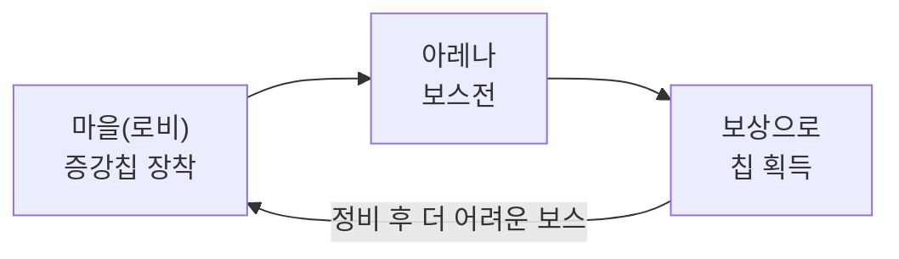
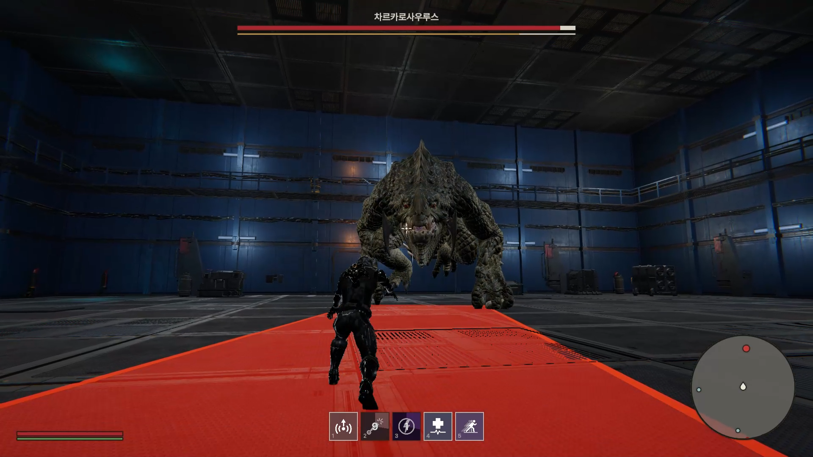
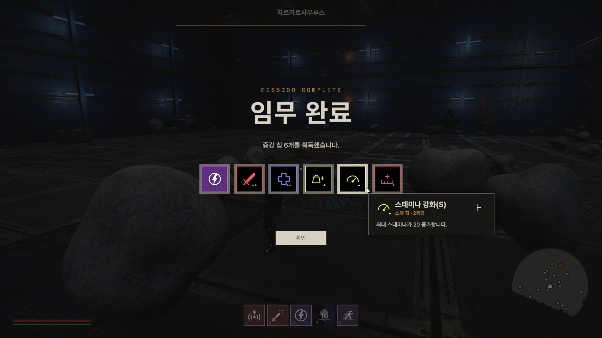
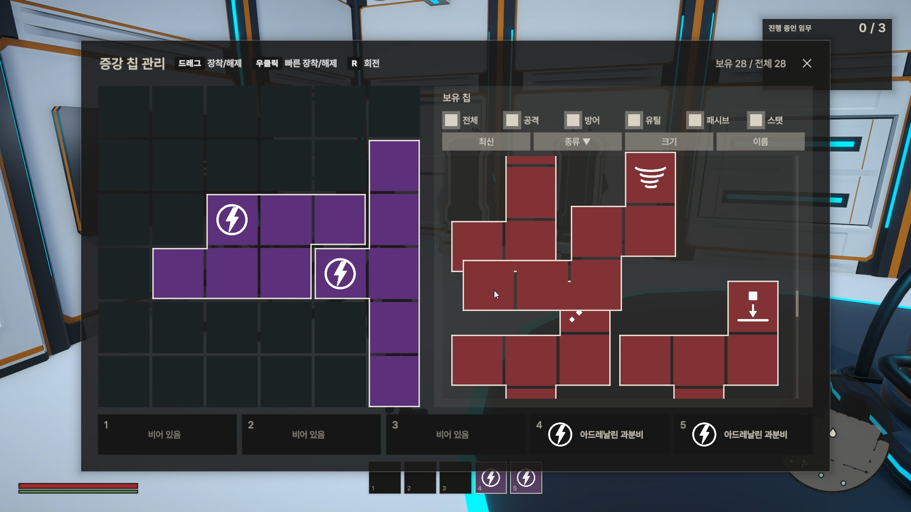
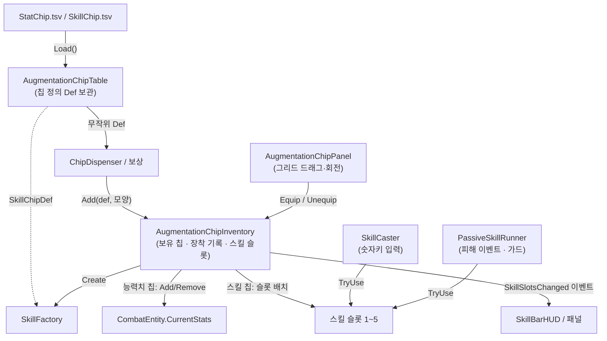
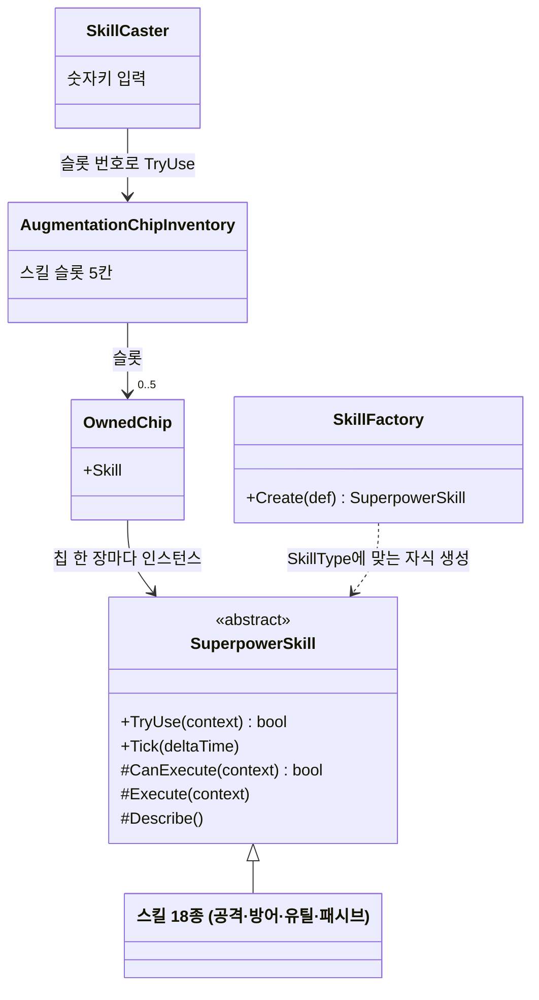
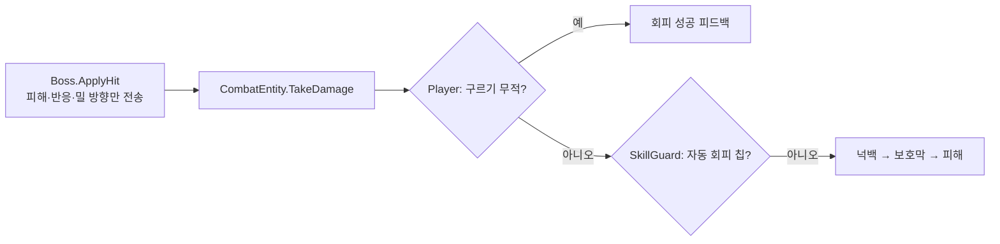
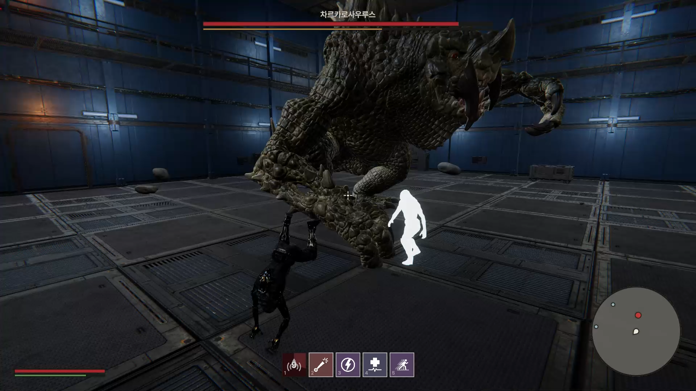

# 증강칩 · 초능력 스킬 시스템 (Oddity)

> 4인 팀 보스 러시 하이퍼 TPS에서 맡은 증강칩 시스템과 초능력 스킬 18종의 공통 구조
>
> 6×6 그리드에 끼우는 증강칩 28종(능력치 10 · 스킬 18)과, 스킬마다 다른 동작을 클래스 하나씩으로 나눈 스킬 구조다. 개발 3주 동안 칩 규칙·이름·수치가 여러 번 바뀌어도 코드 대신 표만 고치면 되도록 만든 것이 핵심이다.
>
> - **결과:** 칩 크기 규칙 변경(L 칩 5종 삭제)과 스킬 7종 밸런스 패치를 모두 표 수정으로 받아냈고, 팀원도 같은 구조 위에 스킬 2종을 추가했다
> - **배운 점:** 유연성은 필요해질 때 들이고, 여러 사람의 코드에 걸친 구조는 문서로 공유해 합의한 뒤 고친다

---

## 1. 프로젝트 소개

### 1.1 프로젝트 개요

| 항목 | 내용 |
|---|---|
| 프로젝트 | Oddity |
| 장르 | 하이퍼 TPS · 보스 러시 — 다양한 초능력으로 보스를 연달아 공략 |
| 팀 구성 | 4명 — 박수하(본인), 팀원 A, 팀원 B, 팀원 C |
| 내 담당 | **증강칩 시스템**과 **초능력 스킬 공통 구조** — 칩 획득·장착 그리드, 스킬 18종 중 16종 |

| 팀원 | 담당 |
|---|---|
| **박수하 (본인)** | **증강칩 시스템**(획득·장착 그리드·UI), **초능력 스킬 공통 구조**(`SuperpowerSkill`·`SkillFactory`·`SkillChip.tsv`)**와 18종 중 16종 구현**, 스킬 슬롯·HUD, 패시브 트리거 |
| 팀원 A | 전반 폴리싱, 보스 패턴, 증강칩 UI 편의성 개선(툴팁·전체 필터·조작 안내), 초능력 스킬 2종(염동 내려찍기·시간 정지 — 공통 스킬 구조 위에 추가) 등 |
| 팀원 B | 보스 AI · 상태 머신, 인간형 보스 패턴 |
| 팀원 C | 플레이어 조작 · 카메라, 미션 |

**핵심 루프**



| ① 마을 · 증강칩 장착 | ② 아레나 · 보스전 | ③ 보상으로 칩 획득 |
|---|---|---|
|  |  |  |

**영상:** [게임 소개와 핵심 루프 (쇼츠)](https://youtube.com/shorts/A48eJAss2Oo)

플레이어는 보상으로 얻은 **증강칩**을 **6×6 그리드**에 테트리스처럼 끼워 넣는다. 6×6 그리드는 본인이 제안하고 팀원들과 상의해 정했다.
- **능력치 칩**(10종): 장착하는 동안 공격력·체력·스태미나 등 스탯을 올린다.
- **스킬 칩**(18종): 1~5번 슬롯에 들어가 숫자키로 발동하거나(공격·방어·유틸), 조건이 맞으면 자동으로 발동한다(패시브).

보스전 보상으로 받는 칩은 같은 칩이라도 장마다 모양이 무작위라, 그리드에 더 잘 맞는 모양을 얻으려고 다시 보스전에 나서게 된다. 레퍼런스인 백팩 히어로와 가장 크게 다른 점이 여기다.



| | 백팩 히어로 | 이 프로젝트 |
|---|---|---|
| 조각의 모양 | 아이템마다 **정해진 모양** | 같은 칩도 **장마다 무작위 모양** (`ChipShapeLibrary.Roll`) |
| 의도한 경험 | 정해진 모양을 가방에 맞춰 넣는 배치 | 더 잘 맞는 모양을 다시 얻으려는 **파밍** |

> **문서 범위** — 팀 프로젝트 중 담당 파트인 **증강칩 시스템**과 **초능력 스킬 공통 구조**를 시스템 단위로 다룬다.
> 칩 데이터를 TSV(탭으로 칸을 나눈 표 파일)에서 읽어 보유·장착까지 잇는 **증강칩 데이터 및 장착 시스템**(2장), 서로 다른 스킬을 같은 입력 구조로 실행하는 **초능력 스킬 실행 시스템**(3장), 패시브 스킬을 전투 흐름에 잇고 피격 판단의 책임을 바로잡은 **전투 이벤트 및 패시브 시스템**(4장) 순서다.
> 보스 AI·플레이어 조작·카메라·미션은 다른 팀원의 담당이라 필요한 맥락에서만 언급한다. AI 협업 기록은 부록 A에, 스킬 VFX·UI 연출 등 그 밖의 담당 작업은 부록 B에 둔다. 기여 범위 전체는 5.2에 정리한다.

### 1.2 프로젝트 목표와 핵심 성과

**목표한 경험:** 같은 칩이라도 더 잘 맞는 모양을 다시 얻으려고 보스전을 되풀이하게 만드는 파밍의 재미

**개발 목표:** 3주 동안 칩 크기 규칙, 칩 이름, 스킬 수치가 여러 번 바뀌었다. 칩이 코드에 박혀 있다면 바뀔 때마다 여러 파일을 고치고 버그를 감수해야 한다.
그래서 칩은 표 데이터로 관리하고, 스킬마다 다른 동작은 독립된 클래스로 나눠 입력 코드를 고치지 않고 스킬을 늘릴 수 있게 하는 것을 목표로 했다.

목표와 실제 결과는 다음과 같다. 달성하지 못한 부분도 함께 적는다.

| 목표 | 결과 | 다루는 곳 |
|---|---|---|
| 기획 변경을 표 수정으로 받는다 | L 칩 5종 삭제와 스킬 7종 밸런스 패치를 표 수정만으로 받음 | 2.2, 5.1 |
| 입력 코드를 고치지 않고 스킬을 늘린다 | 새 스킬 추가 시 입력·인벤토리 코드 수정 0줄. 팀원 A도 같은 구조 위에 스킬 2종을 추가함 | 3.4 |
| 같은 칩도 더 잘 맞는 모양을 얻으려고 파밍한다 | 장마다 무작위 모양과 6×6 그리드 배치는 구현함. 재미가 전해졌는지는 플레이테스터 1명의 의견뿐이라 판단하지 못함 | 2.3, 5.1 |

### 1.3 시연 및 조작법

마을에서 증강칩을 장착하고, 아레나에서 보스와 싸운 뒤, 보상으로 칩을 얻는 흐름을 시연 영상(1.4)에서 볼 수 있다.

| 입력 | 동작 |
|---|---|
| `E` | 증강칩 패널 열기/닫기 |
| `F` | 증강칩 NPC 근처에서 패널 열기 |
| 드래그 / `R` | 칩 이동 / 드래그 중 90도 회전 |
| 우클릭 | 빠른 장착·해제 |
| `1` ~ `5` | 스킬 슬롯 발동 (누르고 있으면 채널링) |

### 1.4 개발 환경 및 프로젝트 정보

| 항목 | 내용 |
|---|---|
| Engine | Unity 6 (6000.3.15f1), URP, Input System, DOTween |
| Language | C# |
| Core | TSV 데이터 테이블 + 로드 시 검증, 전략 패턴(스킬마다 다른 동작을 자식 클래스로 나눔) + 단순 팩토리(표의 스킬 종류를 보고 맞는 클래스를 만들어 줌), 전투 이벤트 기반 패시브 트리거 |
| 기간 | 2026.10.15 ~ 2026.11.07 (약 3주, 4인 팀) |
| AI 활용 | Claude Code — 구현·코드 탐색·커밋 메시지·문서 초안 작성에 활용. 설계 방향 결정과 결과물 검토는 직접 (부록 A) |
| GitHub | https://github.com/KooHoo-Dev/3rd_3D_1-3D-Project-team_odd |
| 시연 영상 | https://youtu.be/w1BEb_1pHL0 |

---

## 2. 증강칩 데이터 및 장착 시스템

**핵심 질문:** 표에 정의된 칩을 어떻게 보유하고, 6×6 그리드에 배치해 플레이어의 능력치와 스킬 슬롯에 반영하는가?

아래 그림은 담당 시스템 전체의 흐름이다. 칩 정의는 표(TSV)에서 읽혀 보유 칩 → 장착 → 스탯·스킬 슬롯으로 이어지고(2장), 숫자키 입력과 전투 이벤트는 모두 슬롯의 `TryUse`로 모인다(3장·4장).



### 2.1 해결하려는 문제

- **칩의 이름·수치·크기 규칙이 자주 바뀐다.** 개발 3주 동안 여러 번 바뀌었으므로, 칩 정의를 코드 밖에 두어야 했다.
- **같은 칩을 여러 장 가질 수 있다.** 그리고 같은 칩이라도 **장마다 모양이 무작위**이며, 스킬 칩이라면 **쿨타임도 칩마다 따로** 돌아야 한다.
- **능력치 칩과 스킬 칩은 장착 결과가 다르다.** 능력치 칩은 스탯을 올리고, 스킬 칩은 1~5번 슬롯에 들어가 발동을 기다린다.

### 2.2 칩 데이터와 보유 상태 분리

칩 정의는 두 표에 있다. `StatChip.tsv`는 능력치 칩 10종, `SkillChip.tsv`는 스킬 칩 18종이다. `AugmentationChipTable`이 이 두 표를 읽어 칩 정의(`AugmentationChipDef`, 이하 `Def`)를 ID로 보관한다.
표 하나에서 28종의 수치를 나란히 비교할 수 있고, 기획이 바뀌면 표만 고치면 된다. 외부 표로 데이터를 관리하는 흐름을 직접 구현해 보는 것도 목표였다. (스킬 데이터를 ScriptableObject(Unity의 데이터 에셋) 대신 표로 둔 이유와 대가는 3.4)

플레이어가 실제로 가진 칩은 `OwnedChip`이다. **공통 값은 `Def`에, 한 장마다 다른 값은 `OwnedChip`에** 둔다.

| 클래스 | 역할 | 하지 않는 일 |
|---|---|---|
| `AugmentationChipTable` | TSV 두 개를 읽어 칩 정의(`Def`)를 ID로 보관. 읽을 때 스킬을 한 번 만들어 보며 값을 검증 (3.4) | 플레이어 상태를 모른다 |
| `OwnedChip` | 보유한 칩 **한 장**. 모양·장착 위치·회전·스킬 인스턴스를 가진다 | 스스로 장착 상태를 바꾸지 않는다 |
| `AugmentationChipInventory` | 보유 목록, 장착/해제, 스탯 반영, 스킬 슬롯 관리, 변경 이벤트 발행 | 그리드 칸 겹침 판정은 하지 않는다 (`ChipGridView` 몫) |

같은 칩 두 장은 `Def`를 함께 쓰지만, 모양도 장착 위치도 다르고 스킬 인스턴스도 따로라 쿨타임이 서로 섞이지 않는다. `Def`에 이 값들을 두면 같은 칩을 두 장 가질 수 없다.

### 2.3 칩 지급과 장착 흐름

보상과 장착을 잇는 부분이다. 보상으로 받은 칩이 장마다 무작위 모양으로 들어와, 마을에서 그리드에 어떻게 끼울지 판단할 거리가 생긴다.

칩을 주는 쪽(보상·`ChipDispenser`)은 **`Add` 하나**만 부르면 된다. 모양은 `ChipShapeLibrary.Roll()`이 칩의 칸 수에 맞춰 무작위로 정한다. 장착 UI는 `Equip`/`Unequip`만 부른다.

```csharp
// 칩을 주는 쪽·장착 UI에서 인벤토리를 부르는 방법 (예시)
// 보상으로 칩 한 장 지급: 모양은 칸 수에 맞춰 무작위로 정한다
AugmentationChipDef def = table.Get(2101);                       // 염동 충격파
Vector2Int[] cells = ChipShapeLibrary.Roll(def.CellCount, gridSize);
OwnedChip chip = inventory.Add(def, cells);

// 장착: 능력치 칩이면 스탯 +, 스킬 칩이면 가장 앞 빈 슬롯에 들어간다
inventory.Equip(chip, origin, rotation);
```

그리드 화면은 `AugmentationChipPanel`(드래그·회전), `ChipGridView`(그리드 점유·배치 가능 판정·미리보기), `ChipItemView`(칩 모양·회전 표시)가 나눠 맡는다.
**"이 자리에 놓을 수 있는가"는 `ChipGridView`가, "장착 상태를 바꾸고 스탯·슬롯에 반영하는 것"은 인벤토리가** 맡는다. 그리드 뷰는 스탯을 건드리지 않고, 인벤토리는 칸 겹침을 판정하지 않는다.

장착 결과는 칩 종류에 따라 갈린다.
- **능력치 칩** → `CombatEntity.CurrentStats`에 보너스를 더한다 (2.4).
- **스킬 칩** → 스킬 슬롯 5칸 중 **가장 앞 빈 슬롯**에 들어간다. 슬롯이 바뀌면 `SkillSlotsChanged` 이벤트로 HUD와 패널이 갱신된다.


**영상:** [칩 지급과 장착 (쇼츠)](https://youtube.com/shorts/oeuApCbPEgk)

### 2.4 능력치 칩의 스탯 반영

#### 스탯 반영 — 데코레이터 vs 합계 더하기·빼기

능력치 칩의 보너스를 플레이어 스탯에 어떻게 반영할지가 이 절의 결정이었다.

첫 구현은 칩 하나가 스탯을 한 겹씩 감싸는 **데코레이터 패턴**(`Stat` → `StatDecorator` → `StatHandler`)이었다.

| | [A] 데코레이터 패턴 (처음 방식) | [B] 런타임 스탯에 더하고 빼기 — `CurrentStats.Add/Remove` (채택) |
|---|---|---|
| 장점 | 칩마다 **계산 규칙이 달라도**(곱연산, 조건부 보정) 한 겹씩 쌓아 표현할 수 있다 | 장착 = 더하기, 해제 = 빼기로 끝. 전투·UI를 맡은 팀원도 `CurrentStats`만 읽으면 된다 |
| 단점 | 칩을 **해제할 때** 체인 중간의 한 겹을 빼야 해 구조가 복잡하다. 스탯을 읽을 때마다 체인을 끝까지 계산한다 | 곱연산·조건부 효과는 직접 표현할 수 없다 |

**B로 바꾸고 데코레이터를 제거했다.** 데코레이터는 계산 규칙이 다를 때 힘을 발휘하는데, 실제 능력치 칩 10종은 모두 **고정값 합연산**뿐이다.
쓰지 않을 유연성을 위해 클래스 3개와 체인 관리 코드를 유지하는 것은 **과설계(Over-engineering)** 다.
이 기준을 지키려고, 뒤에 추가한 염동력 칩도 %가 아니라 **절대값**(사거리 +2m, 최대 질량 +5kg)으로 맞췄다. 모든 능력치 칩이 "기본값 + Value" 규칙 하나로 돌아간다.

**비율 효과가 실제로 필요해졌을 때** — 이후 패시브 '정당한 보복'(피격마다 공격력 +10% 누적)이 생겼다. 데코레이터를 되살리지 않고, 비율을 **기본 스탯 기준 정수 보너스**로 환산해 같은 합연산 구조에 넣었다.

```csharp
// RightfulRevengeSkill — 비율 효과를 '정수 보너스'로 환산해 같은 합연산 구조에 넣는다
stacks++;
// owner.Stats = 칩 보너스를 뺀 '기본' 공격력. 합산값에 곱하면 보너스가 보너스를 키우는 복리가 된다
SetBonus(owner.Stats.Atk * amount * stacks / 100);
// 정수 보너스라 1%씩 바로 더하면 소수점이 버려진다 → 누적 횟수로 매번 다시 계산
```

**기본값 기준 환산**으로 복리 문제를 피하면서, 합연산 구조 하나로 고정값 칩과 비율 효과를 함께 다룬다.

**다시 바꿀 기준** — 패턴은 칩 개수가 아니라 보너스의 성격으로 고른다. 칩을 여러 개 장착한다고 데코레이터가 필요한 것은 아니다.

| 보너스가 하는 일 | 어울리는 방식 |
|---|---|
| 숫자 더하기만 (순서 무관) | **합계 누적** (`Add/Remove`) ← 지금 |
| 더하기와 곱하기가 섞임 (순서 중요) | 보너스 목록 + 계산 순서 |
| 칩마다 동작이 다름 (관통, 충격파) | 전략 패턴 (효과 객체) |
| 한 동작을 여러 겹으로 꾸밈 (투척 → 관통 → 폭발) | 데코레이터 |

비율·곱연산 칩이 **여러 종**으로 늘어 **적용 순서**(고정값 → 비율 → 최종 배율)가 결과를 바꾸기 시작하면, 그때 계산 규칙 계층(데코레이터나 Modifier 파이프라인)을 도입한다. 이는 개선 방향이며, 지금은 그 조건이 아니다.

### 2.5 씬을 넘어 보유 칩 유지

마을과 아레나를 오가면 플레이어가 씬마다 새로 생기지만, 보유한 칩과 장착 상태는 남아야 한다.

**보유 목록과 스킬 슬롯 필드만 `static`으로** 두었다. `DontDestroyOnLoad` 매니저 같은 별도 세이브 객체도 대안이었지만, 칩 목록 하나를 위해 전용 객체를 두는 것은 과하다고 봤다. `static`은 **가장 적은 수정으로 같은 효과**를 낸다.

대신 초기화 시점을 직접 관리한다.
- 새 게임을 시작할 때 `ResetAll()`이 **장착 보너스를 먼저 뺀 뒤** 목록을 비운다. 그냥 비우면 이미 더해진 스탯 보너스가 남는다.
- 플레이어가 아직 없을 때 불러온 장착 기록은 **대기열에 두었다가** `Start`에서 반영한다.

전역 상태라 테스트와 초기화 순서에 민감하다는 한계가 남는다(5.3). 별도 세이브 객체는 아직 구현하지 않은 개선 방향이다.

### 2.6 결과와 한계

**결과**
- 표 데이터에서 칩을 읽어 지급(`Add`) → 그리드 배치 → 장착(`Equip`)까지 하나의 흐름으로 이었다. 칩을 주는 쪽과 UI는 각각 메서드 하나·둘만 안다.
- 같은 칩도 장마다 무작위 모양으로 생성되고, 6×6 그리드에 배치된다. 이것이 목표한 파밍 경험의 바탕이다.
- 능력치 칩은 `CurrentStats` 합연산으로, 스킬 칩은 슬롯 5칸으로 서로 다르게 반영된다.

**한계** (개선 방향은 5.3)
- 보유 칩과 스킬 슬롯이 `static` 전역 상태라 테스트와 초기화 순서에 민감하다(2.5).
- 칩 표를 읽는 단계의 한계(매개변수 오류가 표 읽기 전체를 멈춤)는 3.4에서 다룬다.

---

## 3. 초능력 스킬 실행 시스템

**핵심 질문:** 동작과 필요한 매개변수가 모두 다른 스킬을 어떻게 같은 입력 구조에서 실행하고 확장할 수 있는가?

### 3.1 해결하려는 문제

- **스킬마다 필요한 값과 동작이 전부 다르다.** 충격파는 반경·밀어내는 힘, 순간 이동은 거리, 시간 감속은 배율이 필요하다.
- 이 차이를 입력 코드가 알게 되면 **스킬이 추가될 때마다 `if`가 늘어난다.** 스킬 칩마다 실행 흐름을 따로 만들 수도 없다.
- 수치는 표(2.2)에서 바꾸고 동작은 코드에서 바꾸도록, **스킬 데이터와 동작 코드를 나눠야** 했다.

### 3.2 스킬 공통 구조 설계

**스킬 사용(`SkillCaster`)과 스킬 내용(`SuperpowerSkill`)을 분리**했다. 입력 코드는 스킬이 18개든 30개든 바뀌지 않는다.



> 다이어그램에는 실행에 관여하는 클래스만 그렸다. 스킬 18종은 모두 `SuperpowerSkill`의 자식 클래스다.

| 클래스 | 역할 | 하지 않는 일 |
|---|---|---|
| `SuperpowerSkill` (추상) | 모든 스킬 공통: 쿨타임, `TryUse`, 피해 계산식. 자식 클래스가 `Execute`(무엇을 할지)와 `Describe`(설명)를 구현 | 입력을 받지 않는다 |
| `SkillFactory` | `SkillType`에 맞는 스킬 클래스를 골라 표의 값으로 생성 | — |
| `SkillCaster` | 숫자키 → 해당 슬롯의 `TryUse`. 스태미나·시전 중·정비소 등 공통 조건 확인 | 어떤 스킬인지 모른다 |

- **전략 패턴** — 스킬마다 다른 동작을 `SuperpowerSkill`의 자식 클래스 하나씩으로 나눴다. 부르는 쪽은 `TryUse`만 알면 된다.
- **단순 팩토리** — 표의 `SkillType`을 보고 `SkillFactory`가 맞는 클래스를 만든다. 스킬 칩이 인벤토리에 들어올 때 이렇게 만든 인스턴스를 `OwnedChip`이 가지므로(2.2), 같은 스킬 칩 두 장은 쿨타임이 따로 돈다.
- 인벤토리의 스킬 슬롯 5칸이 입력과 스킬을 잇는다. `SkillCaster`는 슬롯 번호만 알고, 슬롯에 무엇이 들었는지는 모른다.

### 3.3 스킬 발동과 공통 실행 규칙

어떤 칩을 끼웠든 같은 규칙으로 발동해, 장착한 조합이 그대로 보스전의 전투 방식이 된다.

숫자키를 누르면 `SkillCaster`가 공통 조건을 확인하고 그 슬롯 스킬의 `TryUse`를 부른다. 모든 스킬은 **쿨타임 확인 → 실행 가능 확인(`CanExecute`) → 쿨타임 설정 → 실행(`Execute`)** 순서를 **부모 클래스 한 곳**에서 지킨다.

```csharp
// SuperpowerSkill.TryUse
public bool TryUse(SkillContext context)
{
    // 대상이 없는 등 실제로 나가지 않은 스킬은 쿨타임도, 스태미나도 쓰지 않게 false를 돌려준다
    if (IsReady == false || CanExecute(context) == false)
        return false;

    remainingCooldown = Cooldown;
    Execute(context);   // 무엇을 할지는 자식 클래스가 정한다 (전략 패턴)
    return true;
}
```

`SkillCaster`는 `TryUse`가 `true`일 때만 스태미나를 줄인다. 대상이 없어 실제로 나가지 않은 스킬이 쿨타임과 스태미나만 쓰는 일을 막기 위해서다.
**예외 처리**: 사망·피격 중, 다른 스킬 시전 중(염동 연사·시간 역행 등), 정비소 안, 빈 슬롯, 쿨타임 중, 스태미나 부족 — 각각 경고 메시지를 띄우고 중단한다.

### 3.4 새로운 스킬 추가와 데이터 검증

**새 스킬을 추가하는 방법** (실제 작업 순서)
1. `SkillType` enum에 이름 추가
2. `Skills/분류` 폴더에 `SuperpowerSkill` 자식 클래스 작성 (`Execute`, `Describe`)
3. `SkillFactory`의 switch에 **한 줄** 추가
4. `SkillChip.tsv`에 **한 줄** 추가 — 쿨타임·스태미나·매개변수(`Radius=8;Force=25;Power=400`)는 표에서 조정

입력(`SkillCaster`)과 인벤토리 코드는 건드리지 않는다. 팀원 A도 이 순서로 같은 구조 위에 스킬 2종(염동 내려찍기·시간 정지)을 추가했다.

스킬마다 다른 매개변수는 `Params` 문자열 한 칸에 `키=값`으로 적는다. 스킬마다 ScriptableObject를 두는 방식은 칩마다 클래스·에셋을 만들고 연결해야 해 번거로워서, **TSV 한 줄 + `Params` 문자열 + switch 팩토리**를 골랐다.
대가는 **매개변수 오타를 컴파일러가 잡지 못한다**는 것이다. 그래서 칩 표를 읽을 때 스킬을 한 번 만들어 보며 값을 검증한다.

```csharp
// AugmentationChipTable.Load() (발췌)
// 매개변수 오타를 '칩을 줍는 순간'이 아니라 '게임 시작 시' 알 수 있게 한 번 만들어 본다
if (SkillFactory.Create(def) == null)
{
    Debug.LogError($"{chipDto.ID}번 스킬 칩의 값이 잘못되어 테이블에서 뺍니다.");
    continue;
}
```

검증은 두 갈래로 나뉜다.
- **만드는 코드가 없는 `SkillType`** → `Create`가 `null`을 돌려주고, 그 칩만 표에서 빼고 계속 읽는다.
- **매개변수 키 오타·형식 오류** (`Raduis=8`, `Radius=abc`) → `SkillParams`가 **예외를 던져** 표 읽기가 그 자리에서 멈춘다.
  게임 시작 시 바로 드러나지만, 오타 하나로 **뒤의 칩까지 로드되지 않는다**는 한계가 있다(5.3).

### 3.5 쿨타임 — 준비되는 시각 vs 남은 시간

`TryUse`의 쿨타임은 **남은 시간**(`remainingCooldown`)으로 들고 있다. 첫 구현은 흔히 쓰는 **준비되는 시각**(`readyTime = Time.time + Cooldown`) 방식이었다.

`Time.time`은 **float**라서 게임을 오래 켜 둘수록 표현 간격이 벌어져, 수천 시간이면 2초 단위로 끊긴다. 정밀도만 고치는 더 간단한 해법(double 시각)도 있어, 대안은 세 가지였다.

| | [A] float 시각 (처음 방식) | [A'] double 시각 (`Time.timeAsDouble`) | [B] 남은 시간 + `Tick` (채택) |
|---|---|---|---|
| 정밀도 | 장시간 실행 시 오차 (하루 ≈ 0.008초, 수천 시간 ≈ 2초) | **해결** | **해결** (항상 작은 값만 다룸) |
| 수정량 | — | **두 줄** | 스킬·인벤토리 두 파일 |
| 매 프레임 호출 | 필요 없음 | 필요 없음 | **누군가 `Tick`을 불러야 함** |
| 해제한 칩은 쿨타임 정지 | 해제 시점의 남은 시간을 따로 저장 → 재장착 때 재계산 | A와 같음 | **장착된 칩만 `Tick`** → 추가 코드 없음 |
| N초 감소 | `readyTime -= N` | A와 같음 | `ReduceCooldown(N)` — **둘 다 쉬움** |
| 쿨타임 2배속 같은 속도 효과 | 시작·종료마다 모든 `readyTime`을 역산. 겹치면 금방 꼬임 | A와 같음 | `Tick(deltaTime * 배율)` |

정밀도만 보면 A'의 두 줄로 충분해 B로 갈 이유가 없다. 방향을 정한 것은 기획에 있던 **시간 가속** 스킬("n초 동안 다른 스킬의 쿨타임이 m% 빠르게 흐른다")이다.
시각 방식으로는 효과가 시작·끝날 때마다 모든 `readyTime`을 다시 계산해야 하지만, B는 `Tick(deltaTime * 배율)` 하나로 끝난다. **"빨라질 대상이 몇 개인지 효과 쪽이 몰라야 한다"** 는 원칙에 따라 **B를 선택했다.**
"언제, 얼마나 빨리 쿨타임이 도는가"를 **누가 `Tick`을 부르는가** 한 곳으로 제어할 수 있고, 효과 코드가 시각 계산 없이 남은 시간만 다루면 되기 때문이다.

```csharp
// AugmentationChipInventory — 장착된 칩(슬롯 5칸)만 쿨타임이 돈다
private void Update()
{
    foreach (OwnedChip chip in skillSlots)
    {
        if (chip != null)
            chip.Skill.Tick(Time.deltaTime);
    }
}
```

- 인벤토리는 **스킬 슬롯 5칸만** `Tick`하므로 장착한 칩만 쿨타임이 돈다. 지금은 칩을 마을에서만 바꿀 수 있어 이 성질이 필요 없지만, 나중에 전투 중에 칩을 바꿀 수 있게 되면 해제한 칩의 쿨타임을 멈추는 데 추가 코드가 들지 않는다.
- `Tick`을 **`SkillCaster.Update`가 아니라 인벤토리 `Update` 한 곳**에서 부른다. 커서 상태에 따라 일찍 `return`하는 `SkillCaster.Update`에 두면 패널을 여는 동안 쿨타임이 멈추기 때문이다.
- **실제 적용 결과:** 바꾼 뒤 추가된 효과(피해를 줄 때마다 쿨타임 1초 감소, 씬 이동 시 쿨타임 초기화)는 모두 한 줄로 끝났다.
- 시간 가속 스킬은 이후 시간 감속·시간 정지와 역할이 겹쳐 **기획에서 삭제됐다.** 그래서 지금 게임에는 배율을 쓰는 효과가 없다.

**감수한 대가**
- `Tick` 호출을 빠뜨리면 쿨타임이 영원히 멈춘다. 그래서 부르는 곳을 인벤토리 `Update` 한 곳으로 정했다.
- 그리드 위의 칩을 집어 옮기는 몇 초 동안은 장착이 풀려 그 칩의 쿨타임이 멈춘다. 이를 막으려면 인벤토리가 패널 상태까지 알아야 하므로, **멈추게 두는 쪽이 더 단순하다**고 판단했다.

### 3.6 결과와 한계

**결과**
- 스킬 동작(`SuperpowerSkill` 자식 클래스)과 입력 처리(`SkillCaster`)를 나눠, 새 스킬을 추가할 때 입력·인벤토리 코드를 수정하지 않는다.
- 팀원 A가 이 구조를 그대로 써서 스킬 2종을 추가했다.
- 쿨타임을 남은 시간으로 바꾼 덕에 쿨타임 감소·초기화 효과가 한 줄로 붙었다. 대신 `Tick`을 부르는 책임이 생겼다.

**한계** (개선 방향은 5.3)
- TSV 매개변수의 키 오타·형식 오류가 표 읽기 전체를 멈춘다. 오타 하나로 뒤쪽의 정상 칩까지 로드되지 않는다(3.4).

---

## 4. 전투 이벤트 및 패시브 시스템

**핵심 질문:** 키 입력 없이 발동하는 패시브 스킬을 전투 흐름에 어떻게 연결하고, 피해 판정과 회피 처리를 어느 객체가 책임지게 할 것인가?

### 4.1 해결하려는 문제

- 패시브 스킬은 **키를 누르지 않아도 조건이 맞으면** 발동해야 한다. 키를 누르지 않아도 보스전에서 효과가 나므로, 어떤 칩을 끼울지가 곧 전투 준비가 된다.
- 발동 시점이 서로 다르다. 피해를 **준 뒤**, **받은 뒤**, **받기 직전**, **죽기 직전**.
- 그래서 패시브는 전투 시스템과 플레이어 피격 흐름 양쪽에 연결되어야 한다. 이 연결을 만들다가, 피격 판단이 **때리는 쪽(보스)에 쌓여** 있다는 문제를 발견했다(4.3).

### 4.2 전투 이벤트를 통한 패시브 발동

패시브 스킬(두 번째 심장, 생명 착취, 조건 반사, 정당한 보복 등 5종)은 키가 아니라 **전투 이벤트**로 발동한다. `PassiveSkillRunner`가 트리거마다 맞는 패시브를 골라 슬롯 스킬의 `TryUse`를 부른다(3.3과 같은 실행 규칙).

| 발동 시점 | 연결 방식 |
|---|---|
| 피해를 **준 뒤 / 받은 뒤** | `CombatManager`의 피해 이벤트 구독 |
| 피해를 **받기 직전 / 죽기 직전** | `Player`의 `SkillGuard`(`IDamageGuard`)로 등록되어, 구르기 무적 판정 **다음에** 질문을 받는다 |

- 피해·죽음을 막는 트리거는 **하나가 막으면 멈춘다.** 같은 칩 두 장이 한 번의 피해를 함께 막느라 내부 쿨타임을 둘 다 소모하지 않게 하기 위해서다.
- "구르기 무적 다음에 가드가 질문을 받는다"는 순서는 처음부터 있던 것이 아니라, 아래 리팩터링(4.4)으로 만든 것이다. 판정 순서 전체는 4.4의 그림에 있다.

### 4.3 회피 피드백을 붙이며 발견한 피격 흐름 문제

**문제:** 구르기로 공격을 피했을 때 회피 성공 피드백을 띄우려 했지만, 플레이어 코드에서는 "방금 피했다"를 알 방법이 없었다.
플레이어가 무적이면 **보스 코드에서 바로 `return`** 해, 플레이어 쪽 코드가 아예 불리지 않았다.

**원인:** 피격 판단이 **때리는 쪽(보스)에 땜질로 쌓여** 있었다. 커밋 이력에 남은 순서는 다음과 같다.
1. `DamageInfo`에 넉백 정보를 담을 자리가 없어, 보스가 넉백을 직접 걸었다.
2. 구를 때도 넉백이 걸리자, 보스가 무적도 확인했다.
3. 무적이면 피해까지 보스 쪽에서 막도록 넓혔다.
4. 넉백 방향 계산도 보스 쪽에 더해졌다.
5. 자동 회피 칩을 넉백보다 먼저 묻기 위해, 보스 코드에 칩 확인을 끼워 넣었다(본인의 수정).

하나씩 보면 각각 합리적인 수정이었지만, 쌓인 결과 문제가 세 가지 생겼다.
- 무적 플래그가 두 곳에서 따로 확인됨 → 시간 역행 중에도 넉백이 들어갈 수 있는 구조
- 공격 하나에 칩이 **두 번** 질문을 받음
- 보스가 아닌 피해에는 구르기 무적이 적용되지 않음

**채택하지 않은 해결:** 회피 이펙트를 보스 코드에 넣으면 당장은 되지만, 보스가 플레이어 연출까지 알게 된다. 보스의 무적 확인을 다른 호출로 바꾸는 한 줄짜리 최소 수정도 있었지만, 판단이 여전히 보스에 남는다. 둘 다 Claude Code가 먼저 낸 안이었고 받아들이지 않았다(부록 A).

### 4.4 피격 판단을 맞는 쪽으로 이동한 리팩터링

**해결:** "때리는 쪽은 이벤트만 보내고, 판단은 맞는 쪽이 한다."
구조 문제를 짚고 이 방향을 정한 것은 본인이다. 팀원 두 명의 코드에 걸친 변경이라, **현재 구조·문제·커밋 이력·변경안을 문서로 정리해 공유하고 동의를 받은 뒤** 리팩터링했다. 구현은 정한 설계대로 Claude Code에 맡기고, 빌드와 Unity 플레이테스트로 확인했다.



`Boss.ApplyHit()`은 피해·반응·밀 방향만 보낸다. 받는 쪽 `CombatEntity.TakeDamage()`에서 플레이어의 구르기 무적을 먼저 확인하고, 그다음 `SkillGuard`가 자동 회피 칩에게 묻고, 통과하면 넉백 → 보호막 → 피해 순으로 처리한다.

리팩터링하면서 내린 판단은 세 가지다.
- **의존 방향** — 처음 구현에서는 `Player`가 칩 코드(`PassiveSkillRunner`)를 직접 참조하고 있었다. 빌드도 플레이테스트도 정상이었지만, 피격 흐름 범위 안에서 책임 분리를 다시 점검하다 발견했다.
  **"`4. Superpower` 폴더를 지워도 `Player.cs`가 컴파일되는가?"** 로 점검했다. 소유(플레이어가 칩을 가짐)와 의존(누가 없어도 돌아가야 하나)은 다르다. 그래서 `Player`에는 `IDamageGuard` 빈 자리만 두고, 칩이 그 자리에 자신을 꽂게 했다.
- **무적 플래그는 합치지 않음** — bool 하나로 합치면 기상 무적이 끝날 때 진행 중인 부활 무적까지 꺼진다. 그래서 저장은 두 곳에 그대로 두고 **확인만 한 곳**으로 모았다.
- **확정 피격** — 머지 후 인간형 보스의 "구르기로도 못 피하는 공격"은 판단을 보스에 되돌리지 않고 **공격의 속성**(`DamageInfo.Unavoidable`)으로 넘겼다.

**회피 피드백** — 수동 회피(하얀 허물 + 슬로 모션)와 자동 회피(파란 잔상)로 나눠 붙였다. 회피를 부르는 쪽이 회피 유형(`DodgeType`)을 넘기고, 피드백 쪽이 유형을 보고 연출을 고른다. 자동 회피 중 들어온 공격에 수동 회피 연출이 나가던 문제도 이렇게 해결했다.

| 수동 회피 — 구르기 무적 | 자동 회피 — 조건 반사 칩 |
|---|---|
|  |  |

**영상:** [패시브 스킬 — 회피 피드백 (쇼츠)](https://youtube.com/shorts/xxZeLqbcf-g)

**결과:** 플레이어 코드 밖에서 넉백을 걸거나 무적을 확인하는 곳이 **0곳**이 됐고, 4.3의 세 문제가 한 번에 해결됐다.

### 4.5 결과와 한계

**결과**
- 피격 판단이 맞는 쪽 한 곳으로 모여 4.3의 세 문제가 해결됐다(4.4).
- 공격하는 쪽은 **피해 이벤트만 보내면** 회피·패시브 칩·넉백이 모두 적용된다. 앞으로 몬스터가 늘어도 같은 피해 처리 규칙을 쓸 수 있는 구조다.
- 회피 피드백이 수동·자동으로 나뉘어, 플레이어가 무엇으로 피했는지 화면에서 구분된다.

**한계**
- 검증은 컴파일 확인(`dotnet build`)과 Unity 플레이테스트, 머지 후 인간형 보스의 확정 피격까지다. 보스가 아닌 새 몬스터 종류가 추가되면, 그 공격이 `TakeDamage`를 거쳐 같은 규칙을 따르는지 확인해야 한다.

---

## 5. 통합 검증과 프로젝트 회고

**핵심 질문:** 칩과 스킬 시스템을 게임에 연결해 어디까지 동작을 확인했으며, 구현 과정에서 무엇을 배웠는가?

### 5.1 스킬 및 칩 시스템의 통합 검증

목표한 경험은 "같은 칩이라도 더 잘 맞는 모양을 다시 얻으려고 보스전을 되풀이하게 만드는 파밍의 재미"였다(1.2). 장마다 무작위 모양과 6×6 그리드 배치는 구현했지만, 플레이테스터 1명에게서 "스킬 칩은 시스템 자체가 불편하고, 왜 이렇게 해야 했는지 이유를 모르겠다. 최대 코스트 제한을 두고 슬롯에 끼는 방식으로 해도 되지 않나"라는 의견을 받았다. 의견이 한 명뿐이라 목표한 경험이 전해졌는지는 판단하지 못했다.

**팀의 결과** — 4인 팀이 게임을 완성해 수업 최종 발표를 했다. 내 파트(증강칩·스킬)의 목표별 결과는 1.2 표에, 장마다의 결과는 2.6 · 3.6 · 4.5에 있다.

- 능력치 칩 **10종**, 스킬 칩 **18종**(공격 6 · 방어 3 · 유틸 4 · 패시브 5)을 표 데이터로 운영
- 새 스킬 추가 시 입력(`SkillCaster`)·인벤토리 코드 **수정 0줄** — 팀원 A의 2종도 같은 구조 위에 추가됐다

**기획 변경을 표 수정으로 흡수한 결과**

| 변경 | 한 일 | 건드린 곳 |
|---|---|---|
| 능력치 칩을 **2~3칸 크기만** 쓰기로 기획 변경 | 가장 큰 **L 칩 5종 삭제** | `StatChip.tsv` **줄 삭제만** — 코드는 그대로, 참조가 꼬일 곳 없음 |
| 스킬 칩 **일괄 밸런스 패치** + 이름 정리 | 스킬 7종의 수치·설명 조정, 칩 28종 이름 끝의 "칩" 제거 | `SkillChip.tsv`·`StatChip.tsv` **두 표, 한 커밋** — C# 쪽 변경 없이 끝남 |

칩 정의가 코드가 아니라 **표 한 곳**에 있었기 때문에(2.2), 기획이 바뀌어도 단순 반복 작업으로 끝났다.


### 5.2 기여도와 검증 범위

**기여 범위**

| 내용 | 기여 |
|---|---|
| 칩 데이터 표·보유·장착 그리드(2장), 스킬 공통 구조와 스킬 18종 중 16종(3장), 스킬 슬롯·HUD, 패시브 트리거(4.2) | 본인 구현 |
| 데코레이터 제거(2.4), `static` 보유 칩(2.5), TSV + `Params` 문자열(3.4), 쿨타임 남은 시간 방식(3.5) | 본인 설계 결정 |
| 6×6 그리드 | 본인 제안, 팀원들과 상의해 결정 (1.1) |
| 피격 흐름 리팩터링(4.4) | 구조 문제 제기·방향 결정·팀원 공유는 본인, 구현은 정한 설계대로 Claude Code (부록 A) |
| 스킬 2종(염동 내려찍기·시간 정지), 증강칩 UI 편의성(툴팁·전체 필터·조작 안내) | 팀원 A 구현 |

**검증 범위**

| 확인 방법 | 확인한 것 |
|---|---|
| 컴파일 | `dotnet build`로 확인 (4.4) |
| 본인 검증 (Unity 플레이테스트) | 구현한 기능과 피격 흐름 리팩터링을 직접 플레이해 확인했다. 머지 후 인간형 보스의 확정 피격까지 (4.5) |
| 팀 결과 | 게임을 완성해 수업 최종 발표를 했다 |
| 외부 플레이 | 플레이테스터 1명의 의견 (5.1) |
| **확인하지 못한 것** | 파밍의 재미가 전해졌는지는 의견이 한 명뿐이라 판단하지 못했다. 보스가 아닌 몬스터의 공격이 같은 피해 처리 규칙을 따르는지는 확인하지 않았다 |

### 5.3 기술 부채와 개선 방향

각 장의 "결과와 한계"에서 다룬 부채 2건을 한곳에 모으고 우선순위를 붙였다. 아래 개선 방향은 모두 **아직 구현하지 않은 계획**이며, 효과를 측정한 것도 아니다.

| 순위 | 부채 | 현상 | 영향 | 개선 방향 | 자세히 |
|---|---|---|---|---|---|
| 1 | TSV 매개변수 검증 | `SkillFactory`의 switch가 스킬마다 매개변수 이름을 문자열로 적는다. 키 오타·형식 오류는 로드 시 예외를 던져 **표 읽기 전체를 멈춘다** | 오타 하나로 뒤쪽의 정상 칩까지 로드되지 않는다 | 줄 단위로 예외를 잡아 "몇 번 칩의 어떤 키가 틀렸는지"만 기록하고 그 칩만 뺀다. 장기적으로는 스킬 클래스에 매개변수 정의를 두고 팩토리를 자동화 | 3.4 |
| 2 | 보유 칩의 `static` 상태 | 전역 상태에 의존하고, 초기화 순서에 민감하다 | 테스트와 새 게임 초기화에서 상태 관리가 복잡해질 수 있다 | 칩 말고도 씬을 넘어 유지할 상태가 늘어나면, 그때 세이브 데이터를 들고 다니는 별도 객체로 분리 | 2.5 |

### 5.4 배운 점

**유연성은 필요해질 때 들인다.**
데코레이터는 쓰지 않는 유연성이었고, 걷어낸 뒤에 생긴 비율 효과도 기존 합연산 구조 안에서 처리했다(2.4). 대신 "언제 다시 도입할지" 기준을 함께 정해 둔다.

**기술 문제의 가장 싼 해법과 기획이 원하는 동작을 구분한다.**
쿨타임 정밀도는 double 두 줄로 끝났지만, 방식을 정한 건 기획에 있던 쿨타임 가속 효과였다(3.5). 그 스킬은 결국 삭제됐지만, 같은 구조 덕에 쿨타임 감소·초기화 효과는 한 줄로 붙었다.

**"무엇이 자주 바뀔까"를 먼저 묻는다.**
표 데이터(2.2)를 이 질문으로 골랐고, 이후 기획 변경을 적은 수정으로 흡수했다(5.1).

**여러 사람의 코드에 걸친 변경은 문서로 공유하고 합의한 뒤 진행한다.**
땜질은 하나씩 보면 합리적이어도 쌓이면 구조를 비튼다. 보스 쪽에 쌓인 피격 판단에는 자동 회피 칩을 위해 직접 넣은 확인도 있었다(4.3). 그래서 현재 구조·문제·변경안을 문서로 공유하고 동의를 받은 뒤 고쳤다(4.4).

**의견 하나로는 경험이 전해졌는지 알 수 없다.**
그리드 규칙이 불편하다는 의견을 받았지만 한 명뿐이라, 규칙을 바꿀지 판단할 근거가 되지 못했다(5.1). 다음에는 여러 명에게 플레이를 받아 목표한 경험이 전해졌는지 확인한다.

---

## 부록

### A. AI 협업

Claude Code를 구현 보조로 썼고, 피격 흐름 리팩터링(4.3·4.4)은 함께 진행했다.

| | 내용 |
|---|---|
| Claude Code에게 맡긴 것 | 코드 구현, 커밋 메시지·문서 초안 작성. 피격 흐름 리팩터링(4.3·4.4)에서는 코드 탐색과 커밋 이력 추적까지 |
| 직접 판단한 것 | 설계 결정 전부(데코레이터 제거 2.4 · static 보유 칩 2.5 · TSV 3.4 · 쿨타임 방식 3.5), 피격 흐름의 구조 문제 제기와 방향 결정 |
| 확인한 방법 | `dotnet build`로 컴파일을 확인한 뒤 Unity에서 직접 플레이테스트했다. 정상 작동한 뒤에도 피격 흐름 범위 안에서 책임 분리를 다시 점검했다(아래 ③) |
| 잘 된 것 | 피격 순서를 다시 읽혀 구조 문제 3개를 찾고, `git log`로 땜질이 쌓인 커밋 5개를 거슬러 올라간 것(4.3) |
| 받아들이지 않은 것 | 회피 이펙트를 보스 코드에 넣은 수정과, 보스의 무적 확인만 바꾸는 한 줄짜리 최소 수정 제안(아래 ①②) |

**AI의 판단을 바로잡은 지점** — 피격 흐름 리팩터링(4.3·4.4)의 실제 대화 기록에서 옮긴 것이다.

| | AI의 제안·작업 | 직접 짚은 것 | 결과 |
|---|---|---|---|
| ① | 회피 성공 이펙트를 띄우려고 **보스 코드에 한 줄**을 넣음 (팀원 파일) | "보스 공격에 회피 이펙트를 넣으면 책임이 꼬인다" | 바로 되돌림 |
| ② | 대신 보스의 무적 확인을 `TryAvoidHit()` 호출로 바꾸는 **한 줄짜리 최소 수정**을 추천 | "그게 사실이면 구조가 많이 꼬인 것 아닌가?" | AI가 피격 순서를 다시 읽어 4.3의 문제 3개를 찾음. 이후 "때리는 쪽은 이벤트만 보내고 맞는 쪽이 판단하면 되지 않나"로 방향을 정함 |
| ③ | 리팩터링 후 빌드 오류 0개, 플레이테스트도 정상 | "정상 작동이 책임 분리가 확실하다는 뜻은 아니다. 피격 흐름 범위 안에서만 다시 점검" | AI가 **자기 실수**를 찾음: `Player`가 칩 코드(`PassiveSkillRunner`)를 직접 참조하고 있었음 → `IDamageGuard` 빈 자리로 수정 |
| ④ | 회피 피드백을 자동·수동 두 갈래로 나누는 후보 제시 | 설계를 직접 지정: "`DodgeType` enum을 만들고, 회피를 부르는 쪽이 유형을 넘기고, 피드백 쪽이 유형을 보고 판단" | 자동 회피 중 들어온 공격에 수동 회피 연출이 나가던 문제도 함께 해결 |

①과 ②에서 AI의 첫 답은 모두 **"지금 신호를 받을 수 있는 가장 가까운 자리"에 붙이는 해법**이었다. 동작은 하지만, 그 해법이 어느 클래스의 책임을 늘리는지는 따지지 않는다. 이 질문은 직접 던져야 한다.

**피격 흐름 리팩터링의 역할 분담**

| Claude Code에게 맡긴 것 | 직접 한 것 |
|---|---|
| 피격 흐름 코드를 읽고 실제 호출 순서 정리 | 구조 문제 제기와 방향 결정 |
| `git log`로 땜질이 쌓인 커밋 5개 추적 (넉백 → 무적 확인 → 피해 차단 → 방향 계산 → 칩 확인) | 팀원 두 명에게 공유하고 동의 받기 |
| 팀원 공유용 제안 문서, 배포용 요약 문서 초안 | 문서 검토 후 공유 |
| 직접 정한 설계대로 구현, `dotnet build`로 컴파일 확인 | Unity 플레이테스트 |
| 회피 연출 후보 제시 | 최종 연출 결정 (자동: 파란 잔상 / 수동: 하얀 허물 + 슬로 모션) |
| 커밋 분할과 메시지 작성 | 커밋 규칙 지정 ("씬 변경은 절대 커밋하지 않는다") |

### B. 그 밖의 담당 작업

- 스킬 VFX·사운드 연동 (블랙홀·에네르기파·폭풍 이펙트, 루프 재생·저주파 필터)
- 증강칩 UI 연출: 계열별 칩 색, NEW 표시, 정렬, 스킬 분류 필터, 쿨타임이 당겨질 때 스킬 슬롯이 번쩍이며 튀는 연출 (아드레날린 과분비 칩)
  (스킬 정보 팝업 툴팁, 전체 필터, 조작 안내, 스킬 슬롯 HUD 가독성 개선은 팀원 A의 작업)
- 테스트 도구: 칩 일괄 지급(F8), 시연용 칩 디스펜서

| 공격 필터 | 유틸 필터 |
|---|---|
|  |  |

**영상:** [그 밖의 담당 작업 — 증강칩 UI (쇼츠)](https://youtube.com/shorts/uTXZt2WGFQI)
