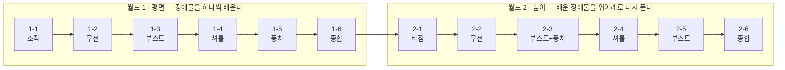
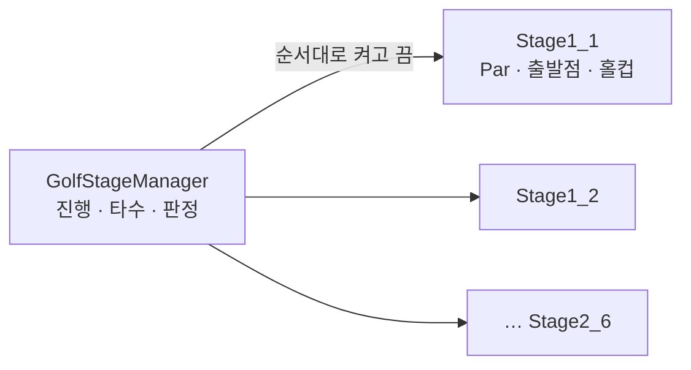

# 미니골프 레벨 디자인 (Mini Golf Level Design)

> 설명 없이 코스만으로 장애물을 가르치는 12홀 미니골프
>
> - **무엇을:** 2개 월드 × 6홀, 장애물 4종과 해저드(물)로 구성한 코스
> - **왜:** 튜토리얼 텍스트 없이 플레이어가 홀을 지나며 규칙을 스스로 익히게 하고 싶어서
> - **결과:** 한 홀에 새 요소 하나 → 월드 마지막 홀에서 부스트·셔틀·풍차·물을 조합하는 구조, 플레이테스트로 Par 재조정 <!-- ✏️ 확인 -->
> - **배운 점:** 만든 사람이 직접 하는 테스트는 실제 플레이어보다 '정직하다' — 설계자 테스트로는 Par를 정할 수 없다

---

## 1. 개요

### 1.1 무엇을 (What)

이 문서는 미니골프 12홀의 **레벨 디자인**을 다룬다. 공을 치는 조작과 물리는 수업에서 함께 만든 기반을 사용했고, 이 프로젝트에서 내가 집중한 것은 **어떤 장애물을, 어떤 순서로, 어떤 난이도로 배치하는가**다.

> **문서 범위** — 코드 구현보다 **배치 의도와 그 근거**가 중심이다. 코드는 기획 의도를 지탱하는 설계 결정(4장)에서만 다룬다.

### 1.2 왜 (Why)

<!-- ✏️ 작성 필요: 이 프로젝트를 레벨 디자인 중심으로 잡은 이유. 예) 기능 구현은 다른 프로젝트에서 보여 줬고, 이번엔 '같은 조작으로 다른 문제를 만드는 능력'을 보여 주고 싶었다 등 -->

### 1.3 조작법

| 입력 | 동작 |
|---|---|
| 공 위에서 좌클릭 → 드래그 → 놓기 | 당긴 반대 방향으로 발사 (당긴 거리 = 세기) |
| 드래그 중 마우스 휠 | **타점(피치) 조절** — 5° 단위, 공을 띄워 치기 |
| 드래그 중 `ESC` | 샷 취소 |
| 우클릭 드래그 / 휠 | 카메라 회전 / 줌 |

타점 조절은 월드 2의 핵심 조작이다. (2.2 참조)

### 1.4 개발 환경

- **Engine:** Unity 6 (6000.3.15f1), URP
- **Language:** C#
- **Level Tool:** 프리팹 조립 (`Floor`, `Wall`, `Water`, `Tee`, `Hole_Group` + 장애물 프리팹)
- **기간:** <!-- ✏️ 작성 필요: YYYY.MM.DD ~ YYYY.MM.DD (N주, 개인 프로젝트) -->
<!-- ✏️ AI 활용: 활용했다면 Oddity 문서처럼 한 줄 추가 -->

### 1.5 링크

- **GitHub:** <!-- ✏️ 작성 필요 -->
- **시연 영상:** (촬영 예정) <!-- TODO: 업로드 후 실제 주소로 교체 -->

---

## 2. 코스 구조

### 2.1 전체 배치표

| 홀 | 새로 등장하는 요소 | 함께 쓰인 요소 | Par |
|---|---|---|---|
| **1-1** | — (조작 익히기) | | 4 |
| **1-2** | 쿠션 벽 | 물 | 6 |
| **1-3** | 부스트 패드 | 물 | 3 |
| **1-4** | 셔틀 벽 | 물 | 3 |
| **1-5** | 풍차 | 물 | 5 |
| **1-6** | **월드 1 종합** | 부스트 · 셔틀 · 풍차 · 물 | 6 |
| **2-1** | **높이 (타점 조절 필수)** | 물 | 4 |
| **2-2** | 높이 × 쿠션 벽 | 물 | 3 |
| **2-3** | 높이 × 부스트 + 풍차 | 물 | 4 |
| **2-4** | 높이 × 셔틀 벽 | 물 | 3 |
| **2-5** | 높이 × 부스트 패드 | 물 | 3 |
| **2-6** | **월드 2 종합** | 부스트 · 셔틀 · 풍차 · 물 | 6 |



### 2.2 월드 1과 월드 2의 역할

- **월드 1 — 평면.** 한 홀에 새 장애물을 **하나만** 넣는다. 플레이어가 실패했을 때 원인이 무엇인지 헷갈리지 않게 하기 위해서다. 마지막 1-6에서 앞서 배운 부스트 패드·셔틀 벽·풍차를 물과 함께 조합한다. <!-- ✏️ 확인: 종합 홀(1-6, 2-6)에 쿠션 벽을 넣지 않은 이유가 있다면 한 줄 추가. 실제로 있다면 2.1 배치표를 고칠 것 -->
- **월드 2 — 높이.** 2-1부터 **타점(피치) 조절 없이는 넘어갈 수 없게** 만들었다. 월드 1에서는 몰라도 클리어할 수 있던 조작을 여기서 반드시 쓰게 한다. 이후 홀은 월드 1의 장애물을 높이 차이와 결합해 다시 등장시킨다.

<!-- ✏️ 작성 필요: 2-1에서 '타점을 써야 한다'는 걸 플레이어가 어떻게 알아채게 했는지 (예: 물 너머 높은 그린이 정면에 보임, 굴려서는 닿지 않는 턱 등) -->

### 2.3 난이도 곡선

| 월드 1 | 1-1 | 1-2 | 1-3 | 1-4 | 1-5 | 1-6 |
|---|---|---|---|---|---|---|
| Par | 4 | 6 | 3 | 3 | 5 | 6 |
| **월드 2** | **2-1** | **2-2** | **2-3** | **2-4** | **2-5** | **2-6** |
| Par | 4 | 3 | 4 | 3 | 3 | 6 |

두 월드 모두 **새 규칙이 나오는 첫 홀은 Par를 넉넉히, 중간 홀은 짧게, 종합 홀은 길게** 잡았다. 예외는 1-2로, 4.1에서 다룬다.

<!-- ✏️ 이 곡선 의도가 맞는지 확인해 주세요. 다르면 실제 의도로 고쳐 주세요. -->

---

## 3. 장애물 설계

각 장애물이 **플레이어에게 어떤 판단을 요구하는가**를 기준으로 정리했다.

| 장애물 | 플레이어에게 묻는 질문 | 조정한 값 | 첫 등장 → 재등장 |
|---|---|---|---|
| **쿠션 벽** | "벽을 맞혀 꺾어 보낼 수 있나?" (반사각) | 탄성 물리 머티리얼 `PM_Bouncy` | 1-2 → 2-2 |
| **부스트 패드** | "패드 방향을 이용할까, 피할까?" (경로 선택) | 속도 25 (일반 샷 최대 15보다 강함) | 1-3 → 2-3, 2-5, 1-6, 2-6 |
| **셔틀 벽** | "언제 칠까?" (타이밍) | 한쪽 이동 2초, 왕복 | 1-4 → 2-4, 1-6, 2-6 |
| **풍차** | "날개 사이로 지나갈 수 있나?" (타이밍 + 정확도) | 회전 속도 | 1-5 → 2-3, 1-6, 2-6 |
| **물 (해저드)** | "안전하게 돌아갈까, 위험하게 질러갈까?" (위험 감수) | 빠지면 **직전 샷 위치로 복귀** + 1타 | 1-2 → 대부분의 홀 |

<!-- ✏️ 작성 필요: 장애물별로 '처음 등장하는 홀에서 어떻게 안전하게 보여 줬는지' 한두 줄씩. 예) 1-4에서는 셔틀 벽을 실패해도 물에 빠지지 않는 위치에 둠 -->

> 📹 영상: 장애물별 쇼츠 링크 <!-- ✏️ 촬영 후 -->

---

## 4. 고민과 선택

### 4.1 설계자 테스트가 만든 Par 6 (1-2)

1-2는 쿠션 벽이 처음 나오는 홀인데 Par가 6으로 월드 1에서 가장 높다. 의도한 난이도가 아니라 **테스트 방식의 문제**였다.

Par를 정할 때 플레이어의 역량을 너무 낮게 잡았다. 직접 테스트하면서 **코스가 꺾이는 지점마다 공을 멈추고 다음 샷을 쳤다.** 코스를 설계한 대로 '정직하게' 따라간 것이다. 하지만 쿠션 벽은 원래 **벽에 튕겨 한 번에 모퉁이를 돌게** 하려고 넣은 장애물이었다. 설계자인 내가 그 장애물을 활용하지 않고 테스트한 셈이다.

<!-- ✏️ 작성 필요: 다른 사람이 플레이했을 때 1-2를 몇 타에 끝냈는지 / Par를 고쳤는지, 그대로 두었다면 왜인지 -->

**배운 점:** 설계자는 코스의 '정답 경로'를 알기 때문에 오히려 그 경로대로만 친다. Par는 설계자 테스트가 아니라 **처음 보는 사람의 플레이 기록**으로 정해야 한다.

### 4.2 해저드 벌칙: 출발점이 아니라 직전 샷 위치로

**결정 대상** — 공이 물에 빠졌을 때 어디로 되돌릴 것인가?

| | [A] 출발점으로 복귀 | [B] 직전 샷 위치로 복귀 (채택) |
|---|---|---|
| 결과 | 벌칙이 지나치게 큼. 긴 종합 홀(1-6, 2-6)에서 끝부분 실수 한 번에 처음부터 다시 | 실수한 그 샷만 다시 시도. 질러가기를 '시도해 볼 만한 위험'으로 만든다 |

**[결정]** 물에 빠졌을 때 공을 **출발점**이 아니라 **마지막으로 친 위치**로 되돌린다.

부스트 패드가 공을 밀어낸 것은 '친 위치'로 기록하지 않는다(`isPassive`). 패드 위에서 빠져도 플레이어가 마지막으로 직접 친 곳으로 돌아간다.

```csharp
// GolfBall.cs — 플레이어가 직접 친 샷만 복귀 지점으로 기록
public void Shoot(Vector3 direction, float power, bool isPassive = false)
{
    ...
    if (isPassive == false)
        lastPosition = transform.position;
}
```

### 4.3 홀을 데이터로 분리 — 코드 없이 홀을 추가

각 홀은 `GolfStage` 프리팹 하나이며 **Par, 출발점, 홀컵**만 가진다. 진행·타수·스코어 판정(버디, 보기 등)은 `GolfStageManager` 한 곳에서 처리한다.



그래서 레벨 디자인 작업은 **프리팹을 조립하고 Par를 입력해 목록에 넣는 것**으로 끝난다. 12홀을 만드는 동안 진행 코드는 수정하지 않았다. 반복해서 고치고 테스트하는 레벨 디자인에서는 이 점이 작업 속도에 직접 영향을 준다.

### 4.4 움직이는 장애물과 공의 충돌

셔틀 벽은 `Transform`을 직접 옮기지 않고 키네마틱 `Rigidbody.MovePosition`으로 움직인다. Transform을 직접 옮기면 물리 엔진이 벽의 속도를 모르기 때문에, 벽이 공을 밀어낼 때 공이 벽을 뚫거나 이상하게 튕길 수 있다. 타이밍을 묻는 장애물이 불공정하게 느껴지지 않으려면 **충돌 결과를 플레이어가 예측할 수 있어야** 한다.

---

## 5. 결과 및 배운 점

### 5.1 결과 — 플레이테스트

<!-- ✏️ 작성 필요: 테스트 인원, 홀별 평균 타수 vs Par, 가장 많이 막힌 홀, 테스트 후 고친 것
     표 예시)
| 홀 | Par | 평균 타수 | 비고 |
|---|---|---|---|
| 1-2 | 6 | ? | 대부분 쿠션 벽 반사로 단축 |
-->

### 5.2 아쉬운 점 및 향후 계획

<!-- ✏️ 작성 필요. 예) 플레이 기록(타수, 해저드 횟수)을 자동으로 남겼다면 Par를 데이터로 정할 수 있었다 -->

### 5.3 배운 점

- **설계자 테스트의 한계** — 정답을 아는 사람은 정답대로만 친다. Par와 난이도는 처음 보는 사람의 플레이로 정해야 한다. (4.1)
- **한 홀에 하나만 새로** — 새 요소를 하나씩만 추가하면 플레이어가 실패 원인을 알 수 있고, 설계자도 플레이테스트에서 무엇이 문제인지 구분할 수 있다.
- <!-- ✏️ 추가 -->
