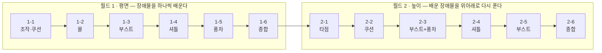
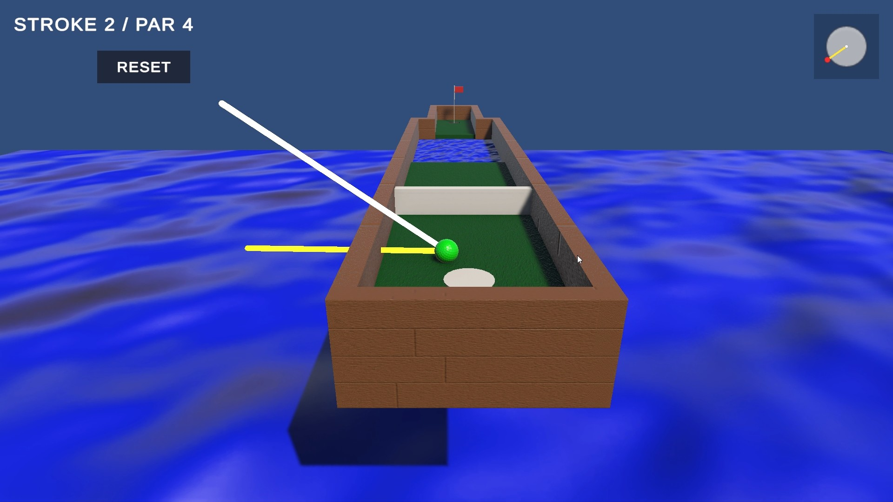
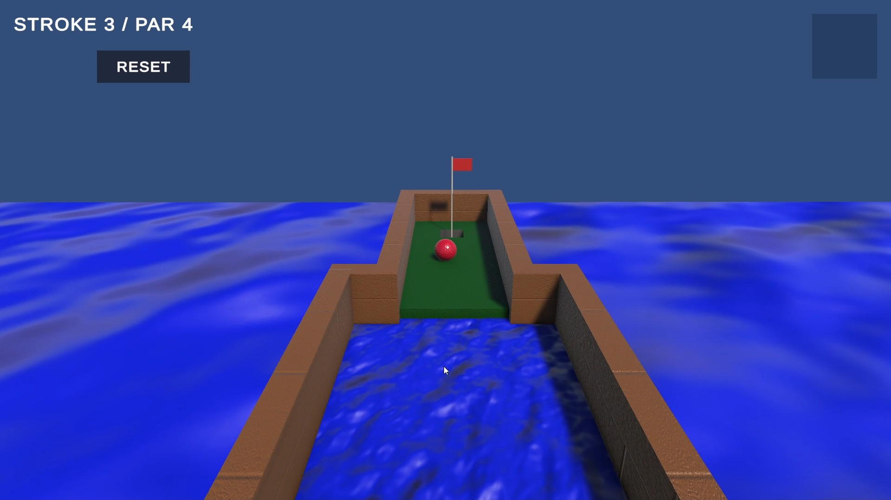
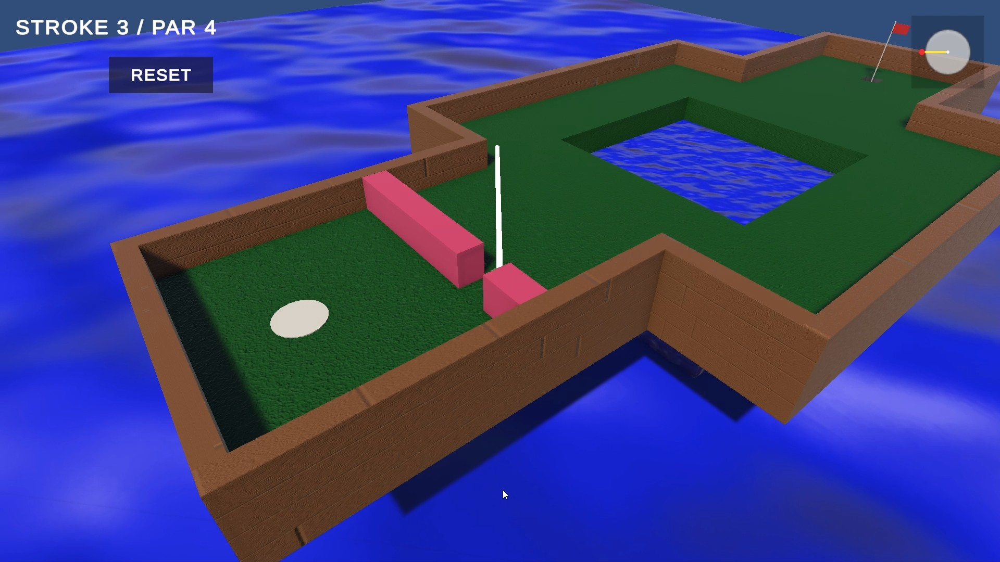
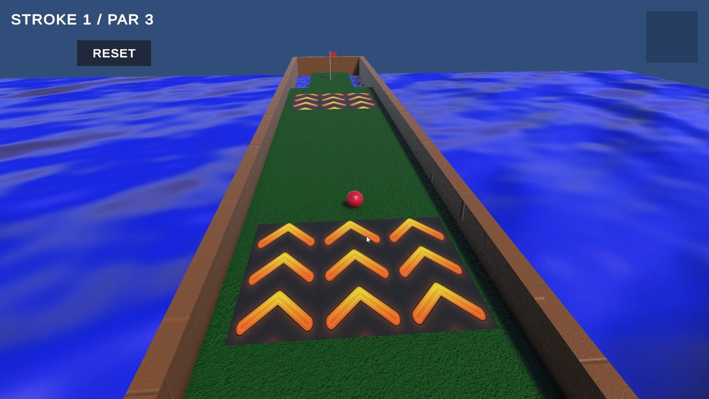
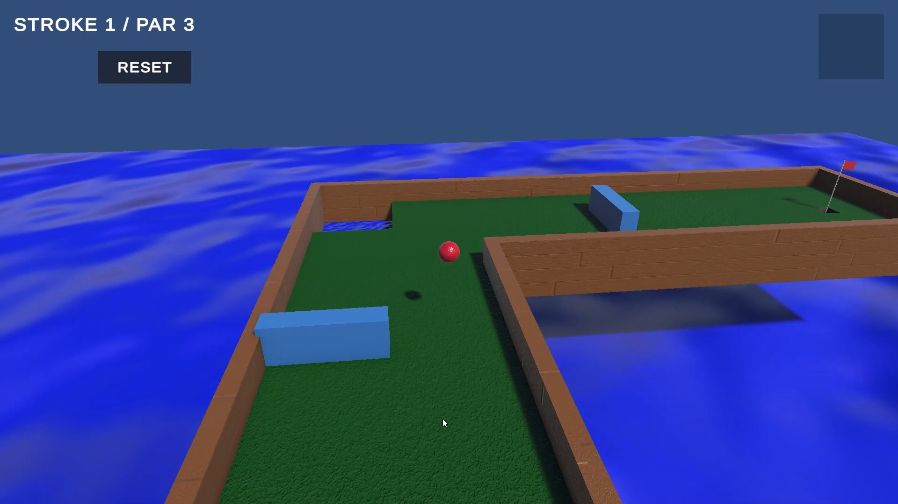
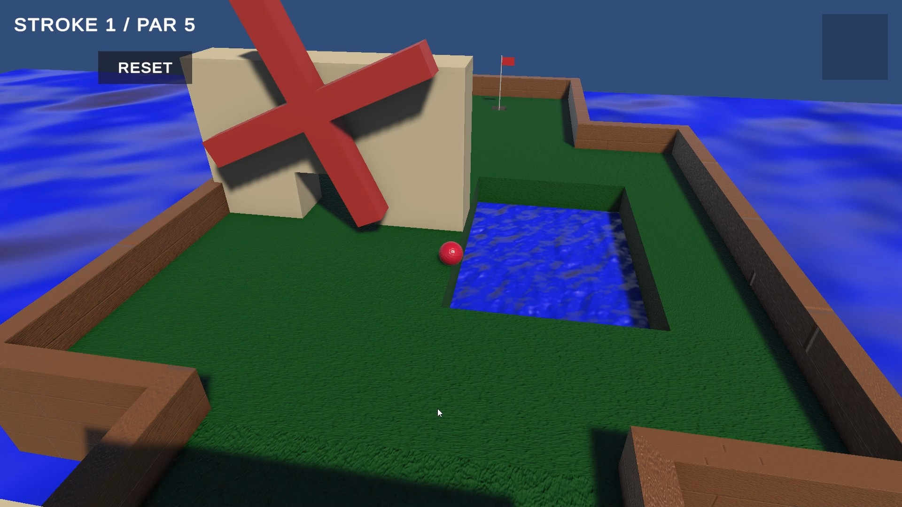
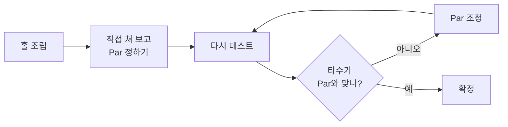
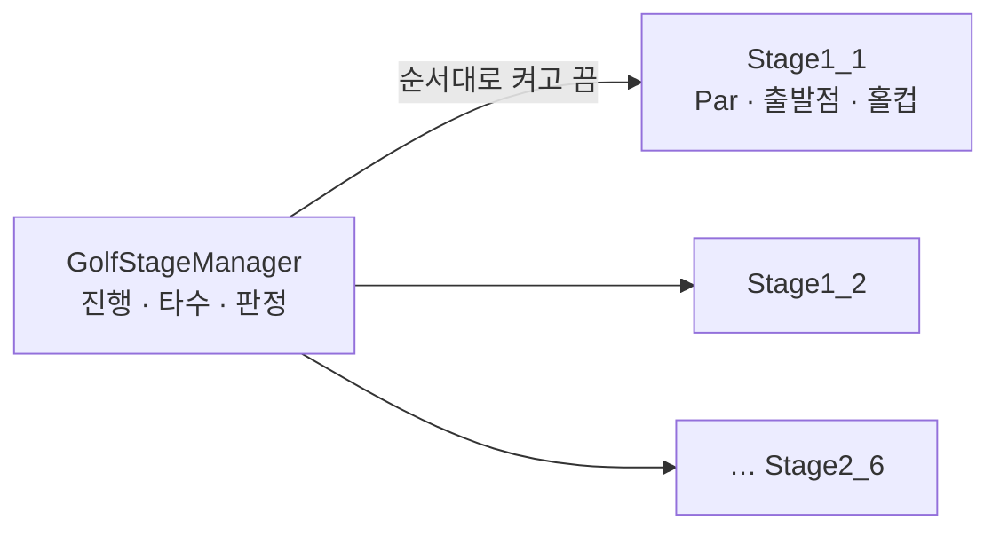

# 미니골프 레벨 디자인 (Mini Golf Level Design)

> 설명 없이 코스만으로 장애물을 가르치는 12홀 미니골프
>
> 2개 월드 × 6홀에 장애물 4종(쿠션 벽·부스트 패드·셔틀 벽·풍차)과 물 해저드를 배치한 레벨 디자인이다. 튜토리얼 텍스트 없이 플레이어가 홀을 지나며 규칙을 스스로 익히도록, 한 홀에 새 요소를 하나씩만 넣고 월드 마지막 홀에서 조합하게 한다.
>
> - **결과:** 한 홀에 새 요소 하나 → 월드 마지막 홀에서 부스트·셔틀·풍차·물을 조합하는 12홀 구조. Par는 직접 쳐 보고 다시 테스트해 정했다(예: 1-2 Par 6 → 4). 다만 타점 조작은 설명 없이 전달되지 않아 시연하며 안내해야 했다
> - **배운 점:** 설계자는 정답 경로대로만 친다 — Par는 장애물을 의도대로 활용하는 플레이로 다시 확인해야 한다

---

## 1. 프로젝트 소개

### 1.1 목적과 목표한 경험

이 문서는 미니골프 12홀의 **레벨 디자인**을 다룬다.
공을 치는 조작과 물리는 수업에서 함께 만든 기반을 쓰고, 이 프로젝트는 **어떤 장애물을, 어떤 순서로, 어떤 난이도로 배치하는가**에 집중한다.
수업 과제는 장애물을 소개 → 응용 → 심화 코스에 나눠 배치해, 플레이어가 장애물을 배우고 익히고 시험받게 만드는 것이었다.

**목표한 경험:** 플레이어가 튜토리얼 텍스트 없이 **코스만으로 장애물을 익히는 것**

> **문서 범위** — 코드 구현보다 **배치 의도와 그 근거**가 중심이다. 코드는 기획 의도를 지탱하는 설계 결정(4장)에서만 다룬다.

### 1.2 조작법

| 입력 | 동작 |
|---|---|
| 공 위에서 좌클릭 → 드래그 → 놓기 | 당긴 반대 방향으로 발사 (당긴 거리 = 세기) |
| 드래그 중 마우스 휠 | **타점(피치) 조절** — 5° 단위, 공을 띄워 치기 |
| 드래그 중 `ESC` | 샷 취소 |
| 우클릭 드래그 / 휠 | 카메라 회전 / 줌 |

타점 조절은 월드 2의 핵심 조작이다(2.2).

**영상:** [조작법 (쇼츠)](https://youtube.com/shorts/hddJjnldtfk)

### 1.3 개발 환경과 링크

| 항목 | 내용 |
|---|---|
| Engine | Unity 6 (6000.3.15f1), URP |
| Language | C# |
| Level Tool | 프리팹 조립 (`Floor`, `Wall`, `Water`, `Tee`, `Hole_Group` + 장애물 프리팹) |
| 기간 | 2026.10.01 ~ 2026.10.08 (1주, 개인 프로젝트) |
| AI 활용 | Claude — 이 문서의 초안과 시연 영상 편집. 레벨 설계는 직접 (AI 협업) |
| GitHub | https://github.com/parksooha102-ai/3rd-minigolf_level_design-parksooha102-ai |
| 시연 영상 | https://youtu.be/zcE0SYz_UfA |

---

## 2. 코스 구조

### 2.1 12홀 배치표

두 월드 모두 한 홀에 새 요소가 하나씩 나오고, 마지막 홀(1-6, 2-6)에서 앞의 요소를 함께 쓴다.

| 홀 | 새로 등장하는 요소        | 함께 쓰인 요소 | Par |
|---|-------------------|---|---|
| **1-1** | — (조작 익히기) + 쿠션 벽 | | 4 |
| **1-2** | 물 (해저드)          | 쿠션 벽 | 4 |
| **1-3** | 부스트 패드            | 물 | 3 |
| **1-4** | 셔틀 벽              | 물 | 3 |
| **1-5** | 풍차                | 물 | 5 |
| **1-6** | **월드 1 종합**       | 부스트 · 셔틀 · 풍차 · 물 | 6 |
| **2-1** | **높이 (타점 조절 필수)** | 물 | 4 |
| **2-2** | 높이 × 쿠션 벽         | 물 | 3 |
| **2-3** | 높이 × 부스트 + 풍차     | 물 | 4 |
| **2-4** | 높이 × 셔틀 벽         | 물 | 3 |
| **2-5** | 높이 × 부스트 패드       | 물 | 3 |
| **2-6** | **월드 2 종합**       | 부스트 · 셔틀 · 풍차 · 물 | 6 |



### 2.2 월드 1과 월드 2의 역할

- **월드 1 — 평면.** 한 홀에 새 장애물을 **하나만** 넣는다. 플레이어가 실패했을 때 원인이 무엇인지 헷갈리지 않게 하기 위해서다. 마지막 1-6에서 앞서 배운 부스트 패드·셔틀 벽·풍차를 물과 함께 조합한다.
- **월드 2 — 높이.** 2-1부터 **타점(피치) 조절 없이는 넘어갈 수 없다.** 월드 1에서는 몰라도 클리어할 수 있던 조작을 여기서 반드시 쓰게 한다. 이후 홀은 월드 1의 장애물을 높이 차이와 결합해 다시 등장시킨다.

**영상:** [월드 1 — 한 홀에 새 요소 하나 (쇼츠)](https://youtube.com/shorts/jBQBeNV_LyE)

| 2-1 조준 | 2-1 물 너머 그린 |
|---|---|
|  |  |

**영상:** [월드 2 — 타점 조절 필수 (쇼츠)](https://youtube.com/shorts/z8LqXoqqx3A)

2-1에는 타점을 써야 한다는 것을 알려 주는 장치가 따로 없다(그 결과는 5.1).

### 2.3 난이도 곡선

| 월드 1 | 1-1 | 1-2 | 1-3 | 1-4 | 1-5 | 1-6 |
|---|---|---|---|---|---|---|
| Par | 4 | 4 | 3 | 3 | 5 | 6 |
| **월드 2** | **2-1** | **2-2** | **2-3** | **2-4** | **2-5** | **2-6** |
| Par | 4 | 3 | 4 | 3 | 3 | 6 |

두 월드 모두 **새 규칙이 나오는 첫 홀은 Par를 넉넉히, 중간 홀은 짧게, 종합 홀은 길게** 잡는다.

---

## 3. 장애물 설계와 배치

장애물은 **플레이어에게 어떤 판단을 요구하는가**로 나뉜다. 같은 장애물도 홀마다 세기·속도가 다르다.

| 장애물 | 플레이어에게 묻는 질문 | 조정한 값 | 첫 등장 → 재등장 |
|---|---|---|---|
| **쿠션 벽** | "벽을 맞혀 꺾어 보낼 수 있나?" (반사각) | 탄성 물리 머티리얼 `PM_Bouncy` | 1-1 → 1-2, 2-2 (2-4의 셔틀 벽에도 같은 재질) |
| **부스트 패드** | "패드 방향을 이용할까, 피할까?" (경로 선택) | 세기 6~25. 첫 등장인 1-3은 6·8로 일반 샷 최대(15)보다 약하게, 2-3은 20 | 1-3 → 2-3, 2-5, 1-6, 2-6 |
| **셔틀 벽** | "언제 칠까?" (타이밍) | 한쪽 이동 1.5~2초, 왕복 | 1-4 → 2-4, 1-6, 2-6 |
| **풍차** | "날개 사이로 지나갈 수 있나?" (타이밍 + 정확도) | 회전 속도 5~60 (1-5는 30, 종합 홀 1-6·2-6은 60) | 1-5 → 2-3, 1-6, 2-6 |
| **물 (해저드)** | "안전하게 돌아갈까, 위험하게 질러갈까?" (위험 감수) | 빠지면 **직전 샷 위치로 복귀** (4.2) | 1-2 → 대부분의 홀 |

장애물이 처음 나오는 월드 1의 홀들이다.

| 1-2 쿠션 벽과 물 | 1-3 부스트 패드 |
|---|---|
|  |  |

| 1-4 셔틀 벽 | 1-5 풍차 |
|---|---|
|  |  |

**영상:** [장애물 설계와 배치 (쇼츠)](https://youtube.com/shorts/KxFBEUqtTVg)

<!-- ✏️ 작성 필요: 장애물별로 '처음 등장하는 홀에서 어떻게 안전하게 보여 줬는지' 한두 줄씩. 예) 1-4에서는 셔틀 벽을 실패해도 물에 빠지지 않는 위치에 둠 -->

---

## 4. 설계 결정과 트러블슈팅

이 장은 Par를 정한 과정(4.1), 대안을 비교해 고른 해저드 복귀 위치(4.2), 레벨 디자인 작업을 받쳐 준 구조 두 가지(4.3 홀 데이터 분리, 4.4 움직이는 장애물의 충돌)를 다룬다.

### 4.1 Par 정하기 — 직접 쳐 보고 다시 테스트

Par는 대부분의 홀에서 **직접 쳐 보고 정한 뒤, 다시 테스트해서 고치는** 과정을 거쳤다. 2.1 배치표의 Par는 이 조정을 마친 값이며, 시연도 이 값으로 진행했다.



조정 전 값이 데이터에 남아 있는 홀은 1-2뿐이다(프리팹 6, 씬에서 4로 덮어씀).

#### 넉넉하게 잡혔던 1-2의 Par (6 → 4)

**문제:** 1-2는 직접 쳐 본 결과로 Par를 **6**으로 정했는데, 다시 테스트해 보니 이 홀에 필요한 타수보다 넉넉했다.

**원인:** 테스트를 정답 경로로만 쳐서 쿠션 벽을 쓰는 샷이 빠졌다. **코스가 꺾이는 지점마다 공을 멈추고 다음 샷을 쳤는데,** 쿠션 벽은 **벽에 튕겨 한 번에 모퉁이를 돌게** 하려고 넣은 장애물이다.

**해결:** 쿠션 벽을 의도대로 활용하는 플레이로 다시 쳐 보고 Par를 **4로 낮췄다.**

**결과:** 쿠션 벽에 튕겨 모퉁이를 한 번에 돌면 4타 안에 들어갔다.

### 4.2 해저드 복귀 위치 — 출발점 vs 직전 샷 위치

**결정 대상** — 공이 물에 빠졌을 때 어디로 되돌릴 것인가?

| | [A] 출발점으로 복귀 | [B] 직전 샷 위치로 복귀 (채택) |
|---|---|---|
| 결과 | 벌칙이 지나치게 큼. 긴 종합 홀(1-6, 2-6)에서 끝부분 실수 한 번에 처음부터 다시 | 실수한 그 샷만 다시 시도. 질러가기를 '시도해 볼 만한 위험'으로 만든다 |

**[결정]** 물에 빠졌을 때 공을 **출발점**이 아니라 **마지막으로 친 위치**로 되돌린다. 따로 벌타는 더하지 않는다.

부스트 패드가 공을 밀어낸 것은 '친 위치'로 기록하지 않는다(`isPassive`). 패드 위에서 빠져도 플레이어가 마지막으로 직접 친 곳으로 돌아간다.

```csharp
// GolfBall.cs — 플레이어가 직접 친 샷만 복귀 지점으로 기록
public void Shoot(Vector3 direction, float power, bool isPassive = false)
{
    ...
    if (isPassive == false)
        lastPosition = transform.position;
}
```

**영상:** [해저드 복귀 — 직전 샷 위치로 (쇼츠)](https://youtube.com/shorts/MpuyYn5gMuQ)

### 4.3 홀을 데이터로 분리 — 코드 없이 홀을 추가

각 홀은 `GolfStage` 프리팹 하나이며 **Par, 출발점, 홀컵**만 가진다. 진행·타수·스코어 판정(버디, 보기 등)은 `GolfStageManager` 한 곳에서 처리한다.



그래서 레벨 디자인 작업은 **프리팹을 조립하고 Par를 입력해 목록에 넣는 것**으로 끝난다. 12홀을 만드는 동안 진행 코드는 수정하지 않았다. 반복해서 고치고 테스트하는 레벨 디자인에서는 이 점이 작업 속도에 직접 영향을 준다.

### 4.4 움직이는 장애물과 공의 충돌

셔틀 벽은 `Transform`을 직접 옮기지 않고 키네마틱 `Rigidbody.MovePosition`으로 움직인다. Transform을 직접 옮기면 물리 엔진이 벽의 속도를 모르기 때문에, 벽이 공을 밀어낼 때 공이 벽을 뚫거나 이상하게 튕길 수 있다. 타이밍을 묻는 장애물이 불공정하게 느껴지지 않으려면 **충돌 결과를 플레이어가 예측할 수 있어야** 한다.

**영상:** [움직이는 장애물과 공의 충돌 (쇼츠)](https://youtube.com/shorts/7aTRH37YQ98)

---

## AI 협업

Claude는 이 문서와 시연 영상 작업에 쓰고, 레벨 설계는 직접 했다.

| | 내용 |
|---|---|
| Claude에게 맡긴 것 | 이 프로젝트 문서의 초안 작성 · 시연 영상 편집 |
| 직접 판단한 것 | 홀 배치·장애물 순서·Par·장애물 수치와 4장의 결정 전부 |
| 확인한 방법 | 초안을 읽고 직접 고침 · 영상 편집 결과를 실제 플레이 장면과 대조 |
| 받아들이지 않은 것 | 문서 초안에 코드에 없는 규칙("물에 빠지면 직전 샷 위치 + 1타")이 들어가 있었다. 레포의 코드와 대조해 벌타가 없는 실제 규칙으로 바로잡았다 (4.2) |

---

## 5. 결과와 회고

### 5.1 목표 달성 여부

| 목표 (1장) | 결과 |
|---|---|
| 코스만으로 장애물을 익힌다 (1.1) | 공을 드래그하면서 휠을 움직여야 하는 **타점(피치) 조절**은 까다로운 조작인데 설명이 부족해, 시연하며 말로 안내해야 했다 (2.2) |
| 소개 → 응용 → 심화 (1.1) | 월드마다 새 요소를 하나씩 소개하는 홀 5개 + 조합하는 종합 홀 1개. 월드 2는 월드 1의 장애물을 높이와 결합해 다시 푼다 (2.2) |
| Par를 테스트로 정한다 (4.1) | 대부분의 홀을 직접 쳐 보고 다시 테스트해 정했다. 1-2는 6 → 4 |

### 5.2 한계와 개선 계획

| 한계 (As-Is) | 개선 계획 (To-Be) |
|---|---|
| 타점 조작이 코스만으로 전달되지 않았다 (5.1) | **타점이 필요하다는 것을 코스에서 먼저 보여 준다** |
| 코스가 뻔하다 — 골 지형을 벽으로 가린 구조가 예상대로 끝난다 | **벽 너머 끝에 아무것도 없게 해 예상을 비튼다** |

### 5.3 배운 점

**설계자는 정답 경로대로만 친다.**
코스의 '정답 경로'를 아는 설계자는 오히려 그 경로대로만 친다. 1-2의 Par 6은 쿠션 벽을 활용하지 않은 첫 테스트에서 나왔다(4.1). Par는 한 번 쳐 보고 정하지 말고, **장애물을 의도대로 활용하는 플레이로 다시 확인**해야 한다.

**한 홀에 새 요소는 하나만 넣는다.**
새 요소를 하나씩만 추가하면 플레이어가 실패 원인을 알 수 있고, 설계자도 플레이테스트에서 무엇이 문제인지 구분할 수 있다(2.2).

**까다로운 조작은 코스만으로 가르치기 어렵다.**
드래그와 휠을 함께 쓰는 조작은 장애물처럼 배치만으로 알려 주기 어렵고, 따로 알려 줄 자리가 필요하다(5.1).
